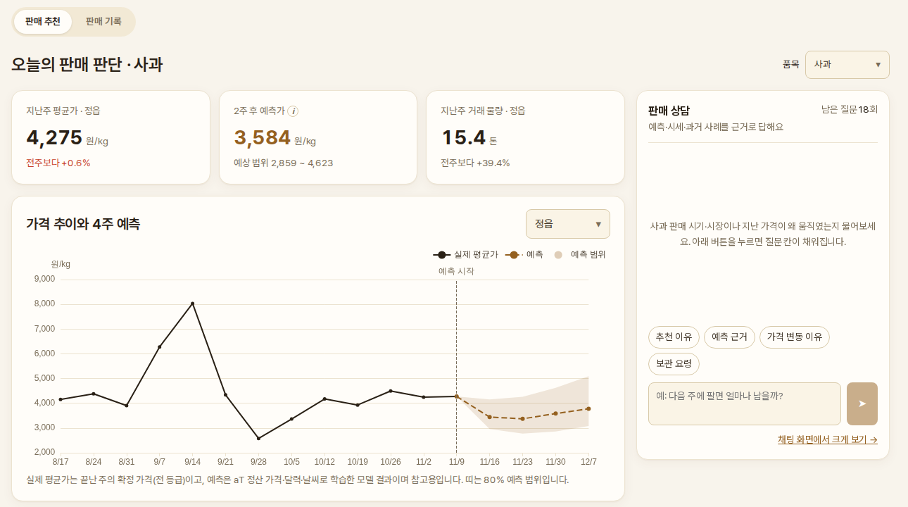
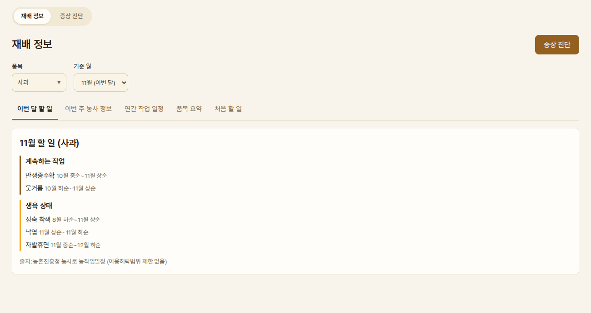
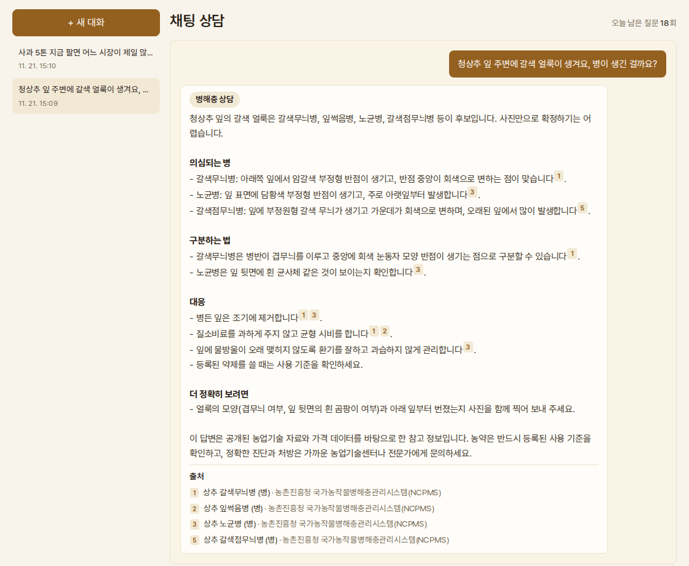
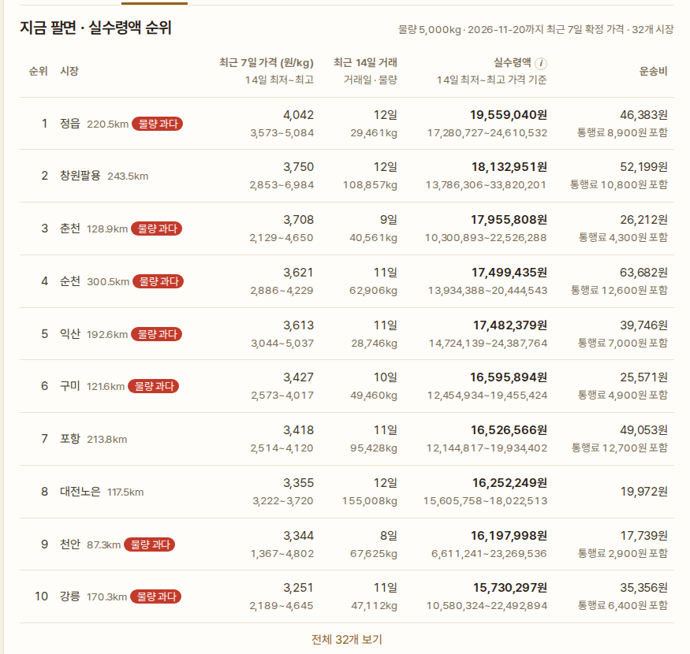
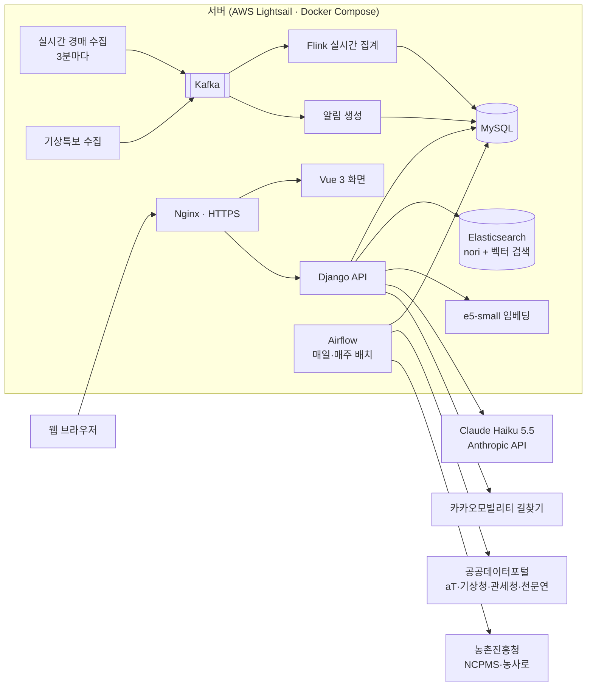

# 🌱 팜잇 (FarmIt)

**농사를 막 시작한 사람이 재배·병해충·판매를 혼자 판단하지 않도록 돕는 AI 농사 도우미**

공공기관 자료를 근거로 질문에 답하고, 전국 도매시장 가격과 예측으로 "언제, 어디에 팔면 얼마가 남는지" 보여 줍니다.

[서비스 바로가기](https://farmit.site) · [개발 문서](docs/DEVELOPMENT.md)

> **시연 계정** `farmitdemo` / `Demo2026farm` — 가짜 데이터로 만든 체험용 계정입니다. 로그인하지 않아도 가격 통계와 "지금 팔면" 계산은 쓸 수 있습니다.



---

## 왜 만들었나

농사를 처음 시작하면 농사일만으로도 벅찬데, 판단할 일이 끝없이 생깁니다.

| 초보 농업인의 어려움 | 지금은 |
|---|---|
| **이번 달에 무엇을 해야 하지?** | 정보가 농사로·NCPMS 등 여러 기관에 흩어져 있고 용어가 어렵다 |
| **잎에 생긴 이 얼룩은 무슨 병이지?** | 커뮤니티에 사진을 올리고 경험자의 답을 몇 시간씩 기다린다. 답에는 근거가 없다 |
| **언제, 어느 시장에 팔아야 하지?** | 시세 화면은 평균가만 보여 준다. 운송비를 빼면 어디가 더 남는지는 직접 계산해야 한다 |

- 귀농인이 꼽은 불만족 이유 1위는 **영농기술·경험 부족(33.6%)** 입니다. ([농림축산식품부, 2020 귀농·귀촌 실태조사](https://www.mafra.go.kr/bbs/mafra/68/326536/artclView.do))
- 물어볼 선배 농가는 나이 들고 있습니다. 농가 경영주 평균 **67.7세**, 60대 이상이 **78.8%** 입니다. (국가데이터처, 2025 농림어업총조사 확정)
- 해마다 새로 농사를 시작하는 청년이 있습니다. 청년농업인 영농정착지원사업은 2026년 1차에만 **2,000명**을 뽑았습니다. ([농림축산식품부](https://www.mafra.go.kr/bbs/home/792/575810/artclView.do))

---

## 핵심 기능

### 1. 재배 길잡이 — 이번 달에 할 일
품목을 고르면 농촌진흥청 농작업일정으로 이번 달 할 일과 생육 상태를, 농사로 주간농사정보로 이번 주 할 일을 보여 줍니다.



### 2. AI 상담 — 근거가 붙은 병해충·재배 답변
일상어로 물으면 질문 의도(판매·시세·병해충·날씨재해·재배·범위 밖)를 먼저 가립니다. 그다음 농촌진흥청 NCPMS·농사로 자료에서 근거를 찾아 답하고, 답 문장마다 근거 번호와 문서 이름을 붙입니다. 작물 사진을 올려도 됩니다.



### 3. 판매 판단 — 언제, 어디에 팔면 얼마가 남나
- **가격 예측**: 전국 32개 도매시장의 1~4주 뒤 가격을 80% 예측 범위와 함께 보여 줍니다. 지난 예측이 얼마나 맞았는지 **성적표도 공개**합니다.
- **지금 팔면**: 물량을 넣으면 32개 시장에서 손에 남는 돈(실수령액)을 순위로 보여 줍니다. 내 위치에서 시장까지의 도로 거리·통행료로 운송비를 빼고, 감모율을 반영합니다. 거래가 적어 내 물량을 소화하기 어려운 시장에는 "물량 과다" 경고를 붙입니다.



> 예: 충주에서 사과 5,000kg을 팔 때, 가장 가까운 충주보다 창원팔용이 **약 636만 원(+54%) 더 남습니다**. (감모율 3%·수수료 제외, 2026-11-20까지 최근 7일 정산 평균가)

### 그 밖에
- **기상특보 알림**: 내 산지에 특보가 나오면 알리고 대비 체크리스트를 줍니다.
- **판매 기록**: 내가 받은 가격을 같은 날 시장 평균과 비교하고, 월별·시장별 성적을 보여 줍니다.
- **과거 사례**: 한파·폭염 같은 일이 있었을 때 가격이 어떻게 움직였는지 평년과 비교합니다.

---

## 아키텍처



- **AI 상담**: Elasticsearch에서 키워드(nori 형태소)와 의미(e5-small 벡터)를 함께 찾는 하이브리드 검색으로 근거를 고르고, Claude가 그 근거로만 답합니다.
- **가격 예측**: Airflow가 매주 월요일 다시 계산합니다. 모델(RandomForest·LightGBM·XGBoost 앙상블)과 실험은 MLflow로 관리하고, 과거 데이터 분석에는 Spark를 씁니다.

---

## AI를 쓴 곳과 한계 대응

| 어디에 | 어떻게 | 틀릴 때를 대비해 |
|---|---|---|
| 질문 의도 판단 | Claude가 6가지 중 하나로 분류 | 범위 밖 질문은 답하지 않고 안내 |
| 병해충·재배 상담 | 하이브리드 검색으로 찾은 공공 자료를 근거로 답변 | 근거에 없으면 "자료에서 확인되지 않습니다"로 답하고 농업기술센터를 안내. 근거 번호를 붙이고, 근거에 없는 번호는 지움 |
| 약제 안내 | 사용량·희석 배수를 일부러 쓰지 않음 | 잘못된 처방을 막기 위한 설계. "등록된 사용 기준을 확인하세요"로 안내 |
| 가격 예측 | 시장·품목별 1~4주 뒤 가격과 80% 범위 | 예측 성적표를 화면에 공개. 테스트 기간 오차율 0.112(직전 주 가격을 그대로 쓰는 기준선보다 29% 개선), 서비스 첫 3주 오차율 0.089·범위 적중 87.5% (사과) |
| 사진 진단 | Claude가 사진에서 증상을 읽고 같은 근거 검색으로 연결 | 직접 학습한 사진 분류 모델(시험 정확도 0.972)은 실제 사진에서 틀리고 LLM까지 오답을 따라가서 **서비스에서 뺐다** ([기록](docs/vision.md)) |
| 비용 | 회원별 하루 질문 20회, 같은 질문은 캐시 | |

---

## 기술 스택

| 구분 | 기술 |
|---|---|
| 화면 | Vue 3, Vue Router, Pinia, Apache ECharts, Vite |
| 서버 | Django, Django REST framework, gunicorn, Nginx |
| AI | Claude Haiku 5.5 (Anthropic API), multilingual-e5-small, Elasticsearch(nori) |
| 데이터 | MySQL, Kafka, Flink, Airflow, Spark, Kibana |
| 예측 | scikit-learn, LightGBM, XGBoost, MLflow |
| 배포 | Docker Compose, AWS Lightsail, Let's Encrypt |

---

## 팀

| 이름 | 역할 |
|---|---|
| 양정호 | 팀장 · 백엔드 · AI 상담 에이전트(RAG·LLM), 회원, 판매 추천·기록, 가격·기상특보 수집과 알림 |
| 김기현 | 데이터 엔지니어링 · 가격 예측 ML · 프론트엔드 · 배포 |

SSAFY 프로젝트로 2026년 10월에 시작했고, 2026 대한민국 청년 CAREER FAIR AI 해커톤에 출품했습니다. 해커톤 제출 시점의 코드는 태그 `hackathon-submission`입니다.

---

## 직접 실행하기

```bash
cp .env.example .env        # API 키를 채운다 (키 이름만 들어 있음)
docker compose -f infra/docker-compose.yml up --build -d
docker compose -f infra/docker-compose.yml exec backend python manage.py test
```

수집기·배치·배포 절차는 [개발 문서](docs/DEVELOPMENT.md)에, 요구사항·화면·ERD·API 명세는 [docs](docs/)에 있습니다.

---

<details>
<summary><b>Credits / Licenses</b> (외부 데이터·모델·오픈소스)</summary>

### 데이터·API
| 자원 | 제공 | 이용 조건 | 쓰는 곳 |
|---|---|---|---|
| 도매시장 정산정보, 실시간 경매정보 | 한국농수산식품유통공사(aT), 공공데이터포털 | 이용허락범위 제한 없음 | 가격 통계·예측·실수령액 |
| ASOS 일자료, 기상특보 | 기상청, 공공데이터포털 | 공공누리 제1유형(출처표시) | 날씨, 산지 특보 알림 |
| 특일 정보 | 한국천문연구원, 공공데이터포털 | 이용허락범위 제한 없음 | 명절·휴일 |
| 품목별 국가별 수출입실적 | 관세청, 공공데이터포털 | 이용허락범위 제한 없음 | 수입량 급증 알림 |
| 병해충 정보·예찰 (NCPMS) | 농촌진흥청 | 출처 표시, 비상업 이용 (무료 비영리 서비스로 이용) | 상담 근거, 알림 |
| 현장기술지원 Q&A, 주간농사정보, 농업용어사전 | 농촌진흥청 농사로 | 공공누리 제1유형 | 상담 근거, 이번 주 농사 정보, 용어 풀이 |
| 농작업일정, 기술정보, 재해예방정보 | 농촌진흥청 농사로 | 이용허락범위 제한 없음 | 이번 달 할 일, 상담 근거 |
| 농업기술길잡이 | 농촌진흥청 | 공공누리 제4유형 — 본문은 쓰지 않고 목차·쪽 링크만 | 답변 아래 길잡이 링크 |
| 정책브리핑 보도자료 | 문화체육관광부 | 공공누리 제1유형 | 검색 |
| 한국어 위키백과 | 위키미디어 재단 | CC BY-SA 4.0 | 용어 풀이 보조 |
| 자동차 길찾기 (도로 거리·통행료) | 카카오모빌리티 | 카카오 API 이용약관 | 운송비 계산 |
| 작물 질병 진단 이미지 (153·147·146) | 한국지능정보사회진흥원(NIA) AI 허브 | AI 허브 이용정책 (연구·개발 목적, 데이터 재배포 금지) | 사진 분류 실험 모델 학습에만 사용. 서비스에 연결하지 않았고 데이터·가중치는 이 저장소에 없다. 이 결과물은 한국지능정보사회진흥원의 사업결과인 AI 허브 데이터를 활용했다 |

### AI 모델
| 자원 | 이용 조건 | 쓰는 곳 |
|---|---|---|
| Claude Haiku 5.5 (Anthropic API) | Anthropic 상용 이용약관 | 질문 의도 분류, 근거 기반 답변, 사진 판독 |
| multilingual-e5-small (intfloat) | MIT | 상담 근거 의미 검색 (서버에서 직접 실행) |

### 오픈소스
| 이름 | 라이선스 | 쓰는 곳 |
|---|---|---|
| Vue 3, Vue Router, Pinia, Vite, Vitest, axios | MIT | 화면 |
| Apache ECharts | Apache-2.0 | 차트 |
| Django, Django REST framework | BSD-3-Clause | 서버 |
| Apache Kafka, Apache Flink, Apache Airflow, Apache Spark | Apache-2.0 | 수집·스트리밍·배치 |
| Elasticsearch, Kibana | Elastic License 2.0 / AGPL-3.0 / SSPL 중 선택 (서버로만 실행, 수정·배포하지 않음) | 검색, 대시보드 |
| MySQL | GPL-2.0 (서버로만 실행) | DB |
| scikit-learn | BSD-3-Clause | 가격 예측 |
| LightGBM, ONNX Runtime | MIT | 가격 예측, 사진 모델 실험 |
| XGBoost, MLflow | Apache-2.0 | 가격 예측, 모델 관리 |
| Anthropic Python SDK | MIT | LLM 호출 |

### 개발에 쓴 AI 도구
Claude Code (Anthropic, Claude Opus 5.5·Sonnet 5.5)로 코드·테스트·문서 초안을 만들고, 팀이 검토·검증했습니다. 자세한 내용은 해커톤 제출서의 「AI 활용내역」에 적었습니다.

### 화면 캡처
README의 화면은 모두 가짜 데이터로 만든 시연 계정으로 찍었습니다.

</details>
