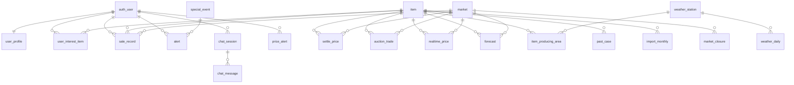
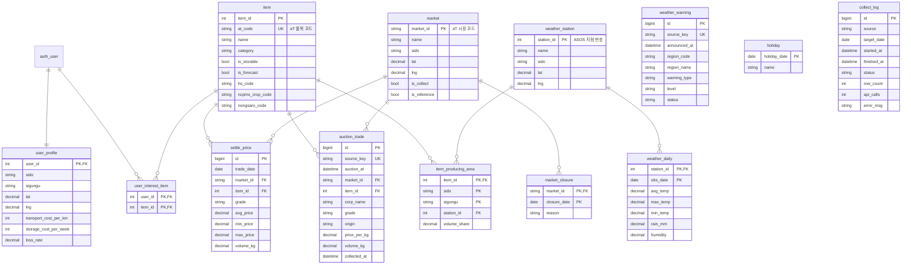

# 팜잇(FarmIt) ERD

| 항목 | 내용 |
|---|---|
| 버전 | 0.2 (초안) |
| 작성일 | 2026-10-31 |
| 수정일 | 2026-11-06 (0.2: `warning_zone` 추가, `special_event`·`alert` 1주차로 당겨 구현, `weather_warning.source_key`에 단계 추가) |
| DB | MySQL 8 (utf8mb4) |

- **1주차 테이블**은 컬럼·키까지 확정, 나머지는 주요 컬럼만 적었다. 해당 주차에 상세화한다.
- 가격은 모두 **원/kg**으로 바꿔 저장한다. aT 원본(포장 단위 가격)은 HDFS에 그대로 보관한다.
- 시장·품목은 코드 테이블로 관리하고 코드에 고정하지 않는다 (REQ-NFR-010).
- 회원 계정은 Django 기본 `auth_user`를 쓴다 (비밀번호 해시 저장, REQ-NFR-004).
- 재배·병해충 문서(RAG)와 보도자료는 MySQL이 아니라 **Elasticsearch 인덱스**로 관리한다 (6절).

---

## 1. 전체 구성

| 영역 | 테이블 | 주차 |
|---|---|---|
| 코드 | `market`, `item`, `weather_station`, `item_producing_area`, `holiday`, `market_closure`, `warning_zone` | 1주차 |
| 회원 | `auth_user`, `user_profile`, `user_interest_item` | 1주차 |
| 가격 | `settle_price`, `auction_trade` | 1주차 |
| 가격 | `realtime_price` | 2주차 (Flink) |
| 날씨 | `weather_daily`, `weather_warning` | 1주차 |
| 운영 | `collect_log` | 1주차 |
| 판매 | `sale_record` | 2주차 |
| 예측 | `forecast` | 2주차 (이전 예측으로 개발), 4주차 자동화 |
| 특수 상황 | `special_event`, `alert` | 1주차 (기상특보 알림부터) |
| 특수 상황 | `import_monthly`, `pest_survey`, `past_case` | 3주차 |
| 채팅 | `chat_session`, `chat_message` | 4주차 |
| 재배 | `farm_schedule` | 4주차 |
| 선택 | `price_alert` | 12월 1주 |

---

## 2. 1주차 테이블

### 2.1 코드

**market** — 시장 (REQ-NFR-010)
| 컬럼 | 타입 | 키 | 설명 |
|---|---|---|---|
| market_id | varchar(6) | PK | aT 시장 코드 (예: 250001) |
| name | varchar(50) | | 시장명 |
| sido | varchar(20) | | 시도 |
| lat, lng | decimal(9,6) | | 위치 (직접 입력, 거리 계산용) |
| is_collect | boolean | | 수집 대상 여부. 4개 시장 + 가락만 true. 33곳 모두 등록 |
| is_reference | boolean | | 참고용 시장 여부 (가락) |

**item** — 품목. 출처마다 코드가 달라 한 행에 모아 둔다
| 컬럼 | 타입 | 키 | 설명 |
|---|---|---|---|
| item_id | int | PK | 자동 증가 |
| at_code | varchar(10) | UK | aT 품목 코드. 표준코드의 **대분류(`gds_lclsf_cd`) + 중분류(`gds_mclsf_cd`) 4자리** (예: 깻잎 `1011`). 소분류(품종)는 품목으로 나누지 않는다. 실시간 경매 API 응답으로 확인함. 정산 API도 포털 명세상 같은 코드 필드를 쓰지만, 정산 담당자가 실제 응답으로 확인 필요 |
| name | varchar(50) | | 품목명 |
| category | varchar(20) | | 과일·채소 등 |
| is_storable | boolean | | 저장 후 출하 시점을 고를 수 있는 품목 |
| is_forecast | boolean | | 가격 예측 제공 여부. 처음엔 사과만 true로 검증하고 전 품목으로 넓힌다 (REQ-PRD-006). 예측 대상 판단은 이 값으로만 한다 (품목 이름·코드로 분기하지 않음) |
| hs_code | varchar(10) | | 관세청 HS 코드 (수입량 알림) |
| ncpms_crop_code | varchar(10) | | NCPMS 작물 코드 |
| nongsaro_code | varchar(10) | | 농사로 품목 코드 |

**weather_station** — ASOS 관측소
| 컬럼 | 타입 | 키 | 설명 |
|---|---|---|---|
| station_id | int | PK | ASOS 지점 번호 |
| name | varchar(30) | | 지점명 |
| sido | varchar(20) | | 시도 |
| lat, lng | decimal(9,6) | | 위치 |

**item_producing_area** — 품목별 주산지. 정산정보 원산지로 만들고 가까운 관측소를 연결
| 컬럼 | 타입 | 키 | 설명 |
|---|---|---|---|
| item_id | int | PK, FK | 품목 |
| sido, sigungu | varchar(20) | PK | 주산지 |
| station_id | int | FK | 가장 가까운 ASOS 관측소 |
| volume_share | decimal(5,2) | | 최근 물량 비중(%) |

**holiday** — 공휴일·명절 (특일 정보)
| 컬럼 | 타입 | 키 | 설명 |
|---|---|---|---|
| holiday_date | date | PK | 날짜 |
| name | varchar(30) | | 이름 (설날, 추석 등) |

**market_closure** — 시장 휴장일 (직접 입력, REQ-REC-005)
| 컬럼 | 타입 | 키 | 설명 |
|---|---|---|---|
| market_id | varchar(6) | PK, FK | 시장 |
| closure_date | date | PK | 휴장일 |
| reason | varchar(50) | | 사유 |

**warning_zone** — 기상특보 구역. 특보(`weather_warning.region_code`)를 주산지·회원의 시도·시군구에 잇는다 (REQ-ALT-001)
| 컬럼 | 타입 | 키 | 설명 |
|---|---|---|---|
| region_code | varchar(10) | PK | 특보구역 코드 (예: L1011400) |
| name | varchar(50) | | 구역명 (가평군, 평창군평지, 강원북부앞바다 등) |
| sido | varchar(20) | | 시도 (정식 명칭). 해상 구역은 NULL → 알림 대상 아님 |
| sigungu | varchar(20) | | 시군구. NULL이면 시도 전체 (서울동남권 같은 광역시 권역) |

- 데이터: 기상청 활용가이드 별첨 "특보구역코드안내" 엑셀 → `backend/codes/fixtures/build_warning_zone.py` → `warning_zone.json` → 마이그레이션 `codes.0007`이 넣는다 (`migrate`만 하면 채워짐)
- 평지·산지·동부 같은 하위 구역은 상위 시군구로 묶는다 (평창군평지 → 평창군). 시도는 현재 정식 명칭으로 바꾼다 (강원도 → 강원특별자치도)

### 2.2 회원

**user_profile** — `auth_user`와 1:1 (REQ-USR-003)
| 컬럼 | 타입 | 키 | 설명 |
|---|---|---|---|
| user_id | int | PK, FK | auth_user.id |
| sido, sigungu | varchar(20) | | 위치 (시군까지만, REQ-NFR-006) |
| lat, lng | decimal(9,6) | | 시군 중심 좌표 (거리 계산용) |
| transport_cost_per_km | int | | 기본 운송비 (원/km) |
| storage_cost_per_week | int | | 기본 보관비 (원/주) |
| loss_rate | decimal(5,2) | | 기본 감모율(%), 기본값 0 |

**user_interest_item** — 관심 품목 (회원 : 품목 = N : M)
| 컬럼 | 타입 | 키 | 설명 |
|---|---|---|---|
| user_id | int | PK, FK | 회원 |
| item_id | int | PK, FK | 품목 |

회원 탈퇴 시 `user_profile`, `user_interest_item`, `sale_record`, `alert`, `chat_session`을 모두 삭제한다 (REQ-USR-004). Django의 `on_delete=CASCADE`로 구현하므로 DB의 FK 제약(`DELETE_RULE`)은 `NO ACTION`이다. 탈퇴 처리는 반드시 Django ORM(`user.delete()`)으로 한다. SQL로 `auth_user`를 직접 지우지 않는다.

### 2.3 가격

**settle_price** — 정산 확정 가격. 원본을 수집기(`collectors/settle`)가 시장·품목·등급별로 모은 값 (REQ-PRC-001)
| 컬럼 | 타입 | 키 | 설명 |
|---|---|---|---|
| id | bigint | PK | 자동 증가 |
| trade_date | date | UK① | 거래정산일자 |
| market_id | varchar(6) | UK①, FK | 시장 |
| item_id | int | UK①, FK | 품목 |
| grade | varchar(10) | UK① | 등급. 전 등급 합계는 `ALL` |
| avg_price | decimal(10,1) | | 물량가중 평균 (원/kg) |
| min_price, max_price | decimal(10,1) | | 최저·최고 (원/kg) |
| volume_kg | decimal(12,1) | | 거래 물량 |

- UK① = (trade_date, market_id, item_id, grade). 같은 날짜를 다시 수집해도 중복되지 않는다 (REQ-COL-008).
- 인덱스: (item_id, market_id, trade_date) — 기간 조회용

**auction_trade** — 실시간 경매 낙찰 건 원본 (REQ-COL-002)
| 컬럼 | 타입 | 키 | 설명 |
|---|---|---|---|
| id | bigint | PK | 자동 증가 |
| source_key | varchar(64) | UK | 원본 행을 구분하는 값. 주기(2분)마다 겹쳐 받아도 중복 방지. `whsl_mrkt_cd|corp_cd|trd_clcln_ymd|auctn_seq|spm_no|scsbd_dt`의 SHA-1(40자) |
| auction_at | datetime | | 낙찰 시각 |
| market_id | varchar(6) | FK | 시장 |
| item_id | int | FK | 품목 |
| corp_name | varchar(30) | | 법인명 |
| grade | varchar(10) | | 등급. 실시간 API에는 등급이 없어 빈 문자열 `''` |
| origin | varchar(30) | | 산지 |
| price_per_kg | decimal(10,1) | | 낙찰가 (원/kg) = `scsbd_prc`(단량당 낙찰가) ÷ `unit_qty`(단위물량) |
| volume_kg | decimal(10,1) | | 물량 = `qty`(수량) × `unit_qty` |
| collected_at | datetime | | 수집 시각 |

- 인덱스: (market_id, item_id, auction_at)
- `source_key`: `auctn_seq`(경매고유번호)·`spm_no`(원표번호)만으로는 겹친다. 같은 원표가 시각을 달리해 나눠 낙찰되므로 낙찰 일시까지 합친다 (2026-11-06 실제 응답으로 확인).
- 단위(`unit_nm`)가 kg가 아니거나 `unit_qty`가 0인 건은 환산할 수 없어 저장하지 않는다. 원본(포장 단위)은 Kafka 메시지의 `raw`에 그대로 담긴다.
- `item`에 없는 품목(`at_code`)의 건은 저장하지 않고 프로듀서 로그에 건수를 남긴다. 품목 초기 데이터: `backend/codes/fixtures/items.json`.

### 2.4 날씨

**weather_daily** — ASOS 일자료 (REQ-COL-003)
| 컬럼 | 타입 | 키 | 설명 |
|---|---|---|---|
| station_id | int | PK, FK | 관측소 |
| obs_date | date | PK | 관측일 |
| avg_temp, max_temp, min_temp | decimal(4,1) | | 기온 (℃) |
| rain_mm | decimal(6,1) | | 일강수량 |
| humidity | decimal(4,1) | | 평균 습도(%) |

**weather_warning** — 기상특보 이력. 최근 6일만 제공되므로 매일 쌓는다 (REQ-COL-004)
| 컬럼 | 타입 | 키 | 설명 |
|---|---|---|---|
| id | bigint | PK | 자동 증가 |
| source_key | varchar(64) | UK | 발표 시각 + 지역 + 종류 + 단계. 중복 방지. 예: `202611061200_S1151100_6_0` (API `tmFc_areaCode_warnVar_warnStress`, 시각은 API 원래 값인 KST) |
| announced_at | datetime | | 발표 시각 |
| region_code | varchar(20) | | 특보 구역 코드 |
| region_name | varchar(50) | | 구역명 |
| warning_type | varchar(20) | | 강풍·호우·한파·건조·폭풍해일·풍랑·태풍·대설·황사·폭염·열대야 |
| level | varchar(10) | | 주의보·경보·중대경보 |
| status | varchar(10) | | 발표·해제·연장·정정·변경발표·변경해제, 취소된 특보는 `취소` (알림에서 제외) |

### 2.5 운영

**collect_log** — 수집 기록 (REQ-COL-008, REQ-NFR-009). Kibana 대시보드의 원천
| 컬럼 | 타입 | 키 | 설명 |
|---|---|---|---|
| id | bigint | PK | 자동 증가 |
| source | varchar(30) | | `at_settle`, `at_auction`, `asos`, `warning` 등 |
| target_date | date | | 수집 대상 날짜 |
| started_at, finished_at | datetime | | 실행 시각 |
| status | varchar(10) | | `success`, `fail`, `partial` |
| row_count | int | | 저장 건수 |
| api_calls | int | | API 호출 수 (일일 한도 확인) |
| error_msg | text | | 실패 사유 |

### 2.6 구현 규칙 (Django 모델)

위 표가 정하지 않은 부분을 Django 모델에서 이렇게 정했다. 테이블은 앱별로 나눠 두었다 (`codes`, `accounts`, `weather`, `prices`, `api`). 테이블 이름은 `db_table`로 이 문서의 이름에 맞춘다.

**비어도 되는 컬럼 (NULL 허용).** 값이 없다는 것(NULL)과 0은 다르다. 이 컬럼을 읽는 코드는 `None`을 처리해야 한다.
| 테이블 | 컬럼 | 이유 |
|---|---|---|
| `item` | `hs_code`, `ncpms_crop_code`, `nongsaro_code` | 해당 기능을 만들 때 채운다 (1주차엔 `at_code`만 필요) |
| `market_closure` | `reason` | 직접 입력하며 사유를 모를 수 있다 |
| `weather_daily` | `avg_temp`, `max_temp`, `min_temp`, `rain_mm`, `humidity` | 관측값이 빠진 날이 있다. 빠진 값을 0으로 채우지 않는다 |
| `user_profile` | `lat`, `lng`, `transport_cost_per_km`, `storage_cost_per_week` | 가입 뒤에 채운다 (`sido`, `sigungu`는 가입 때 필수) |
| `forecast` | `last_week_price` | 기준 시점에 지난주 실제 가격이 없을 수 있다 |
| `collect_log` | `finished_at`, `error_msg` | 실행 중이거나 성공이면 없다 |

위에 적지 않은 컬럼은 모두 NOT NULL이다.

**삭제 규칙 (`on_delete`).** DB의 FK 제약이 아니라 Django가 처리한다 (2.2절 마지막 문단 참고).
| 규칙 | 해당 | 의미 |
|---|---|---|
<<<<<<< HEAD
| `PROTECT` | `settle_price`·`auction_trade`의 `market`, `item`, `crop_production.item`, `sale_record`의 `market`, `item`, `item_producing_area.station` | 가격 이력이 있는 시장·품목, 주산지가 쓰는 관측소는 지울 수 없다 |
| `CASCADE` | `user_interest_item`(`user`, `item`), `user_profile.user`, `sale_record.user`, `market_closure.market`, `item_producing_area.item`, `weather_daily.station` | 부모를 지우면 함께 지운다 |
=======
| `PROTECT` | `settle_price`·`auction_trade`의 `market`, `item`, `crop_production.item`, `forecast`의 `market`, `item`, `item_producing_area.station` | 가격 이력이 있는 시장·품목, 주산지가 쓰는 관측소는 지울 수 없다 |
| `CASCADE` | `user_interest_item`(`user`, `item`), `user_profile.user`, `market_closure.market`, `item_producing_area.item`, `weather_daily.station` | 부모를 지우면 함께 지운다 |
>>>>>>> origin/develop

**기본값.** `default`는 Django가 값을 채울 때만 적용되고 DB에는 기본값이 없다. SQL로 직접 INSERT하는 수집기는 값을 직접 넣어야 한다. DB에도 기본값을 심을지(`db_default`)는 수집기를 만들 때 정한다.
| 테이블 | 컬럼 | 기본값 |
|---|---|---|
| `market` | `is_collect`, `is_reference` | false |
| `item` | `is_storable`, `is_forecast` | false |
| `collect_log` | `row_count`, `api_calls` | 0 |
| `user_profile` | `loss_rate` | 0 |

**제약·인덱스 이름.**
| 이름 | 테이블 | 내용 |
|---|---|---|
| `idx_sale_user_date` | `sale_record` | (user_id, sale_date) |
| `uk_settle_price` | `settle_price` | UK① (trade_date, market_id, item_id, grade) |
| `idx_settle_item_mkt_date` | `settle_price` | (item_id, market_id, trade_date) |
| `idx_auction_mkt_item_at` | `auction_trade` | (market_id, item_id, auction_at) |

---

## 3. 2주차 이후 테이블 (주요 컬럼)

| 테이블 | 주요 컬럼 | 키·비고 | 관련 REQ |
|---|---|---|---|
| `realtime_price` | trade_date(정산일자. 전날 오후 경매분 포함, settle_price와 같은 기준), market_id, item_id, avg_price(물량 가중, 원/kg), min_price, max_price, volume_kg, trade_count, last_auction_at(UTC), updated_at(UTC) | UK(trade_date, market_id, item_id) `uk_realtime_price`. Flink `realtime_price` 작업이 UPSERT (`source_key`로 중복 제거 후 집계). **구현됨** (`prices` 앱) | REQ-PRC-004 |
<<<<<<< HEAD
| `sale_record` | user_id, sale_date, market_id, item_id, grade, volume_kg, amount_won, created_at | grade 기본 `ALL`(settle_price.grade와 같은 값), amount_won은 총액(원). 평균 대비 %는 저장하지 않고 조회 때 settle_price(같은 날짜·시장·품목·등급)와 맞춰 계산. 인덱스 `idx_sale_user_date`(user_id, sale_date). **구현됨** (`accounts` 앱) | REQ-SAL-001~003 |
| `forecast` | item_id, market_id, base_week(예측 기준 월요일), horizon(1~4), target_week, pred_price, lower80, upper80, last_week_price, model_version, created_at | UK(item_id, market_id, base_week, horizon). 지난 예측도 지우지 않음 | REQ-PRD-001~005 |
=======
| `sale_record` | user_id, sale_date, market_id, item_id, grade, volume_kg, amount_won, created_at | 평균 대비 %는 settle_price와 조인해 계산 | REQ-SAL-001~003 |
| `forecast` | item_id, market_id, base_week(예측 기준 월요일), horizon(1~4), target_week, pred_price, lower80, upper80, last_week_price, model_version, created_at | UK(item_id, market_id, base_week, horizon) `uk_forecast`. 지난 예측도 지우지 않음. h1의 target_week = base_week(이번 주), h4 = 3주 뒤. 값 채우기는 `ml/` 예측 작업(김기현). **구현됨** (`prices` 앱) | REQ-PRD-001~005 |
>>>>>>> origin/develop
| `special_event` | event_type(WARNING·IMPORT_SURGE·PEST_INCREASE·GOV_NOTICE), item_id(없으면 NULL), sido, sigungu(NULL이면 시도 전체), occurred_at, title, detail(JSON: 비교 수치 등), source_url, source_ref | 특수 상황 1건 = 1행. UK(event_type, source_ref) `uq_special_event_source`. 기상특보는 source_ref = `source_key:status`, 상태가 발표·변경발표일 때만 만든다. **구현됨** (`alerts` 앱) | REQ-ALT-001, 004~006 |
| `alert` | user_id, special_event_id, created_at, read_at | 회원별 알림. read_at이 NULL이면 안 읽음. UK(user_id, special_event_id) `uq_alert_user_event`. **구현됨** (`alerts` 앱) | REQ-ALT-003 |
| `crop_production` | item_id, year, area_ha(ha), production_kg(KOSIS 톤 × 1000), yield_kg_10a(10a당 kg), kosis_updated_on(KOSIS 최종 수정일 `LST_CHN_DE`) | UK(item_id, year) `uk_crop_production`. KOSIS 과실생산량(DT_1ET0292) **전국·연** 단위. item 이름과 정확히 같은 과일만 저장(`기타`처럼 item에 이름이 둘이면 제외). 값 3개는 KOSIS에 없을 수 있어 NULL 허용. 예측은 `kosis_updated_on` 뒤에만 그해 값을 쓴다(공표 전 값 누수 방지). `collectors/weather/kosis.py`가 UPSERT. **구현됨** (`prices` 앱) | REQ-COL-003 |
| `import_monthly` | item_id, hs_code(item.hs_code 그대로. 6자리면 아래 10자리 합), ym(그달 1일), import_kg(kg), import_usd(USD) | UK(hs_code, ym) `uk_import_monthly`. 관세청 나라별 행을 달마다 더함. 거래 없는 달도 0으로 저장(공표된 마지막 달까지). `collectors/imports/customs.py`가 UPSERT. **구현됨** (`alerts` 앱) | REQ-ALT-004, REQ-HIS-001 |
| `pest_survey` | ncpms_crop_code, insect_key(NCPMS 회차 키), survey_type(기본조사·노지고추 등), survey_year, survey_round, survey_date(조사 기준일), sido, sigungu, sigungu_code, pest_code(inqireCnClCode), pest_name, value(decimal 12,3) | 시군·항목 하나 = 1행. UK(insect_key, sigungu_code, pest_code) `uk_pest_survey`, 인덱스(ncpms_crop_code, survey_date). 회차 번호의 날짜가 해마다 달라 같은 시기 비교는 survey_date로 한다. 품목과는 `item.ncpms_crop_code`로 잇는다. `collectors/pests/ncpms.py`가 UPSERT. **구현됨** (`alerts` 앱) | REQ-ALT-005, REQ-HIS-001 |
| `past_case` | item_id, market_id, event_type, sido, event_start, event_end, base_price, change_w1, change_w2, change_w3, change_w4 | Spark 계산 결과 | REQ-HIS-001 |
| `chat_session` | user_id, title, created_at | | REQ-CHT-008 |
| `chat_message` | session_id, role(user·assistant), content, intent(판매·병해충·날씨재해·재배), sources(JSON), input_tokens, output_tokens, latency_ms, created_at | 하루 질문 수 제한과 비용·응답 시간 측정에 사용 | REQ-CHT-001~008, REQ-NFR-002, 008 |
| `farm_schedule` | item_id, task_name, stage, start_month, start_period(상·중·하), end_month, end_period | 농사로 농작업일정. 이번 달 할 일·연간 일정 | REQ-RAG-002, 003 |
| `price_alert` (선택) | user_id, item_id, market_id, target_price, is_active, notified_at | | REQ-ALT-007 |

---

## 4. Elasticsearch 인덱스 (MySQL 밖)

| 인덱스 | 내용 | 관련 REQ |
|---|---|---|
| `press_release` | 보도자료 제목·본문·날짜·출처·URL | REQ-SRC-002, REQ-ALT-006 |
| `rag_docs` | NCPMS 병해충, 현장기술지원, 재해예방정보, 길잡이 목차를 나눈 조각 + 벡터 | REQ-CHT-001~007, REQ-RAG-001 |
| `collect_log` | MySQL `collect_log`를 옮겨 Kibana에서 시각화 | REQ-COL-008 |

벡터 검색 저장소(ES 통합 / Chroma 추가)는 4주차 전에 결정한다.
