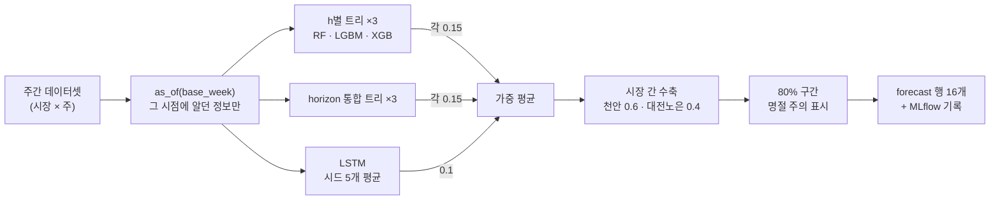

# 가격 예측 (ML)

저장성 농산물의 시장별 주평균 도매가격을 4주 앞까지 예측한다 (REQ-PRD-001~006). 코드는 [`ml/`](../ml)에 있다.

| 항목 | 내용 |
|---|---|
| **지금 운영 코드** | 사과 × 대전·충청 4개 시장(대전오정·대전노은·천안·청주). `ml/farmit_ml` v3. 테스트 NMAE **0.098** ([1장](#1-현재-운영-모델-사과-v3)) |
| **확장 검토 (2026-11)** | 저장성 8개 상품 × 전국 33개 공영도매시장. **사과·감자·고구마 가능, 배·양파·단감 조건부, 노지 감귤 보류, 깐마늘 예측 불필요** ([7장](#7-전국저장성-품목-확장-검토)) |
| 제안 구조 | 상품마다 모델 하나를 전국 모든 시장 데이터로 학습 → 시장별로 예측 → OOF로 검증된 시장만 노출, 나머지는 시도 단위 예측으로 대체 |
| 예측 시점·범위 | 매주 월요일 아침, 지난주(월~일)까지의 정보로 이번 주(h1) ~ 3주 후(h4) |
| 평가 | NMAE = Σ\|실제 − 예측\| / Σ실제. 기준선 B1 직전값(지난주 가격 그대로)·B2 4주 이동평균 |

## 목차
1. [현재 운영 모델: 사과 v3](#1-현재-운영-모델-사과-v3)
2. [코드 구조와 흐름](#2-코드-구조와-흐름)
3. [입력 데이터](#3-입력-데이터)
4. [출력 (forecast 테이블)](#4-출력-forecast-테이블)
5. [사용법](#5-사용법)
6. [확장 방법](#6-확장-방법)
7. [전국·저장성 품목 확장 검토](#7-전국저장성-품목-확장-검토)
8. [다음 단계](#8-다음-단계): 운영 방식(예측·재학습 주기), 팀 결정 사항, 만들 것

---

## 1. 현재 운영 모델: 사과 v3

> **2026-11-16부터 운영은 v4다** (K13, `config/0601`): 공통 피처 40개로 전국 32개 시장을 학습하고 32곳 모두 노출한다. 테스트 NMAE 0.112, 기준선 대비 29% 개선, 시장 × h별 80% 구간(테스트 커버리지 80.1%). 결과와 이유는 [7.10](#710-운영-코드로-재현-k13-2026-11-16-사과-v4).
> 아래는 대전·충청 4개 시장 v3 기록이다. v3 설정은 `config/0601_v3`로 남아 있다 (4개 시장만 보면 v3가 0.098로 약간 낫다. 7.2).

실험 저장소 `ml_kimkihyun_yangjeongho`(원본 저장소에 있음, 이 레포에는 없음)에서 정한 방식을 `ml/farmit_ml`로 옮겼다. Windows에서 실험 저장소의 테스트 결과와 2026-10-19 예측 16행을 똑같이 재현한다.

**문제 정의**
- 대상: 대전·충청 4개 시장의 사과(전 품종·전 등급, 등외·하·5등 이하 제외) 물량가중 kg당 주평균 가격
- 분할: 학습 2018~2023 / 검증 2024 / 테스트 2025-01 ~ 2026-10 (시간순, 테스트는 한 번만)
- 타깃은 로그변화율 log(h주 뒤 가격 / 지난주 가격), 가격 피처는 지난주 가격 대비 비율로 바꾼다 (해마다 가격 수준이 달라서)
- 모든 모델은 L1(MAE) 계열 손실. 최종 모델은 2021~2024 OOF 평균 NMAE로 고른다

**모델 (v3):** RF·LightGBM·XGBoost의 h별 모델과 horizon 통합 모델(h1~h4를 한 모델로) 평균 0.9 + LSTM 0.1. 후처리로 천안(w=0.6)·대전노은(w=0.4) 예측을 다른 시장 예측 쪽으로 당긴다(시장 간 수축).
**피처:** 가격·달력(명절)·생산량·ASOS 날씨 77개. 물가·무역·소매가·병해충 예찰은 묶음 후진 제거에서 빠졌다 ([7.7](#77-피처-외부-데이터는-효과가-작다)).

| 모델 (테스트) | h1 | h2 | h3 | h4 | 평균 | 기준선 대비 |
|---|---|---|---|---|---|---|
| B1 직전값 | 0.102 | 0.141 | 0.162 | 0.170 | 0.143 | |
| B2 4주 이동평균 | 0.127 | 0.147 | 0.156 | 0.164 | 0.148 | |
| **v3 + 후처리** | **0.079** | **0.098** | **0.106** | **0.111** | **0.098** | **31%** |

- MAE 494원/kg, 방향 정확도 0.70. 80% 예측 구간은 테스트 상대잔차 10~90% 분위수 (3주 후 약 −16% ~ +21%)
- **한계:** 명절 급등의 크기를 낮게 예측한다(2025 설 직전 35% 오차). 대상 주가 명절 3주 이내면 주의 문구를 띄운다(REQ-PRD-003, 출력의 `near_holiday`)
- **주의:** 예측값은 전 등급·전 품종 평균이다. 특품 가격으로 보면 안 되고, 판매 추천에서는 가격 수준보다 방향과 시장 간 차이를 근거로 쓴다

---

## 2. 코드 구조와 흐름

```
ml/
├── config/                  모델 구성. 코드를 고치지 않고 여기서 바꾼다. 품목마다 폴더 하나
│   ├── <품목코드>/          운영 설정 (--item <품목코드>). 파일 구성은 아래 0601_v3와 같다
│   └── 0601_v3/             사과 v3 (대전·충청 4개 시장, 77개 피처). 재현·비교용으로 남긴다 (--config config/0601_v3)
│       ├── model.json       버전(v3), 품목 코드, 데이터 파일 이름(data_file), horizon, LSTM 시드 수, 80% 구간 분위수
│       ├── markets.json     학습 시장(train: 코드 → 이름, 순서 = 시장 더미·LSTM 임베딩 순서), 예측을 내보낼 시장(serve)
│       ├── (intervals.json) 시장 × h별 80% 구간 분위수 (v4부터. v3는 model.json의 h별 값 하나)
│       ├── preprocess.json  타깃 변환(logratio), 트리 피처 77개, LSTM 피처 71개, 전처리 옵션
│       ├── best_params.json h별 트리 모델 하이퍼파라미터 (전국 실험도 이 값을 쓴다)
│       ├── stack_params.json horizon 통합 트리 모델 하이퍼파라미터
│       ├── lstm_params.json LSTM 하이퍼파라미터
│       ├── final_choice.json 앙상블 가중치 (구성 모델 이름 → 비중)
│       └── postprocess.json 시장 간 수축 시장별 w, 비율 계산 주 수
├── farmit_ml/               운영 패키지 (품목·시장·피처는 설정에서 읽는다)
│   ├── settings.py          경로·상수(horizon 1~4, 시드), 설정 폴더 고르기, config 묶음(Bundle) 로드
│   ├── data.py              데이터 로드·컬럼 검사·분할·교차검증 fold·as_of(그 시점 정보만 남기기)
│   ├── metrics.py           NMAE·MAE·RMSE·방향 정확도, 기준선
│   ├── preprocess.py        Preprocessor(상대화·결측·스케일), 타깃 변환
│   ├── models.py            트리 모델: h별 모델, horizon 통합 모델
│   ├── lstm.py              LSTM (torch는 쓸 때만 불러옴)
│   ├── ensemble.py          구성 모델 등록(COMPONENTS), 가중 평균, 후처리, 80% 구간
│   ├── postprocess.py       시장 간 수축
│   ├── tracking.py          MLflow 기록
│   ├── selection.py         [실행] 학습·노출 시장 선별, OOF·테스트 평가 → markets.json (7.10)
│   ├── intervals.py         [실행] OOF 잔차로 시장 × h별 80% 구간, 테스트 커버리지 → intervals.json (7.10)
│   ├── forecast.py          [실행] 주간 예측 → serve 시장 × h1~h4 forecast 행 (--to-db면 바로 적재). --item이면 레지스트리 champion 설정
│   ├── registry.py          [실행] 설정 묶음을 MLflow 등록 모델 버전으로 등록, 백테스트 승격 (5장 "모델 레지스트리", K40)
│   ├── store.py             [실행] forecast CSV → forecast 테이블 UPSERT (4장)
│   └── evaluate.py          [실행] 테스트 평가 (재현·비교)
├── experiments/             전국·저장성 품목 확장 실험 (7장, 사용법은 experiments/README.md)
├── tests/                   가짜 데이터로 출력 형식·누수 없음 확인
├── requirements.txt         운영용 (Docker 이미지)
├── requirements-dev.txt     실험·튜닝용 (+ optuna, requests, tabulate)
└── Dockerfile
# 실행하면 생기는 폴더 (커밋 안 함): data/ 입력 데이터셋, outputs/ 결과 CSV, mlruns/ MLflow
```



- 매주 **처음부터 다시 학습**한다. 그 시점까지 정답이 있는 모든 행을 쓴다. 전체 실행은 1분 안팎이다.
- `as_of()`는 `base_week` 이후 행을 빼고 아직 끝나지 않은 주의 타깃을 지운다. 그래서 지난 주차를 다시 예측(백필)해도 미래 정보가 섞이지 않는다. 테스트 `test_backfill_ignores_future_rows`가 확인한다.

---

## 3. 입력 데이터

`ml/data/<model.json의 data_file>`이 기본 경로다 (없으면 `weekly_<품목코드>.csv`, v3는 `apple_weekly.csv`. `--data` 또는 환경 변수 `FARMIT_ML_DATA`로 바꾼다). 시장 × 주 한 행이며, `markets.json`의 학습 시장 행만 읽는다. 아래 컬럼이 반드시 있어야 한다. 빠지면 `check_columns()`가 빠진 컬럼 이름(학습 시장이 없으면 그 시장)을 알려 준다.

| 컬럼 | 의미 |
|---|---|
| `market_cd`, `market_nm` | 시장 코드(`market.id`와 같음: 250001 등), 이름 |
| `week` | 정보가 끝나는 주의 월요일 |
| `pred_date` | 예측 시점 = `week` + 7일 |
| `price_kg`, `price_ma4` | 그 주 kg당 가격, 4주 이동평균 (기준선·타깃 변환에 사용) |
| `target_h1~4`, `target_week_h1~4` | h주 뒤 가격과 그 주 월요일 (최근 주는 비어 있음) |
| `hol_offset_h1~4`, `hol_in_target_h1~4` | 타깃 주와 명절 사이 일수, 타깃 주에 명절 포함 여부 |
| `preprocess.json`의 피처 | 가중치가 0보다 큰 구성 모델이 쓰는 것만 검사한다: 트리 모델이 있으면 `tree.features`, LSTM이 있으면 `linear.features` (v3: 트리 77개 + LSTM 71개) |

- **이 데이터셋은 레포에 없다.** 실험 저장소의 `scripts/run_all.py`(수집) → `build_dataset.py`(통합·누수 검사)로 만든다. 운영에서는 `batch/`로 옮겨야 한다 ([8장](#8-다음-단계)).
- **옮기는 중 (K12, 2026-11-15):** `batch/spark/features.py`(Airflow `build_features_weekly`, 매주 일 23:00 UTC → K19에서 `forecast_weekly`에 합침)가 MySQL에서 읽어
  `ml/data/weekly_<품목코드>.csv`(사과 `weekly_0601.csv`)를 만든다. 지금은 필요한 컬럼 89개 중 54개만 있어 `check_columns()`를 통과하지 못한다.
  나머지는 실험 저장소 정의를 확인하거나(24개), DB에 원천이 없거나(8개: 품종 비중·`n_records`·일조·면적 3종), 생산량을 몇 년도 값으로 붙일지 정해야 한다(3개).
  **2026-11-16 방향 변경:** 나머지 35개를 채우는 대신, 운영 피처를 v3 77개가 아니라 7장 실험의 **공통 피처**(`ml/experiments/dataset.py`)로 맞춘다 (양정호와 합의, WBS K30). 아래 3.1절.
- 단위 테스트(`pytest`)는 가짜 데이터를 쓰므로 이 파일 없이도 돈다.

### 3.1 공통 피처 (K30)

`batch/spark/features.py` → `ml/data/weekly_<품목코드>.csv`. **예측 품목 × 전국 시장(K31로 정산을 받는 32곳) × 주** 한 행.
정의는 `ml/experiments/dataset.py`(`weekly`·`build`·`GROUPS`)와 같다. 날씨·생산량·가락 묶음은 넣지 않는다.

| 묶음 | 컬럼 | 정의 (W = 그 행의 주, 시장별 주 달력 순서) |
|---|---|---|
| base | `price_kg` | W주 kg당 가격. 등외·하·5등 이하를 뺀 등급의 물량가중 (`amount 합 / 물량 합`) |
| | `qty_kg`, `n_trade_days` | W주 전 등급 물량(kg), 거래일 수 |
| | `price_allgrade` | 전 등급 물량가중 가격 (K12의 `price_kg_allgrade`에서 이름 변경) |
| | `price_last1` | W주 마지막 거래일의 `price_kg` |
| lags | `price_lag1·2·4`, `price_yoy` | 1·2·4·52주 전 `price_kg` |
| | `price_ma4`, `price_ma8` | 4주(값 2개 이상)·8주(4개 이상) 이동평균 |
| | `qty_lag1`, `qty_ma4` | 1주 전 물량, 4주 이동평균(2개 이상) |
| | `chg_1w`, `chg_4w` | `log(price_kg / price_lag1)`, `log(price_kg / price_lag4)` |
| national | `nat_price` | W주 전국(모든 시장) 주요 등급 물량가중 가격 |
| | `nat_price_ma4`, `nat_chg_1w` | 전국 가격 4주 이동평균(2개 이상), `log(nat_price / 1주 전 nat_price)` |
| | `dev_nat` | `log(price_kg / nat_price)` (전국 대비 이 시장의 수준) |
| | `ratio_nat_med26` | 시장별 `dev_nat`의 26주 이동 중앙값(8개 이상) |
| supply | `nat_qty`, `nat_qty_ma4`, `nat_qty_yoy` | W주 전국 전 등급 물량, 4주 이동평균, `/ 52주 전` |
| | `qty_share`, `qty_yoy` | `qty_kg / nat_qty`, `qty_kg / 52주 전 qty_kg` |
| calendar | `weekofyear`, `month` | W의 주차·월 |
| | `days_to·since_seol·chuseok` | 예측일(W + 7일)과 설·추석 본날 사이 일수 (상한 400) |
| | `hol_offset_h1~4`, `hol_in_target_h1~4` | 타깃 주와 가장 가까운 명절의 일수(±35로 자름), 타깃 주에 연휴(전날~다음날)가 겹치는지 |
| market | `mkt_id` | 시장 코드를 정수로 |
| 그 밖 | `market_cd`, `market_nm`, `week`, `pred_date`, `target_h1~4`, `target_week_h1~4` | 3절 표와 같다 |

- 시장마다 첫 주~마지막 주의 모든 주를 만들고(거래 없는 주도 행이 있어야 "1주 전"이 정확하다) 시차·이동평균을 계산한 뒤, **`price_kg`가 없는 행은 뺀다** (지난주 거래가 없으면 예측하지 않는다).
- **답을 기다리며 정한 가정** (양정호 답이 다르면 그 부분만 고친다)
  1. 전국 시장 행을 모두 만든다. 학습 시장 선별(`pick_markets`, 7.2절 "학습 시장")은 ML 쪽(K13)에서 한다.
  2. 가락 묶음(`garak_price`·`garak_price_ma4`·`dev_garak`)은 넣지 않는다.
  3. `n_records`(거래 건수)는 넣지 않는다. 정산 테이블(`settle_price`)은 (날짜, 시장, 등급) 합계라 원천이 없다. 시장 선별 기준 "주당 거래 20건 이상"은 "주당 거래일 수 중앙값 4일 이상"으로 바꿨다 ([7.10](#710-운영-코드로-재현-k13-2026-11-16-사과-v4)).
- **실험과 똑같이 못 하는 것**
  - 이상치: 실험은 원본 거래 한 건씩 "품목·월 전국 중앙값의 1/5~5배" 밖을 버린다. DB에는 (날짜, 시장, 등급) 합계만 있어 같은 단위로 거를 수 없다 → 합계 행의 kg당 가격으로 비슷하게 거르고, 실험 데이터셋과의 차이를 숫자로 확인한다 (K30 3단계).
  - 명절: holiday 테이블에 2017년이 없어 2018년 초 `days_since_*`가 400이 된다 → 2017년 설·추석을 보충한다.
- farmit_ml v3의 `check_columns()`(77개)와는 맞지 않는다. K13에서 8.3 "farmit_ml 일반화"대로 품목·시장·피처를 설정형으로 바꾼다.

**실험 데이터셋과 비교 (2026-11-16, 사과, `ml/experiments/compare_spark.py`)** — 같은 (시장, 주) 14,659행 (실험에만 1행)

| 컬럼 | 결과 |
|---|---|
| 달력 13개, `mkt_id` | 100% 같다 (2017년 명절 보충·본날 고르기 수정 뒤) |
| 가격·물량 (`price_kg` 등) | 87% 행이 0.5% 이내, 중앙값 차이 0, 99% 분위 5.5%, 상관 0.999. 5% 넘게 다른 행 179개(1.2%)가 해마다 고르게 흩어져 있다 |
| 로그 비율 (`chg_*`, `dev_nat`, `nat_chg_1w`, `ratio_nat_med26`) | 절대 차이 중앙값 0.0003~0.0017, 95% 분위 0.02~0.03 |
| 타깃 | 가격과 같다. 실험 데이터는 2026-11-08까지라 마지막 주들의 타깃이 Spark에만 있다(32행) |

- 차이는 이상치를 거르는 단위가 달라서 생긴다 (실험: 원본 거래 한 건씩, Spark: 날짜·시장·등급 합계 행). 걸러지는 거래가 섞인 합계 행은 통째로 남거나 빠진다.
- 피처가 실험과 거의 같아 7장 결과를 운영 피처로도 기대할 수 있다. K13 2단계에서 OOF로 다시 확인한다.

---

## 4. 출력 (forecast 테이블)

`python -m farmit_ml.forecast --item <품목코드>`는 `ml/outputs/forecast_<품목코드>_<base_week>.csv`를 만든다. 학습 시장 전부로 학습하고 `markets.json`의 `serve` 시장 행만 낸다. 컬럼은 [ERD의 `forecast` 테이블](erd.md)에 맞췄다.

| 출력 컬럼 | forecast 테이블 | 비고 |
|---|---|---|
| `item_code` | `item_id` | aT 품목 코드(사과 `0601`). 적재할 때 `item`에서 id로 바꾼다 |
| `market_cd` | `market_id` | 그대로 |
| `market_nm` | - | 확인용 |
| `base_week` | `base_week` | 예측 기준 월요일 |
| `horizon` | `horizon` | 1~4 |
| `target_week` | `target_week` | h1 = `base_week`, h4 = 3주 뒤 월요일 |
| `pred_price`, `lower80`, `upper80` | 같음 | 원/kg |
| `last_week_price` | 같음 | 지난주 실제 가격 |
| `near_holiday` | - (**테이블에 없음**) | 대상 주가 명절 3주(21일) 이내. REQ-PRD-003 주의 문구용 |
| `model_version` | `model_version` | `<버전>-<MLflow run_id 앞 8자리>`, 예: `v4-1386060b` (REQ-PRD-004) |
| `created_at` | `created_at` | UTC (`+00:00`). API가 Asia/Seoul로 바꿔 보여 준다 |

**적재:** `farmit_ml.store`가 CSV를 `forecast` 테이블에 UPSERT한다 (수집기와 같은 PyMySQL + 환경 변수 `MYSQL_*`·`DB_HOST`·`DB_PORT`).
- UK `uk_forecast`(item_id, market_id, base_week, horizon)로 덮어쓴다. 같은 기준 주를 다시 돌려도 행이 늘지 않고, 지난 기준 주는 그대로 남는다.
- `item_code`(aT 코드)로 `item.item_id`를 찾고, `item.is_forecast`가 false거나 `market`에 없는 시장이 있으면 아무것도 쓰지 않고 멈춘다.
- 표준 라이브러리 + PyMySQL만 써서 수집기 컨테이너에서도 돈다. 2026-11-16 첫 적재: 기준 주 2026-11-16, 32개 시장 × h1~h4 = 128행, `GET /api/forecasts?item_id=10`으로 확인. 매주 자동 실행은 아래 "자동 실행".

---

## 5. 사용법

명령은 모두 **`ml/` 폴더에서** 실행한다.

### 설치 (처음 한 번)
```bash
python -m venv .venv
source .venv/Scripts/activate      # Windows Git Bash. macOS·Linux는 .venv/bin/activate
pip install torch==2.14.1 --index-url https://download.pytorch.org/whl/cpu   # CPU 버전 먼저
pip install -r requirements.txt
# 실험(experiments/)·튜닝까지 하려면: pip install -r requirements-dev.txt
```

### 주간 예측
품목은 코드에 고정하지 않는다. `--item <품목코드>`(→ `config/<품목코드>/`, `data/weekly_<품목코드>.csv`) 또는 `--config <설정 폴더>`를 꼭 준다.
`forecast --item`은 MLflow 레지스트리에 그 품목의 champion이 있으면 **champion 설정**을 쓰고, 없으면 `config/<품목코드>/`를 쓴다 (아래 "모델 레지스트리").
`--config`·`FARMIT_ML_CONFIG`·`--no-mlflow`를 주면 레지스트리를 보지 않는다.
```bash
python -m farmit_ml.selection --item 0601                         # 학습·노출 시장 선별 → config/0601/markets.json (설정을 바꿨을 때·분기마다)
python -m farmit_ml.intervals --item 0601                         # 위 OOF로 시장별 80% 구간 → config/0601/intervals.json
python -m farmit_ml.forecast --item 0601                          # 데이터의 마지막 주 기준
python -m farmit_ml.forecast --item 0601 --base-week 2026-10-19   # 지난 주차 다시 예측 (백필)
python -m farmit_ml.forecast --item 0601 --skip LSTM              # torch 없이 (나머지 가중치로 다시 나눔, 버전에 -noLSTM 표시)
python -m farmit_ml.forecast --item 0601 --no-mlflow              # MLflow 기록 없이
python -m farmit_ml.forecast --item 0601 --to-db                  # 예측하고 forecast 테이블에 UPSERT (DB 환경 변수 필요)
python -m farmit_ml.store outputs/forecast_0601_2026-11-16.csv    # 이미 만든 CSV를 적재
# 호스트에 DB 환경 변수가 없으면 수집기 컨테이너로 (레포 루트, Git Bash는 앞에 MSYS_NO_PATHCONV=1):
# docker compose -f infra/docker-compose.yml --profile collect run --rm --no-deps -v "$PWD/ml:/ml:ro" collectors \
#   python /ml/farmit_ml/store.py /ml/outputs/forecast_0601_2026-11-16.csv
python -m farmit_ml.evaluate --item 0601                          # 테스트 평가
# v3 재현 (실험 저장소의 apple_weekly.csv를 data/에 둔 뒤): 후처리 NMAE Windows 0.0984, Linux·Docker 0.0982
python -m farmit_ml.evaluate --config config/0601_v3
```
- Windows와 Linux의 차이는 XGBoost·LSTM 부동소수점 연산 차이다. 같은 OS·같은 스레드 수에서는 매번 같다.

### 모델 레지스트리 (설정 버전·승격, K40)
`forecast`는 저장된 모델을 쓰지 않고 매주 다시 학습한다(8.1). 그래서 레지스트리에는 학습된 모델 파일이 아니라 **설정 묶음**(설정 폴더의 json 전부)을
MLflow 등록 모델 `farmit-<품목코드>`의 버전으로 올린다. 별칭은 두 개다.

| 별칭 | 뜻 |
|---|---|
| `champion` | 운영 설정. 주간 예측(`forecast --item`)이 쓴다 |
| `challenger` | 승격을 기다리는 새 설정. `promote`가 판정하면(승격이든 탈락이든) 지운다 |

```bash
# ml/ 에서. Airflow에서는 /home/airflow/ml-venv/bin/python (아래 "자동 실행")
python -m farmit_ml.registry register --config config/0601 --champion   # 처음 한 번 (되돌릴 때도 같은 명령으로 그 버전 폴더를 champion으로)
python -m farmit_ml.registry register --config config/0601_v5           # 새 설정을 challenger로
python -m farmit_ml.registry promote --item 0601                        # challenger가 있으면 백테스트 후 판정 (없으면 바로 끝)
python -m farmit_ml.registry promote --item 0601 --until 2026-11-16 --weeks 8   # 백테스트 구간을 정해서
python -m farmit_ml.registry show --item 0601                           # 버전·별칭·모델 버전·설정 경로·판정 결과
```
- **백테스트:** `until`(기본: 한국 날짜로 이번 주 월요일) 앞 8개 기준 주를 기준 주마다 그 시점까지의 데이터로만 다시 학습해 예측한다(`as_of`, 백필과 같다).
  실제는 `monitor`와 같은 정의(피처 CSV의 `price_kg`, 진행 중인 주 제외)로 붙인다.
- **승격 조건 (8.1 "설정 교체 조건"):** challenger NMAE < champion NMAE **이고** < 기준선(지난주 가격 그대로) NMAE. 같으면 바꾸지 않는다.
  두 설정이 모두 예측하는 (시장, 기준 주, h) 행끼리만 비교한다. challenger에만 있는 노출 시장은 판정에 들어가지 않는다.
- **기록:** 판정마다 MLflow 실행 `promote <품목> v<버전>`(stage=promote, 지표 `champion_nmae`·`challenger_nmae`·`base_nmae`·`n_rows`)과
  challenger 버전 태그 `promote_result`. 등록은 실행 `register <품목> <버전>`(stage=register)에 설정 json이 산출물로 남는다.
- **예측 행의 버전:** champion으로 예측하면 `forecast.model_version`이 `<설정 버전>-r<레지스트리 버전>-<MLflow 실행 id 8자>`가 된다 (예: `v4-r1-1a2b3c4d`).
- **비용:** 다시 학습을 기준 주 8개 × 설정 2개 = 16번 한다. challenger가 있을 때만 돈다.
- 레지스트리는 MLflow 추적 저장소와 같은 SQLite 파일에 있다 (내 PC `mlruns/mlflow.db`, Airflow `mlruns/airflow.db`). 둘은 따로라서 Airflow 쪽은 컨테이너 안에서 등록한다.

### 자동 실행 (Airflow `forecast_weekly`, K19)
매주 일 23:00 UTC(한국 월 08:00) `batch/dags/forecast.py`가 돈다: 점검(`weather.check`) → 피처(`batch/spark/features.py`) → 예측 품목(`item.is_forecast`)마다
승격 판정(`farmit_ml.registry promote --item <품목>`, K40) → `farmit_ml.forecast --item <품목> --base-week <이번 주 월요일> --to-db`. 점검이 실패하면 예측하지 않는다(태스크 로그에 빠진 것이 남는다).
- 승격 판정이 실패하면 `promote` 태스크는 실패가 아니라 skipped로 끝나고(`skip_on_exit_code=99`), `forecast`(`trigger_rule=none_failed`)는 지금 champion으로 돈다.
  challenger 별칭이 남아 다음 주에 다시 판정한다. 백테스트가 길어 `promote`는 제한 3시간·재시도 없음.
- 점검은 예측 피처가 실제로 쓰는 원천만 본다: 지난주 예측 품목 정산(`settle_price`)과 공휴일(`--only price holiday`). v4는 날씨·생산량을 쓰지 않는다(3.1절).
  날씨 점검(`--only weather`)은 과거 사례(`past_case`) 앞에만 둔다. 피처에 날씨·생산량을 다시 넣으면 DAG의 `--only`에도 더한다.
- 예측은 Airflow 이미지 안의 **별도 가상환경**(`/home/airflow/ml-venv`, `batch/airflow/Dockerfile`)에서 돈다. pandas 3·MLflow가 Airflow 고정 버전과 부딪치지 않게 나눴다.
  torch는 넣지 않았다(LSTM 가중치 0). LSTM을 다시 쓰면 그 Dockerfile에 torch CPU를 더한다.
- compose가 `ml/`을 `/opt/farmit/ml`에 붙인다. MLflow 기록은 내 PC 실행분(`mlruns/mlflow.db`)과 나눠 `mlruns/airflow.db`(산출물 `mlruns/airflow-artifacts/`)에 쌓인다.
  `mlflow.db`의 실험은 산출물 경로가 Windows 경로라 컨테이너에서 쓰면 산출물이 컨테이너 안에 버려지기 때문이다.
```bash
# 레포 루트에서. 지난 기준 주 다시 예측(백필) — Git Bash는 앞에 MSYS_NO_PATHCONV=1
docker compose -f infra/docker-compose.yml exec airflow-scheduler sh -c   "cd /opt/farmit/ml && /home/airflow/ml-venv/bin/python -m farmit_ml.forecast --item 0601 --base-week 2026-11-09 --to-db"
# 자동 실행 기록 보기 (ml/ 폴더에서)
mlflow ui --backend-store-uri sqlite:///mlruns/airflow.db
```

### 예측 이력 (REQ-PRD-005, K19)
`forecast` 테이블은 지난 기준 주를 지우지 않는다. `farmit_ml.monitor`가 지난 예측과 실제 주평균을 나란히 놓는다 (Airflow `forecast_weekly`의 `monitor` 태스크가 매주 돈다). 사용자에게는 `GET /api/forecasts/history`와 판매 추천 화면의 예측 성적표로 공개한다 (K47, api.md 2.5).
```bash
python -m farmit_ml.monitor --item 0601                     # 실제가 있는 가장 최근 주(지난주)를 채점
python -m farmit_ml.monitor --item 0601 --week 2026-11-09   # 그 주를 다시 채점
```
- **실제 주평균:** 피처 CSV의 `price_kg` (모델 정답과 같은 정의). 이번 주(한국 날짜 월요일)부터는 진행 중이라 실제로 치지 않는다.
- **`outputs/monitor_<품목>.csv`:** 예측 한 행(시장 × 기준 주 × h)마다 `actual`·`error`(예측 − 실제)·`abs_pct_error`(%)·`in_80`(80% 구간 안 1/0). 실제가 아직 없으면 비어 있다.
- **MLflow `monitor <품목> <주>`** (stage=monitor): 그 주가 대상인 예측들의 `nmae`·`nmae_h1~4`, 기준선(지난주 가격 그대로) `base_nmae`·`base_nmae_h1~4`, `coverage80`, `n_rows`·`n_markets`.
  8.1 운영 감시: `nmae`가 `base_nmae`보다 나쁜 주가 이어지는지, `coverage80`이 80%에서 멀어지는지 본다.
- 2026-11-17 첫 확인: 기준 주 10/19~11/09를 백필(`forecast --base-week`, 그 시점까지의 데이터로만 학습)한 뒤 11/09 대상 주 채점 — 32개 시장 × h1~h4 128행,
  NMAE 0.109 (기준선 0.137), h1 0.094 / h2 0.092 / h3 0.130 / h4 0.122, 80% 커버리지 82.8%. 한 주 결과라 흔들림이 크다 (h1·h4는 이 주에 기준선보다 나빴다).

### 단위 테스트·MLflow
```bash
python -m pytest -q                                        # 가짜 데이터, 10초 안팎
mlflow ui --backend-store-uri sqlite:///mlruns/mlflow.db   # http://localhost:5000
```

### Docker
```bash
# 레포 루트에서. Git Bash는 앞에 MSYS_NO_PATHCONV=1
docker build -t farmit-ml ml
docker run --rm -v "$PWD/ml/data:/app/data" -v "$PWD/ml/outputs:/app/outputs" -v "$PWD/ml/mlruns:/app/mlruns" farmit-ml farmit_ml.forecast --item 0601
docker run --rm -v "$PWD/ml/data:/app/data" -v "$PWD/ml/outputs:/app/outputs" farmit-ml farmit_ml.evaluate --item 0601 --no-mlflow
```
- 기본 명령은 `farmit_ml.forecast`(품목 인자를 붙여야 한다). 이미지는 약 2.6GB (torch·XGBoost 모두 CPU 전용)

### 환경 변수

| 변수 | 기본값 | 용도 |
|---|---|---|
| `FARMIT_ML_DATA` | `ml/data/<model.json data_file>` | 입력 데이터셋 (`--data`가 우선) |
| `FARMIT_ML_CONFIG` | `ml/config/<--item>` | 설정 폴더 (실험용 설정 비교, `--config`가 우선) |
| `FARMIT_ML_OUTPUT` | `ml/outputs` | 결과 CSV 폴더 |
| `FARMIT_ML_THREADS` | `8` | 학습 스레드 수. **XGBoost·LSTM은 스레드 수가 바뀌면 결과가 조금 달라진다** |
| `MLFLOW_TRACKING_URI` | `sqlite:///ml/mlruns/mlflow.db` | MLflow 서버를 띄우면 그 주소로 |

---

## 6. 확장 방법

### 평가 규칙 (바꿀 때 지킬 것)
1. 하이퍼파라미터·피처는 **2021~2023 교차검증**으로 정한다.
2. 최종 모델·앙상블·후처리·외부 피처·예측 대상 시장은 **2021~2024 OOF**로 고른다.
3. **테스트(2025-01~)는 고른 뒤 한 번만 본다.** 테스트를 보며 설정을 고르면 테스트가 검증 데이터가 된다.
4. 바꾼 설정은 `model.json`의 `version`을 올리고, 결과를 이 문서에 남긴다.

### 설정만 바꾸기 (코드 수정 없음)

| 하고 싶은 것 | 고칠 곳 |
|---|---|
| 앙상블 비중 변경, 모델 빼기 | `final_choice.json`의 `weights` (합 1, 0이면 학습하지 않음) |
| 하이퍼파라미터 | `best_params.json`, `stack_params.json`, `lstm_params.json` |
| 피처 추가·제거 | `preprocess.json`의 `tree.features`, `linear.features` |
| 후처리 끄기·비중 변경 | `postprocess.json`의 `weights` (모두 0이면 후처리 없음) |
| 80% 구간 다시 계산 | `python -m farmit_ml.intervals --item <품목>` → `intervals.json` (없으면 `model.json`의 `interval.quantiles`를 모든 시장에 쓴다) |

| 학습·노출 시장 | `markets.json`의 `train`(학습), `serve`(forecast로 내보냄, `train`의 부분집합). `excluded`는 노출하지 않는 시장의 사유(선별이 쓰는 기록, 예측 코드는 읽지 않음) |
| 시장 더미 끄기 | `preprocess.json`의 `tree.prep.market_dummies: false` (시장 수가 많을 때 `mkt_id` 피처로 대신) |

기존 설정을 두고 비교하려면 `cp -r config/0601 config/0601_exp` 후 `python -m farmit_ml.forecast --config config/0601_exp --no-mlflow`. 버전을 바꾸면 이전 폴더를 `config/<품목>_<버전>`으로 남긴다.

### 새 모델 추가
`ensemble.py`의 `COMPONENTS`에 이름과 예측 함수를 등록하고 `final_choice.json`에 같은 이름으로 비중을 준다. 예측 함수는 `(bundle, df_all, trn, tst)`를 받아 `(len(tst), 4)` 가격(원/kg) 배열을 돌려준다. 예측하지 못한 행은 NaN으로 두면 그 행만 나머지 모델 비중으로 다시 나눈다.

```python
# ensemble.py
def _catboost(b, df_all, trn, tst):
    return models.predict_per_h("catboost", b.tree_features, trn, tst, b.target_mode,
                                b.best_params["catboost"], b.tree_prep)

COMPONENTS["CatBoost"] = _catboost
# models.make_model()에 "catboost" 분기, best_params.json에 "catboost" 추가
```

### 후처리 추가
`postprocess.py`에 넓은 표(`week, market_cd, p1..p4`)를 받아 같은 모양으로 돌려주는 함수를 만들고 `ensemble.predict()`에서 부른다. 비율·통계는 **예측 시점까지의 실제 가격만** 쓴다.

---

## 7. 전국·저장성 품목 확장 검토

> 2026-11 검토. "전국 각 시장에서 저장성 품목의 가격을 예측할 수 있는가"를 실제 데이터로 확인했다. 재현 방법은 [ml/experiments/README.md](../ml/experiments/README.md), 아래 표는 `summarize.py` 출력이다.

### 7.1 결론

| 질문 | 답 |
|---|---|
| 전국 각 시장 가격을 예측할 수 있나? | **예.** 상품 하나당 모델 하나를 전국 시장으로 학습하면, 거의 모든 시장에서 기준선보다 낫다 (OOF에서 이긴 시장의 96.9%가 테스트에서도 이김) |
| 어떤 품목이 되나? | **사과·감자·고구마 가능.** 배·양파·단감은 조건부, 노지 감귤 보류, 깐마늘은 예측할 필요가 없다 (가격이 거의 안 움직여 직전값과 같음) |
| 대전·충청 4개 시장만 학습하는 것보다 나은가? | **예.** 사과 4개 시장 OOF 0.116 → 0.110, 4개 연도 모두 개선 |
| 지역(시도) 단위 예측은? | 지역 가격 자체는 잘 맞지만, **개별 시장 예측을 대신하지 못한다.** 시장별 예측이 안 되는 곳의 대안으로 쓴다 |
| 날씨·생산량·물가 같은 외부 피처는? | **효과가 작거나 없다.** 예측력은 대부분 aT 가격 데이터와 명절 달력에서 나온다. 양파 날씨, 감자 생산량만 작게 도움 |
| 저장이 안 되는 품목은? | 4주 앞 예측이 필요 없다. 기다릴 수 없으니 "언제 팔지"에 쓸 수 없다. "어디서 팔지"는 실시간·최근 가격 비교(REQ-PRC-003·004)로 충분하다 |

### 7.2 데이터와 방법

| 항목 | 내용 |
|---|---|
| 데이터 | aT 정산정보 2018-01 ~ 2026-11, 전국 33개 공영도매시장. 가격 정의는 사과 v3와 같다 (등외·하·5등 이하 제외, 물량가중 kg당 가격, 이상치는 품목·월 전국 중앙값의 1/5~5배 밖). 다시 만든 사과 가격이 v3 데이터셋과 1,836행 모두 일치 |
| 상품 | 사과, 배, 양파, 감자, 고구마, 단감, **노지 감귤**(하우스·수입 제외), **깐마늘**(마늘쫑·풋마늘 제외, 2021-07~) |
| 학습 시장 | 학습 기간(~2023)에 제철 주의 80% 이상 거래가 있고 주당 거래 20건 이상인 시장. 테스트 기간은 보지 않는다 |
| 피처 (공통) | aT 가격·물량, 시차·이동평균, 전국 평균가·가락 가격과의 관계, 전국 공급량·전년 대비, 달력(명절까지 일수 등), 시장 |
| 모델 | RF·LightGBM·XGBoost h별 모델 평균 (사과 v3 하이퍼파라미터). v3의 LSTM·통합 모델·후처리는 빼서 v3보다 약간 보수적이다 (같은 방식으로 사과 4개 시장만 돌리면 0.104, v3는 0.098) |
| 검증 | 피처·예측 대상 시장은 **2021~2024 OOF**로 정하고, 테스트(2025-01~)는 한 번만 본다 |
| API 사용량 | aT 약 4,000건, ASOS 530건, KOSIS 3건 (aT 하루 한도 10,000) |

먼저 1년치 전 품목 데이터로 커버리지를 봤다. 시장 × 품목 4,332개 조합 중 연중 꾸준히 거래되는 조합(천안 사과 수준 이상)은 532개뿐이다. 프로젝트 155개 품목 중 83개는 이런 시장이 한 곳도 없다. 그래서 대상을 저장성 품목으로 좁혔다.

### 7.3 품목별 결과

| 품목 | 학습 시장 | 피처 | OOF NMAE | OOF 연도별 (2021~2024) | 테스트 NMAE | 기준선 대비 (시장 중앙값) | 테스트에서 기준선 이긴 시장 | 판단 |
|---|---|---|---|---|---|---|---|---|
| **사과** | 31 | 공통 | 0.113 | 0.121 / 0.108 / 0.106 / 0.116 | 0.109 | 30% | 30/31 | **가능** |
| **감자** | 28 | 공통 (+생산량) | 0.117 | 0.128 / 0.129 / 0.110 / 0.103 | 0.119 | 32% | 28/28 | **가능** |
| **고구마** | 30 | 공통 | 0.108 | 0.106 / 0.115 / 0.113 / 0.098 | 0.097 | 21% | 30/30 | **가능** |
| 배 | 28 | 공통 | 0.121 | 0.111 / 0.118 / 0.107 / 0.147 | 0.159 | 32% | 28/28 | 조건부: 이상 기후 해에 오차가 커진다 (2024 OOF·테스트) |
| 양파 | 30 | 공통+날씨 | 0.125 | 0.154 / 0.132 / 0.105 / 0.108 | 0.096 | 22% | 30/30 | 조건부: 2021~22년에는 기준선과 비슷. 해마다 신뢰도가 다르다 |
| 단감 | 28 | 공통 | 0.157 | 0.157 / 0.148 / 0.146 / 0.177 | 0.125 | 37% | 28/28 | 조건부: 제철(가을~겨울)만, 오차가 크다 |
| 노지 감귤 | 30 | 공통 | 0.191 | 0.200 / 0.192 / 0.176 / 0.195 | 0.188 | 13% | 25/30 | 보류: 오차가 너무 크다 |
| 깐마늘 | 13 | 공통 | 0.062 | (2023·2024만) 0.068 / 0.056 | 0.066 | 0% | 7/13 | 예측 불필요: 직전값과 같은 수준 |

- 학습 시장이 33곳보다 적은 것은 학습 기준 미달 때문이다. 수산물 시장인 부산국제수산은 모든 품목에서 빠진다.
- 감자는 OOF 규칙상 날씨가 겨우 기준을 넘었지만(−0.0005) 테스트에서 나빠졌고, 생산량은 OOF·테스트 모두 좋아졌다. 그래서 **공통 + 생산량**을 권장한다 ([7.7](#77-피처-외부-데이터는-효과가-작다)).

### 7.4 시장 선별 규칙: "기준선을 꾸준히 이기는가"로 정한다

| 규칙 (OOF로 판단) | 선별 | 선별 시장: 테스트에서 기준선 이김 | 선별 시장: 개선 중앙값 | 미선별 시장: 개선 중앙값 |
|---|---|---|---|---|
| **최종: 4개 연도 중 3개 이상 기준선을 이김** (연도가 적으면 전부) | 186/218 | 96.8% | 29% | 19% |
| 엄격: 위 + OOF NMAE ≤ 0.12, 개선 ≥ 15% | 62/218 | 98.4% | 31% | 24% |

- **"모델이 기준선보다 나은가"는 해가 바뀌어도 거의 그대로다.** OOF에서 이긴 시장의 96.9%가 테스트에서도 이겼다.
- **"NMAE 0.12 이하" 같은 절대 기준은 해마다 흔들린다.** 오차의 크기는 시장보다 그해 가격이 얼마나 출렁였는지에 좌우된다. 엄격 규칙은 배를 통과시켰지만 테스트에서 오차가 커졌고, 양파는 거의 다 떨어뜨렸지만 테스트에서 양파는 모든 시장이 기준선보다 나았다.
- 그래서 **예측 노출 여부는 "꾸준히 이기는가"로 정한다.** 오차 크기는 시장 × 상품별 80% 구간을 넓게 혹은 좁게 보여 주는 방식으로 사용자에게 전달한다.
- 품목 단위 판단(7.3의 "판단")은 별도다. 노지 감귤은 모든 시장이 기준선을 이기지만 오차 자체(0.19)가 서비스하기엔 크다.

### 7.5 시장 × 상품 (테스트 NMAE)

●: 최종 규칙으로 선별, ○: 미선별, -: 학습 기준 미달. 판단이 보류·불필요인 노지 감귤·깐마늘도 참고로 넣었다.

| 시도 | 시장 | 사과 | 배 | 양파 | 감자 | 고구마 | 단감 | 노지 감귤 | 깐마늘 |
|---|---|---|---|---|---|---|---|---|---|
| 서울 | 서울가락 | ● 0.098 | ● 0.117 | ○ 0.083 | ● 0.082 | ● 0.066 | ● 0.097 | ● 0.313 | ○ 0.044 |
| 서울 | 서울강서 | ● 0.112 | ● 0.156 | ○ 0.144 | ● 0.103 | ● 0.063 | ● 0.129 | ● 0.141 | ○ 0.063 |
| 경기 | 구리 | ● 0.089 | ● 0.146 | ○ 0.085 | ● 0.104 | ● 0.074 | ● 0.121 | ● 0.248 | ○ 0.074 |
| 경기 | 수원 | ● 0.115 | ● 0.177 | ○ 0.078 | ● 0.091 | ● 0.100 | ● 0.125 | ● 0.175 | ○ 0.036 |
| 경기 | 안산 | ● 0.112 | ● 0.194 | ○ 0.077 | ● 0.124 | ● 0.117 | ● 0.106 | ● 0.218 | - |
| 경기 | 안양 | ● 0.115 | - | ○ 0.078 | ● 0.088 | ● 0.112 | ● 0.106 | ● 0.186 | ○ 0.053 |
| 인천 | 인천남촌 | ● 0.103 | ● 0.155 | ○ 0.081 | ● 0.082 | ● 0.083 | ● 0.118 | ● 0.206 | ● 0.082 |
| 인천 | 인천삼산 | ● 0.102 | ● 0.189 | ○ 0.079 | ● 0.113 | ● 0.081 | ● 0.124 | ● 0.192 | ○ 0.045 |
| 강원 | 강릉 | ● 0.119 | - | ● 0.076 | ● 0.123 | ● 0.070 | - | ● 0.160 | - |
| 강원 | 원주 | ● 0.145 | ● 0.165 | ○ 0.070 | - | ● 0.111 | - | - | - |
| 강원 | 춘천 | - | - | ● 0.223 | - | - | - | - | - |
| 대전 | 대전오정 | ● 0.091 | ● 0.125 | ○ 0.083 | ● 0.101 | ● 0.084 | ● 0.096 | ● 0.192 | ○ 0.048 |
| 대전 | 대전노은 | ● 0.103 | ● 0.151 | ○ 0.081 | ● 0.117 | ● 0.093 | ● 0.110 | ● 0.213 | ○ 0.077 |
| 충북 | 청주 | ● 0.103 | ● 0.152 | ● 0.083 | ● 0.112 | ● 0.111 | ● 0.127 | ● 0.270 | ○ 0.101 |
| 충북 | 충주 | ● 0.125 | ● 0.190 | ● 0.098 | ● 0.157 | ● 0.128 | ● 0.122 | ● 0.180 | - |
| 충남 | 천안 | ● 0.091 | ● 0.193 | ○ 0.111 | ● 0.140 | ● 0.128 | ● 0.099 | ● 0.175 | - |
| 전북 | 전주 | ● 0.104 | ● 0.185 | ● 0.075 | ● 0.132 | ● 0.160 | ● 0.108 | ● 0.149 | - |
| 전북 | 익산 | ● 0.116 | ● 0.171 | ● 0.105 | - | ● 0.127 | ● 0.092 | ● 0.180 | - |
| 전북 | 정읍 | ● 0.178 | - | ○ 0.124 | - | - | - | ● 0.197 | - |
| 광주 | 광주각화 | ● 0.098 | ● 0.152 | ○ 0.094 | ● 0.108 | ● 0.073 | ● 0.138 | ● 0.224 | ○ 0.152 |
| 광주 | 광주서부 | ● 0.098 | ● 0.151 | ○ 0.086 | ● 0.122 | ● 0.073 | ● 0.179 | ● 0.190 | ○ 0.053 |
| 전남 | 순천 | ● 0.112 | ● 0.197 | ● 0.086 | ● 0.127 | ● 0.090 | ● 0.176 | ● 0.168 | - |
| 대구 | 대구북부 | ● 0.094 | ● 0.127 | ○ 0.087 | ● 0.084 | ● 0.065 | ○ 0.102 | ● 0.168 | - |
| 경북 | 안동 | ● 0.092 | ● 0.157 | - | ● 0.153 | ● 0.117 | ● 0.099 | ● 0.190 | - |
| 경북 | 포항 | ● 0.131 | ● 0.126 | - | ● 0.138 | ● 0.116 | ● 0.110 | ● 0.154 | - |
| 경북 | 구미 | ● 0.133 | ● 0.218 | ● 0.132 | ● 0.175 | ● 0.134 | ● 0.199 | ● 0.172 | - |
| 부산 | 부산엄궁 | ● 0.094 | ● 0.123 | ○ 0.097 | ● 0.089 | ● 0.077 | ● 0.099 | ● 0.207 | - |
| 부산 | 부산반여 | ● 0.094 | ● 0.128 | ○ 0.083 | ● 0.100 | ● 0.067 | ● 0.136 | ● 0.221 | - |
| 울산 | 울산 | ● 0.106 | ● 0.150 | ○ 0.084 | ● 0.126 | ● 0.142 | ● 0.103 | ● 0.158 | - |
| 경남 | 창원팔용 | ● 0.103 | ● 0.164 | ● 0.095 | ● 0.149 | ● 0.088 | ● 0.137 | ● 0.182 | - |
| 경남 | 창원내서 | ● 0.104 | ● 0.164 | ● 0.090 | ● 0.117 | ● 0.090 | ● 0.164 | ● 0.148 | ○ 0.048 |
| 경남 | 진주 | ● 0.110 | ● 0.148 | ● 0.085 | ● 0.168 | ● 0.091 | ● 0.203 | ● 0.146 | - |

- 양파의 ○는 대부분 2021~22년에 기준선을 못 이긴 시장이다. 테스트에서는 잘 맞았지만, 해에 따라 신뢰도가 크게 달라지는 품목이라 규칙대로 둔다.
- 대구·충남·전남은 공영도매시장이 aT 데이터에 한 곳뿐이다. 울산 시장 코드(380201)는 경남 체계라 따로 지정했다.

### 7.6 전국 묶음 학습과 지역 단위

**전국 묶음 학습 (사과, 대전·충청 4개 시장에서 OOF 비교)**

| 학습 | 2021 | 2022 | 2023 | 2024 | 평균 |
|---|---|---|---|---|---|
| 4개 시장만 | 0.125 | 0.106 | 0.111 | 0.121 | 0.116 |
| **전국 31개 시장** | **0.124** | **0.098** | **0.104** | **0.113** | **0.110** |

실험 저장소의 v3 실험에서는 가락 하나를 추가했더니 나빠졌는데, 시장을 전국으로 넓히고 전국 가격·공급량 피처를 함께 쓰면 좋아진다.

**시도 단위** (시도 안 모든 시장의 거래를 합친 가격, 15개 시도)

| 품목 | 테스트 NMAE (중앙) | 기준선 대비 (중앙) | 테스트에서 기준선 이긴 지역 |
|---|---|---|---|
| 사과 | 0.094 | 33% | 15/15 |
| 배 | 0.135 | 31% | 15/15 |
| 양파 | 0.085 | 19% | 15/15 |
| 감자 | 0.098 | 35% | 15/15 |
| 고구마 | 0.069 | 25% | 15/15 |
| 단감 | 0.115 | 38% | 15/15 |
| 노지 감귤 | 0.173 | 18% | 12/15 |

**지역 예측을 개별 시장에 옮겨 쓰면?** 시장 예측 = 시장의 지난주 가격 × 지역 예측 변화율로 만들어, 시장별 모델과 같은 시장·같은 주에서 비교했다(테스트, 시장 NMAE 중앙값).

| 품목 | 시도 → 시장 | 권역 → 시장 | 시장별 모델 | 시도 방식이 더 나은 시장 |
|---|---|---|---|---|
| 사과 | 0.112 | 0.124 | **0.104** | 3% |
| 배 | 0.176 | 0.182 | **0.156** | 7% |
| 양파 | 0.092 | 0.094 | **0.085** | 7% |
| 감자 | 0.125 | 0.126 | **0.117** | 18% |
| 고구마 | 0.103 | 0.111 | **0.091** | 0% |
| 단감 | 0.127 | 0.134 | **0.120** | 18% |

- 지역 가격은 여러 시장을 합쳐 부드러워서 오차가 작다. 하지만 시장마다 지역 평균과 따로 움직이는 부분(그 시장의 수급, 거래 잡음)이 커서, 지역 흐름만으로는 시장 가격을 못 맞힌다. 넓게 묶을수록(권역) 더 나빠진다.
- **시장별 예측 우선 → 안 되는 시장은 같은 시도의 지역 예측("지역 평균 흐름"으로 표시) → 그것도 없으면 "예측 없음"과 사유.**

### 7.7 피처: 외부 데이터는 효과가 작다

| 품목 | 날씨 OOF Δ | 날씨 테스트 Δ | 생산량 OOF Δ | 생산량 테스트 Δ |
|---|---|---|---|---|
| 사과 | +0.0024 | +0.0035 | −0.0003 | −0.0026 |
| 배 | +0.0051 | +0.0055 | +0.0004 | +0.0018 |
| **양파** | **−0.0024** | **−0.0029** | −0.0024 | +0.0025 |
| **감자** | −0.0005 | +0.0017 | **−0.0014** | **−0.0017** |
| 고구마 | +0.0023 | +0.0004 | +0.0013 | −0.0002 |
| 단감 | +0.0022 | −0.0036 | +0.0057 | +0.0016 |
| 노지 감귤 | −0.0003 | +0.0032 | −0.0005 | −0.0009 |
| 깐마늘 | −0.0001 | +0.0004 | −0.0011 | −0.0006 |

음수가 개선이다. 날씨는 공통 피처 대비, 생산량은 7.3의 선택 피처 대비. OOF로 0.0005 넘게 좋아질 때만 채택한다.

- **날씨**(시도별 ASOS 관측소 평균을 2023년 원산지 시도 비중으로 가중): OOF·테스트 모두 좋아진 것은 **양파**뿐이다. 노지 작물이라 산지 날씨가 작황에 바로 영향을 준다.
- **생산량**(KOSIS, 공표된 뒤에만 사용): OOF·테스트 모두 좋아진 것은 **감자**뿐이다. 연 1회 값이라 학습 기간에 서로 다른 값이 6~7개뿐이고, 연도 표시로 잘못 쓰일 위험이 있다(단감 +0.0057).
  - 공표 시점(최신 연도 최종수정일로 확인): 양파·마늘 Y년 값은 Y년 8월, 봄감자 Y년 10월, 과일·고구마는 Y+1년 초 → 각각 Y-09-01, Y-11-01, Y+1-01-01부터 사용
- **물가·무역·소매가·예찰·할당관세**(사과 실험): 묶음 후진 제거에서 빼자 CV NMAE가 0.123 → 0.111로 **좋아졌다**. 월 단위·공표 지연이라 1~4주 변동을 설명하지 못한다. 또 꾸준히 오르는 지표(CPI 등)를 트리 모델이 연도 표시로 외워 처음 보는 수준에서 엉뚱하게 외삽한다. 할당관세는 학습 기간에 거의 변하지 않아 효과가 0이었다.
- 운영 측면에서는 좋은 소식이다. aT 데이터와 달력만으로 대부분 예측할 수 있어 외부 API 의존과 공표 시차 관리 부담이 작다.

### 7.8 상품 정의: aT 중분류 하나에 다른 상품이 섞인다

| 중분류 | 섞인 상품 (2025-05 전국 하루) | 영향 |
|---|---|---|
| 마늘 | 마늘쫑 51% (2,214원/kg), 깐마늘 31% (6,659원/kg), 햇마늘 | 봄에 마늘쫑이 들어오면 가격이 폭락한 것처럼 보인다 (대구북부 마늘 NMAE 0.374) |
| 감귤 | 5월 수입 42%·하우스 41% (5,000~6,800원), 11월 노지 조생·극조생 (2,100~2,400원) | 계절마다 다른 상품이 된다 |
| 양파·감자·고구마·배·사과 | 품종이 여러 개지만 kg당 가격 차이가 작다 | 문제 없음 |

- 마늘은 깐마늘, 감귤은 노지(하우스·수입 제외)로 다시 정의했다. **깐마늘 소분류는 2021년 중반부터만 따로 기록**되어 있어 OOF가 2년뿐이다.
- 넓힐 때는 품목을 aT 중분류가 아니라 **"상품 정의"(중분류 + 소분류 포함·제외 규칙) 단위로 관리**해야 한다.

### 7.9 한계
- 하이퍼파라미터는 사과 v3 값을 그대로 썼다. 품목별로 튜닝하면 더 나아질 여지가 있다.
- 80% 예측 구간을 상품·시장별로 아직 만들지 않았다. (사과는 K13에서 만들었다: [7.10](#710-운영-코드로-재현-k13-2026-11-16-사과-v4))
- 날씨는 시도 단위로 거칠다 (사과 v3는 시군 단위). 생산량 값은 이후 수정된 최신값이라 공표 당시 값과 조금 다를 수 있다.
- 깐마늘은 OOF가 2년뿐이다. 모든 결과는 2026-11 이후 새 데이터로 다시 확인해야 한다.

### 7.10 운영 코드로 재현 (K13, 2026-11-16, 사과 v4)

7장 실험 구성을 `farmit_ml` 설정(`config/0601`, 버전 v4)으로 옮기고, 운영 피처(K30 `weekly_0601.csv`, 32개 시장)로 다시 돌렸다.
`python -m farmit_ml.selection --item 0601` 한 번이 학습 시장 선별 → 2021~2024 OOF → 노출 시장 선별(`markets.json` 저장) → 테스트 한 번 → MLflow(stage=select)를 한다.

| 설정 | 내용 |
|---|---|
| 피처 | 공통 피처 40개 = 실험 `GROUPS`에서 K30에 없는 `n_records`·가락 묶음 3개를 뺀 것 (`preprocess.json`) |
| 전처리 | 실험과 같게: 가격 수준 → 지난주 가격 대비 로그비, 물량 5개 → `log1p`, 시장 → `mkt_id` 하나(더미 없음), RF 결측 → 학습 중앙값(결측 표시 없음), 무한대 → 결측 |
| 모델 | RF·LightGBM·XGBoost h별 모델 같은 비중(`final_choice.json`), 통합 트리·LSTM·후처리 0. 하이퍼파라미터는 v3 값 |
| 학습 시장 | 학습 기간(~2023)에 제철 주의 80% 이상 거래 **+ 주당 거래일 수 중앙값 4일 이상** (`model.json`의 `selection`) |
| 노출 시장 | 7.4 최종 규칙: OOF 4개 연도 중 3개 이상 기준선(B1·B2 중 그 시장 OOF에서 나은 쪽)을 이김 |

**"주당 거래 20건" 기준을 바꾼 이유:** 정산 테이블은 (날짜, 시장, 등급) 합계라 거래 건수(`n_records`)가 없다. 거래일 수가 그다음으로 "꾸준히 거래되는가"를 보여 준다.
사과는 32개 시장 모두 중앙값 5~6일이라 모두 통과했다. 실험에서 건수 기준으로 빠졌던 **춘천(320101)이 학습·노출 시장에 들어온다** (주 5일 거래, 물량 중앙값 6.8t으로 강릉·정읍과 비슷해 거래일·물량으로는 가를 수 없다).

| 결과 | OOF 평균 | 2021 | 2022 | 2023 | 2024 | 테스트 | 테스트 h1 / h2 / h3 / h4 |
|---|---|---|---|---|---|---|---|
| 7.3 실험 (31개 시장) | 0.113 | 0.121 | 0.108 | 0.106 | 0.116 | 0.109 | |
| **v4 운영 (32개 시장)** | **0.115** | 0.119 | 0.110 | 0.110 | 0.123 | **0.112** | 0.093 / 0.108 / 0.120 / 0.124 |
| v4, 춘천 빼고 채점 | 0.112 | 0.116 | 0.106 | 0.107 | 0.120 | | |
| v4, 춘천 빼고 학습·채점 | 0.112 | 0.116 | 0.106 | 0.108 | 0.118 | 0.111 | |

- **재현됐다.** 차이(OOF +0.002)는 대부분 춘천 한 곳의 큰 오차(OOF 0.199)가 전체 평균에 들어가서다. 춘천을 빼고 채점하면 0.112로 실험과 같은 수준이고, 춘천을 학습에 넣든 빼든 다른 시장 결과는 같다. 테스트에 남은 0.002 차이는 가락 묶음·`n_records`를 뺀 것과 이상치 거르는 단위 차이(3.1절)로 본다.
- **기준선 대비:** 테스트 NMAE 0.112 vs 기준선 0.158(B1 직전값, B2는 0.161) → **29% 개선**. 시장별 개선 중앙값 30% (실험 30%).
- **노출 시장 32/32** (모두 OOF 4개 연도 전부 기준선을 이김). 테스트에서도 31/32(96.9%)가 기준선을 이겼다. 진 곳은 서울가락(−0.1%, 사실상 같음).
- 춘천은 노출하지만 오차가 크다(OOF 0.199, 테스트 0.128). 7.4대로 오차 크기는 시장별 80% 구간 폭으로 보여 준다 (K13 3단계).
- 결과 파일: `ml/outputs/select_0601_v4.csv`(시장별 표), `ml/outputs/oof_0601_v4.csv`(OOF 예측, 구간 계산용), `ml/outputs/test_0601_v4.csv`(테스트 예측, 커버리지 확인용), MLflow `apple-price` 실험의 `select 0601 v4` 실행.

**80% 구간 (REQ-PRD-002, `python -m farmit_ml.intervals --item 0601` → `config/0601/intervals.json`)**

v3 구간은 4개 시장 **테스트** 잔차로 만들어 전국 시장에 쓸 수 없고, 테스트를 보고 만든 값이라 검증도 안 된다. v4는 **2021~2024 OOF 상대잔차** (실제 − 예측) / 예측의 10%·90% 분위수를 **시장 × h별**로 만들고(잔차 100개 미만이면 전체 분위수, 사과는 32곳 모두 자기 값), 테스트에서는 커버리지만 확인했다. 구간이 예측값을 꼭 포함하게 하한 ≤ 0 ≤ 상한으로 자른다.

| 테스트 (2025-01~) | 커버리지 | h1 | h2 | h3 | h4 | 시장별 커버리지 범위 | 70~90%인 시장 | 80%에서 평균 벗어남 | 평균 폭 |
|---|---|---|---|---|---|---|---|---|---|
| **시장 × h별 (채택)** | **80.1%** | 79.3% | 78.7% | 80.5% | 82.1% | 67.8% ~ 90.5% | 29/32 | 4.1%p | ±19% |
| 전체 시장 한 구간 (비교) | 81.4% | 80.5% | 80.2% | 81.9% | 83.2% | 61.6% ~ 90.2% | 29/32 | 5.7%p | ±19% |

- 전체 커버리지는 둘 다 목표(80%)에 맞는다. 시장별 구간이 시장 사이 커버리지 차이를 줄인다 (평균 벗어남 5.7 → 4.1%p). 무엇보다 **시장마다 폭이 달라** 오차가 큰 시장을 넓게 보여 준다(7.4): h4 폭이 가장 좁은 부산반여 36%, 가장 넓은 춘천 72%.
- 커버리지가 낮은 시장: 정읍 67.8%, 포항 68.5%, 창원내서 70.6%, 서울가락 70.9%. 정읍·포항·창원내서는 테스트 NMAE가 OOF보다 0.02~0.05 커서 OOF 잔차로 만든 구간이 좁았다 (서울가락은 NMAE는 비슷하지만 구간 자체가 가장 좁은 편). 8.1의 매주 성능 감시에서 커버리지도 함께 본다.
- OOF 예측은 테스트 때보다 짧은 학습 기간으로 만든 것이라 실제 운영 오차보다 약간 클 수 있다(보수적인 쪽).
- 결과 파일: `ml/outputs/coverage_0601_v4.csv`(시장 × h 커버리지), MLflow `intervals 0601 v4` 실행.

### 7.11 저장성 품목 확대: 감자·고구마 (K28, 2026-11-17)

`config/0601`(v4)을 `config/0501`(감자)·`config/0502`(고구마)로 복사하고 `item_code`만 바꿨다. 피처·모델·하이퍼파라미터·선별 규칙은 사과와 같다.
**감자도 공통 피처만 쓴다.** 7.7의 생산량 효과(OOF −0.0014)가 작고, 넣으려면 K30 피처에 생산량·공표 시점 처리를 새로 넣어야 해서 뺐다 (2026-11-17 결정).

순서 (품목 하나 추가하는 방법):
1. `item.is_forecast`·`is_storable`을 켠다 (`backend/codes/fixtures/items.json` → `loaddata items`)
2. 전국 정산 과거 적재: `python -m settle.at_settle --national --start 2018-01-02 --end <K32 전국 수집 시작 전날> --item 0501 --item 0502` → 감자·고구마 API 383건, 853,240행
3. 피처: `batch/spark/features.py` (예측 품목마다 `ml/data/weekly_<품목>.csv`)
4. `farmit_ml.selection --item <품목>` → `farmit_ml.intervals --item <품목>` → `farmit_ml.forecast --item <품목> --to-db`
   (Airflow 컨테이너의 ML 가상환경에서 실행, MLflow는 `mlruns/airflow.db`)

| 품목 | 학습 / 노출 시장 | OOF 평균 | 2021 / 2022 / 2023 / 2024 | 테스트 | h1 / h2 / h3 / h4 | 기준선(B1) | 개선 | 테스트에서 기준선 이긴 노출 시장 | 80% 커버리지 (테스트) |
|---|---|---|---|---|---|---|---|---|---|
| 7.3 실험 감자 | 28 | 0.117 | 0.128 / 0.129 / 0.110 / 0.103 | 0.119 | | | 32% | 28/28 | |
| **v4 감자** | 31 / 31 | **0.123** | 0.130 / 0.137 / 0.117 / 0.108 | **0.122** | 0.103 / 0.121 / 0.129 / 0.134 | 0.177 | **31%** | 31/31 | 78.9% (시장별 70.9~91.1%) |
| 7.3 실험 고구마 | 30 | 0.108 | 0.106 / 0.115 / 0.113 / 0.098 | 0.097 | | | 21% | 30/30 | |
| **v4 고구마** | 32 / 31 | **0.110** | 0.108 / 0.117 / 0.116 / 0.100 | **0.099** | 0.081 / 0.096 / 0.105 / 0.114 | 0.124 | **20%** | 30/31 | 83.6% (시장별 72.0~94.2%) |

- **재현됐다.** 테스트 NMAE 차이 +0.002~0.003, 기준선 대비 개선율은 같은 수준이다. 감자 OOF가 0.006 큰 것은 실험보다 학습 시장이 3곳 많고(원주·정읍 등 오차가 큰 시장, 7.10의 춘천과 같은 이유: 거래 건수 대신 거래일 수 기준) 생산량 피처를 뺀 영향으로 본다.
- **빠진 시장과 사유:** 감자 익산(350301)은 학습 기간 제철 주 거래 79.9%로 학습 기준(80%) 미달 → 학습·노출 모두 제외. 고구마 천안(340101)은 OOF에서 기준선을 2개 연도만 이겨 노출 제외 (학습에는 씀).
- **예측하지 못한 품목·시장의 사유가 남는 곳 (REQ-PRD-006)**

  | 경우 | 사유가 남는 곳 |
  |---|---|
  | 선별에서 빠진 시장 (학습 기준 미달·기준선을 못 이김) | `config/<품목>/markets.json`의 `excluded` (`farmit_ml.selection`이 씀, 분기 재검증 때 갱신) |
  | 노출 시장인데 이번 주 거래가 없음 | `forecast` 태스크 로그 경고 "이번 주 데이터가 없어 예측하지 못한 시장" |
  | 품목 전체를 예측하지 못함 (설정·데이터 없음, 기준 주 행 없음) | 그 품목의 `forecast` 태스크 실패와 로그. 다른 품목은 그대로 저장된다 (품목마다 태스크) |
  | 예측 대상이 아닌 품목 (`is_forecast` false) | API가 `forecast_available: false` + 안내 문구 (`docs/api.md`) |
- 고구마 춘천은 노출 시장이지만 테스트에서 기준선보다 나빴다(−10%). 8.1의 매주 감시 대상이다.
- 첫 적재: 기준 주 2026-11-16, 감자·고구마 각 31개 시장 × h1~h4 = 124행. `GET /api/forecasts?item_id=8`(감자)·`9`(고구마)로 확인.
- **자동 실행 확인 (2026-11-17, `forecast_weekly` 손으로 실행):** DAG 코드는 고치지 않았다. `forecast_items`가 `item.is_forecast`에서 0501·0502·0601을 읽어 품목마다 `forecast`·`monitor` 태스크가 하나씩 돌았고 모두 성공했다. 사과 128행·감자 124행·고구마 124행이 같은 기준 주로 다시 UPSERT됐다(행 수 그대로, `model_version`만 새 실행).

  | 태스크 | 걸린 시간 |
  |---|---|
  | check / features (Spark, 세 품목 한 번에) | 1초 / 31초 |
  | forecast (품목마다 다시 학습 + 예측 + 적재) | 감자·고구마·사과 각 34초 (병렬) |
  | monitor | 품목당 4~6초 |
  | 선별·OOF·테스트 (`farmit_ml.selection`, 분기 재검증 때만) | 품목당 약 50초 |

  예측 품목이 늘어도 `forecast`는 품목마다 따로 돌아 전체 시간은 거의 늘지 않는다 (Airflow 병렬 수 안에서).
- 결과 파일: `ml/outputs/select_050{1,2}_v4.csv`, `oof_·test_·coverage_050{1,2}_v4.csv`, MLflow(`mlruns/airflow.db`) `select`·`intervals`·`forecast` 실행.

---

## 8. 다음 단계

### 8.1 운영 방식: 매주 예측, 매주 다시 학습, 주기적 재검증

**예측은 실시간이 아니라 매주 월요일 한 번이다.** 예측하는 값이 주평균 가격(이번 주 ~ 3주 후)이라 경매가 들어올 때마다 예측해도 값이 거의 변하지 않는다. 실시간 경매 데이터는 "지금 시세·시장 비교"(REQ-PRC)에 쓰고, 예측에는 쌓인 정산 데이터를 주 단위로 모아 넣는다.

```
수집기(매일·실시간) → MySQL 정산·경매 테이블
                         ↓ 월요일 새벽 Airflow
            주간 데이터셋 (batch/) → farmit_ml.forecast → forecast 테이블 → 지난 예측 vs 실제 비교
```

- 모델은 aT **정산** 데이터로 학습했다. 실시간 **경매** 데이터를 예측 입력에 섞으려면 두 가격이 같은 정의인지 먼저 확인한다.
- "이번 주(h1)"만 주중에 매일 갱신하는 것은 필요해지면 넣는다.

**바뀌는 주기는 세 단계로 나눈다.**

| 무엇 | 주기 | 방법 |
|---|---|---|
| 모델 다시 학습 | **매주** (예측과 함께) | `forecast.py`는 저장된 모델을 쓰지 않고, 실행할 때마다 기준 주까지의 전체 데이터로 학습한다. 지난주 가격도 피처로 들어간다. 설정(피처·하이퍼파라미터·가중치·예측 시장)은 그대로다 |
| 설정 재검증 | 분기 1회 | 최근 데이터를 포함해 OOF를 다시 돌린다. 예측을 노출할 시장(7.4 규칙), 피처 묶음, 80% 구간을 다시 정한다 |
| 하이퍼파라미터 재탐색 | 연 1회 | Optuna (`requirements-dev.txt`), `models.cv_eval` |

- **데이터가 들어올 때마다 학습(온라인 학습)하지 않는 이유:** 1주에 늘어나는 데이터가 시장당 1행뿐이다. RF·LightGBM·XGBoost는 이어서 학습하는 구조가 아니다. 매주 처음부터 다시 학습해도 품목당 몇 분이면 끝난다.
- **설정 교체 조건:** 새 설정을 최근 기간으로 검증해 지금 설정과 기준선(지난주 가격)보다 나을 때만 바꾼다. 바꾼 이력은 MLflow와 `model_version`에 남는다 (REQ-PRD-004).
  **K40에서 만듦:** 새 설정을 레지스트리에 challenger로 올리면 주간 DAG가 최근 8주 백테스트로 판정해 champion을 바꾼다 (5장 "모델 레지스트리").
- **운영 감시:** 지난 예측과 실제 가격을 비교한다 (REQ-PRD-005). 최근 8주 동안 기준선보다 나쁜 시장 × 상품은 다음 재검증까지 노출을 멈추고, 시도 단위 예측이나 "예측 없음"으로 바꾼다.

### 8.2 팀에서 정할 것

| 정할 것 | 내용 | 관련 |
|---|---|---|
| ~~예측 대상 범위~~ | **정함 (K28, 2026-11-17):** REQ-PRD-006을 "저장성 품목으로" 고침. 1차 사과·감자·고구마를 `is_forecast`로 켬. 2차 배·양파·단감·연근은 품목별 검증 뒤, 생강은 시장 선별이 불안정해 조건부. 제외: 당근·양배추·무·참다래(기준선을 못 이김·시장 부족), 노지 감귤(오차 0.19), 깐마늘(예측 불필요). 양정호 확인은 K28 MR에서 | requirements.md 2절, REQ-PRD-006 |
| `is_storable` 정리 | 기준은 **"예측 범위(3~4주) 이상 저장할 수 있는가"**. K28에서 감자·고구마를 true로 바꿈 (지금 사과·감자·고구마). 2차 품목은 예측을 켤 때 같이 바꾼다 | REQ-REC-003 |
| 지역 예측 저장 | 시도 단위 대체 예측을 `forecast` 테이블에 어떻게 담을지 (market_id 대신 sido 컬럼 등) | ERD |
| `near_holiday` 저장 위치 | forecast 테이블 컬럼 추가 또는 백엔드 계산 | REQ-PRD-003 |

### 8.3 만들 것

| 할 일 | 내용 | 관련 |
|---|---|---|
| 데이터셋 만들기 | `experiments/dataset.py`의 데이터셋 생성을 `batch/`(Airflow·Spark)로 옮긴다. 원천은 수집기가 MySQL에 쌓은 aT 정산 데이터 | REQ-COL-003 |
| `farmit_ml` 일반화 | 사과·4개 시장 고정을 **상품 정의·시장 목록 설정형**으로 바꾸고, 시장 × 상품 선별 결과(7.4 규칙)를 설정으로 둔다 | REQ-NFR-010 |
| 상품·시장별 80% 구간 | OOF 잔차로 상품 × 시장(또는 거래량 구간)별 분위수 | REQ-PRD-002 |
| DB 적재·자동 실행 | 예측 CSV → `forecast` 테이블(**K13에서 만듦**: `farmit_ml.store`, `forecast --to-db`), Airflow 월요일 DAG `forecast_weekly` (**K19에서 만듦**, Airflow 이미지 안 가상환경) | REQ-PRD-001, 005 |
| 성능 감시 | 지난 예측 vs 실제 가격 NMAE를 시장 × 상품별로 매주 계산하고, 기준선보다 나쁜 곳은 노출을 멈춘다 (8.1). **K19에서 매주 채점·MLflow 기록까지 만듦** (`farmit_ml.monitor`, 5장). 노출 멈춤은 아직 없음 | REQ-PRD-005 |
| 분기 재검증 | `experiments/run_oof.py`의 OOF·시장 선별을 운영 작업으로 옮겨 분기마다 설정을 다시 정한다. 첫 재검증은 2026-11 이후 실제 가격으로. 다시 정한 설정은 레지스트리에 challenger로 올려 승격 판정을 받는다 (**K40에서 레지스트리·승격 판정까지 만듦**, challenger 자동 등록은 아직 없음) | REQ-PRD-004, 005 |
