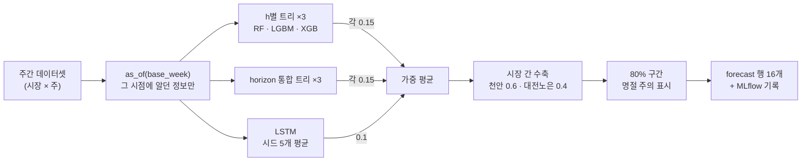

# 가격 예측 (ML)

사과 4개 도매시장의 주평균 가격을 4주 앞까지 예측한다 (REQ-PRD-001~005). 코드는 [`ml/`](../ml)에 있다.

| 항목 | 내용 |
|---|---|
| 예측 대상 | 대전오정·대전노은·천안·청주 도매시장, 사과(전 품종·전 등급) 주평균 kg당 가격 |
| 예측 시점 | 매주 월요일 아침. 지난주(월~일)까지의 정보만 쓴다 |
| 예측 범위 | 이번 주(h1)·다음 주(h2)·2주 후(h3)·3주 후(h4) → 시장 4 × h 4 = **16행** |
| 모델 (v3) | 트리(RF·LightGBM·XGBoost의 h별 모델 + horizon 통합 모델) 평균 0.9 + LSTM 0.1, 시장 간 수축 후처리 |
| 성능 (테스트 2025-01 ~ 2026-10) | **NMAE 0.098**, MAE 494원/kg, 방향 정확도 0.70. 기준선(직전값 0.143)보다 31% 정확 |
| 출처 | 실험 저장소 `ml_kimkihyun_yangjeongho` (이 레포에는 커밋하지 않음). `ml/`은 그 결과를 운영용으로 옮긴 것이다 |

> `ml/`로 옮긴 코드는 Windows 로컬에서 실험 저장소의 테스트 결과(NMAE 0.0984, MAE 493.85)와 2026-10-19 예측 16행을 **똑같이 재현**한다 (`python -m farmit_ml.evaluate`로 확인). Linux(Docker)에서는 XGBoost·LSTM의 수치 연산이 조금 달라 NMAE 0.0982가 나온다 ([5장](#5-사용법) 참고).

## 목차
1. [진행한 방식과 결과](#1-진행한-방식과-결과)
2. [코드 구조와 흐름](#2-코드-구조와-흐름)
3. [입력 데이터](#3-입력-데이터)
4. [출력 (forecast 테이블)](#4-출력-forecast-테이블)
5. [사용법](#5-사용법)
6. [확장 방법](#6-확장-방법)
7. [아직 안 된 것](#7-아직-안-된-것)

---

## 1. 진행한 방식과 결과

### 1.1 문제 정의와 평가 기준

| 컬럼 | 예시 | 의미 |
|---|---|---|
| `week` | 2026-10-12 (월) | 정보가 끝나는 주: 10/12(월) ~ 10/18(일) |
| `pred_date` | 2026-10-19 (월) 아침 | 예측하는 시점 = forecast 테이블의 `base_week` |
| `target_h1` ~ `target_h4` | 10/19 주 ~ 11/9 주 평균가 | 이번 주 ~ 3주 후 |

| 지표 | 정의 | 역할 |
|---|---|---|
| **NMAE (주 지표)** | Σ\|y − ŷ\| / Σy | 모델 선택·튜닝·비교. 가격 수준이 다른 연도·시장을 같은 척도로 본다 |
| MAE | 원/kg | 실제 금액 감각 |
| 방향 정확도 | 예측과 실제가 지난주 대비 같은 방향인 비율 | 오를지 내릴지 |

- 모든 모델은 NMAE에 맞춰 **L1(MAE) 계열 손실**로 학습한다.
- 기준선: **B1 직전값**(지난주 가격 그대로), **B2 4주 이동평균**. 둘 중 나은 쪽이 넘어야 할 선이다.

**분할 (시간순으로만)**

| 구간 | 기간 | 용도 |
|---|---|---|
| 학습 | 2018-01 ~ 2023 | 학습, 하이퍼파라미터 튜닝(2021·2022·2023 확장 윈도우 교차검증) |
| 검증 | 2024 | 모델 비교. 최종 모델은 2021~2024 OOF 평균으로 고른다 |
| 테스트 | 2025-01 ~ 2026-10 | **최종 평가 한 번만** |

### 1.2 데이터
- 공공 API 9종(aT 정산, ASOS, 농업기상, NCPMS 예찰, 특일, KAMIS, ECOS, KOSIS, 관세청)과 할당관세 공식 자료로 만든 (시장, 주) 단위 표. 2018-01 ~ 2026-10, **1,836행 × 160열**.
- 날씨·예찰은 4개 시장과 가락에 들어온 물량의 누적 80%를 차지하는 주산지 22개 시군의 물량 가중 평균이다.
- **누수 방지:** 모든 피처는 예측 시점에 실제로 알 수 있었던 값만 쓴다. 월별 지표는 공표 시차를 둔다(CPI M+1월 21일, PPI M+2월 21일, 생산량은 전년도 값 등). 데이터를 만들 때 자동 누수 검사 4종을 돌리고, 하나라도 실패하면 저장하지 않는다.

### 1.3 EDA에서 정한 것

| 발견 | 모델링에 반영 |
|---|---|
| 가격 수준이 해마다 크게 바뀐다 (연평균 2018년 2,240원 → 2024년 5,290원) | 가격 대신 **로그변화율** log(타깃 / 지난주 가격)을 예측 |
| 평균회귀 (주간 변화 2주 시차 자기상관 −0.22) | 가격 피처를 지난주 가격 대비 비율로 **상대화** |
| **명절이 가장 어렵다** (명절 2주 이내 기준선 오차가 평소의 2배 이상) | 명절까지 일수, horizon별 타깃 주 명절 포함 여부 피처 |
| 천안은 거래가 적고 변동이 크다 | 시장별 성능을 따로 보고 후처리로 보정 |

### 1.4 전처리·특징 선택
LightGBM으로 교차검증(2021~2023) NMAE를 비교했다. 피처를 빼는 쪽은 0.0005 넘게 나빠지지 않으면 채택했다.

| 실험 | 교차검증 NMAE | 결정 |
|---|---|---|
| 타깃: 가격 그대로 → 로그변화율 | 0.179 → 0.131 | 로그변화율 |
| 가격 피처 상대화 | 0.131 → 0.124 | 상대화 |
| 날씨: ASOS·농업기상 둘 다 / ASOS만 | 0.124 / 0.123 | ASOS만 |
| 묶음 후진 제거 (물가 → 무역 → 소매가 → 예찰) | 0.123 → 0.111 | **트리: 가격·달력·생산량·날씨 77개** |
| (참고) 달력 묶음 제거 | 0.111 → 0.125 | 명절 피처가 가장 중요 |

- LSTM은 가격·달력·날씨 71개 피처를 쓴다. 결측은 중앙값으로 채우고 결측 표시 컬럼을 붙이며 ±5σ로 자른다.
- 물가·환율·무역·소매가는 1~4주 예측에 도움이 되지 않았다.

### 1.5 모델·튜닝·선택
- Huber, RandomForest, LightGBM, XGBoost, LSTM을 Optuna(TPE)로 교차검증(2021~2023) NMAE를 목표로 튜닝했다. 데이터가 작아 하이퍼파라미터 한 세트를 4개 horizon에 공통으로 쓴다.
- LSTM은 최근 4주 시퀀스 + 시장 임베딩으로 h1~h4를 한 번에 예측한다. 시드에 따라 흔들려서 5개 시드 예측을 평균한다.
- **최종 모델은 테스트를 보기 전에 2021~2024 OOF 평균 NMAE로 골랐다.**

### 1.6 개선 이력

| 단계 | 내용 | 테스트 NMAE |
|---|---|---|
| v1 | 1차 데이터·모델 | 0.119 |
| v2 (05 최종) | 데이터 보강(2018~, 정밀 명절 피처), 트리 평균 0.8 + LSTM 0.2 | 0.102 |
| + 후처리 | 천안·대전노은 예측을 다른 시장 예측 쪽으로 당김 (시장 간 수축) | 0.101 |
| **v3** | **horizon 통합 모델**을 h별 모델과 반씩 섞음, 트리 0.9 + LSTM 0.1, 후처리 다시 고름 | **0.098** |

- **horizon 통합 모델:** h1~h4를 모델 하나로 학습하고 예측 대상 주의 명절 위치와 horizon을 피처로 준다. 같은 명절을 네 시점에서 보므로 명절 학습 사례가 4배가 된다. 명절 근처 h4 오차가 0.151 → 0.139로 줄었다.
- **시장 간 수축 후처리:** 시장 예측을 (1 − w) × 자기 예측 + w × (다른 세 시장 예측 평균 × 최근 26주 가격 비율)로 바꾼다. w는 천안 0.6, 대전노은 0.4, 나머지 0이다. 2021~2024 네 해 모두 개선되는 w 중 평균 개선이 가장 큰 값을 골랐다.
- 시도했지만 채택하지 않은 것: 시장 간 피처(효과 없음), 가락시장 행을 학습에 추가(악화. 병목은 시장 수가 아니라 서로 다른 명절의 수).

### 1.7 최종 결과 (테스트, 한 번 적용)

| 모델 | h1 | h2 | h3 | h4 | 평균 | 기준선 대비 |
|---|---|---|---|---|---|---|
| B1 직전값 | 0.102 | 0.141 | 0.162 | 0.170 | 0.143 | |
| B2 4주 이동평균 | 0.127 | 0.147 | 0.156 | 0.164 | 0.148 | |
| LightGBM (단일) | 0.082 | 0.100 | 0.113 | 0.116 | 0.103 | 28.1% |
| LSTM (단일) | 0.089 | 0.112 | 0.134 | 0.146 | 0.120 | 16.3% |
| **v3 최종 + 후처리** | **0.079** | **0.098** | **0.106** | **0.111** | **0.098** | **31.3%** |

- 4주 블록 부트스트랩(5,000회)으로 v2 → v3 개선의 95% 구간은 [−0.0046, −0.0006]으로, 0을 포함하지 않는다.
- **80% 예측 구간**은 v3 테스트 상대잔차의 10~90% 분위수다. 3주 후는 예측값의 약 −16% ~ +21%다.

### 1.8 한계 (서비스에서 안내할 것)

| 한계 | 원인 | 서비스 대응 |
|---|---|---|
| 명절 급등의 **크기**를 낮게 예측한다 (2025 설 직전 35% 오차) | L1 손실은 중앙값을 맞추는 쪽이라 극단값을 낮게 본다. 명절 사례가 설·추석 각 7번뿐이다 | 대상 주가 명절 3주 이내면 주의 문구 (REQ-PRD-003, 출력의 `near_holiday`) |
| 방향은 비교적 잘 맞지만 금액 오차 폭이 크다 | 3주 후 80% 구간이 −16% ~ +21% | 예측값과 함께 구간을 보여 준다 (REQ-PRD-002) |
| 테스트 개선에 낙관적 편향이 있을 수 있다 | 개선 아이디어를 v1 테스트 오류에서 얻었다 | 2026-11 이후 예측을 실제 가격과 비교해 다시 검증한다 (REQ-PRD-005) |
| 사과·4개 시장·전 등급 평균에만 맞춰져 있다 | | 다른 품목은 REQ-PRD-006에서 같은 틀로 넓힌다 |

---

## 2. 코드 구조와 흐름

```
ml/
├── config/                  모델 구성. 코드를 고치지 않고 여기서 바꾼다
│   ├── model.json           버전(v3), 품목·시장 코드, horizon, LSTM 시드 수, 80% 구간 분위수
│   ├── preprocess.json      타깃 변환(logratio), 트리 피처 77개, LSTM 피처 71개, 전처리 옵션
│   ├── best_params.json     h별 트리 모델 하이퍼파라미터
│   ├── stack_params.json    horizon 통합 트리 모델 하이퍼파라미터
│   ├── lstm_params.json     LSTM 하이퍼파라미터
│   ├── final_choice.json    앙상블 가중치 (구성 모델 이름 → 비중)
│   └── postprocess.json     시장 간 수축 시장별 w, 비율 계산 주 수
├── farmit_ml/
│   ├── settings.py          경로·상수, config 묶음(Bundle) 로드
│   ├── data.py              데이터 로드·컬럼 검사·분할·교차검증 fold·as_of(그 시점 정보만 남기기)
│   ├── metrics.py           NMAE·MAE·RMSE·방향 정확도, 기준선
│   ├── preprocess.py        Preprocessor(상대화·결측·스케일), 타깃 변환
│   ├── models.py            트리 모델: h별 모델, horizon 통합 모델
│   ├── lstm.py              LSTM (torch는 쓸 때만 불러옴)
│   ├── ensemble.py          구성 모델 등록(COMPONENTS), 가중 평균, 후처리, 80% 구간
│   ├── postprocess.py       시장 간 수축
│   ├── tracking.py          MLflow 기록
│   ├── forecast.py          [실행] 주간 예측 → forecast 행 16개
│   └── evaluate.py          [실행] 테스트 평가 (재현·비교용)
├── tests/                   가짜 데이터로 출력 형식·누수 없음 확인
├── notebooks/               실험용
├── data/                    입력 데이터셋 (커밋 안 함)
├── outputs/                 예측·평가 결과 CSV (커밋 안 함)
├── mlruns/                  MLflow 저장소 (커밋 안 함)
├── requirements.txt         운영용 (Docker 이미지)
├── requirements-dev.txt     실험용 (+ optuna, matplotlib, jupyter)
└── Dockerfile
```



- 매주 **처음부터 다시 학습**한다. 그 시점까지 정답이 있는 모든 행을 쓴다. 학습 파일(pkl)을 저장해 두고 불러 쓰는 방식이 아니다. 전체 실행은 1분 안팎이다.
- `as_of()`는 `base_week` 이후 행을 빼고 아직 끝나지 않은 주의 타깃을 지운다. 그래서 지난 주차를 다시 예측(백필)해도 미래 정보가 섞이지 않는다. 테스트 `test_backfill_ignores_future_rows`가 이것을 확인한다.

---

## 3. 입력 데이터

`ml/data/apple_weekly.csv`가 기본 경로다 (`--data` 또는 환경 변수 `FARMIT_ML_DATA`로 바꿀 수 있다). 시장 × 주 한 행이며, 아래 컬럼이 반드시 있어야 한다. 빠지면 `check_columns()`가 빠진 컬럼 이름을 알려 준다.

| 컬럼 | 의미 |
|---|---|
| `market_cd`, `market_nm` | 시장 코드(`market.id`와 같음: 250001 등), 이름 |
| `week` | 정보가 끝나는 주의 월요일 |
| `pred_date` | 예측 시점 = `week` + 7일 |
| `price_kg`, `price_ma4` | 그 주 kg당 가격, 4주 이동평균 (기준선·타깃 변환에 사용) |
| `target_h1~4`, `target_week_h1~4` | h주 뒤 가격과 그 주 월요일 (최근 주는 비어 있음) |
| `hol_offset_h1~4`, `hol_in_target_h1~4` | 타깃 주와 명절 사이 일수, 타깃 주에 명절 포함 여부 |
| `config/preprocess.json`의 피처 | 트리 77개 + LSTM 71개 (겹침 포함) |

- **지금은 실험 저장소의 `scripts/run_all.py`(수집) → `build_dataset.py`(통합·누수 검사)로 만든 파일을 복사해서 쓴다.** 운영에서 이 데이터셋을 누가 어떻게 만들지는 [7장](#7-아직-안-된-것)을 본다.
- 컬럼별 정의·출처·사용 가능 시점은 실험 저장소의 `data/processed/data_dictionary.md`에 있다.

---

## 4. 출력 (forecast 테이블)

`python -m farmit_ml.forecast`는 `ml/outputs/forecast_<base_week>.csv`를 만든다. 컬럼은 [ERD의 `forecast` 테이블](erd.md)에 맞췄다.

| 출력 컬럼 | forecast 테이블 | 비고 |
|---|---|---|
| `item_code` | `item_id` | aT 품목 코드(사과 `0601`). 적재할 때 `item`에서 id로 바꾼다 |
| `market_cd` | `market_id` | 그대로 |
| `market_nm` | - | 확인용 |
| `base_week` | `base_week` | 예측 기준 월요일 |
| `horizon` | `horizon` | 1~4 |
| `target_week` | `target_week` | h1 = `base_week`, h4 = 3주 뒤 월요일 |
| `pred_price`, `lower80`, `upper80` | 같음 | 원/kg |
| `last_week_price` | 같음 | 지난주 실제 가격 |
| `near_holiday` | - (**테이블에 없음**) | 대상 주가 명절 3주(21일) 이내. REQ-PRD-003 주의 문구용. 테이블에 컬럼을 추가할지, 백엔드가 달력으로 계산할지 정해야 한다 |
| `model_version` | `model_version` | `v3-<MLflow run_id 앞 8자리>`. MLflow에서 그 실행의 설정·데이터 해시·git 커밋을 찾을 수 있다 (REQ-PRD-004) |
| `created_at` | `created_at` | |

---

## 5. 사용법

명령은 모두 **`ml/` 폴더에서** 실행한다.

### 설치 (처음 한 번)
```bash
python -m venv .venv
source .venv/Scripts/activate      # Windows Git Bash. macOS·Linux는 .venv/bin/activate
pip install torch==2.14.1 --index-url https://download.pytorch.org/whl/cpu   # CPU 버전 먼저
pip install -r requirements.txt
# 노트북·튜닝까지 하려면: pip install -r requirements-dev.txt
```
데이터셋을 `ml/data/apple_weekly.csv`에 둔다.

### 주간 예측
```bash
python -m farmit_ml.forecast                          # 데이터의 마지막 주 기준
python -m farmit_ml.forecast --base-week 2026-10-19   # 지난 주차 다시 예측 (백필)
python -m farmit_ml.forecast --skip LSTM              # torch 없이 (나머지 가중치로 다시 나눔, 버전에 -noLSTM 표시)
python -m farmit_ml.forecast --no-mlflow              # MLflow 기록 없이 (빠른 확인용)
```

### 테스트 평가 (재현·비교)
```bash
python -m farmit_ml.evaluate      # 구성 모델별·앙상블 테스트 NMAE 표 → outputs/test_results.csv
```
지금 설정이면 마지막 줄 `v3 앙상블 + 후처리`의 nmae가 Windows에서는 **0.0984**(실험 저장소와 같음), Linux·Docker에서는 **0.0982**다.
- 차이는 운영체제별 XGBoost·LSTM 부동소수점 연산 차이다. 같은 OS·같은 스레드 수에서는 매번 같은 값이 나온다.
- 설정을 바꿔 비교할 때는 같은 환경에서 돌린 값끼리 비교한다.

### 단위 테스트
```bash
python -m pytest -q               # 가짜 데이터, 10초 안팎. 실제 데이터 필요 없음
```

### MLflow 보기
```bash
mlflow ui --backend-store-uri sqlite:///mlruns/mlflow.db   # http://localhost:5000
```
실행마다 `stage`(forecast·evaluate), `model_version`, `data_hash`, `git_commit` 태그와 설정 전체가 남는다.

### Docker로 실행
```bash
# 레포 루트에서
docker build -t farmit-ml ml
docker run --rm -v "$PWD/ml/data:/app/data" -v "$PWD/ml/outputs:/app/outputs" -v "$PWD/ml/mlruns:/app/mlruns" farmit-ml
docker run --rm -v "$PWD/ml/data:/app/data" -v "$PWD/ml/outputs:/app/outputs" farmit-ml farmit_ml.evaluate --no-mlflow
```
- 기본 명령은 `farmit_ml.forecast`다. 뒤에 다른 모듈 이름과 옵션을 붙여 바꾼다.
- 이미지는 약 2.6GB다(대부분 torch CPU 약 770MB와 과학 계산 패키지). GPU 라이브러리는 받지 않는다: torch는 CPU 인덱스, XGBoost는 같은 버전의 `xgboost-cpu`를 쓴다.
- Git Bash에서는 `-v` 경로가 바뀌어 실패할 수 있다. 앞에 `MSYS_NO_PATHCONV=1`을 붙인다.

### 환경 변수

| 변수 | 기본값 | 용도 |
|---|---|---|
| `FARMIT_ML_DATA` | `ml/data/apple_weekly.csv` | 입력 데이터셋 |
| `FARMIT_ML_CONFIG` | `ml/config` | 설정 폴더 (실험용 설정 비교) |
| `FARMIT_ML_OUTPUT` | `ml/outputs` | 결과 CSV 폴더 |
| `FARMIT_ML_THREADS` | `8` | 학습 스레드 수. **XGBoost·LSTM은 스레드 수가 바뀌면 결과가 조금 달라진다** (8이 실험 저장소와 같은 값) |
| `MLFLOW_TRACKING_URI` | `sqlite:///ml/mlruns/mlflow.db` | MLflow 서버를 띄우면 그 주소로 |

---

## 6. 확장 방법

### 평가 규칙 (바꿀 때 지킬 것)
1. 하이퍼파라미터·피처는 **2021~2023 교차검증**으로 정한다 (`data.cv_folds`, `models.cv_eval`).
2. 최종 모델·앙상블·후처리 비중은 **2021~2024 OOF 평균 NMAE**로 고른다 (`data.SELECT_YEARS`).
3. **테스트(2025-01~)는 고른 뒤 한 번만 본다.** `evaluate`를 여러 번 돌려 가며 설정을 고르면 테스트가 검증 데이터가 되어 버린다.
4. 바꾼 설정은 `model.json`의 `version`을 올리고(v4 등), 실험 결과를 이 문서 1.6에 한 줄 추가한다.

### 설정만 바꾸기 (코드 수정 없음)

| 하고 싶은 것 | 고칠 곳 |
|---|---|
| 앙상블 비중 변경, 모델 빼기 | `final_choice.json`의 `weights` (합이 1이어야 함, 0이면 학습하지 않음) |
| 하이퍼파라미터 | `best_params.json`, `stack_params.json`, `lstm_params.json` |
| 피처 추가·제거 | `preprocess.json`의 `tree.features`, `linear.features` (데이터셋에 그 컬럼이 있어야 함) |
| 후처리 끄기·비중 변경 | `postprocess.json`의 `weights` (모두 0이면 후처리 없음) |
| 80% 구간 다시 계산 | `model.json`의 `interval.quantiles` |

기존 설정을 그대로 두고 비교하려면 폴더를 복사해 가리킨다.
```bash
cp -r config config_exp
# config_exp/*.json 수정
FARMIT_ML_CONFIG=config_exp python -m farmit_ml.forecast --no-mlflow
```

### 새 모델 추가
`ensemble.py`의 `COMPONENTS`에 이름과 예측 함수를 등록하고, `final_choice.json`에 같은 이름으로 비중을 준다. 예측 함수는 `(bundle, df_all, trn, tst)`를 받아 **`(len(tst), 4)` 가격(원/kg) 배열**을 돌려주면 된다. 예측하지 못한 행은 NaN으로 두면 그 행만 나머지 모델 비중으로 다시 나눈다.

```python
# ensemble.py
def _catboost(b, df_all, trn, tst):
    return models.predict_per_h("catboost", b.tree_features, trn, tst, b.target_mode,
                                b.best_params["catboost"], b.tree_prep)

COMPONENTS["CatBoost"] = _catboost
# models.make_model()에 "catboost" 분기, best_params.json에 "catboost" 추가
```

### 후처리 추가
`postprocess.py`에 넓은 표(`week, market_cd, p1..p4`)를 받아 같은 모양으로 돌려주는 함수를 만들고 `ensemble.predict()`의 후처리 단계에서 부른다. 비율이나 통계를 계산할 때는 **예측 시점까지의 실제 가격만** 쓴다.

### 노트북 실험
`notebooks/`에서 `farmit_ml`을 불러 쓴다. 같은 함수로 실험해야 운영 코드와 결과가 어긋나지 않는다.
```python
import sys; sys.path.insert(0, "..")
from farmit_ml import data, models, metrics
from farmit_ml.settings import load_bundle
b = load_bundle(); df = data.load_data()
dev = df[df["target_week_h4"] <= "2024-12-31"]
models.cv_eval(dev, b.tree_features, "lgbm", params=b.best_params["lgbm"], prep_kw=b.tree_prep)
```

---

## 7. 아직 안 된 것

| 할 일 | 내용 | 관련 |
|---|---|---|
| **입력 데이터셋 만들기** | 지금은 실험 저장소에서 만든 CSV를 복사해 쓴다. 매주 갱신하려면 `build_dataset.py`의 통합·누수 검사를 `batch/`(Airflow·Spark)로 옮기고, 원천은 수집기가 MySQL에 쌓은 데이터를 쓰도록 바꿔야 한다 | REQ-COL-003 |
| **DB 적재** | `outputs/forecast_*.csv` → `forecast` 테이블. `item_code` → `item_id` 변환, UK(item, market, base_week, horizon) 중복 처리 | REQ-PRD-001, 005 |
| **매주 자동 실행** | Airflow DAG: 월요일 아침 데이터 갱신 → `farmit_ml.forecast`(Docker) → 적재 | erd.md "4주차 자동화" |
| `near_holiday` 저장 위치 | forecast 테이블 컬럼 추가 또는 백엔드 계산 중 선택 | REQ-PRD-003 |
| compose 연결 | `infra/docker-compose.yml`에 ml 서비스·MLflow 서버 추가 (Airflow를 붙일 때) | REQ-PRD-004 |
| 재검증 | 2026-11 이후 실제 가격으로 성능 다시 확인 | REQ-PRD-005 |
| 전 품목 확대 | `item.is_forecast` 품목마다 같은 틀로 학습. 품목별 데이터셋·설정 폴더 구조가 필요 | REQ-PRD-006 |
| 데이터 구성 선택지 | 대표 등급, 품종, 공표 시차, 천안 처리 등 정답이 하나가 아닌 선택. 기준과 대안은 실험 저장소 `docs/data_decisions.md` | |
