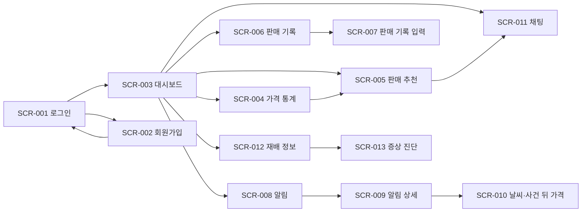

# 팜잇(FarmIt) 화면 목록

| 항목 | 내용 |
|---|---|
| 버전 | 0.2 |
| 작성일 | 2026-10-31 |
| 수정일 | 2026-11-19 품목·시장 선택 상자에 검색·★(관심 품목, 관심 시장) 추가 · 2026-11-19 공통 메뉴 이름 변경(시세→가격 통계, 판매→판매 추천, 농사→재배 정보, AI 상담→AI 챗봇) · 2026-11-19 SCR-003·012에 이번 주 농사 정보 추가(REQ-RAG-008) · 2026-11-19 SCR-003 맨 위에 오늘의 한 줄 브리핑 추가(REQ-HOM-001) · 2026-11-19 비회원 첫 화면을 공개 홈으로(SCR-003 전체 접근, "지금 팔면" 체험) · 2026-11-18 공통 메뉴를 5개로 묶음, 지금 보는 품목 공통 규칙 |

- 화면 ID는 `SCR-번호`. 지워도 번호를 재사용하지 않는다.
- **접근:** 전체 = 비회원도 가능 / 회원 = 로그인 필요
- **필요한 API**는 주소만 적었다. 요청·응답은 `docs/api.md`에서 정한다.
- 관련 REQ는 `docs/requirements.md`의 요구사항 ID다.

---

## 1. 화면 흐름

**공통 메뉴 (모든 화면 상단)** — 2026-11-18 사용자가 하려는 일 기준 5개로 묶음 (설정: `frontend/src/constants/navigation.js`)

| 메뉴 | 사용자가 묻는 것 | 하위 탭 (메뉴 아래에 보임) |
|---|---|---|
| 홈 | 오늘 뭘 봐야 하지? | SCR-003 대시보드 |
| 가격 통계 | 지금 얼마에 팔리나? | SCR-004 가격 통계 · SCR-010 날씨·사건 뒤 가격(과거 사례) |
| 판매 추천 | 언제, 어디에 팔까? | SCR-005 판매 추천 · SCR-006 판매 기록 |
| 재배 정보 | 이번 달 뭘 해야 하지? 병이 생겼다 | SCR-012 재배 정보 · SCR-013 증상 진단 |
| AI 챗봇 | 그냥 물어보고 싶다 | SCR-011 채팅 |

- 회원 전용 화면의 탭·메뉴는 로그인했을 때만 보인다(REQ-USR-002). 비회원에게는 홈·가격 통계·재배 정보만 보인다.
- 오른쪽: 검색(SCR-014), 알림 아이콘(읽지 않은 수), 내 정보(SCR-015). 로그아웃은 PC 헤더와 내 정보 화면에 있다.
- 모바일(768px 미만): 5개 메뉴를 화면 아래 탭 바로 보여 준다(햄버거 메뉴 없음). 위쪽에는 로고와 검색·알림·내 정보 아이콘만 둔다.
- 하단: 이용약관 · 개인정보처리방침 · 데이터 출처(SCR-016)

**지금 보는 품목 (모든 품목 선택 화면 공통)**
- 가격 통계·판매 추천·재배 정보·증상 진단·과거 사례는 같은 품목을 이어서 보여 준다. 한 화면에서 품목을 바꾸면 다른 화면으로 옮겨도 그 품목이 유지된다.
- 처음 품목은 주소의 `?item_id=` → 다른 화면에서 고른 품목 → 첫 관심 품목 → 가격 예측 대상 품목 → 첫 품목 순으로 정한다.

**품목·시장 선택 상자 (모든 품목·시장 선택 화면 공통)**
- 품목이 많아(분류별 수십 개) 목록에서 고르기 어렵다. 선택 상자를 누르면 검색 칸과 목록이 열리고, 품목 이름이나 분류 이름의 일부만 넣어도 걸러진다. 화살표 키로 옮기고 Enter로 고른다.
- 목록 맨 위에 관심 품목을 보여 주고, 그 아래에 분류별 품목을 보여 준다.
- 회원은 목록의 ★로 관심 품목에 넣거나 뺀다(`PATCH /api/users/me`의 `interest_item_ids`, 최대 5개). 내 정보(SCR-015)의 관심 품목과 같은 값이라 홈 화면·알림 기준도 같이 바뀐다. 비회원에게는 ★를 보여 주지 않는다.
- 쓰는 곳: 가격 통계·판매 추천·판매 기록 입력·재배 정보·증상 진단·날씨·사건 뒤 가격·비회원 공개 홈. AI 챗봇(관심 품목 중에서만 고름)은 제외.
- 시장 선택(가격 통계·판매 기록 입력)도 같은 상자를 쓴다. 시도별로 묶어 보여 주고, 시장 이름이나 시도 이름의 일부로 찾는다. 회원은 ★로 관심 시장에 넣거나 빼고(`interest_market_ids`, 최대 5개), 관심 시장은 목록 맨 위에 보여 준다. 관심 시장은 목록 순서만 바꾸고 처음 고르는 시장·알림에는 쓰지 않는다. 판매 추천의 차트 시장(예측이 있는 몇 곳)은 기존 선택 상자 그대로.

**비회원 첫 화면**
- 비회원이 첫 주소(`/`)로 오면 소개 화면 대신 **공개 홈**(SCR-003을 비회원용으로 보여 줌)을 본다. 실제 데이터(오늘 경매가·이번 주 예측·이번 달 할 일·날씨·사건 뒤 가격)와 "지금 팔면" 체험을 가입 없이 쓴다. 로고도 공개 홈으로 간다.
- 비회원은 관심 품목이 없으므로 위 "지금 보는 품목" 순서(다른 화면에서 고른 품목 → 가격 예측 대상 품목 → 첫 품목)로 품목을 정하고, 머리말에서 바꿀 수 있다.
- 소개 화면(SCR-018, `/welcome`)은 공개 홈의 "서비스 소개" 링크로 간다.

**화면 용어** — 2026-11-18 처음 농사짓는 사용자가 읽기 쉽게 정리
- 화면에는 쉬운 말을 쓰고, 남겨 둘 용어는 옆에 ⓘ 설명을 단다. 설명 문장은 `frontend/src/constants/glossary.js` 한 곳에 둔다.
- 바꾼 말: 특수 상황 → 날씨·사건, 80% 구간 → 예상 범위, 정산 확정 → 확정 가격, 예찰 증가 → 병해충 증가, 내 평균 수취율 → 시장 평균 대비 내가 받은 가격, 기준 주 → ○○ 주 예측.
- ⓘ 설명을 다는 용어: 예상 범위, 확정 가격, 평년, 날씨·사건, 실수령액, 시장 평균 대비 받은 가격.
- API·DB의 코드값과 이름(`event_type`, `event_name` 등)은 그대로 둔다. 화면이 코드값으로 이름을 정한다.

---

## 2. 화면 목록

### 회원

| 화면 ID | 화면명 | 접근 | 보여 줄 정보 | 사용자 동작 | 필요한 API | 관련 REQ |
|---|---|---|---|---|---|---|
| SCR-001 | 로그인 | 전체 | 아이디·비밀번호 입력 칸, 오류 안내 | 로그인, 회원가입으로 이동 | `POST /api/auth/login` | REQ-USR-002 |
| SCR-002 | 회원가입 | 전체 | 아이디·비밀번호·비밀번호 확인, 위치(시·군), 관심 품목, 약관 동의 | 아이디 중복 확인, 가입 | `POST /api/auth/signup`, `GET /api/items` | REQ-USR-001, 003, REQ-NFR-006 |
| SCR-015 | 내 정보 | 회원 | 위치, 관심 품목, 기본 운송비 단가·보관비·감모율, 오늘 남은 채팅 횟수 | 수정·저장, 로그아웃, 회원 탈퇴 | `GET·PATCH /api/users/me`, `POST /api/auth/logout`, `DELETE /api/users/me` | REQ-USR-002~004, REQ-NFR-008 |

### 메인

| 화면 ID | 화면명 | 접근 | 보여 줄 정보 | 사용자 동작 | 필요한 API | 관련 REQ |
|---|---|---|---|---|---|---|
| SCR-003 | 대시보드 (비회원에게는 공개 홈) | 전체 | **맨 위 오늘의 한 줄 브리핑(회원·비회원 공통):** 지금 품목 기준으로 시세 변화(기준 시장 서울가락의 주간 확정 평균가가 지난주보다 3% 이상 움직이면 "올랐다/내렸다", 아니면 "비슷하다". 월요일처럼 이번 주 정산이 없으면 "지난주 평균가가 그 전주보다") · 읽지 않은 알림 수(회원, 1건 이상일 때) · 이번 달 새로 시작할(없으면 이어서 할) 작업 수를 한 문장으로. 데이터가 없는 조각은 빼고, 하나도 없으면 안내 문장. **회원:** ① 관심 품목 오늘 경매가(마지막 수집 시각) ② 이번 주 예측 요약(사과) ③ 읽지 않은 알림 3개 ④ 이번 달 할 일 요약, 이번 주 농사 정보(농촌진흥청 주간농사정보 요약에서 내 품목 분야 항목 3개 · 기간 · 출처 · PDF 원문 보기. 요약을 못 읽은 호는 원문 링크만, 수집된 호가 없으면 안내 문장) ⑤ 채팅 입력창. **비회원:** 머리말에서 고른 품목으로 ①②④를 보여 주고, ⑤ 자리에는 가입하면 되는 것(내 품목·지역 기준, 운송비 반영 4주 판매 추천, 알림, AI 상담) 안내와 "서비스 소개"(SCR-018) 링크, ③ 자리에는 "가입하고 알림 받기"를 둔다. 그 아래 "지금 팔면" 체험 카드: 물량 입력(처음 10kg으로 바로 계산) → 시장별 실수령액 상위 5곳·거래 적음·물량 과다 표시, "운송비 미반영" 경고와 "내 위치로 운송비까지 계산" 가입 버튼 | 브리핑 조각을 눌러 가격 통계(SCR-004)·알림 목록(SCR-008)·재배 정보(SCR-012)로 이동, 각 카드에서 해당 화면으로 이동, 채팅 바로 질문(회원). 품목 바꾸기·물량 넣어 계산·회원가입으로 이동(비회원) | `GET /api/prices/realtime`, `GET /api/forecasts`, `GET /api/alerts?unread=true`(회원), `GET /api/farming/monthly`, `GET /api/farming/weekly`, `GET /api/markets`·`GET /api/prices/daily`(unit=week, 브리핑), `GET /api/items`·`POST /api/recommendations/now`(비회원) | REQ-PRC-004, REQ-PRD-001, REQ-ALT-003, REQ-RAG-002, REQ-RAG-008, REQ-USR-002, REQ-REC-007, REQ-HOM-001 |

### 가격·판매

| 화면 ID | 화면명 | 접근 | 보여 줄 정보 | 사용자 동작 | 필요한 API | 관련 REQ |
|---|---|---|---|---|---|---|
| SCR-004 | 가격 통계 | 전체 | 일·주·월 가격 추이 차트(평균·최저·최고, 물량), 전년 같은 시기 비교선, 수집 대상 시장(전국 32곳) 비교 표, 당일 경매가(확정 전 표시), 도·소매 참고가(선택) | 품목·시장(전국 시장, 시도별로 묶음. 처음엔 서울가락)·기간·단위·등급 선택, "이 품목 판매 추천" 이동 | `GET /api/items`, `GET /api/markets?collect=false`, `GET /api/prices/daily`, `GET /api/prices/compare`, `GET /api/prices/realtime`, `GET /api/prices/retail` | REQ-PRC-001~006 |
| SCR-005 | 판매 추천 ("오늘의 판매 판단") | 회원 | 위에서부터: 특수 상황 띠(최근 2주 내 알림, "과거 사례 보기"), 요약 카드 3개(지난주 평균가·전주 대비, 2주 후 예측가·80% 범위, 지난주 거래 물량·전주 대비 — 차트에서 고른 시장 기준), 가격 추이와 4주 예측 차트(최근 12주 실제 주평균가 + 예측 점선 + 80% 범위 띠, 시장 선택. 처음엔 추천 1위 시장), 예측 성적표("지난 예측은 얼마나 맞았나" — 차트에서 고른 시장의 끝난 주 예측과 실제 주평균가. 언제 한 예측인지 탭(그 주 초·1~3주 전), 평균 오차·예상 범위 적중 두 숫자, 주별 표 = 예측가와 범위·실제 평균가·오차·범위 안/밖·명절 표시. 끝난 주가 8주 미만이면 "참고만" 안내, 아직 없으면 안내 문장만), 판매 추천(들어오면 물량 10kg·내 정보 비용으로 바로 계산, 추천 한 줄 = 1위와 이번 주 판매 대비 더 남는 돈, "조건 바꾸기"에 물량·희망 시기·운송비·보관비·감모율, 결과 표 = 시장 × 이번 주~3주 후 예상 수령액 순위·예측값과 80% 구간·휴장·명절 주의, "지금 팔면" 탭 = 전국 시장 최근 7일 가격 기준 실수령액 순위·거래 적음·물량 과다·운송비 미반영 경고, 내 평균 수취율, 수확 시기), 과거 사례 요약(사건 종류별 4주 뒤 평균 변화 vs 평소). 오른쪽(1024px 이하는 아래)에 판매 상담 채팅 패널(지금 품목으로 질문, 추천 질문 버튼은 질문 칸만 채움, 질문 1번 = 하루 한도 1회). 예측 대상이 아닌 품목(`is_forecast` false)은 카드·차트 없이 "지금 팔면"만 + "이 품목은 아직 가격 예측을 제공하지 않습니다" 안내. 비회원은 이 화면에 들어올 수 없고, 공개 홈(SCR-003)의 체험 카드에서 "지금 팔면" 상위 5곳만 본다 | 품목 선택, 차트 시장 선택, 조건 바꿔 다시 계산(0.5초 뒤 자동), 채팅 질문 | `POST /api/recommendations`, `POST /api/recommendations/now`, `GET /api/forecasts`, `GET /api/forecasts/history`, `GET /api/prices/daily`(unit=week), `GET /api/cases`, `GET /api/alerts`, `POST /api/chat/messages` | REQ-REC-001~007, REQ-PRD-001~003, REQ-PRD-005, REQ-HIS-002, REQ-SAL-003, REQ-CHT-001 |
| SCR-006 | 판매 기록 목록 | 회원 | 기록 목록(날짜·시장·품목·등급·물량·받은 금액·평균 대비 %), 기간 합계, 내 판매 성적(기간 전체 한 문장 + 월별 막대 + 시장별 표: 건수·물량·평균 대비 %, 물량 가중). 기간 안 기록이 3건 미만이면 리포트 대신 안내, 정산 전 기록은 "비교 대기 n건" | 기간 필터(목록·합계·리포트에 함께 적용), 기록 추가·수정·삭제로 이동 | `GET /api/sales`, `GET /api/sales/summary` | REQ-SAL-001, 002, 005 |
| SCR-007 | 판매 기록 입력·수정 | 회원 | 입력 폼(날짜·시장·품목·등급·물량·받은 금액), 저장 후 같은 날 평균 가격 비교 결과 | 저장, 삭제, 정산서 사진 올리기(선택) | `POST /api/sales`, `PATCH·DELETE /api/sales/{id}`, `POST /api/sales/ocr` | REQ-SAL-001, 002, 004 |

### 특수 상황

| 화면 ID | 화면명 | 접근 | 보여 줄 정보 | 사용자 동작 | 필요한 API | 관련 REQ |
|---|---|---|---|---|---|---|
| SCR-008 | 알림 목록 | 회원 | 알림 목록(유형: 기상특보·수입량 급증·예찰 증가·정부 발표·목표가격, 지역, 날짜, 읽음 여부) | 유형 필터, 알림 열기, 목표가격 알림 설정(선택) | `GET /api/alerts`, `POST /api/price-alerts` | REQ-ALT-001, 003~007 |
| SCR-009 | 알림 상세 | 회원 | 알림 내용(특보 종류·지역·발표 시각 또는 비교 수치), 대응 체크리스트(사전 대비·사후 조치), 출처 링크, 관련 과거 사례 요약 | 읽음 처리(자동), 과거 사례로 이동, 채팅으로 물어보기 | `GET /api/alerts/{id}`, `PATCH /api/alerts/{id}/read` | REQ-ALT-002, 003 |
| SCR-010 | 날씨·사건 뒤 가격 (과거 사례 리포트) | 전체 | 사건 유형별 과거 사례 목록, 사례별 전후 몇 주 가격 변화 차트, "참고 정보" 문구 | 품목·사건 유형(폭염·호우·한파·수입 급증·병해충 증가) 선택, 시기 선택(지금 시기 = 오늘과 달·일이 앞뒤 4주 안에 시작된 예년 사례만, 기본 · 전체 시기). 지금 시기 평균은 화면에서 다시 계산 | `GET /api/cases` | REQ-HIS-001, 002 |

### 재배·상담

| 화면 ID | 화면명 | 접근 | 보여 줄 정보 | 사용자 동작 | 필요한 API | 관련 REQ |
|---|---|---|---|---|---|---|
| SCR-011 | 채팅 | 회원 | 대화 영역(판단된 역할 표시, 답변, 근거 번호와 출처 목록, 길잡이 원문 링크, 면책 문구), 진행 상태, 이전 대화 목록, 남은 질문 수 | 질문 보내기, 이전 대화 열기, 새 대화 | `POST /api/chat/messages`(스트리밍), `GET /api/chat/sessions`, `GET /api/chat/sessions/{id}` | REQ-CHT-001~008, REQ-RAG-005, 007, REQ-NFR-008 |
| SCR-012 | 재배 정보 | 전체 | 탭 ① 이번 달 할 일(시작·계속·다음 달 작업, 생육 상태, 주의 시기) ② 이번 주 농사 정보(주간농사정보 요약을 분야별로, 내 품목 분야를 맨 앞에. 품목별 자료가 아님. PDF 원문 보기) ③ 연간 작업 일정(월 × 상·중·하순 차트, 현재 시점 선) ④ 품목 요약(주요 병해충 수, 현장기술지원 건수) ⑤ 처음 할 일(선택) | 품목·기준 월 선택, 증상 진단으로 이동 | `GET /api/farming/monthly`, `GET /api/farming/weekly`, `GET /api/farming/calendar`, `GET /api/farming/summary`, `GET /api/farming/guide` | REQ-RAG-002, 003, 004, 006, 008, REQ-REC-006 |
| SCR-013 | 증상 진단 | 회원 | 입력(품목, 증상 설명), 병해충 후보 최대 3개(맞는 증상·구분점·대응 요약·근거·출처) | 진단하기, 후보별 자세히 보기, 채팅으로 이어 묻기 | `POST /api/farming/diagnose` | REQ-RAG-001, REQ-CHT-003, 005 |

### 검색·기타

| 화면 ID | 화면명 | 접근 | 보여 줄 정보 | 사용자 동작 | 필요한 API | 관련 REQ |
|---|---|---|---|---|---|---|
| SCR-014 | 검색 | 전체 | 결과 탭: 품목·시장 / 보도자료(제목·날짜·원문 링크) / 시장 공지(선택) | 검색어 입력, 탭 전환, 결과 클릭 | `GET /api/search`, `GET /api/notices` | REQ-SRC-001~003 |
| SCR-016 | 약관·개인정보·데이터 출처 | 전체 | 이용약관, 개인정보처리방침, 데이터별 출처·이용 조건 | 탭 전환 | (정적 페이지) | REQ-NFR-006, 007 |
| SCR-017 | 오류·안내 | 전체 | 없는 페이지, 로그인 필요(비로그인으로 회원 화면에 들어오면 여기로. 단 첫 주소 `/`는 소개 화면으로), 서버 오류, 채팅 한도 초과 안내 | 대시보드·로그인으로 이동. 로그인 필요 안내만 로그인(보려던 화면으로 돌아옴)·가격 보기 | - | REQ-NFR-008 |
| SCR-018 | 소개 | 전체 | 서비스 한 줄 소개, 예시 화면(예시임을 표시), 주요 기능 4개(시세·판매 추천·날씨·사건 알림·재배와 AI 상담), 시작 순서 3단계, 데이터 출처 안내. 비회원 첫 화면이 아니며 공개 홈(SCR-003)의 "서비스 소개" 링크로 온다 | 회원가입, 가격 먼저 보기(SCR-004), 로그인, 데이터 출처(SCR-016)로 이동. 로그인한 사용자에게는 '대시보드로 가기' | - | REQ-USR-001 |

---

## 3. 관리자 화면

별도로 만들지 않는다.
- 시장·품목 코드 관리: Django 관리 화면(`/admin`)
- 수집 상태 확인: Kibana 대시보드

## 4. 개발 순서 (WBS 기준)

| 주차 | 화면 |
|---|---|
| 1주차 (11/01~11/07) | SCR-001, 002, 004, 017 + 공통 메뉴 |
| 2주차 (11/08~11/14) | SCR-006, 007, 015 |
| 3주차 (11/15~11/21) | SCR-005 |
| 4주차 (11/22~11/30) | SCR-003, 008, 009, 010, 011, 012, 013, 014 |
| 12월 1주 | SCR-016, 선택 기능(정산서 사진·목표가격 알림) |
