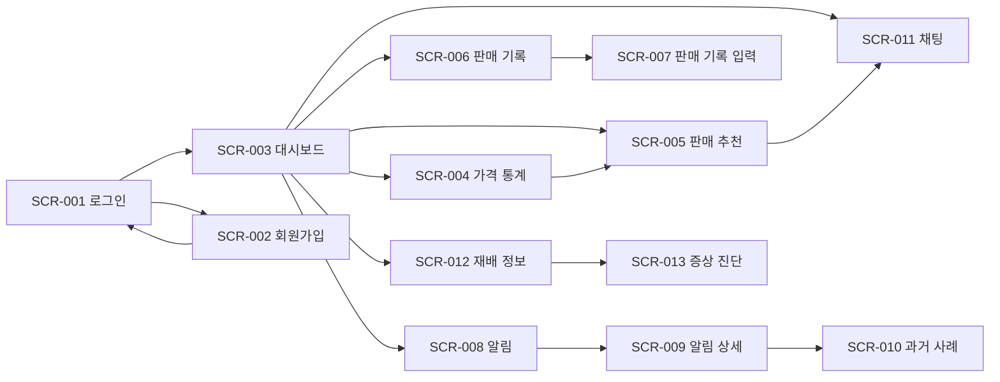

# 팜잇(FarmIt) 화면 목록

| 항목 | 내용 |
|---|---|
| 버전 | 0.1 (초안) |
| 작성일 | 2026-10-31 |

- 화면 ID는 `SCR-번호`. 지워도 번호를 재사용하지 않는다.
- **접근:** 전체 = 비회원도 가능 / 회원 = 로그인 필요
- **필요한 API**는 주소만 적었다. 요청·응답은 `docs/api.md`에서 정한다.
- 관련 REQ는 `docs/requirements.md`의 요구사항 ID다.

---

## 1. 화면 흐름

**공통 메뉴 (모든 화면 상단)**
- 대시보드 · 가격 · 판매 추천 · 판매 기록 · 재배 정보 · 채팅
- 오른쪽: 검색(SCR-014), 알림 아이콘(읽지 않은 수), 내 정보(SCR-015)
- 하단: 이용약관 · 개인정보처리방침 · 데이터 출처(SCR-016)

---

## 2. 화면 목록

### 회원

| 화면 ID | 화면명 | 접근 | 보여 줄 정보 | 사용자 동작 | 필요한 API | 관련 REQ |
|---|---|---|---|---|---|---|
| SCR-001 | 로그인 | 전체 | 아이디·비밀번호 입력 칸, 오류 안내 | 로그인, 회원가입으로 이동 | `POST /api/auth/login` | REQ-USR-002 |
| SCR-002 | 회원가입 | 전체 | 아이디·비밀번호·비밀번호 확인, 위치(시·군), 관심 품목, 약관 동의 | 아이디 중복 확인, 가입 | `POST /api/auth/signup`, `GET /api/items` | REQ-USR-001, 003, REQ-NFR-006 |
| SCR-015 | 내 정보 | 회원 | 위치, 관심 품목, 기본 운송비 단가·보관비·감모율, 오늘 남은 채팅 횟수 | 수정·저장, 로그아웃, 회원 탈퇴 | `GET·PATCH /api/users/me`, `POST /api/auth/logout`, `DELETE /api/users/me` | REQ-USR-002~004, REQ-NFR-008 |

### 메인

| 화면 ID | 화면명 | 접근 | 보여 줄 정보 | 사용자 동작 | 필요한 API | 관련 REQ |
|---|---|---|---|---|---|---|
| SCR-003 | 대시보드 | 회원 | ① 관심 품목 오늘 경매가(마지막 수집 시각) ② 이번 주 예측 요약(사과) ③ 읽지 않은 알림 3개 ④ 이번 달 할 일 요약 ⑤ 채팅 입력창 | 각 카드에서 해당 화면으로 이동, 채팅 바로 질문 | `GET /api/prices/realtime`, `GET /api/forecasts`, `GET /api/alerts?unread=true`, `GET /api/farming/monthly` | REQ-PRC-004, REQ-PRD-001, REQ-ALT-003, REQ-RAG-002 |

### 가격·판매

| 화면 ID | 화면명 | 접근 | 보여 줄 정보 | 사용자 동작 | 필요한 API | 관련 REQ |
|---|---|---|---|---|---|---|
| SCR-004 | 가격 통계 | 전체 | 일·주·월 가격 추이 차트(평균·최저·최고, 물량), 전년 같은 시기 비교선, 4개 시장 비교 표, 당일 경매가(확정 전 표시), 도·소매 참고가(선택) | 품목·시장·기간·단위·등급 선택, "이 품목 판매 추천" 이동 | `GET /api/items`, `GET /api/markets`, `GET /api/prices/daily`, `GET /api/prices/compare`, `GET /api/prices/realtime`, `GET /api/prices/retail` | REQ-PRC-001~006 |
| SCR-005 | 판매 추천 | 회원 | 입력 폼(품목·물량·희망 시기·운송비·보관비·감모율), 결과 표(시장 × 이번 주~3주 후, 예상 수령액 순위), 예측값과 80% 구간, 근거(최근 시세·관련 특수 상황), 휴장 표시, 명절 주의 문구, 내 평균 수취율, 수확 시기. 사과 외 품목은 시장 비교만 + "가격 예측은 사과만 제공" 안내 | 계산하기, 비용 값 바꿔 다시 계산, "채팅으로 물어보기" | `POST /api/recommendations`, `GET /api/forecasts` | REQ-REC-001~006, REQ-PRD-002, 003, REQ-SAL-003 |
| SCR-006 | 판매 기록 목록 | 회원 | 기록 목록(날짜·시장·품목·등급·물량·받은 금액·평균 대비 %), 기간 합계 | 기간 필터, 기록 추가·수정·삭제로 이동 | `GET /api/sales` | REQ-SAL-001, 002 |
| SCR-007 | 판매 기록 입력·수정 | 회원 | 입력 폼(날짜·시장·품목·등급·물량·받은 금액), 저장 후 같은 날 평균 가격 비교 결과 | 저장, 삭제, 정산서 사진 올리기(선택) | `POST /api/sales`, `PATCH·DELETE /api/sales/{id}`, `POST /api/sales/ocr` | REQ-SAL-001, 002, 004 |

### 특수 상황

| 화면 ID | 화면명 | 접근 | 보여 줄 정보 | 사용자 동작 | 필요한 API | 관련 REQ |
|---|---|---|---|---|---|---|
| SCR-008 | 알림 목록 | 회원 | 알림 목록(유형: 기상특보·수입량 급증·예찰 증가·정부 발표·목표가격, 지역, 날짜, 읽음 여부) | 유형 필터, 알림 열기, 목표가격 알림 설정(선택) | `GET /api/alerts`, `POST /api/price-alerts` | REQ-ALT-001, 003~007 |
| SCR-009 | 알림 상세 | 회원 | 알림 내용(특보 종류·지역·발표 시각 또는 비교 수치), 대응 체크리스트(사전 대비·사후 조치), 출처 링크, 관련 과거 사례 요약 | 읽음 처리(자동), 과거 사례로 이동, 채팅으로 물어보기 | `GET /api/alerts/{id}`, `PATCH /api/alerts/{id}/read` | REQ-ALT-002, 003 |
| SCR-010 | 과거 사례 리포트 | 전체 | 사건 유형별 과거 사례 목록, 사례별 전후 몇 주 가격 변화 차트, "참고 정보" 문구 | 품목·사건 유형(폭염·호우·한파·수입 급증·예찰 증가) 선택 | `GET /api/cases` | REQ-HIS-001, 002 |

### 재배·상담

| 화면 ID | 화면명 | 접근 | 보여 줄 정보 | 사용자 동작 | 필요한 API | 관련 REQ |
|---|---|---|---|---|---|---|
| SCR-011 | 채팅 | 회원 | 대화 영역(판단된 역할 표시, 답변, 근거 번호와 출처 목록, 길잡이 원문 링크, 면책 문구), 진행 상태, 이전 대화 목록, 남은 질문 수 | 질문 보내기, 이전 대화 열기, 새 대화 | `POST /api/chat/messages`(스트리밍), `GET /api/chat/sessions`, `GET /api/chat/sessions/{id}` | REQ-CHT-001~008, REQ-RAG-005, 007, REQ-NFR-008 |
| SCR-012 | 재배 정보 | 전체 | 탭 ① 이번 달 할 일(시작·계속·다음 달 작업, 생육 상태, 주의 시기) ② 연간 작업 일정(월 × 상·중·하순 차트, 현재 시점 선) ③ 품목 요약(주요 병해충 수, 현장기술지원 건수) ④ 처음 할 일(선택) | 품목·기준 월 선택, 증상 진단으로 이동 | `GET /api/farming/monthly`, `GET /api/farming/calendar`, `GET /api/farming/summary`, `GET /api/farming/guide` | REQ-RAG-002, 003, 004, 006, REQ-REC-006 |
| SCR-013 | 증상 진단 | 회원 | 입력(품목, 증상 설명), 병해충 후보 최대 3개(맞는 증상·구분점·대응 요약·근거·출처) | 진단하기, 후보별 자세히 보기, 채팅으로 이어 묻기 | `POST /api/farming/diagnose` | REQ-RAG-001, REQ-CHT-003, 005 |

### 검색·기타

| 화면 ID | 화면명 | 접근 | 보여 줄 정보 | 사용자 동작 | 필요한 API | 관련 REQ |
|---|---|---|---|---|---|---|
| SCR-014 | 검색 | 전체 | 결과 탭: 품목·시장 / 보도자료(제목·날짜·원문 링크) / 시장 공지(선택) | 검색어 입력, 탭 전환, 결과 클릭 | `GET /api/search`, `GET /api/notices` | REQ-SRC-001~003 |
| SCR-016 | 약관·개인정보·데이터 출처 | 전체 | 이용약관, 개인정보처리방침, 데이터별 출처·이용 조건 | 탭 전환 | (정적 페이지) | REQ-NFR-006, 007 |
| SCR-017 | 오류·안내 | 전체 | 없는 페이지, 로그인 필요, 서버 오류, 채팅 한도 초과 안내 | 대시보드·로그인으로 이동 | - | REQ-NFR-008 |

---

## 3. 관리자 화면

별도로 만들지 않는다.
- 시장·품목 코드 관리: Django 관리 화면(`/admin`)
- 수집 상태 확인: Kibana 대시보드

## 4. 개발 순서 (WBS 기준)

| 주차 | 화면 |
|---|---|
| 1주차 (11/01~11/07) | SCR-001, 002, 004, 017 + 공통 메뉴 |
| 2주차 (11/08~11/14) | SCR-006, 007, 015 |
| 3주차 (11/15~11/21) | SCR-005 |
| 4주차 (11/22~11/30) | SCR-003, 008, 009, 010, 011, 012, 013, 014 |
| 12월 1주 | SCR-016, 선택 기능(정산서 사진·목표가격 알림) |
