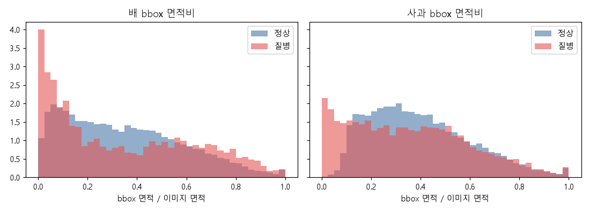
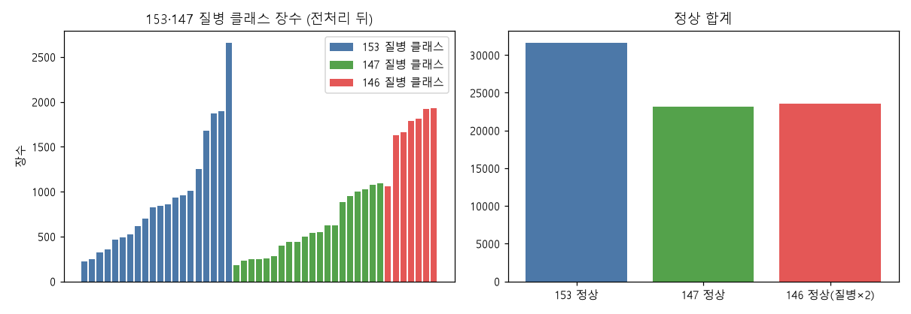

# 사진 진단 — 146 과수화상병 촬영 이미지 (사과·배)

[vision.md](vision.md)의 153 기록, [vision-147.md](vision-147.md)의 147 기록과 **별개**로 146을 진행하는 문서다. 153·147 기록은 고치지 않는다. 결정·규격 출처는 vision.md 1장(결정), 5장(전처리 규격), [vision-preprocess-test.md](vision-preprocess-test.md)이다.

| 항목 | 내용 |
|---|---|
| 상태 (2026-11-19) | **F1~F4 완료, 상한 확정, 원본 삭제 완료.** 전처리 12,993장(`data/processed/146/`) 검증 통과. 질병 이름 확정(4.2). 다음: E5b 합친 학습(별도 세션) |
| 데이터 | AI Hub 146 과수화상병 촬영 이미지, 2작물(사과·배), 질병 코드 7개. 과제 번호 80 |
| 위치 | `ml/vision/data/raw/146/과수화상병 촬영 이미지/{Training,Validation}/` (zip 18개, **112.8 GiB(121 GB)**. 처음 예상 170GB보다 작다) |
| 모델 구성 | 최종 배포 모델은 153·147·146을 합친 하나 (vision.md 1장). 이 세션은 146의 EDA·전략 확인·전처리까지만 했다. 합친 학습은 하지 않았다 |
| 기록 위치 | 이 문서, `docs/vision-146-eda/`, `docs/vision-146-f3/`. 이미지가 든 시트는 `ml/vision/data/review/146/`에만 있다 (docs에는 표·그래프만) |
| 데이터 취급 | AI Hub 데이터는 git·공유에 올리지 않는다. 원본 삭제는 사용자에게 먼저 알리고 한다 |

## 1. 체크리스트

- [x] **F1. 받은 파일 확인** (2026-11-19, 2장. 18개 모두 열림, 라벨 수 = 원천 수·이름 집합 일치, 증강·모델 없음. **사과 질병에 .png 867장**)
- [x] **F2. EDA** (2026-11-19, 4장. 작물 코드 배 1·사과 2, 질병 7개, 질병 JSON `type`=null, bbox EXIF 6 회전 뒤 좌표 176개, 질병 클래스와 부위·지역이 거의 1:1, 질병 이름 미확정, **불균형 분석 4.8**)
- [x] **F3. 전략 확인** (2026-11-19, 5장. bbox crop + 배경 교체 증강이 146에서도 맞음. 상자 모양 단서 있음)
- [x] **F4. 전처리 → 원본 삭제** (2026-11-19, 6장. 12,993장, 검증 통과, 상한 확정, 사용자 동의 후 `data/raw/146` 삭제)
- [x] **E5b. 합친 학습** (2026-11-20, [vision.md 4.5](vision.md#45-합친-학습-e5b-결과-2026-11-20): 146 시험 정확도 0.980·macro F1 0.977, 사과·배가 전체의 13%) — 153+147+146 (별도 세션). 데이터셋별 점수는 manifest `dataset` 열(146)로 나눈다

## 2. F1 받은 파일 확인

방법: zip 중앙 디렉터리만 읽었다 (`ml/vision/experiments/eda_146_f1.py`, 결과 [f1_files.md](vision-146-eda/f1_files.md)). 이미지·JSON은 풀지 않았다. 한글 파일명은 UTF-8 flag가 없어 `cp437 → cp949`로 읽었다. 중앙 디렉터리는 파일 끝에 있어서 중간에 끊긴 zip은 열리지 않는다 (18개 모두 열림). 압축 내용의 CRC까지 검사한 것은 아니다.

| 항목 | 값 |
|---|---|
| 파일 | 18개 (Training 10 = 라벨 4 + 원천 6, Validation 8 = 라벨 4 + 원천 4) |
| 용량 | 112.8 GiB. 원천 정상 Training 사과 (1) 31.2GB·(2) 16.5GB, 배 (1) 31.3GB·(2) 8.9GB |
| 증강본·모델 | 이름에 "증강" 0개, `_a000N` 0개, `model.zip` 없음 |
| 중복 | zip 안 중복 이름 0 |
| 짝 | 8개 조합(Training/Validation × 사과/배 × 정상/질병) 모두 라벨 수 = 원천 수, 파일명 집합 일치 |
| 정상 (1)(2) 분할 | 배 Training 16,530 + 3,904 = 20,434, 사과 20,779 + 7,959 = 28,738. 합치면 라벨과 정확히 일치 |

| 작물 | 구분 | Training | Validation | 합 |
|---|---|---:|---:|---:|
| 배 | 정상 | 20,434 | 2,558 | 22,992 |
| 배 | 질병 | 2,557 | 322 | 2,879 |
| 사과 | 정상 | 28,738 | 3,595 | 32,333 |
| 사과 | 질병 | 8,286 | 1,036 | 9,322 |
| **합계** | 정상 | 49,172 | 6,153 | 55,325 |
| | 질병 | 10,843 | 1,358 | 12,201 |

특이한 점:
- 이미지 확장자가 `.jpg`·`.JPG`이고 **사과 질병에 `.png` 867장**이 있다 (Training 775 + Validation 92). 라벨 JSON 이름은 `<이미지 이름>.json`이라 `x.JPG.json`·`x.png.json` 꼴이다.
- 질병 JSON의 `type`이 **전부 null**이다 (153·147은 1). 정상/질병은 zip 종류로 가른다.
- Training 정상 원천은 모두 10GB를 넘는 것이 받아졌다 (147과 같다, 기록만).

## 3. 진행 기록

최신이 위.

- 2026-11-20 · E5b 완료 (합친 학습) · 146 시험 정확도 **0.980**, macro F1 **0.977** (사과 0.969·배 0.993, 사과_4 과수화상병 0.900이 가장 낮음). 불균형 상한(질병 1,000/클래스·정상 3,000/작물)으로 다른 작물이 묻히지 않았다. 전체 결과 [vision.md 4.5](vision.md#45-합친-학습-e5b-결과-2026-11-20)

- 2026-11-19 · F4 원본 삭제 · 사용자가 상한(질병 1,000/클래스, 정상 3,000/작물)을 그대로 확정하고 원본 삭제를 동의했다. 삭제 직전 `processed/146` 12,993장과 manifest 일치를 재확인하고 `data/raw/146`(112.8 GiB)을 삭제했다. C: 여유 438GB → 551GB. 같은 날 사용자가 AI Hub 질병 이름표를 제공해 7개 이름을 확정했다(manifest `disease_name`·`preprocess_146.py` 반영, 4.2). 규격을 바꾸려면 146을 다시 받아야 한다. **다음:** E5b 합친 학습
- 2026-11-19 · F4 완료 (원본 삭제 대기) · `preprocess_146.py`로 12,993장(질병 6,993 + 정상 6,000, 약 71초). 질병 클래스당 상한 1,000장·작물당 정상 min(질병×2, 3,000)을 적용했다. 검증 통과(manifest = 파일 12,993, 누수 0/64, bbox 범위 0 위반, EXIF 시트 확인). **원본 삭제 여부를 사용자에게 묻는다.** 상한을 바꾸려면 원본이 필요하다 (아직 있음). 6장
- 2026-11-19 · F3 완료 · 사과 6클래스·배 3클래스, 입력 5종×시드 3, 학습 방식 4종×충돌 시험. **결과:** 배경 교체 증강으로 잎을 따름 0.79 → 0.92, 배경 따름 0.095 → 0.025 (153·147과 같은 효과). 전체 이미지(0.944)와 crop(0.947) 차이 없음, 배경만 0.846, **상자 모양만 정상/병 0.82**(147 0.78). **결정:** 153·147 전략 그대로. 5장
- 2026-11-19 · F2 완료 · 라벨 JSON 67,526개 EDA. 153·147과 다른 점: ① 같은 대상ID가 두 병에 걸친 것 0/64 ② Train·Val 대상 겹침 64/64 ③ JSON·파일명 어긋남 약 170행 ④ **질병 클래스가 부위(잎·열매·가지)·지역과 거의 1:1** ⑤ 질병 클래스 장수가 1,055~1,928로 153·147보다 크다. 4장
- 2026-11-19 · F1 완료 · zip 18개(112.8 GiB) 확인. 2장

## 4. F2 EDA 결과 (2026-11-19)

방법: 라벨 zip 8개의 JSON 67,526개를 zip에서 바로 읽었다 (`ml/vision/experiments/eda_146_load.py` → `data/review/146/labels.csv`, `eda_146.py` → 표·그림, `eda_146_sheets.py` → 시트·EXIF 조사. 모두 `.venv/Scripts/python.exe -I -X utf8`로 `ml/vision/`에서 실행). 전체 표 [vision-146-eda/tables.md](vision-146-eda/tables.md), EXIF 조사 [exif_survey.md](vision-146-eda/exif_survey.md). 이미지는 시트·EXIF 조사에 표본 몇백 장만 메모리로 읽었다.

### 4.1 라벨 구조

- 67,526개 모두 같은 키 구조다. `description`: `image, date, worker, height, width, task, type, region` / `annotations`: `disease, crop, area, grow, risk, points`. **153·147과 같은 필드**이고 새 필드는 없다. `worker`는 전부 빈 문자열, `task`는 전부 80, `points`는 **모두 1개**.
- **`type`**: 정상 55,320개는 0, 정상 5개는 1(이상), **질병 12,201개는 전부 null**.
- 파일명 `V006_80_{type}_{disease}_{crop}_{area}_{grow}_{risk}_{대상ID}_{날짜}_{번호}`. 정상 대상ID는 `a01`·`c25` 꼴(영문 1+숫자 2), 질병은 `0093w` 꼴(숫자 4+영문 1)이라 서로 겹치지 않는다 (겹침 0).

| 이상 | 개수 | 내용 | 영향 |
|---|---:|---|---|
| **bbox가 EXIF 회전 뒤 좌표** | 176 (사과 정상 174·사과 질병 2) | EXIF 방향 6이고 JSON 크기는 **회전 전 크기**, bbox는 **회전 뒤** 좌표다. 표본 조사와 시트로 확인 (시트 `data/review/146/exif_check.jpg`: 위 줄 회전 전은 어긋나고 아래 줄 회전 뒤는 맞음). 무작위 600장 중 EXIF 6은 2장뿐이라 대부분의 사진은 영향 없음 | 147과 같다: **먼저 `exif_transpose`, 그다음 JSON bbox 그대로** |
| bbox 이미지 밖 | 1 (배 정상, EXIF 1) | 회전과 무관 | 이미지 안으로 자른다 |
| 작물 코드가 zip과 다름 | 41 | 배 zip에 crop=2 23(질병)·0 5(정상), 사과 zip에 crop=1 8·0 5 | 제외 |
| JSON 질병 코드 ≠ 파일명 | 40 | 배 24(JSON 4·0), 사과 16 | 제외 |
| JSON risk ≠ 파일명 risk | 102 (질병) + 정상 risk 이상 25 | 정상은 JSON type=1 5개, risk>0 13~16개, 파일명 risk가 `c15` 16개 | 제외 |
| 질병인데 risk 0 | 7 | | 제외 |
| 정상 파일명 규칙 밖 | 3,706 (사과 3,439·배 267) | **6자리 날짜 `201202` 꼴 3,195**(JSON date도 비어 있음), 이름이 긴 `V006_..._V006_...` 225, `IMG_` 62, 날짜 뒤 번호 꼴이 다른 것 등. 질병은 2장 | 147처럼 제외 (아래 4.9 결정 5) |
| JSON 질병 부위(area) ≠ 파일명 부위 | 질병 대부분 | 정상은 99.9% 일치. 질병은 JSON area에 8·9·10·11 등 이상한 값이 많고 파일명은 01·03·04·05뿐 | **파일명 부위를 쓴다** |
| `date` 빈 값 | 약 3,200 | 대부분 위 6자리 날짜 정상 | 제외되는 쪽과 겹침 |

### 4.2 코드표

**작물 코드(JSON `crop`)**: **배 = 1, 사과 = 2** (파일명 `01`·`02`). 153(고추 2…)·147(고추 1…)과 다르다. 합칠 때는 `(데이터셋, 작물, 질병)`으로 구분하고, 라벨은 `<작물>_<질병코드>`(`사과_3`, `배_1`)로 만든다. 153·147 라벨과 겹치지 않는다 (사과·배는 두 데이터셋에 없는 작물).

**질병 코드**: 배 1·2, 사과 3·4·5·6·7 (**7개**, 데이터셋 안에서 이어짐). 153·147의 숫자와 겹치지만 뜻이 다르다 (예: 146의 4 = 사과, 153의 4 = 고추).

| 작물 | 질병 코드 | 장수 (Train + Val) | 질병 이름 (AI Hub 표) | 시트에서 본 모습 |
|---|---|---:|---|
| 배 | 1 | 997 + 129 = 1,126 | 배검은별무늬병 | 잎의 검은 반점 |
| 배 | 2 | 1,540 + 189 = 1,729 | 배과수화상병 | 마른 갈색 잎·가지 |
| 사과 | 3 | 1,732 + 198 = 1,930 | 사과갈색무늬병 | 노란 잎 위 갈색 반점 |
| 사과 | 4 | 1,647 + 199 = 1,846 | 사과과수화상병 | 마른 잎·가지 |
| 사과 | 5 | 1,690 + 233 = 1,923 | 사과부란병 | 가지·줄기 껍질의 궤양 |
| 사과 | 6 | 1,598 + 223 = 1,821 | 사과점무늬낙엽병 | 잎의 붉은 점 |
| 사과 | 7 | 1,605 + 181 = 1,786 | 사과탄저병 | 열매의 갈색 부패 |

- **코드표 밖 조합**: 배(1,4) 23장(작물 코드도 2로 틀림)·배(1,0) 1장·사과(2,2) 7장·(2,1) 1장 등 합계 32장. 모두 1~수십 장짜리 잡음이다. 제외.
- **질병 이름은 JSON·파일명에 없다.** 처음엔 미확정이었으나 사용자가 AI Hub 표(작물명·질병명·구축수량)를 제공해 확정했다. 사진에서 본 모습과 모두 맞는다. 표의 구축수량(사과 질병 5종 각 2.1만~2.3만, 배 2.0만 등, 합계 211,555)은 증강본 포함 수치이고 우리 원본 라벨은 12,201장이다. (153의 14·15번 이름은 여전히 미정이라는 점과 무관)
- 부위 코드: 01 열매, 03 잎, **04 가지**, **05 줄기(굵은 주간)** (시트로 확인. 147의 02 꽃은 정상 6장뿐이라 무시).

### 4.3 클래스별 장수

| 작물 | 정상 T / V | 질병 코드: T / V (코드표 안, JSON = 파일명) |
|---|---|---|
| 배 | 20,434 / 2,558 | 1: 997 / 129 · 2: 1,540 / 189 |
| 사과 | 28,738 / 3,595 | 3: 1,732 / 198 · 4: 1,647 / 199 · 5: 1,690 / 233 · 6: 1,598 / 223 · 7: 1,605 / 181 |

질병 클래스는 **1,126~1,930장**이다 (153은 221~2,658·중앙 830, 147은 182~1,090·중앙 516). 사과 5종이 모두 1,800장 안팎이라 **147의 최대보다 크다.** 정상은 질병의 약 4.5배(55,325 : 12,201)로 147(12배)보다 덜 치우쳤다.

### 4.4 bbox

- **이미지마다 1개.** 탐지 모델은 필요 없다.
- 면적비 (회전 보정 뒤, 이상 라벨 포함 전체):

| 작물 | 구분 | p5 | 중앙 | p95 | <0.02 |
|---|---|---:|---:|---:|---:|
| 배 | 정상 | 0.04 | 0.32 | 0.78 | 1.9% |
| 배 | 질병 | 0.01 | 0.28 | 0.84 | 8.3% |
| 사과 | 정상 | 0.12 | 0.37 | 0.78 | 0.0% |
| 사과 | 질병 | 0.02 | 0.34 | 0.79 | 4.4% |

- 질병 클래스별 면적비 중앙값: 배_1 0.62, **배_2 0.11**, 사과_3 0.29, **사과_4 0.13**, 사과_5 0.45, 사과_6 0.46, 사과_7 0.34. 마른 가지·잎(배_2·사과_4)은 상자가 작다.
- **bbox가 가리키는 것 (시트로 확인)**: 153·147처럼 **관찰 대상 한 개**이고 병반이 아니다. 잎 한 장(배_1·사과_3·6), 열매 한 개(사과_7), 굵은 가지·줄기 한 부분(사과_5), **마른 잎·가지 무리**(배_2·사과_4). 정상은 잎·열매·**가지(가늘고 긴 띠)**·**줄기(세로 긴 띠)**다.
- 종횡비 (긴 변/짧은 변): 정상 p95 4.4·p99 7.6, 질병 p95 2.8·p99 5.1 (147 정상은 7.3·11.6). 147보다 극단적이지 않다.

### 4.5 부위·위험도·지역·시기·성장단계

이상 라벨 제외 뒤 비율. 전체 표는 [tables.md E](vision-146-eda/tables.md).

**부위 (파일명 area)**: 질병은 배 잎 70%·가지 25%, 사과 잎 52%·가지 27%·열매 19% (줄기 2%). 정상은 배 가지 41%·줄기 35%·잎 23%, 사과 가지 47%·줄기 29%·열매 14%·잎 11%. 즉 **정상 쪽에 줄기(주간)가 많고 질병 쪽엔 거의 없다.**

**부위와 질병 클래스가 겹친다 (새로 확인)**: 사과_3·6은 잎 100%, 사과_5는 가지 100%, 사과_7은 열매 100%, 배_1은 잎 94%다. 즉 **부위(잎/가지/열매)만으로 병 클래스 상당수가 정해진다.** 153·147(작물마다 병이 같은 부위)과 비슷하지만 사과는 병 5종이 3개 부위에 나뉘어 있어 더 두드러진다.

**위험도**: 정상은 전부 0, 질병은 1~3 (클래스마다 거의 한 값: 사과_3·5·7은 2 100%, 배_2 3 99%). 입력으로 쓰면 안 된다.

**지역**: 정상은 **빈 값 100%**, 질병은 클래스마다 한두 지역이다 (사과_6은 지역 2 100%, 사과_4 지역 8 79%, 배_1 지역 1 98%, 사과_3 지역 7 60%). 정상 사진과 질병 사진의 촬영지가 다르다 (153·147과 같음).

**시기 (JSON date)**: 질병은 전 클래스가 2020-09~11이다. 정상은 배 10월 58%·12월 29%, 사과 11월 47%·12월 23%·10월 20%(결측 10%). **같은 부위끼리 비교(E8)**: 열매·잎은 정상도 10~11월이라 시기가 겹치고, **가지·줄기는 정상이 12월(잎 떨어진 겨울 가지)에 많다** (배 가지 12월 43%, 사과 가지 12월 32%). 147(정상 12월 vs 질병 9~11월)보다 편향이 약하지만 가지·줄기에서는 같은 문제다.

**성장단계 (grow)**: 정상 25·26, 질병 21·22·23 (정상과 질병이 완전히 갈린다, 147과 같음). 입력으로 쓰면 안 된다.

### 4.6 묶음 구조

| 작물 | 질병 | 장수 | 대상ID | 양쪽(Train·Val)에 있음 | 대상당 장수 최소/중앙/최대 |
|---|---|---:|---:|---:|---|
| 배 | 1 / 2 | 1,121 / 1,685 | **6 / 16** | 6 / 16 | 102/144/323 · 38/108/153 |
| 사과 | 3 | 1,928 | **5** | 5 | 333/408/440 |
| 사과 | 4 | 1,808 | 17 | 17 | 21/103/274 |
| 사과 | 5 | 1,923 | **5** | 5 | 299/370/458 |
| 사과 | 6 / 7 | 1,816 / 1,785 | 8 / 7 | 8 / 7 | 67/263/278 · 48/387/434 |

- **질병 대상ID 64개 모두 Training·Validation 양쪽에 있다** (153 111개 중 109, 147 85개 중 79). AI Hub의 분할은 쓰지 않고 다시 나눈다.
- **같은 대상ID가 두 병 클래스에 걸친 것: 0/64.** 같은 (대상, 날짜)에서 병 둘 이상: 0/3,263. **153 수박·147 무·애호박 문제와 달리 146은 같은 식물이 두 병으로 갈리지 않는다.**
- **대상 수가 적다:** 사과_3·사과_5는 **대상 5개**, 배_1은 6개. 대상 하나가 클래스 장수의 15~25%를 차지한다 (사과_3 최대 440장). 분할하면 train 3 / val 1 / test 1 (6장).
- **질병도 연속 프레임이다**: (대상, 날짜) 묶음 3,263개 안에서 번호 간격 1이 87%, 5 이하 98% (정상은 93%·100%). 같은 장면이 많이 반복된다 → 간격 추출이 필요하다.
- 정상 묶음 (gid, 날짜): 배 131개(gid 13)·사과 126개(gid 16), 크기 중앙 59~99장·최대 1,688장. Train·Val 양쪽에 있는 묶음이 대부분이다 (125/131, 124/126).

### 4.7 출처 편향

수치 (4.5)와 시트 ([sheet_사과.jpg·sheet_배.jpg], `ml/vision/data/review/146/`, 클래스·부위별 8장, 인상)로 봤다.

| 편향 | 내용 |
|---|---|
| 지역·시기 | 정상은 지역 빈 값, 질병은 클래스마다 한두 지역. 시기는 열매·잎은 겹치고 **가지·줄기는 정상이 겨울(12월) 가지** |
| **부위 ↔ 클래스** | 사과_5(줄기 궤양)·사과_7(열매)·배_1(잎)은 부위가 곧 클래스에 가깝다. 정상 줄기(05)는 질병에 거의 없어서 제외 대상 |
| 배경 | 질병 열매(사과_7)는 **검은 판·접시 위에 올린 열매** 사진이 섞여 있다 (정상 열매는 나무에 달린 모습). 질병 잎(배_1·사과_6)은 손에 든 잎·흙 배경이 많고 정상 잎은 나무에 달린 모습 |
| 상자 모양 | 정상 가지·줄기는 가늘고 긴 띠, 질병은 정사각에 가까운 상자 (5.1의 상자 모양만 점수 0.82) |

→ **153·147과 같은 구조의 편향이다.** 시기는 147보다 약하다 (열매·잎). 대응은 같다(bbox crop + 배경 교체 증강 + 대상ID 분할 + E6 외부 사진).

### 4.8 클래스 불균형 분석 (핵심 우려)

비교는 전처리 뒤 장수(manifest)로 같은 척도로 했다 ([tables.md H](vision-146-eda/tables.md)).

**1) 분량 비교**

| 데이터셋 | 이미지 | 작물 | 질병 클래스 | 질병 클래스 장수 최소/중앙/최대 | 질병 합 | 정상 합 | 작물당 정상 최소/중앙/최대 |
|---|---:|---:|---:|---|---:|---:|---|
| 153 | 50,350 | 12 | 20 | 221 / 830 / 2,658 | 18,726 | 31,624 | 442 / 2,144 / 7,148 |
| 147 | 34,730 | 10 | 20 | 182 / 516 / 1,090 | 11,579 | 23,151 | 494 / 2,043 / 4,717 |
| **146 (상한 없이 규칙만 적용한 경우)** | 35,391 | 2 | 7 | 1,055 / 1,785 / 1,928 | 11,797 | 23,594 | 사과·배 각 약 11,800 |

규칙을 그대로 쓰면 (질병 전부 + 정상 질병×2) **146이 3.5만 장으로, 2개 작물이 합친 전체(약 12만)의 29%**를 차지한다. 작물 수로는 20종 중 2종(10%)이고 질병 클래스는 47개 중 7개(15%)다. 사과·배가 학습을 지배하고, 사과 정상(약 1.8만)이 다른 작물 정상(최대 7천)의 2.5배가 된다.

**2) 질병 클래스 상한 제안:** 클래스당 **1,000장**. 근거: 147의 최대(1,090)와 같고 153의 상위 25% 수준이다. 146의 7개 클래스는 모두 원본이 1,055 이상이라 다 상한에 걸린다. **장수보다 대상ID 수로 보면** 사과_3·사과_5는 대상 5개뿐이라, 장수를 늘려도 정보는 늘지 않는다 (같은 대상의 연속 프레임). 상한 1,000이면 대상당 약 200장이다.

**3) 정상**: 153·147 규칙(질병 합의 2배)을 그대로 쓰면 사과 약 1만, 배 약 4천이다. 사과가 과하므로 **작물당 3,000장 상한**을 제안한다 (153·147의 작물당 정상 중앙값 2,000~2,100, 최대 4,700~7,100). 상한 3,000이면 사과 정상 3,000 : 사과 질병 5,000(클래스당 1,000), 배 정상 3,000 : 질병 2,000.

**4) 줄이는 방법 비교 (질병이 지나치게 많은 클래스)**

| 방법 | 장점 | 단점 | 판단 |
|---|---|---|---|
| A. 대상ID 균등 + 같은 대상 안에서 **간격 추출**로 장수 줄이기 | 거의 같은 연속 프레임을 덜어낸다. 대상 편중이 줄어든다. 학습 시간이 준다 | 원본이 없으면 다시 못 뽑는다 | **추천** |
| B. 장수는 두고 **클래스 가중치**로 보정 | 데이터를 안 버린다 | 연속 프레임 중복이 그대로여서 같은 장면을 반복 학습한다. 사과가 합친 전체의 29%를 계속 차지해 학습 시간·메모리 부담. `train.py`는 이미 역빈도 제곱근 가중치를 쓴다 | 보조로만 |

**제안: A(상한 1,000/클래스 + 정상 작물당 3,000) + 기존 가중치.** 결과 12,993장으로 합친 전체(98,073장)의 **약 13%**다. 시나리오 표 ([tables.md H2](vision-146-eda/tables.md)): 상한 없음 29% → 1,500 26% → **1,000 + 정상 3,000 → 13%** → 800 → 12%. 상한을 낮추면 사과_3·5의 대상별 다양성이 줄어드는 것은 아니지만(균등 분배) 같은 대상의 프레임 수가 줄어든다.

**5) dataset 열**: manifest에 `dataset=146`을 유지한다 (전처리에서 확인, 값 146 한 종류).

### 4.9 위험·결정할 것

| # | 위험·결정 | 제안 |
|---|---|---|
| 1 | 질병 클래스가 부위·지역과 1:1에 가깝다 (사과_5 줄기, 사과_7 열매, 사과_6 지역 2 100%) | E6 외부 사진·Grad-CAM으로 모델이 병을 보는지 확인. 시험 점수는 믿지 않는다 |
| 2 | 질병 이름 7개 | **확정** (사용자 제공 표, 4.2). NCPMS 병명과 맞추는 표는 RAG 연결 때 |
| 3 | EXIF 6 회전 뒤 bbox 176개, JSON 해상도는 회전 전 | `exif_transpose` 뒤 JSON bbox 사용 (완료) |
| 4 | JSON·파일명 어긋남(코드·risk) 약 170행, 질병 JSON area 불신 | 어긋난 행 제외, **파일명 부위** 사용 (완료) |
| 5 | 정상 파일명 규칙 밖 3,706장 (6자리 날짜 3,195 포함) | 147처럼 제외했다. 6자리 날짜는 `201202` = 2020-12-02로 읽을 수 있어 되살릴 수 있다 (겨울 가지 정상을 늘림). 필요하면 알려 달라 |
| 6 | 불균형: 규칙대로면 합친 전체의 29% | 질병 1,000/클래스, 정상 3,000/작물 (4.8) |
| 7 | 사과_3·5 대상 5개, 배_1 6개, test 1개 대상 | 점수 편차 큼. val+test 합산·시드 반복으로 읽는다 |
| 8 | 상자 모양이 단서 (정상 가지·줄기는 가늘고 긴 상자) | 5장. E6에서 확인. 필요하면 정사각 crop 변형 |
| 9 | png 867장 | 처리됨 (PIL이 읽는다) |

## 5. F3 전략 시험 결과 (2026-11-19)

153·147과 같은 방식 ([vision-preprocess-test.md](vision-preprocess-test.md), [vision-147.md 5장](vision-147.md#5-e3-전략-시험-결과-2026-11-19))으로, **bbox crop + 배경 교체 증강**이 146에서도 맞는지 재 보았다. 스크립트 `ml/vision/experiments/e3_146.py`·`e3_146_summary.py`, 원자료 [vision-146-f3/](vision-146-f3/) (`part1_results.json`, `part2_results.json`, `summary.md`, `run_all.log`). 합성 샘플 이미지는 docs가 아니라 `data/review/146/conflict_samples.jpg`에 있다.

**설정:** 사과(정상+병 3~7)·배(정상+병 1·2) = 9클래스, 클래스당 최대 400장 (3,597장), 정상은 질병과 같은 부위·정상 파일명만, 이상 라벨 제외, EfficientNet-B0(ImageNet) 224px 6 epoch, 시험은 학습과 겹치지 않는 묶음, 시드 3개, 점수는 품목 마스킹, EXIF 회전 뒤 bbox. 시험 묶음이 클래스당 1~2개라 편차가 크다. GPU 시험은 사용자에게 알린 뒤 시작했다 (약 25분).

### 5.1 입력 변형

| 입력 | 마스킹 정확도 | macro F1 | 정상/병 | 병끼리 | 사과 | 배 |
|---|---|---|---|---|---|---|
| 이미지 전체 | 0.944 ± 0.017 | 0.946 | 0.973 | 0.959 | 0.93 | 0.97 |
| crop 25% | 0.947 ± 0.009 | 0.948 | 0.972 | 0.964 | 0.94 | 0.97 |
| crop 0% | 0.946 ± 0.011 | 0.947 | 0.978 | 0.959 | 0.94 | 0.97 |
| **배경만(bbox 가림)** | 0.846 ± 0.016 | 0.851 | 0.936 | 0.875 | 0.81 | 0.92 |
| **상자 모양만** | **0.529 ± 0.010** | 0.522 | **0.817** | 0.591 | 0.43 | 0.72 |

- 전체·crop25·crop0의 차이는 편차 안이다 (153과 같고, 147은 crop이 약간 높았다). 전체 이미지는 153의 충돌 시험(배경 51%)으로 이미 쓰지 않기로 했으므로 바꿀 이유가 없다.
- 배경만 0.846은 우연(약 0.2~0.5)보다 훨씬 높다. 153 0.936·147 0.82 사이다. 배경 단서가 있다.
- **상자 모양만으로 정상/병 0.817** (147 0.78). 정상 가지·줄기의 가늘고 긴 상자 vs 질병 상자 차이로 보인다. crop 입력은 정사각 224로 줄이므로 크기는 잃지만 종횡비는 일부 남는다. 서비스는 가이드 틀로 자르므로 E6에서 확인한다.

### 5.2 학습 방식 × 단서 충돌

| 학습 | clean@0 | clean@25 | clean@50 | 충돌@25 잎 | 충돌@25 배경 | 충돌@50 잎 | 충돌@50 배경 |
|---|---|---|---|---|---|---|---|
| crop25 | 0.875 | 0.915 | 0.922 | 0.793 | 0.095 | 0.746 | 0.147 |
| mix (0%+25%) | 0.898 | 0.921 | 0.924 | 0.802 | 0.102 | 0.762 | 0.141 |
| crop25+swap | 0.918 | 0.938 | 0.938 | 0.920 | 0.025 | 0.895 | 0.046 |
| **mix+swap** | **0.926** | **0.937** | **0.940** | **0.924** | **0.025** | **0.900** | **0.045** |

- **배경 교체 증강이 146에서도 같은 효과**: 잎 따름 0.79 → 0.92 (여백 25%), 0.75 → 0.90 (50%), 배경 따름 0.095 → 0.025. 153(0.81 → 0.95, 0.12 → 0.025)·147(0.80 → 0.935)과 같은 크기다.
- 병 잎 → 정상 배경이 가장 어렵다 (배경 0.05, 잎 0.93). 정상 잎 → 병 배경은 배경 0.025.

### 5.3 결론

| 질문 | 답 |
|---|---|
| 153·147 전략이 146에도 맞나? | **맞다.** bbox crop(여백 0~25% 무작위) + 배경 교체 증강(원본 2 : 합성 1), 이미지 전체는 쓰지 않는다. vision.md 5장 규격 그대로 |
| bbox가 병든 가지·열매라도 되나? | 된다. 시험이 열매·가지·잎을 모두 포함했고 점수·충돌 결과가 잎 위주(153)와 같다 |
| 규격 변경 | 146 전용으로 **불균형 상한**(4.8)과 **JSON·파일명 어긋남 제외**, **파일명 부위 사용**을 넣었다. crop 규격은 그대로 |

**한계:** 9클래스·224px·6 epoch 시험이다. 시험 묶음이 적어 클래스별 점수는 불안정하다. 합성은 사각형을 붙인 것이다 (E6에서 실제 사진으로 확인).

## 6. F4 전처리 결과 (2026-11-19) — 원본은 아직 있다

스크립트 `ml/vision/preprocess_146.py`, 검증 `ml/vision/experiments/check_processed_146.py`. 결과: `ml/vision/data/processed/146/` (12,993장, 71초), `manifest.csv`, `summary.md`(복사본 [vision-146-f4/summary.md](vision-146-f4/summary.md)), 확인 시트 `data/review/146/{배,사과}.jpg`·`exif_sheet.jpg` (git 제외 폴더). 먼저 배만 5,000장으로 시험한 뒤 전체를 돌렸다.

### 6.1 규격 (153·147과 같은 것 + 146에서 바꾼 것)

- 같은 것: bbox를 사방 25% 넓혀 crop, 긴 변 512px, JPEG 90, 질병 부위 5% 이상만, 정상은 질병의 2배(묶음 균등·간격 추출·질병 부위 비율), manifest 형식(`dataset=146`, `bx0..by1`, `exif`), 128px 미만 crop 제외, 이미지 전체 저장 안 함.
- 바꾼 것:
  - EXIF 회전을 먼저 적용하고 bbox를 그대로 쓴다.
  - **이상 라벨 제외:** JSON·파일명 어긋남(작물·질병 코드·risk) 114, 정상 type≠0 5, 정상 risk>0 16, 파일명 규칙 밖 3,706, 코드표 밖 32. (질병 risk 0 7·정상 region은 어긋남 검사에 먼저 걸려 0으로 센다)
  - **파일명 부위를 쓴다** (질병 JSON area 불신).
  - **불균형 상한 (신규):** 질병 클래스당 1,000장(대상ID 균등 분배 + 같은 대상 안에서 이름 순서로 간격 추출), 정상은 작물당 min(질병×2, 3,000). 쓰는 부위: 배 잎·가지, 사과 열매·잎·가지 (줄기 2%는 제외).
  - 분할: 147과 같다 (작물 안에서 같은 대상ID는 같은 분할). 146은 같은 식물이 두 병에 걸치지 않아 질병은 문제가 없다.
  - crop이 너무 작음 7장 제외.
- 질병 이름은 manifest 생성 뒤 사용자 제공 표로 `disease_name`을 채웠다 (`사과탄저병` 등).

### 6.2 장수 (클래스 9개, 12,993장)

| 클래스 | train | val | test | 합 | 묶음 train/val/test |
|---|---:|---:|---:|---:|---|
| 배_0 정상 | 2,396 | 301 | 303 | 3,000 | 94/12/12 |
| 배_1 | 805 | 100 | 95 | 1,000 | 4/1/1 |
| 배_2 | 791 | 103 | 105 | 999 | 12/2/2 |
| 사과_0 정상 | 2,400 | 298 | 302 | 3,000 | 84/10/10 |
| 사과_3 | 600 | 200 | 200 | 1,000 | 3/1/1 |
| 사과_4 | 798 | 114 | 83 | 995 | 13/2/2 |
| 사과_5 | 600 | 200 | 200 | 1,000 | 3/1/1 |
| 사과_6 | 800 | 67 | 133 | 1,000 | 6/1/1 |
| 사과_7 | 894 | 56 | 49 | 999 | 5/1/1 |
| **합계** | 10,084 | 1,439 | 1,470 | 12,993 | |

질병 6,993 + 정상 6,000. 합친 전체 (153 50,350 + 147 34,730 + 146 12,993 = 98,073)에서 146은 **13.2%**다.

### 6.3 검증

| 항목 | 결과 |
|---|---|
| manifest 행 = 파일 수 | 12,993 = 12,993, 파일 없음 0, manifest에 없는 파일 0, 경로 중복 0 |
| `dataset` 열 | 전부 146 |
| 분할 누수 | 같은 (작물, group_id)가 여러 분할에 걸린 것 0/286, 질병 대상ID 0/64, 정상 묶음 ∩ 질병 대상ID 0 |
| bbox가 저장 이미지 안 | 밖·뒤집힘 0 |
| 저장 크기 | 표본 300장 모두 manifest와 같음. 긴 변 512px 8,575장, 384px 미만 359, 256px 미만 26 |
| EXIF 회전 이미지 14장 (사과 12·배 2) | 시트로 확인: bbox가 마른 잎·가지에 맞는다 (`exif_sheet.jpg`) |
| 클래스별 확인 시트 (10장씩, 빨간 상자 = 저장 bbox) | 배·사과 9클래스 모두 상자 위치 정상 (정상 가지·줄기는 가늘고 긴 상자) |

### 6.4 알아 둘 한계

| 항목 | 내용 | 대응 |
|---|---|---|
| 대상 5~6개 클래스 | 사과_3·5 train 3 / val 1 / test 1, 배_1 4/1/1. val·test가 각각 20%로 크다 | E5b에서 val+test 합산·시드 반복으로 읽는다 |
| 상자 모양 단서 | 정상 가지·줄기는 가늘고 긴 상자 | E6 외부 사진 |
| 규칙 밖 정상 제외 | 6자리 날짜 3,195장 포함 3,706장 제외 | 필요하면 되살린다 (4.9 결정 5) |
| 규격 변경 | 원본 삭제됨 | 변경하려면 다시 받는다 |

### 6.5 원본 삭제 (완료)

- 삭제 대상: `ml/vision/data/raw/146/과수화상병 촬영 이미지/` (18개 파일, 112.8 GiB). C: 여유 약 440GB.
- **삭제하면 상한·정상 규칙·여백·6자리 날짜 정상 복구 등을 바꾸려면 다시 받아야 한다** (153·147과 같다).
- 지우지 않는 것: `data/processed/146`, `data/review/`, `runs/`, 문서.
- **2026-11-19 사용자 동의로 `data/raw/146`(18개 파일, 112.8 GiB)을 삭제했다.** 삭제 직전 `processed/146` 이미지 12,993개와 manifest 12,993행이 일치함을 확인했다. C: 여유 438GB → 551GB. 규격을 바꾸려면 146을 다시 받아야 한다.
