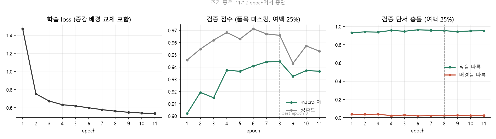
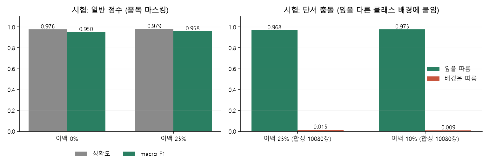
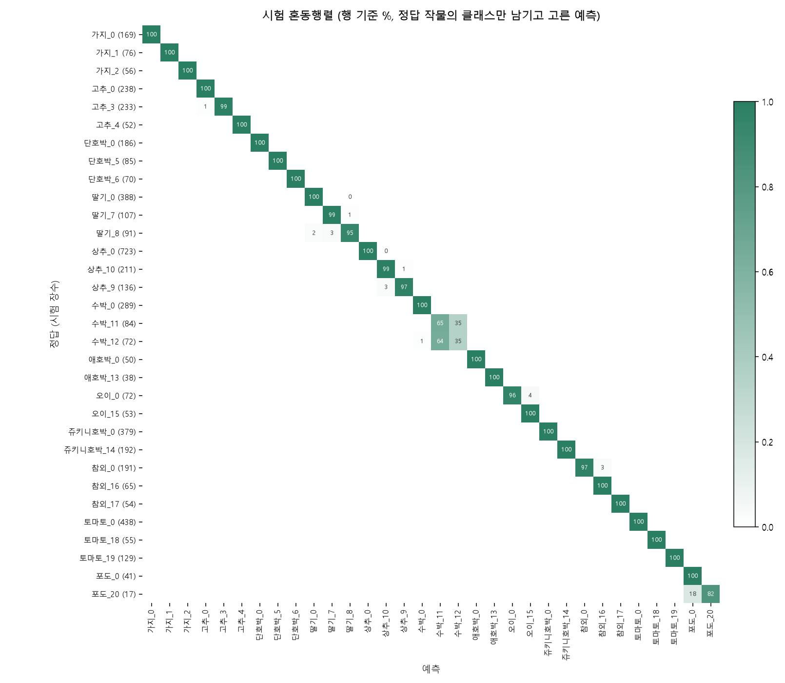
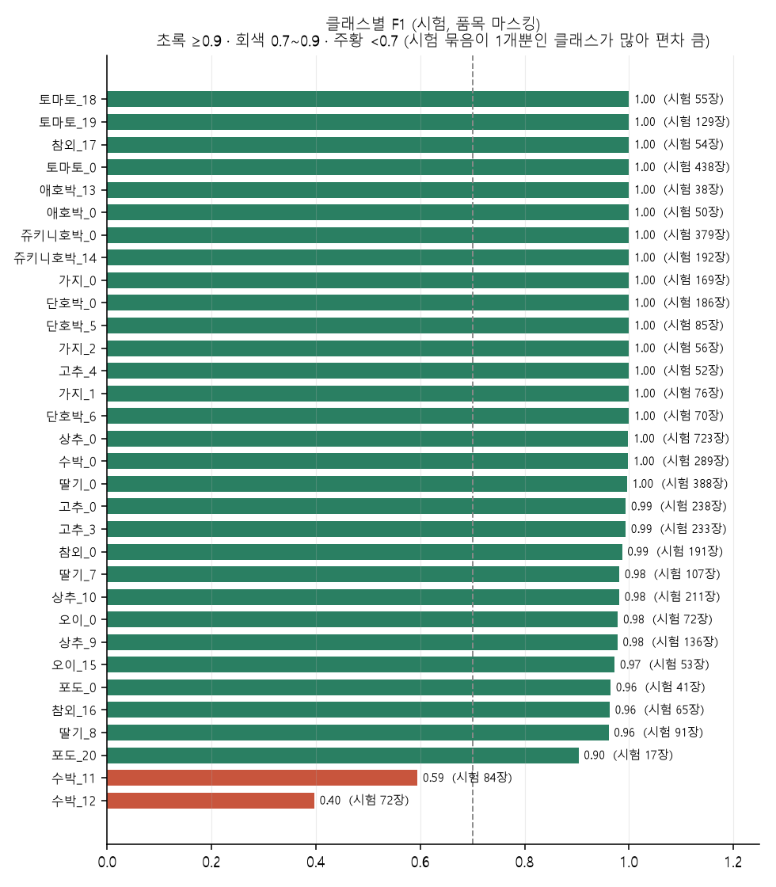

# 사진 진단 (이미지 분류)

> **문서 목록** — [vision.md](vision.md) 총괄·153 · [vision-147.md](vision-147.md) 147 · [vision-146.md](vision-146.md) 146 · [vision-preprocess-test.md](vision-preprocess-test.md) 전처리 방식 시험. 표·그래프·원자료는 `vision-*/` 폴더, 코드는 `ml/vision/`.
> **레포에 없는 것:** AI Hub 데이터와 그 파생물(`ml/vision/data/`), 학습 산출물(`runs/`, `*.pt`), 사진이 든 시트·샘플 jpg(AI Hub 이미지라 제외, 각 문서에 재생성 스크립트를 적었다), `*.log`.

품목을 고르고 잎 사진을 올리면 병 후보를 내고, 대응은 기존 RAG(NCPMS 병·해충 문서)로 보여 준다. 기존 증상 진단(REQ-RAG-001, `POST /api/farming/diagnose`)의 앞단이다.

| 항목 | 내용 |
|---|---|
| 상태 (2026-11-19) | **153 전처리 완료** (`data/processed/153/` 50,350장, 2.9GB). 원본(`data/raw/153`)은 삭제했다. 학습 코드 `train.py` 작성·스모크 시험 완료, 1차 학습 완료 (시험 마스킹 macro F1 0.958, 수박 병 2종만 약함). 다음: 147 받기 또는 S9 |
| 흐름 | 데이터셋마다 `다운로드 → 확인 → 전처리(작게 줄인 사본) → 원본 삭제`를 153 → 147 → 146 순서로 한다. 마지막에 전처리 결과를 모두 합쳐 **모델 하나**를 학습한다 |
| 이후 | 계속하기로 정하면(S10) 요구사항(REQ-RAG-008 안, 우선순위 "선택")·API·화면을 연결한다 |
| 담당 | 양정호 |

## 1. 정한 것

| 항목 | 결정 | 이유 |
|---|---|---|
| 범위 | **병만** 다룬다. 153(시설 12종)·147(노지 10종)·146(과수 2종). 해충(148)은 제외 | 일정. "벌레가 보여요"는 텍스트 증상 진단으로 넘긴다 |
| 모델 구성 | 세 데이터셋을 합쳐 **분류 모델 하나**. 클래스는 `(작물, 병)`이고 정상도 클래스다. 추론할 때 사용자가 고른 품목의 클래스만 남긴다 (logit masking) | 배포 파일이 하나다. 고추·오이·토마토·애호박은 시설·노지 둘 다 있어서, 사용자가 시설인지 노지인지 몰라도 두 데이터셋의 병을 함께 후보로 낸다 |
| 학습 품목 | 세 데이터셋의 작물·병을 **전부** 학습한다. 화면에는 품목표(`backend/codes/fixtures/items.json`)에 있는 작물만 보여 준다 | 클래스가 많을수록 서로 헷갈리는 사례를 더 배운다 |
| AI Hub 제공 모델 | **쓰지 않는다.** 153 모델은 참외 3클래스 예시였다 ([4.1](#41-153-시설-작물-질병)). 147·146 모델도 받지 않는다 | 직접 학습한다 |
| 모르는 병 | 신뢰도가 기준보다 낮으면 "판단 어려움"으로 보고 텍스트 증상 진단으로 넘긴다 | 작물마다 병이 1~2개뿐이라, 학습하지 않은 병도 억지로 맞추게 된다 |
| 배경 처리 | 분할 모델은 쓰지 않는다. bbox crop으로 학습하고 강하게 증강한다. 앱에 촬영 가이드 틀을 둔다 | 단계가 늘면 그 단계에서 또 실패한다 |
| 추론 입력 | **서비스에는 bbox가 없다.** 앱이 가이드 틀 안쪽만 잘라 서버로 보내고, 학습 때 bbox crop과 비슷한 모양으로 맞춘다. 서버는 받은 이미지를 384px로 줄여 모델에 넣는다 | 학습(잎 crop)과 추론(사용자 사진)의 모양이 다르면 점수가 떨어진다. 가이드 틀을 무시한 사진은 신뢰도가 낮아질 가능성이 높다 |
| 감자·고구마 | 사진 진단에서 뺀다 (텍스트 진단만) | 실제 촬영 질병 데이터가 없다 |
| 학습 환경 | SSAFY PC, RTX 5060 Ti 16GB. `ml/vision/.venv` (Python 3.12, torch 2.11.0+cu128, torchvision 0.26.0. 2026-11-18 GPU 확인) | Blackwell GPU는 cu128 이상이 필요하다. 서비스 Docker와 분리한다 |
| 배포 | EfficientNet-B0급 하나를 ONNX로 바꿔 onnxruntime(CPU)로 돌린다. 추론 서비스도 하나 | EC2 8GB에 GPU가 없고, 여유 메모리는 약 3.5GB다 (`infra-memory.md`) |
| 작업 장소 | 원본 다운로드·전처리·학습은 SSAFY PC. 집에는 `data/processed/`만 옮긴다 | 원본은 데이터셋마다 수백 GB다 |
| 데이터 취급 | AI Hub 데이터는 본인 학습용. git·공유 링크에 올리지 않는다. `ml/vision/data/`와 `*.pt`·`*.onnx`·`*.pth`는 `.gitignore`에 있다 | 이용 조건 |
| 사진 저장 | 서비스에서 추론한 뒤 저장하지 않는다 | REQ-NFR-006 수집 항목에 사진이 없다 |

## 2. 데이터셋

모두 AI Hub(내국인만 신청)이고, JPEG + JSON(bbox + 코드) 구성이다.

| 구분 | dataSetSn | 이름 | 작물 | 질병 |
|---|---|---|---|---|
| 학습 | [153](https://www.aihub.or.kr/aihubdata/data/view.do?currMenu=115&topMenu=100&dataSetSn=153) | 시설 작물 질병 진단 이미지 | 가지·고추·단호박·딸기·상추·수박·애호박·오이·쥬키니호박·참외·토마토·포도 | 20 |
| 학습 | [147](https://www.aihub.or.kr/aihubdata/data/view.do?currMenu=115&topMenu=100&dataSetSn=147) | 노지 작물 질병 진단 이미지 | 고추·무·배추·애호박·양배추·오이·콩·토마토·파·호박 | 20 |
| 학습 | [146](https://aihub.or.kr/aihubdata/data/view.do?currMenu=115&topMenu=100&aihubDataSe=realm&dataSetSn=146) | 과수화상병 촬영 이미지 | 사과·배 | 7 |
| **수집 안 함** (2026-11-18 결정) | Kaggle | Strawberry Disease Detection (전북대), Plant Pathology 2020/2021 | 딸기, 사과 | 추가 데이터셋은 받지 않는다 |
| **수집 안 함** | - | PlantDoc | | 〃 |
| 안 씀 | - | PlantVillage | | 실험실·흰 배경. 실제 사진에서 F1 98.9%→11.5% (arXiv 2610.04456) |
| 제외 | 148 | 노지 작물 해충 진단 이미지 | | 해충 제외 (1장) |
| **수집 안 함** | 525, 71344 | 식물 병 유발 통합, 스마트팜(참외) | | 〃 |

학습 데이터는 **153·147·146만** 쓴다. 외부 평가용 사진은 다른 데이터셋 대신 **우리가 직접 찍은 사진**으로 마련한다 (3장 "내일 할 일").

### 2.1 다운로드 규칙 (153·147·146 공통)

- **받는 것:** Training과 Validation 각각 라벨링데이터 전부, 원천 질병 전부, 원천 정상(아래 예외 제외)
- **받지 않는 것:** 이름에 "증강"이 들어간 파일 전부, AI 모델(`model.zip`)
- **정상 예외:** 원천 정상 zip 하나가 10GB를 넘으면 받지 않고 이름을 진행 기록에 남긴다
  - **153 확정:** Training의 토마토·포도 정상은 받지 않는다. Validation의 토마토·포도 정상만 받는다
- **위치:** `ml/vision/data/raw/<dataSetSn>/Training|Validation/...` (받은 폴더 구조 그대로, 압축은 풀지 않는다)
- **153 실제 선택 용량:** 약 321GB (2026-11-18, 사용자 다운로드 화면 기준). C: 남은 공간은 약 560GB

## 3. 작업 순서

각 단계를 끝내면 체크하고 [6장](#6-진행-기록)에 한 줄 남긴다.

### 다음 할 일 (2026-11-19 갱신, 순서대로)

153 다운로드(321GB)는 `ml/vision/data/raw/153/`에 있다. 원본은 사용자 동의 후 삭제했다. 전처리 방식은 정해졌다 → [vision-preprocess-test.md](vision-preprocess-test.md) (bbox crop 0~25% 무작위 + 배경 교체 증강, 이미지 전체는 쓰지 않음).

1. **전처리 스크립트** `ml/vision/preprocess.py` (5장 규격) → `data/processed/153/` + `manifest.csv` + `summary.md` + 확인 시트(`data/review/`). 먼저 작은 표본(예: 작물 1개)으로 시험한 뒤 전체를 돌린다. 포함: S4(받은 파일 확인, 4.1 표의 Training 열 채우기)
2. **장수 표·확인 시트를 사용자에게 보여 주고 원본 삭제 여부를 묻는다** (S5). 동의 전에는 지우지 않는다
3. **학습 코드** `ml/vision/train.py` (S8): EfficientNet-B0, 384px, AMP, 클래스 가중치, 여백 0~25% 무작위 crop + **배경 교체 증강**(잎을 다른 학습 이미지 배경에 붙임, 원본 2 : 합성 1), `.contiguous()` 필수·`channels_last` 금지. 153만으로 먼저 학습해 코드를 검증한다. 시험 점수는 **품목 마스킹 macro F1 + 같은 방식의 단서 충돌 시험**(`experiments/cue_conflict_test.py` 방식)을 함께 낸다. 일반 정확도만으로 판단하지 않는다
4. 147을 받아 4.2를 채운다 (146은 그다음)
5. S9: 직접 찍은 사진 몇 장 + **Grad-CAM 개발자 점검**(필수, 서비스 코드에는 넣지 않음). 사용자용 히트맵은 **지금 정하지 않는다**: 모델 구조에 영향이 없고, ONNX로 내보낼 때 마지막 특징 맵을 추가 출력으로만 두면 나중에 `heatmap=true` 옵션으로 켜고 끌 수 있다 (S9·S10)

- [x] **S1. AI Hub 이용 신청·설명서 검토** (153·147·146·148 신청, 153 설명서 검토 완료)
- [x] **S2. 학습 환경** (`ml/vision/.venv`. `requirements.txt` 버전 고정은 학습 코드와 함께 한다)
- [x] **S3. 153 사전 확인** (Validation과 AI Hub 모델로 확인 → [4.1](#41-153-시설-작물-질병))
- [x] **S4. 153 받은 파일 확인** (2026-11-19, `preprocess.py` 실행 중 확인. 아래 4.1 표의 Training 열, `data/processed/153/summary.md`)
  - 2.1 규칙대로 받았는지, 빠진 zip이 없는지 본다 (특히 Validation `[라벨]12.포도_0.정상.zip`, Training 가지 질병)
  - 작물×병별 원본 수를 4.1 표의 Training 열에 채운다
- [x] **S5. 153 전처리 → 원본 삭제** (2026-11-19: 50,350장 전처리, 사용자 동의 후 `data/raw/153` 삭제. 처리 결과는 보관)
  - [5장 규격](#5-전처리-규격)대로 `data/processed/153/`를 만든다
  - 장수 표를 확인하고, 시트 이미지로 crop을 눈으로 확인한 뒤 원본(`data/raw/153`)을 지운다 (**사용자 확인 후**)
- [ ] **S6. 147 받기 → 확인 → 전처리 → 원본 삭제** (153과 같은 방식. 4.2를 채운다) — **147은 별도 모델로 진행, 기록은 [vision-147.md](vision-147.md)**
- [ ] **S7. 146 받기 → 확인 → 전처리 → 원본 삭제** (4.3을 채운다) — **146은 별도로 기록, [vision-146.md](vision-146.md)** (전처리·원본 삭제 완료)
- [x] **S8. 학습 (153만, 코드 검증용 1차)** (2026-11-19. `ml/vision/train.py`, 결과 [vision-train-s8_153/](vision-train-s8_153/). 147·146을 받은 뒤 전체로 다시 학습한다)
  - `data/processed/` 전체로 EfficientNet-B0(ImageNet 사전학습)를 학습한다. 384px, AMP(fp16), 클래스 가중치, 증강(색·밝기·흐림·JPEG 압축·크기·회전·뒤집기)
  - 기준선: 153만으로 먼저 한 번 학습해 코드를 검증해도 된다
  - **`channels_last`를 쓰지 않는다.** 이 PC(torch 2.11 + RTX 5060 Ti)에서 EfficientNet-B0는 37 img/s, 끄면 322 img/s였다 (ResNet50도 24 → 185). `torch.backends.cudnn.benchmark = True`는 켠다
  - 속도 측정 (2026-11-18, 가짜 데이터, 384px, fp16, 학습 단계만. 이미지 읽기·증강 시간은 제외):

    | 모델 | 학습 img/s | 파라미터 | CPU 추론 (1장, 스레드 4개, torch) |
    |---|---:|---:|---:|
    | EfficientNet-B0 | 322 | 4.1M (fp32 16MB) | 21ms |
    | ResNet50 | 185 | 23.6M | 106ms |
    | ConvNeXt-Tiny | 165 | 27.9M | 193ms |

  - 학습 시간 추정: 전처리 뒤 이미지를 약 5만(153만, 전처리 규격 기준 추정)~15만 장(세 데이터셋 전체, 147·146은 아직 확인 전이라 불확실)으로 본다. B0 384px 기준 1 epoch이 각각 약 2.5분~8분이고, 15 epoch이면 약 40분~2시간이다. 데이터 읽기가 느려 GPU를 못 채우면 더 걸린다 (CPU 28코어, `num_workers` 8~12부터 시험)
  - 완료: 시험셋에서 **품목 마스킹을 적용한** 작물별 macro F1과 혼동행렬
- [ ] **S9. 현실 조건 평가 + 배포 확인**
  - **직접 찍은 사진만** 쓴다 (PlantDoc·Kaggle은 수집하지 않기로 했다). 손으로 잎을 든 사진도 포함한다. 직접 찍은 사진은 **가이드 틀을 맞춰 찍은 것**과 **아무렇게나 찍은 것**을 나눠 점수를 따로 본다 (서비스에는 bbox가 없어서 가이드 틀 crop이 학습 crop을 대신한다)
  - 신뢰도 기준값을 정하고 거절률과 정확도를 함께 기록한다
  - **Grad-CAM 점검 (개발자용, 필수):** 외부 사진·시험 사진 수십 장에 히트맵을 그려, 모델이 병반을 보는지 손·화분·배경을 보는지 눈으로 확인한다 (출처 편향이 해결됐는지 보는 용도. 학습 시간은 늘지 않는다)
  - ONNX로 내보내 CPU 추론 시간·메모리를 잰다 (사용자용 "모델이 주목한 부분" 보기를 넣을 경우를 위해, 마지막 특징 맵을 추가 출력으로 내보내 CAM을 계산하는 방법을 같이 시험한다. EfficientNet-B0는 평균 풀링→선형층이라 Grad-CAM과 같은 결과를 gradient 없이 구할 수 있다)
- [ ] **S10. 계속할지 결정**
  - 기준(안): 현실 평가에서 작물별 macro F1 0.7 이상, CPU 추론 1초 이내
  - 사용자에게 히트맵을 보여 줄지는 Grad-CAM 점검 결과로 정한다. 히트맵이 병반을 가리키지 않으면 넣지 않는다 (틀린 근거를 가르칠 수 있다). 넣는다면 "모델이 주목한 부분"이라고 쓰고 진단 근거가 아니라고 안내한다. 우선순위는 사진 진단 자체보다 뒤다
  - 계속하면: 요구사항·API(`POST /api/farming/diagnose-photo` 안: `item_id`, 사진) → backend 추론 모듈 → 화면(촬영 가이드 틀, 흐림 검사) → RAG 연결. 클래스와 NCPMS 병명을 맞추는 표(`ml/vision/config/classes.json`)도 이때 만든다

## 4. 데이터셋별 확인 결과

### 4.1 153 시설 작물 질병

**라벨 구조** (2026-11-18, Validation으로 확인)
- 이미지 1장마다 JSON 1개다. JSON 파일 이름은 `<이미지 파일명>.json`이다.
- 라벨 zip과 원천 zip이 따로 있다. 작물 폴더마다 `[라벨]NN.작물_0.정상.zip` / `NN.작물_0.정상.zip` 식이다. 포도 폴더만 `1.질병.zip`처럼 이름이 다르다.
- 압축 안의 한글 파일명이 깨질 수 있다. UTF-8 플래그가 없으면 `cp437 → cp949`로 다시 읽는다.

```json
{"description": {"image": "V006_77_1_03_02_03_12_1_1067y_20201015_2.jpeg", "date": "2020/10/15",
                 "height": 3024, "width": 4032, "task": 77, "type": 1, "region": 8},
 "annotations": {"disease": 3, "crop": 2, "area": 3, "grow": 12, "risk": 1,
                 "points": [{"xtl": 2491, "ytl": 1724, "xbr": 3101, "ybr": 2580}]}}
```

- `type`: 0 정상, 1 질병. `area`: 01 열매, 02 꽃, 03 잎, 05 줄기. `points`는 늘 1개다.
- 파일명 구조: `V006_77_{type}_{disease}_{crop}_{area}_{grow}_{risk}_{대상ID}_{날짜}_{번호}`. **대상ID**(예: `1067y`)는 같은 촬영 대상을 묶는 값이다.
- **증강본:** `9.증강.zip`에 따로 있고, 파일명이 `_a000N`으로 끝난다.
- 해상도는 4032×3024가 대부분이다 (3024×3024, 1816×4032 등도 있음). EXIF 회전을 적용해야 한다.

**코드표** (설명서 v2.1이 맞다. 테크니컬 리포트판은 틀림)

| 작물 코드 | 1 가지 | 2 고추 | 3 단호박 | 4 딸기 | 5 상추 | 6 수박 | 7 애호박 | 8 오이 | 9 쥬키니호박 | 10 참외 | 11 토마토 | 12 포도 |
|---|---|---|---|---|---|---|---|---|---|---|---|---|

| 질병 코드 | 이름 | 질병 코드 | 이름 |
|---|---|---|---|
| 0 | 정상 | 11 | 수박탄저병 |
| 1 | 가지잎곰팡이병 | 12 | 수박흰가루병 |
| 2 | 가지흰가루병 | 13 | 애호박점무늬병 |
| 3 | 고추마일드모틀바이러스병 | 14 | (쥬키니호박에 붙음) 오이녹반모자이크바이러스 |
| 4 | 고추점무늬병 | 15 | (오이에 붙음) **CMV인지 CGMMV인지 미정** |
| 5 | 단호박점무늬병 | 16 | 참외노균병 |
| 6 | 단호박흰가루병 | 17 | 참외흰가루병 |
| 7 | 딸기잿빛곰팡이병 | 18 | 토마토잎곰팡이병 |
| 8 | 딸기흰가루병 | 19 | 토마토황화잎말이바이러스병 |
| 9 | 상추균핵병 | 20 | 포도노균병 |
| 10 | 상추노균병 | | |

- 코드 14·15: 데이터에서는 오이=15, 쥬키니=14다. 설명서 이름과 엇갈린다. 학습에는 영향이 없다 (`(작물, 코드)`로 클래스를 만들면 된다). RAG에 연결하기 전에 이름을 정한다.

**원본 규모와 Validation 수**
- 설명서 기준으로 작물마다 정상 10,000장, 질병마다 원본 1,000장이다. AI Hub 페이지 표의 질병 수(2,950~54,429)는 증강본이 들어간 수다.

| 작물 | Val 정상 (잎) | Val 질병 (코드: 장수) | Val 질병 촬영 대상 수 | Training 원본 수 (S4, 라벨 기준·증강 제외) |
|---|---|---|---:|---|
| 가지 | 465 (12) | **0, zip이 비어 있음** | - | 정상 34,234 · 1: 522 · 2: 366 |
| 고추 | 41 (10) | 3: 959 | 7 | 정상 7,452 · 3: 1,702 · 4: 823 |
| 단호박 | 145 (34) | 5: 104, 6: 70 | 22 | 정상 2,751 · 5: 757 · 6: 630 |
| 딸기 | 178 (108) | 7: 117, 8: 109 (잎 83, 꽃 102, 열매 27) | 8 | 정상 19,679 · 7: 955 · 8: 856 |
| 상추 | 149 (149) | 9: 200, 10: 196 | 13 | 정상 10,751 · 9: 1,698 · 10: 1,481 |
| 수박 | 232 (57) | 11: 98, 12: 64 | 11 | 정상 13,612 · 11: 740 · 12: 553 |
| 애호박 | 531 (105) | 13: 28 | 4 | 정상 7,337 · 13: 222 |
| 오이 | 6 (0) | 15: 40 | 5 | 정상 14,117 · 15: 319 |
| 쥬키니호박 | 8 (0) | 14: 208 | 9 | 정상 12,046 · 14: 1,668 |
| 참외 | 336 (288) | 16: 49, 17: 57 | 10 | 정상 19,328 · 16: 419 · 17: 432 |
| 토마토 | 4,423 (1,888) | 18: 110, 19: 136 | 19 | 정상 13,508 · 18: 846 · 19: 1,118 (정상 zip이 Training에 있었다) |
| 포도 | 4,304 (지난번엔 라벨 없음) | 20: 24 | 4 | 정상 17,875 · 20: 221 (Validation 원천은 없다) |

- 같은 대상을 여러 번 찍은 사진이 많다. 예: 고추 질병 959장이 대상 7개에서 나왔다. 그래서 **분할은 대상ID 단위로** 한다.

**출처 편향** (확인됨, 위험이 크다)
- **촬영 지역:** 정상은 `region`이 모두 비어 있다. 질병은 작물마다 거의 한 지역이다.
- **촬영 시기:** 정상은 대부분 2020-12, 질병은 2020-09~11이다.
- **촬영 부위:** 정상은 줄기(05)가 많다. 질병은 거의 잎(03)이다.
- **배경:** 딸기 질병 사진은 모두 손으로 잎을 들고 찍었다. 고추 질병은 연구 시설의 화분과 콘크리트 바닥이 배경이다.
- 대응은 5장 규격에 넣었다: 잎만 사용, bbox crop, 대상ID 단위 분할, 외부 사진 평가.

**AI Hub 제공 모델 (쓰지 않음)**
- 실체는 Docker 이미지 `laonpeople/77_classification:v0.2`(6GB)다. PyTorch 1.7, ResNet50, 입력은 이미지 전체를 512×512로 줄인 것이다.
- `config.py`가 참외(코드 10) 3클래스다. 가중치의 `fc.weight`도 (3, 2048)이다.
- 실제로 돌려 본 결과 (Validation에서 작물마다 60장): 참외 질병은 60/60을 맞혔지만, 참외 정상은 45%만 맞혔다. 다른 작물의 병은 모두 참외 병이나 정상으로 나왔다. 예: 고추 질병 → 정상 16 / 참외노균 34 / 참외흰가루 10.

**Training·Validation 전체 라벨 확인** (2026-11-18 17시, 받은 라벨 20.2만 개)

- 받은 위치: `ml/vision/data/raw/153/071.시설 작물 질병 진단/01.데이터/{1.Training,2.Validation}/{라벨링데이터,원천데이터}/` (총 321GB, 97개 파일). **Validation 원천의 포도(질병·정상)는 받지 못했다.** 포도는 Training 원천으로 충분해서 문제없다
- 받은 라벨에 증강본은 없다 (`_a000N` 이름 0개).
- 정상 18.3만 장, 질병 약 1.9만 장이다. 작물×질병 장수는 4.1의 표와 비슷하다 (고추마일드모틀 2,661, 상추 균핵 1,898·노균 1,677, 쥬키니 1,876, 토마토 황화잎말이 1,254 등). 포도노균 245, 오이 359, 애호박 250처럼 적은 클래스가 있다.
- **bbox가 가리키는 것: 잎(관찰 대상 부위) 전체**다. 병반이 아니다. 이미지마다 1개이고, 전체 이미지 대비 면적비 중앙값은 작물마다 0.16~0.79다 (고추 0.19, 토마토 0.23, 딸기 0.20은 작고, 호박류·수박 질병은 0.6~0.8). → 병 진단에는 **이미지 분류 + bbox crop**이 맞고, 탐지 모델은 필요 없다.
- **라벨 잡음:** `(작물, 질병)` 조합 중 1장짜리가 많다 (예: 가지-7, 고추-2, 쥬키니-3). 코드표에 없는 조합이니 버린다. 쓸 조합은 21개다 (가지 1·2, 고추 3·4, 단호박 5·6, 딸기 7·8, 상추 9·10, 수박 11·12, 애호박 13, 오이 15, 쥬키니 14, 참외 16·17, 토마토 18·19, 포도 20).
- **"잎만 쓴다" 규칙은 틀렸다.** 딸기 잿빛곰팡이(7)는 잎이 1%뿐이고 대부분 꽃·열매 사진이다 (질병 중 꽃 1,022장). 잎만 쓰면 이 클래스가 사라진다. → 5장 규격을 바꿨다.
- **정상 사진은 연속 촬영 프레임이다.** 오이 정상 14,123장이 (장소, 날짜) 135개 묶음에서 나왔고, 파일명이 `..._0000_S01_1`, `..._0001_S01_1`처럼 번호가 이어진다. 거의 같은 사진이 많으니 간격을 두고 뽑아야 한다.
- **AI Hub의 Training/Validation 분할은 새고 있다.** 질병 대상ID 111개 중 109개가 Training에도 있다. AI Hub Validation 점수는 믿을 수 없고, 우리가 대상ID로 다시 나눠야 한다.
- 질병 대상ID는 클래스마다 4~22개뿐이다 (애호박 4, 오이 6, 딸기 8, 포도 7). 시험셋은 클래스마다 대상 1개 정도라 점수의 편차가 클 것이다.

**전처리 효과 빠른 확인 (2026-11-18, `ml/vision/experiments/crop_ablation.py`)**

- 조건: 고추·토마토·상추 9클래스(작물별 정상 + 병 2개), 클래스당 600장(총 5,400장), 잎(area=3)만, EfficientNet-B0 ImageNet 사전학습 6 epoch, 288px, **시험셋은 학습과 겹치지 않는 촬영 대상 그룹**, 3번 반복(분할을 바꿈). 우연 수준 정확도 0.111
- 결과 (정확도 평균 ± 표준편차):

  | 입력 | 정확도 | macro-F1 |
  |---|---:|---:|
  | A 이미지 전체 | 0.970 ± 0.001 | 0.967 |
  | B bbox crop (25% 여백) | 0.969 ± 0.008 | 0.965 |
  | **C 배경만 (bbox 영역을 회색으로 가림)** | **0.936 ± 0.010** | 0.932 |

- **해석:** A와 B는 차이가 없다 (편차 안). 더 중요한 것은 **잎을 가린 C가 0.936**이라는 점이다. 이 데이터에서는 잎이 아니라 배경·촬영 환경만으로도 대부분 맞힌다. 같은 데이터 안의 점수는 "병을 구분하는 능력"이 아니라 "촬영 환경 단서"를 반영할 가능성이 크다. **그러므로 AI Hub 시험셋 점수는 전처리 효과와 모델 성능 판단에 쓰지 않는다. 판단은 외부 사진으로 한다.**
- 이 실험의 한계: ① 클래스에 작물 구분이 들어 있어 C의 점수 일부는 작물 단서다. 사용자가 품목을 고르므로 **작물 안에서의 정확도**(정상 vs 병)를 따로 봐야 한다. ② B는 여백 25%에 배경이 남는다. 여백 0%나 "bbox 밖을 모두 가린" 입력은 아직 재지 않았다. ③ 외부 사진은 아직 없다.
- **다음 실험 (S8 학습 전):** 작물 안 정확도 분리, 여백 0% crop, 잎만 남기기(bbox 밖을 가림), 같은 모델의 외부 사진(**직접 촬영**) 점수. 이 중 외부 점수가 전처리를 정하는 기준이다.
- **코드 주의:** GPU에 올린 이미지를 `permute`하면 NHWC가 되어 `channels_last`처럼 10배 느려진다 (첫 실행이 한 번에 420초 걸렸다). 학습 코드는 입력에 `.contiguous()`를 쓴다. 고친 뒤에는 한 번에 약 40초 (3.7천 장, 6 epoch).

**사후 EDA (2026-11-19, `data/processed/153/manifest.csv` 기준)**

147 EDA([vision-147.md 4장](vision-147.md))와 같은 형식으로, 원본이 삭제된 153을 **전처리 결과(manifest + 처리된 이미지)**로 다시 정리했다. 표·그림·확인 시트 12개: [vision-153-eda/](vision-153-eda/) (`tables.md`, `fig_bbox_ratio.png`, `sheet_<작물>.jpg`), 스크립트 `ml/vision/experiments/eda_153.py`. **한계:** manifest는 선별 뒤 목록이다 (정상은 질병의 약 2배·질병 부위에 맞춘 것이라 정상의 장수·부위 분포는 선별 결과, 포도 Validation 없음, 코드표 밖 66개 제외). 원본 대비 bbox 면적비는 다시 못 쟀다 (위 "bbox가 가리키는 것"의 값을 쓴다).

- **장수:** 50,350장 (질병 18,726장, 정상 31,624장). 질병 클래스 221~2,658장(가장 적은 곳 포도 20 221, 애호박 13 250).
- **지역·시기:** 정상은 전 작물 지역 빈 값, 질병은 작물당 거의 한 지역. 정상이 12월에 몰린 작물이 많고(가지 90%, 참외 87%, 토마토 70%) 질병은 10~11월이 많다 (포도 정상은 10월 100%라 반대). 4.1 "출처 편향"과 일치한다.
- **묶음:** 질병 묶음은 클래스당 4~22개, 정상 묶음 868개(중앙값 27장). **같은 (작물, 대상ID)가 둘 이상의 질병 클래스에 있는 것이 56/146개** (단호박 21·상추 14·수박 10·딸기 8·토마토 3). 수박 병 2종 문제가 수박만의 일이 아니다. 단호박(점무늬/흰가루)·상추(균핵/노균)에서도 같은 식물이 두 병으로 갈려 있어 비슷한 혼동이 나올 수 있다 (4.4 점수는 단호박·상추가 0.98 이상이라 실제로는 가려졌다). 클래스별로 분할해 같은 식물이 서로 다른 분할에 걸친 것이 14개 있다.
- **라벨 이상 (새로 확인):** 정상 코드인데 risk·region이 있는 행 4개(고추 대상 `2766w`, 시트에서 잎에 병반이 보임), 질병 코드인데 risk 0·region 없음인 행 14개(상추 9 12·상추 10 1·포도 20 1). 질병 식물 사진이 정상으로, 또는 정상 사진이 질병으로 들어간 것으로 보인다. 18장이라 학습에는 영향이 작지만 **147의 호박 5장과 같은 종류의 이상**이다. 다음에 manifest를 만들 때 정상 코드인데 risk>0·region 있는 행, 질병 코드인데 risk 0인 행을 제외하는 규칙을 넣을 수 있다.
- 확인 시트로 본 인상: 고추·토마토 질병은 밝은 배경에 손·흰 종이가 보이는 사진이 있고 정상은 비닐·화분·바닥이 보인다. 12장씩 본 인상이다.

### 4.2 147 노지 작물 질병

**147은 별도 모델로 진행한다. 기록은 [vision-147.md](vision-147.md)** (E2 EDA 결과는 4장).

S6에서 채운다. 153과 같은 컨소시엄(라온피플)이 만들어서 구조가 비슷할 것으로 본다 (과제 번호 77~80 중 하나). 코드표와 증강 구분은 따로 확인한다.

### 4.3 146 과수화상병

**146은 별도로 기록한다. [vision-146.md](vision-146.md)** (F2 EDA는 4장). 설명서상 정상 사진은 과원 20~30곳, 질병 사진은 연구기관에서 찍었다.

### 4.4 153 1차 학습 결과 (S8, 2026-11-19)

설정: 153만, 클래스 32개, EfficientNet-B0(ImageNet) 384px, 여백 0~25% 무작위 crop + 배경 교체 증강(원본 2 : 합성 1), 12 epoch 계획·**11 epoch에서 조기 종료**(best epoch 8), 40.9분. 원자료·그림: [vision-train-s8_153/](vision-train-s8_153/)

**학습 곡선.** loss는 계속 내려가는데 검증 macro F1은 epoch 8(0.945)에서 멈춰서 조기 종료가 걸렸다. 단서 충돌의 잎/배경 비율은 처음부터 거의 변하지 않았다 (배경 교체 증강 덕분).



**시험 요약** (학습에 안 쓴 대상ID·묶음, 품목 마스킹). 단서 충돌에서 배경을 따른 비율이 1.5%라 잎을 보고 판단한다.



| 지표 | 여백 25% | 여백 0% |
|---|---:|---:|
| 정확도 / macro F1 | 0.979 / 0.958 | 0.976 / 0.950 |
| 단서 충돌: 잎 / 배경 (여백 25%) | 0.968 / 0.015 | - |
| 단서 충돌: 잎 / 배경 (여백 10%) | 0.975 / 0.009 | - |

**혼동행렬.** 틀린 것은 거의 수박 병 2종끼리다 (수박탄저병 65%·수박흰가루병 35%로 예측), 그 밖에 포도노균병→정상 18%.



**클래스별 F1.** 수박탄저병 0.59, 수박흰가루병 0.40만 0.7 아래다.



| 작물 | 시험 macro F1 |
|---|---:|
| 수박 | 0.663 |
| 포도 | 0.934 |
| 오이 | 0.976 |
| 딸기 | 0.980 |
| 참외 | 0.983 |
| 상추 | 0.986 |
| 고추 | 0.996 |
| 가지·단호박·애호박·쥬키니호박·토마토 | 1.000 |

**수박 병 2종 점검** (`ml/vision/experiments/watermelon_check.py`, 결과 `vision-train-s8_153/watermelon_pred.json`)
- 수박탄저병(11)과 수박흰가루병(12)은 **같은 대상ID(같은 식물)를 공유한다** (예: `6_7188w`, `6_9763w`, `6_0254w`, `6_6022w`가 두 클래스에 모두 있다). 둘 다 2020/09/17 같은 지역에서 찍었다. 즉 환경 단서가 거의 같고 병 모양만 달라야 하는데, 사진을 보면 **탄저 사진에도 흰 가루가 많고 흰가루 사진에도 갈색 반점이 많다** (같은 식물에 두 병이 같이 있거나, 라벨이 식물 단위로 붙었을 가능성).
- 모델은 이 둘을 **학습 사진에서도 못 가른다**: 병 사진 정답률 (학습 / 검증 / 시험) 탄저 0.88 / 0.54 / 0.66, 흰가루 0.63 / 0.36 / 0.35. 정상은 구분한다 (정상으로 가는 병 사진은 거의 없다). 그러므로 시험 묶음이 1개뿐이라서 생긴 우연이 아니라, **지금 데이터·입력으로는 두 병의 시각적 차이를 배우지 못한 것**이다.
- 한 묶음 안에서도 같은 식물의 사진이 두 라벨에 들어 있어서, 이미지 분할 시 "같은 식물이 한쪽 클래스에서는 train, 다른 쪽에서는 test"가 된다 (예: `6_4360w`는 흰가루 시험이면서 탄저 학습). 이 때문에 점수가 부정확해질 수는 있지만 정상 분류에는 영향이 없다.
- 점검한 것이 아닌 것: 라벨이 실제로 틀렸는지 (전문가 확인 필요), 해상도를 올리면 구분되는지, 병반만 잘라 보면 구분되는지.

(수박 병 2종 예시 이미지 `watermelon_samples.jpg`: 위 두 줄은 같은 식물(6_7188w)의 탄저·흰가루, 아래 두 줄은 시험 묶음. AI Hub 이미지라 레포에 올리지 않았다. `watermelon_check.py`로 재생성)

한계: 같은 데이터 안의 점수다 (4.1 "출처 편향"). 병 클래스 대부분은 시험 묶음이 1개뿐이라 편차가 크다. 판단은 S9 외부 사진으로 한다.

## 5. 전처리 규격

데이터셋마다 같은 규격으로 `ml/vision/data/processed/<dataSetSn>/`를 만든다. 원본 zip에서 바로 읽는다 (압축을 풀지 않는다).

1. **대상:** 증강본(`증강` zip, `_a000N` 파일)은 뺀다. 라벨과 이미지가 짝이 맞는 것만 쓴다. **코드표에 있는 `(작물, 질병)` 조합만** 쓴다 (153은 21개 + 작물별 정상 12개). 1장짜리 잡음 조합은 버린다.
2. **작물 분류 기준은 탐지가 아니라 이미지 분류다.** bbox는 잎 전체를 가리키는 영역이라 crop에만 쓴다 (4.1).
3. **부위:** 작물마다 그 작물 **질병 사진에 5% 이상 나오는 촬영 부위**만 쓴다. 정상도 같은 부위만, 질병 사진의 부위 비율에 맞춰 뽑는다 (딸기는 잎·꽃·열매, 나머지는 대부분 잎). 정상 줄기 사진이 정상 신호가 되는 것을 막는다.
4. **자르기:** EXIF 회전을 적용한 뒤, bbox를 사방 **25% 넓혀서**(이미지 밖은 자름) 자르고 긴 변을 512px로 줄인다. JPEG 품질 90. 학습할 때 여백을 0~25%로 무작위로 줄여 잘라 가이드 틀이 정확하지 않은 사진에 대비한다. **이미지 전체를 저장·학습하지 않는다** (단서 충돌 시험에서 전체 이미지는 배경을 51% 따랐다. [시험 기록](vision-preprocess-test.md)).
   - **배경 교체 증강 (학습 때):** 잎(bbox 안쪽)을 다른 학습 이미지의 배경에 붙인 합성을 원본 2 : 합성 1 정도로 섞는다. 정답은 잎의 클래스다. 배경은 작물·클래스 상관없이 학습 이미지에서만 뽑는다. 이 증강으로 잎을 따르는 비율이 0.81 → 0.95가 됐다. 이를 위해 전처리에서 **bbox 밖 배경이 남은 사본(여백 25% crop)**을 저장한다
5. **정상 수 제한:** 작물마다 정상은 그 작물 질병 합계의 **약 2배**까지만 쓴다. 정상은 연속 프레임이라 (장소, 날짜) 묶음마다 간격을 두고(몇 장에 1장) 골고루 뽑는다.
6. **분할:** 원래의 Training/Validation 구분은 무시한다 (대상ID가 양쪽에 겹쳐 새고 있다). **질병은 대상ID, 정상은 (장소, 날짜) 묶음 단위로** 학습/검증/시험 = 8/1/1로 나눈다. 클래스마다 시험셋에 대상이 최소 1개 들어가게 하고, 대상이 3개 미만인 클래스는 기록한다.
7. **결과물**
   - 이미지: `processed/<dataSetSn>/<작물>_<질병코드>/<원본파일명>.jpg`
   - `processed/<dataSetSn>/manifest.csv`: `path, dataset, crop_code, crop_name, disease_code, disease_name, label(작물_질병), group_id, split, area, risk, region, date, orig_w, orig_h, img_w, img_h, bx0, by0, bx1, by1` (뒤 6개는 저장 이미지 크기와 그 안의 bbox 픽셀 좌표)
   - `processed/<dataSetSn>/summary.md`: 클래스×분할별 장수·대상 수
   - 확인용 시트: 클래스마다 몇 장씩 모은 이미지 (`data/review/`)
8. **원본 삭제는** 장수 표와 시트를 확인하고 사용자가 동의한 뒤에 한다.

## 6. 진행 기록

최신이 위.

- 2026-11-19 · E5b (합친 학습, 진행 중) · 153+147+146 67클래스(train 77,640 / val 10,261 / test 10,172), EfficientNet-B0 384px, 최대 30 epoch·patience 6, epoch당 약 6분. 첫 시도는 epoch 2, 두 번째는 epoch 4 직후 **GPU가 사라져(GPU is lost) 중단**됐다 (이 PC에서 반복되는 장애, 재부팅 필요). 그래서 `train.py`에 epoch마다 `last.pt` 저장·`--resume`·`STOP` 파일 중단 기능을 넣었다. epoch 4까지 검증 macro F1 0.883 / **0.911** / 0.890 / 0.903 (best는 epoch 2). **임시 모델:** epoch 2 best를 ONNX로 변환해 `ml/vision/model/`에 올렸다 (`vision.onnx` 16.4MB, CPU 1장 8ms, PyTorch와 출력 차이 2.6e-05). 시험셋·외부 사진 평가 전의 자리표시이며 학습이 끝나면 같은 파일 이름으로 교체한다. [model/README](../ml/vision/model/README.md). **다음:** 재부팅 후 `--resume`으로 이어서 학습 → 시험 평가 → 단독 모델(153 0.958, 147 0.908)과 비교

- 2026-11-19 · 153 사후 EDA · 153에는 147 같은 전용 EDA가 없어서, 원본이 삭제된 상태에서 `processed/153`(manifest + 처리된 이미지)로 같은 형식의 표·시트를 만들었다 ([vision-153-eda/](vision-153-eda/), 4.1 "사후 EDA"). 새로 확인한 것: 같은 식물이 두 병 클래스에 걸친 것이 56/146개(단호박·상추·딸기·토마토에도 있음), 정상/질병 코드와 risk·region이 안 맞는 행 18개. 선별 뒤 목록이라 정상 부위·장수 분포는 원본 기준이 아니다
- 2026-11-19 · S5 완료 · 사용자 동의로 `data/raw/153`(321GB)을 삭제했다. 삭제 직전에 `data/processed/153`을 확인했다 (이미지 50,350개, manifest와 일치, 2.9GB). C: 여유 215GB → 535GB. **정한 것:** 앞으로 데이터셋의 원본은 **전처리 결과를 확인한 뒤 필요 없으면 삭제**한다 (사용자 허락, 같은 날). 전처리 결과·`runs/`는 지우지 않는다. 같은 이유로 전처리 규격을 바꿔야 하면 153은 다시 받아야 한다. **다음:** 수박 병 2종을 한 클래스로 묶고(manifest 라벨) 147 받기(S6)
- 2026-11-19 · S5 점검 · 원본 삭제 전 검증에서 처리 이미지 파일이 50,350개인데 manifest가 50,361행인 것을 발견했다. 원인: 확장자만 다른 같은 stem(`.jpg`/`.jpeg`)이 같은 경로로 겹쳐 쓰였다 (고추_3·상추_9·쥬키니_14, 11장, 모두 같은 분할). manifest의 중복 11행을 제거했다 (**50,350장**: train 40,214 / val 5,096 / test 5,040, 분할 그대로). 학습에는 이 11장이 두 번 들어갔을 뿐이라 결과에 영향이 없다. `preprocess.py`도 같은 경로를 한 번만 쓰도록 고쳤다. 이 일로 확인한 것: 처리 결과 파일은 manifest와 모두 짝이 맞다 (파일 없음 0)
- 2026-11-19 · S8 점검 · 수박 병 2종 확인. 두 병이 **같은 식물(대상ID 공유)·같은 날**에 찍혔고, 사진에서도 탄저에 흰 가루, 흰가루에 갈색 반점이 섞여 있다. 모델은 학습 사진에서도 흰가루를 63%밖에 못 맞힌다 (탄저 88%, 정상은 구분). 시험 묶음 1개 탓이 아니라 데이터에서 두 병이 시각적으로 안 갈리는 것이다. 정상 대 병 구분은 문제없다. 4.4절에 그림·표 기록. 4.4절에 학습 결과 그림도 넣었다. **미결정:** 두 병을 하나로 묶을지, 후보 둘을 모두 보여 줄지, 외부 사진으로 확인할지
- 2026-11-19 · S8 (153 1차 학습) · EfficientNet-B0, 384px, 11 epoch에서 **조기 종료**(patience 4, best는 epoch 8), 40.9분. **시험 (품목 마스킹):** 정확도 0.979, macro F1 **0.958** (여백 0%에서 0.976/0.950). **단서 충돌:** 잎을 따름 0.968(클래스 평균 0.936), 배경을 따름 **0.015** (여백 10%: 0.975/0.009) → 시험 문서의 0.95/0.025와 같은 수준이라 배경 교체 증강이 전체 데이터에서도 작동한다. 검증 macro F1은 0.945(best)로 시험보다 낮다 (검증 묶음도 클래스마다 1개 안팎이라 편차 큼). **약점:** 수박탄저병(F1 0.59)·수박흰가루병(0.40)은 **서로**만 헷갈린다 (탄저 65%/흰가루 35%로 예측, 정상으로는 안 감) → 병 둘을 구분하지 못하는 것이고 환경 단서 문제가 아니다. 학습 데이터가 각각 669·454장·묶음 9·8개인데 시험이 묶음 1개씩이라 정확히 말하기 어렵다. 포도노균병 0.90 (시험 17장). 나머지 클래스는 0.96~1.00. **주의:** 같은 데이터 안의 점수라 높게 나오는 것이 정상이다 (4.1 "출처 편향" 참고). 판단은 S9 외부 사진으로 한다. 그림·원자료: [vision-train-s8_153/](vision-train-s8_153/) (`fig_training.png` 학습 곡선, `fig_test_summary.png`, `fig_confusion.png`, `fig_f1_per_class.png`, `per_crop_f1.md`, `results.json`). **다음:** 사용자가 정하는 대로 147 받기(S6) 또는 수박 원인 확인
- 2026-11-19 · S8 (코드) · `ml/vision/train.py` 작성. EfficientNet-B0(ImageNet), 384px squash, AMP, 클래스 가중치(역빈도의 제곱근), AdamW+OneCycle, label smoothing 0.05, `.contiguous()`·`channels_last` 없음. **여백 0~25% 무작위 crop + 배경 교체 증강(확률 1/3 = 원본 2 : 합성 1)**, 색·밝기·흐림·JPEG·크기·회전·뒤집기. 매 epoch 검증(품목 마스킹 macro F1)으로 best 저장, 시험은 best로 한 번: 마스킹 acc/macro F1(전체·작물별·클래스별), 혼동행렬(`confusion_test.csv`), **단서 충돌 시험**(시험 이미지 잎을 같은 작물·다른 클래스 시험 이미지의 배경에 붙임, 여백 25%·10%, 잎/배경 따름 비율). 클래스는 `(작물, 병)`이고 마스킹은 **작물 이름 기준**이라 147 추가 시 시설·노지 고추가 같은 품목이 된다. 스모크(분할·클래스당 40장, 2 epoch, 4.8분): 끝까지 돌고 시험 마스킹 acc 0.845, 충돌 잎 0.84/배경 0.10 (표본이 작아 점수는 의미 없다). 데이터 로딩 16 작업자에서 약 1,400 img/s로 GPU(약 320 img/s)가 병목이다. 한계: 충돌 시험의 여백은 저장 이미지가 25% 여백까지만 있어 25%·10%만 잰다 (50%는 못 잼). **다음:** `python -X utf8 train.py --processed data/processed/153 --out runs/s8_153`로 본 학습
- 2026-11-19 · S4 완료 · S5 전처리 완료(원본 삭제 대기) · `ml/vision/preprocess.py`를 5장 규격대로 작성하고 고추 1개 표본으로 시험한 뒤 153 전체를 처리했다 (4분 18초). **50,361장** (train 40,219 / val 5,102 / test 5,040), 실패 1장 (bbox 너무 작음). 확인 시트(`data/review/153/<작물>.jpg`)에 저장된 bbox를 빨간 상자로 그려 crop 위치를 확인했다. 결과: ① Validation 원천 포도를 못 받아 라벨 4,328개(포도 정상 4,304 + 질병 24)는 짝이 없어 제외 (Training만으로 포도 정상 17,875·질병 221) ② 코드표 밖 조합 66개 제외 (애호박-2 38개 등) ③ 쓰는 부위는 딸기만 열매·꽃·잎, 나머지는 모두 잎 ④ 정상은 질병 합계의 2배 한도 (고추·단호박은 잎 정상이 한도보다 적어 전부 사용) ⑤ 분할: 묶음 단위는 지키되 장수가 8/1/1에 가깝게 되는 배정을 탐색 (처음 묶음 수만 맞췄을 때 토마토_18 시험 1장·애호박_13 val이 train보다 많은 문제가 있어 고쳤다). 시험 묶음이 1개뿐인 질병 클래스가 대부분이라 점수 편차가 크다 (summary.md). manifest에 저장 이미지 안의 bbox 위치(`bx0,by0,bx1,by1`, 픽셀)를 추가했다 — 배경 교체 증강과 0~25% 무작위 crop에 필요하다. 오이 질병은 train 296/val 10/test 53처럼 비율이 치우친 클래스가 일부 있다 (묶음 4개). **다음:** 사용자 동의 후 `data/raw/153` 삭제 → `train.py`

- 2026-11-19 · S4~S5 전처리 방식 · 시험 3종 (총 96회 학습)으로 전처리를 정했다. 어제 시험은 샘플 부족이 아니라 변별력 부족이었다 (전체·crop·crop0 모두 0.96, 시드 편차 0.006). **단서 충돌 시험**(잎을 다른 클래스 배경에 붙임)에서 전체 이미지는 잎 44%·배경 51%, crop25는 잎 81%, 여기에 **배경 교체 증강**을 넣으면 잎 95% (여백 50%에서도 93%). 5장 규격에 증강을 추가했다. 기록: [vision-preprocess-test.md](vision-preprocess-test.md). **다음:** 전처리 스크립트(5장)로 `processed/153/` 생성 → 원본 삭제 여부(사용자 확인). 학습 때 배경 교체 증강 구현. 한계: 3작물 시험이고 실제 사진은 미확인(S9 Grad-CAM)

- 2026-11-18 18시 · 결정 · 추가 데이터셋(Kaggle 딸기·사과, PlantDoc, 525, 71344)은 수집하지 않는다. 외부 평가는 직접 찍은 사진으로 한다. 내일 할 일을 3장에 정리했다
- 2026-11-18 17:56 · S4 (153) · 전처리 효과 빠른 확인: 전체 0.970 ≈ crop 0.969, **배경만 0.936** → 같은 데이터 안의 점수로는 전처리 효과를 알 수 없고 배경 단서가 크다 (4.1). 외부 사진으로 판단해야 한다. **다음 세션:** 5장 전처리 스크립트(원본 삭제는 아직 안 함) + 위 "다음 실험" + 외부 사진 모으기
- 2026-11-18 17시 · S4 (153) · 다운로드 완료 (321GB). 라벨 20.2만 개를 확인했다 (4.1 마지막 절). **전처리 규격을 바꿨다:** 탐지 모델 불필요(bbox는 잎 전체), "잎만" 규칙 폐기(딸기 잿빛곰팡이는 꽃·열매), 정상은 연속 프레임이라 간격 추출, AI Hub 분할은 새고 있어(질병 대상ID 111개 중 109개 겹침) 대상ID로 다시 분할. Validation 원천의 포도는 받지 못했다(필요 없음). **다음:** 5장 규격대로 전처리 스크립트 작성·시험 → S5
- 2026-11-18 밤 · S1 · 153 다운로드 시작 (2.1 규칙, 선택 용량 약 321GB). 이전에 받았던 Validation·꺼낸 AI Hub 모델은 `ml/vision/data/`와 함께 지워졌다. 확인 결과(4.1)는 유효하다. **다음 세션:** S4부터
- 2026-11-18 · 결정 · 해충(148) 제외. 세 데이터셋을 합친 분류 모델 하나, 작물·병 전부 학습. 데이터셋마다 받기 → 전처리 → 원본 삭제를 차례로 하고, 마지막에 합쳐서 학습한다
- 2026-11-18 · S2·S3 · 학습 환경을 만들었다 (torch 2.11 cu128, GPU 확인). 153 Validation과 AI Hub 모델을 확인했다: 모델은 참외 3클래스 예시라 쓰지 않는다. 코드표는 v2.1, 증강은 `_a000N`, 출처 편향을 확인했다 (4.1)
- 2026-11-18 · S1 · 153 설명서 두 판을 검토했다. AI Hub 이용 신청
- 2026-11-18 · 계획 · 데이터셋 후보를 정리하고 이 문서를 만들었다

## 7. 위험과 대응

| 위험 | 대응 |
|---|---|
| 출처 편향 (정상과 병의 촬영 장소·시기·부위가 다름) | 잎만 사용, bbox crop, 대상ID 단위 분할, 외부 사진 평가. 외부 점수가 낮으면 촬영 가이드를 강하게 하고 신뢰도 기준을 올린다 |
| 대상 수가 적은 클래스 (예: 포도노균 대상 4개) | 시험 점수의 편차가 크다는 것을 기록한다. 필요하면 데이터셋끼리 합쳐 평가한다 |
| 용량 | 데이터셋을 하나씩 받고, 전처리한 뒤 원본을 지운다 |
| 시간 (기능 마감 11/30) | 153만으로 먼저 학습해 전체 흐름을 확인하고, 147·146은 이어서 붙인다 |
| 데이터 커밋 실수 | `ml/vision/data/`는 `.gitignore`의 `data/` 규칙에 걸린다. 모델 파일 확장자도 제외돼 있다 |
