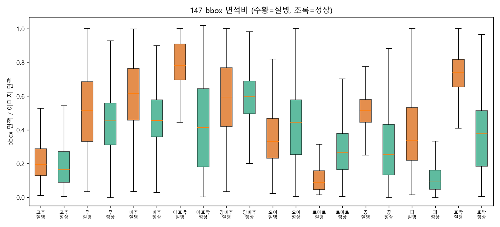
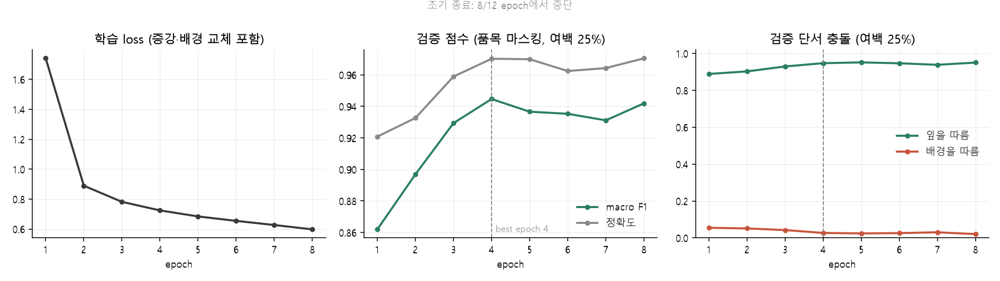
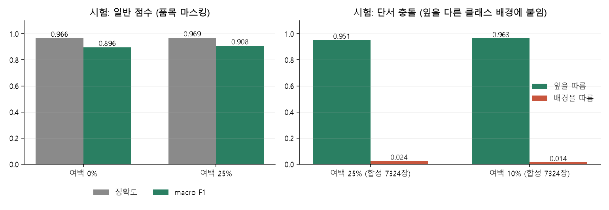
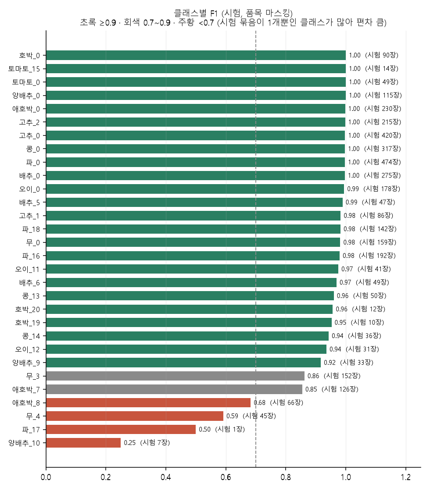
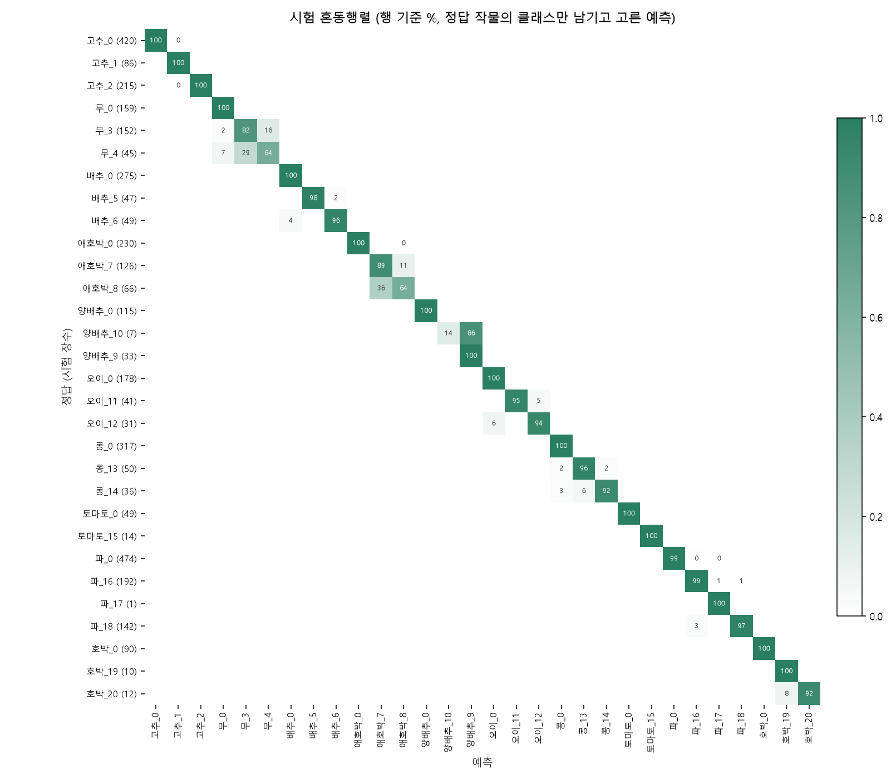

# 사진 진단 — 147 노지 작물 질병 (별도 모델)

> **작업 기록 원본.** 읽기 좋게 정리한 문서는 [vision.md](../../vision.md) · [eda.md](../eda.md) · [preprocessing.md](../preprocessing.md) · [performance.md](../performance.md). 이 문서는 시간 순서대로 쌓은 기록이라 내용 순서가 섞여 있다.

[vision.md](vision.md)의 153 기록과 **별개**로 147을 진행하는 문서다. 153 기록은 고치지 않는다. 결정·규격 출처는 vision.md 1장(결정), 4.1(153 확인), 5장(전처리 규격), [vision-preprocess-test.md](vision-preprocess-test.md)이다.

| 항목 | 내용 |
|---|---|
| 상태 (2026-11-19) | **E3 완료** ([5장](#5-e3-전략-시험-결과-2026-11-19): 153 전략이 147에서도 맞음). E2 EDA는 [4장](#4-e2-eda-결과-2026-11-19). **E5 완료**([7장](#7-e5-147-단독-학습-결과-2026-11-19)): 147 단독 기준선 학습. E4([6장](#6-e4-전처리-결과-2026-11-19))에서 전처리 34,730장·원본 삭제. 다음: E5b 합친 학습, 146 받기 |
| 데이터 | AI Hub 147 노지 작물 질병 진단 이미지, 10작물 (고추·무·배추·애호박·양배추·오이·토마토·콩·파·호박). 과제 번호 79 |
| 위치 | `ml/vision/data/raw/147/노지 작물 질병 진단 이미지/{Training,Validation}/` (평평한 폴더, 압축 안 풀고 zip에서 바로 읽는다) |
| 학습 환경 | `ml/vision/.venv`. `channels_last` 금지, 입력 `.contiguous()` |
| 기록 위치 | 이 문서와 `docs/vision/archive/vision-147-*/` 폴더. vision.md에는 링크 한 줄만 둔다 |
| 모델 구성 (2026-11-19 정리) | **최종 배포 모델은 153·147·146을 합친 하나**다 (vision.md 1장 결정 그대로). "147은 별도"는 **기록·전처리·시험을 분리한다는 뜻**이고, E5의 147 단독 모델은 합치기 전 **시험용**이다. 이유: 사용자가 시설/노지를 모르고(고추·오이·토마토·애호박은 두 데이터셋에 모두 있음), 품목 마스킹이 작물별로 분리해 주며, 학습·변환·서비스를 하나로 두는 편이 마감(11/30)에 맞다. (메모리 때문이라는 vision.md의 이유는 약하다: B0는 16MB 정도라 실측 전에는 근거로 삼지 않는다) |
| 전제 | 153의 전략(bbox crop + 배경 교체 증강)이 147에서도 맞는다는 보장은 없다. E3에서 시험으로 확인한다. 이미지 전체는 입력으로 쓰지 않되 147에서도 충돌 시험으로 다시 본다 |
| 데이터 취급 | AI Hub 데이터는 git·공유에 올리지 않는다. 원본 삭제는 전처리 결과를 확인한 뒤 **사용자에게 먼저 알리고** 한다 |

## 1. 체크리스트

- [x] **E1. 받은 파일 확인** (2026-11-19, 토마토 재다운로드 후 재확인. 아래 2장)
- [x] **E2. EDA** (2026-11-19, 아래 4장. 호박 코드 0 잡음 1장, bbox EXIF 회전 좌표 181개, 정상/질병 시기·부위·배경 편향, 질병 이름은 2026-11-20 확정) — 라벨 구조·코드표(작물·질병 코드), bbox 면적비, 촬영 부위, 대상ID·정상 묶음 구조, 증강본 유무, 출처 편향(지역·시기·부위·배경), 클래스별 장수
- [x] **E3. 전략 시험** (2026-11-19, 5장. bbox crop + 배경 교체 증강이 147에서도 맞음, 상자 모양 단서 있음) — 153 방식(bbox crop 0~25% + 배경 교체 증강)이 147에서 맞는지 단서 충돌 시험으로 확인. 전체 이미지 입력도 다시 잰다
- [x] **E4. 전처리 → 원본 삭제** (**전처리 완료·원본 삭제 2026-11-19, 6장**: 34,730장·검증 통과, 사용자 동의 후 `data/raw/147` 삭제) — 전처리 규격(vision.md 5장)을 147에 맞게 조정해 `data/processed/147/` 생성. 장수 표·확인 시트를 보여 주고 **사용자 동의 후** 원본 삭제
- [x] **E5. 학습** (2026-11-19, 7장. 시험 macro F1 0.908(약한 2클래스 제외 0.946), 배경 따름 2.4%, 약점은 무·애호박·양배추의 병 2종 혼동) — 147 단독 모델. 시험은 품목 마스킹 macro F1 + 단서 충돌 시험
- [x] **E5b. 합쳐 학습·비교** (2026-11-20, [vision.md 4.5](vision.md#45-합친-학습-e5b-결과-2026-11-20): 시험 정확도 0.972·macro F1 0.929, 153 0.949·147 0.910으로 단독과 비슷) — 153+147(+146)을 합친 모델을 단독 학습 결과와 비교한다 (품목 마스킹 macro F1 + 단서 충돌). 합친 쪽이 크게 나빠지면(예: 데이터셋 출처가 단서가 됨) 모델을 나누는 선택지를 다시 검토한다. 정상은 질병의 약 2배로 줄여 불균형을 완화한다
- [ ] **E6. 외부 평가** — 직접 찍은 사진 + Grad-CAM 점검 (153의 S9와 같은 방식)

## 2. E1 받은 파일 확인 (2026-11-19)

방법: zip 중앙 디렉터리(파일 목록)만 읽었다. 이미지·JSON은 풀거나 열지 않았다. 한글 파일명은 UTF-8 플래그가 없으면 `cp437 → cp949`로 다시 읽었다. 라벨 JSON 파일명(`<이미지 파일명>.json`)과 원천 이미지 파일명을 **이름 단위로 대조**했다.

### 2.1 전체 요약

| 항목 | 값 |
|---|---|
| 파일 수 | **81개** (Training 41 = 라벨 20 + 원천 21, Validation 40 = 라벨 20 + 원천 20). 처음 받은 79개 + 토마토 Training 원천 2개 |
| 총 용량 | 약 **243 GiB** (261 GB). 처음 225 GiB + 토마토 정상 18 GiB·질병 0.15 GiB |
| zip 열림 | 79개 모두 정상으로 열린다 (중앙 디렉터리 읽기 성공, 중간에 끊긴 다운로드 없음) |
| 증강본 | 이름에 "증강"이 들어간 파일 0개, `_a000N` 형태 파일명 0개. AI 모델(`model.zip`)도 없음 |
| 라벨 중복 | 라벨 zip 안의 같은 JSON 이름 중복 0개 |
| 짝 | **10작물 모두 라벨 수 = 원천 수이며 파일명 집합이 완전히 같다** (아래 표). 처음엔 토마토 Training 원천이 없었으나 재다운로드로 해결 |

### 2.2 짝이 안 맞거나 특이한 것

| # | 구분 | 내용 | 영향 |
|---|---|---|---|
| 1 | **빠졌다가 해결 (Training)** | 처음엔 `[원천]잎마름병(토마토)` 정상·질병이 둘 다 없었다 (라벨만 11,614·216개). 사용자가 다시 받았다: `_0.정상.zip`(19.4GB, 11,614장)과 `_질병.zip`(0.16GB, 216장). 둘 다 라벨과 파일명이 일치한다. 실수로 같이 받은 `_9.증강.zip`(3.64GB)은 사용자 요청으로 삭제했다 | 토마토 Training 질병 216장 사용 가능. 토마토 질병 합계 247장 |
| 2 | 이름 형식 | 원천 질병 이름이 작물마다 `_질병`과 `_1.질병`으로 섞여 있다 (아래 2.3, 토마토 `_질병` 포함). 라벨은 모두 `_1.질병` | 스크립트가 이름 규칙에 기대면 안 된다. 작물명 + `정상`/`질병` 포함 여부로 짝짓는다 |
| 3 | 이름 형식 | 토마토가 `잎마름병(토마토)`라는 이름이다 (작물명이 아니라 병 이름이 앞에 붙음). 작물은 토마토로 정한다 | 작물 코드표(E2)와 맞춰 본다 |
| 4 | 정상 zip 분할 | Training 양배추 정상 원천이 `_(1)`(31.43GB, 16,195장)과 `_(2)`(22.63GB, 11,435장) **두 개로 나뉘어 있다.** 합치면 라벨 27,630개와 정확히 맞는다 | 둘 다 읽어야 한다 |
| 5 | 10GB 규칙과 다름 | 153 규칙(정상 zip이 10GB 넘으면 받지 않음)과 달리 **Training 정상 원천이 전부 10GB를 넘는데 다 받아졌다** (11.7~31.4GB). Validation 정상은 모두 10GB 미만 | 기록만 남긴다. 규칙을 바꾸는 게 아니라 147에서는 사용자가 전부 받았다는 사실이다 |
| 6 | 눈여겨볼 값 (E2) | 질병 zip 첫 파일명에서 질병 코드가 작물마다 다르게 보인다 (고추 01, 무 03, 배추 05, 애호박 07, 양배추 09, 오이 11, 토마토 15, 콩 13, 파 16, 호박 00·19). 호박은 type=1인데 코드 00·risk 0인 파일명이 있다 (`V006_79_1_00_10_...`). 153 코드표(15 = 오이)와 **겹치지 않게 별도로 봐야 한다** | E2에서 JSON·파일명 전체로 확인. 지금은 첫 파일명만 본 것이라 결론 아님 |

### 2.3 작물 × (정상/질병) × (Training/Validation) 짝 표 (장수 = 파일명 기준)

원천 질병 이름 형식: `질병` = `[원천]<작물>_질병.zip`, `1.질병` = `[원천]<작물>_1.질병.zip`. Validation은 모든 작물이 `_1.질병`이다.

| 작물 | 원천 질병 이름 (Training) | Train 정상 라벨/원천 | Train 질병 라벨/원천 | Val 정상 라벨/원천 | Val 질병 라벨/원천 | 짝 |
|---|---|---|---|---|---|---|
| 고추 | `_질병` | 8,575 / 8,575 | 1,888 / 1,888 | 1,110 / 1,110 | 229 / 229 | 맞음 |
| 무 | `_질병` | 11,001 / 11,001 | 697 / 697 | 1,303 / 1,303 | 100 / 100 | 맞음 |
| 배추 | `_질병` | 9,318 / 9,318 | 1,260 / 1,260 | 1,183 / 1,183 | 147 / 147 | 맞음 |
| 애호박 | `_질병` | 10,562 / 10,562 | 1,027 / 1,027 | 1,349 / 1,349 | 130 / 130 | 맞음 |
| 양배추 | `_1.질병` | 27,630 / 27,630 (원천 zip 2개) | 528 / 528 | 3,478 / 3,478 | 69 / 69 | 맞음 |
| 오이 | `_질병` | 12,873 / 12,873 | 781 / 781 | 1,604 / 1,604 | 107 / 107 | 맞음 |
| 토마토 (잎마름병(토마토)) | `_질병` | 11,614 / 11,614 | 216 / 216 | 1,432 / 1,432 | 31 / 31 | 맞음 (재다운로드 후) |
| 콩 | `_질병` | 9,790 / 9,790 | 1,392 / 1,392 | 1,265 / 1,265 | 180 / 180 | 맞음 |
| 파 | `_1.질병` | 11,372 / 11,372 | 2,117 / 2,117 | 1,383 / 1,383 | 242 / 242 | 맞음 |
| 호박 | `_1.질병` | 10,560 / 10,560 | 435 / 435 | 1,303 / 1,303 | 56 / 56 | 맞음 |
| **합계** | | 123,295 / 123,295 | 10,341 / 10,341 | 15,410 / 15,410 | 1,291 / 1,291 | |

- 원천 이미지 확장자는 `.jpg`·`.jpeg`가 섞여 있다 (`.JPG` 포함). 짝 대조는 확장자까지 포함한 파일명으로 했고 모두 일치했다.
- 쓸 수 있는 질병 장수: Training 10,341장, Validation 1,291장 (E2·E4에서 코드표 밖 조합은 또 제외될 수 있다).
- 153과 마찬가지로 AI Hub의 Training/Validation 분할은 믿지 않고 E4에서 대상ID 단위로 다시 나눈다 (E2에서 겹침 확인 예정).

### 2.4 사용자가 정할 것

없음. 토마토 Training 원천은 다시 받아 해결했다 (진행 기록 참고).

## 3. 진행 기록

최신이 위.

- 2026-11-19 · E5 완료 · 147 단독 학습(`runs/e5_147`, 30클래스, 22.8분, epoch 8에서 조기 종료·best epoch 4). **시험(품목 마스킹):** 정확도 0.969, macro F1 0.908 (파_17 시험 1장·양배추_10 시험 7장을 빼면 0.946), 단서 충돌 잎 0.951 / 배경 **0.024**. 작물별: 토마토 1.0·고추 0.993·배추 0.985·호박 0.970·오이 0.968·콩 0.967·파 0.865·애호박 0.845·무 0.812·양배추 0.722. **약점:** 무 3↔4, 애호박 7↔8, 양배추 10→9처럼 **같은 작물의 병 2종끼리만** 헷갈리고 정상으로는 안 간다 (153 수박과 같은 구조, 콩·고추는 오히려 잘 맞아 같은 식물 공유만으로는 설명 안 됨). 그림·원자료 [vision-train-e5_147/](vision-train-e5_147/). **다음:** E5b 합친 학습(153+147), 146 다운로드·E1
- 2026-11-19 · E4 완료 (원본 삭제) · 사용자 동의로 `data/raw/147`(244GB)을 삭제했다. 삭제 직전 `processed/147`(34,730장, manifest와 일치)을 확인했다. C: 여유 312GB → 553GB. 전처리 규격은 **153과 같은 방식**(bbox crop 여백 25% 저장 + 학습 때 0~25% 무작위 + 배경 교체 증강 2:1, 이미지 전체 미사용)으로 확정했다. 정상 장수·여백·이미지 크기를 바꾸려면 147을 다시 받아야 한다. **다음:** E5 (147 단독 학습, `train.py --processed data/processed/147`)
- 2026-11-19 · E4 전처리 완료 (원본 삭제 대기) · `preprocess_147.py`로 34,730장(질병 11,579 + 정상 23,151, 1.7GB, 165초) 생성. **규격:** 153과 같고 EXIF 회전 뒤 bbox 사용, 이상 라벨 제외(정상 region 4·질병 risk 0 1·정상 파일명 규칙 밖 346), 128px 미만 crop 제외(1), 같은 식물(대상ID)의 분할을 작물 안에서 공유. **검증:** manifest = 파일 34,730, 분할 누수 0/84, bbox 밖 0, EXIF 206장 시트로 확인. **한계:** 파_17 시험 1장·양배추_10 검증 0장(대상 수 부족), 분할 비율이 8/1/1에서 벗어남. 장수 표·검증은 6장. **다음:** 사용자에게 원본 삭제 여부를 묻는다 → E5
- 2026-11-19 · E3 완료 · 고추·토마토·콩·파 12클래스(4,527장), 입력 5종 × 시드 3, 학습 방식 4종 × 충돌 시험. **결과:** ① 배경 교체 증강이 153과 같은 효과: 잎을 따름 0.80 → 0.935, 배경 따름 0.135 → 0.03 (여백 25%) ② crop(0.946)이 전체(0.930)보다 약간 낫고 crop0 0.958, 배경만 0.82(153은 0.936이라 147이 약함) ③ **bbox 모양만으로 정상/병 0.78·마스킹 0.545** → 상자 크기·위치가 단서이고 crop 입력 점수에 섞였을 수 있다 (E6 외부 사진에서 확인) ④ 가장 어려운 충돌은 병 잎→정상 배경(잎 0.90). **결정:** 153 전처리 규격 그대로(여백 0~25% crop + 배경 교체 2:1, 전체 이미지 미사용). **E4에서 정할 것:** 아주 작은 상자(토마토 병 0.09·파 정상 0.09)의 최소 crop 크기. 중간 사고: 첫 시도 중 GPU가 사라져 재부팅 후 다시 돌림. **다음:** E4
- 2026-11-19 · 결정 정리 · 모델은 **최종 하나(153·147·146 합침)**로 유지한다. 147 단독 모델은 E5 시험용이고, E5 뒤 합친 모델과 비교하는 E5b를 추가했다. 합친 결과가 나쁘면 그때 분리를 검토한다. E3(147 전략 시험)은 GPU를 재부팅한 뒤 다시 돌리는 중이다 (첫 GPU 장애로 한 번 중단됨)
- 2026-11-19 · E2 완료 · 라벨 JSON 150,337개를 zip에서 읽어 EDA했다(이미지는 시트용 120장만 메모리로). 스크립트 `ml/vision/experiments/eda_147_load.py`·`eda_147.py`·`eda_147_sheets.py`, 결과 [vision-147-eda/](vision-147-eda/), 요약 4장. **결과:** ① 라벨 구조는 153과 같고 다른 필드는 빈 `worker`뿐, points 1개 ② 작물 코드는 153과 다르고 질병 코드는 1~20 전역, 30클래스(정상 10+질병 20). 코드표 밖은 호박-0 1장뿐. 질병 이름은 EDA 때는 미확정이었고 2026-11-20 사용자가 AI Hub 표를 제공해 확정(4.2) ③ 질병 11,631장(클래스당 202~1,077), 정상 138,705(약 12배) ④ **bbox는 EXIF 회전 뒤 좌표** 181개, JSON 해상도 0 43개. bbox는 잎·열매 등 관찰 부위 한 개이고 토마토 질병·파 정상은 면적비 0.09로 아주 작고 정상/질병 상자 크기가 작물별로 다르다 ⑤ 정상은 12~1월·지역 빈 값, 질병은 9~11월·작물당 1~3개 지역. 6작물은 정상에 줄기·꽃·열매가 많다 ⑥ 질병 대상 85개 중 79개가 Train·Val 양쪽에 있고, 같은 (대상, 날짜)에서 병 2종이 17%(콩·고추·무) ⑦ 정상은 연속 프레임 (번호 간격 1이 91%). **다음:** 4.9 결정을 확인한 뒤 E3 (상자 크기 대조군·배경 효과 시험)

- 2026-11-19 · E1 재확인 2 (토마토 완료) · 사용자 요청으로 `[원천]잎마름병(토마토)_9.증강.zip`(3.64GB)을 삭제했다. 사용자가 `[원천]잎마름병(토마토)_질병.zip`(0.16GB)을 받아 넣었다. **결과:** 토마토 Training 질병 라벨 216 = 원천 216, 파일명 집합 일치. 정상 11,614도 일치. 10작물 × (정상/질병) × (Training/Validation) **40개 조합이 모두 짝이 맞는다.** 파일 81개, 약 243 GiB. 정상 원천 19.4GB(토마토 Training)는 질병의 2배 한도 때문에 쓰이지 않을 가능성이 크지만 받아진 채로 둔다 (E4에서 정한다). **다음:** E2 EDA

- 2026-11-19 · E1 재확인 (토마토) · 사용자가 토마토 Training 원천을 다시 받아 넣었다. 파일 81개, 264.5GB. **받아진 것:** `[원천]잎마름병(토마토)_0.정상.zip` (19.4GB, 11,614장, 라벨과 파일명 완전히 일치) 와 `[원천]잎마름병(토마토)_9.증강.zip` (3.64GB, 3,240장. 증강본이라 쓰지 않는다. 2.1 규칙상 받지 않는 파일). **여전히 없는 것:** `[원천]잎마름병(토마토)_1.질병.zip` — 라벨 216개의 이미지 짝이 없다. 즉 필요했던 질병 원천이 아니라 정상·증강이 받아졌다. 토마토 병은 아직 Validation 31장뿐. **다음:** 질병 원천(`_1.질병` 또는 `_질병`, 수 GB) 받기. 증강 zip은 지워도 된다 (사용자 판단)

- 2026-11-19 · E1 완료 · `ml/vision/data/raw/147/노지 작물 질병 진단 이미지` 79개 파일(약 225 GiB) 확인. 이미지·JSON을 풀지 않고 zip 파일 목록만 읽었다 (E2 EDA는 하지 않음). **결과:** ① **Training 원천 `잎마름병(토마토)` 정상·질병이 둘 다 없다** (라벨만 11,614·216개). Validation 토마토는 있다 (정상 1,432·질병 31) → 토마토 병은 Validation 31장뿐 ② 나머지 9작물은 라벨 수 = 원천 수이고 파일명 집합이 완전히 같다 (Training·Validation, 정상·질병 모두) ③ 증강본·`model.zip` 없음 ④ 원천 질병 이름이 `_질병`(고추·무·배추·애호박·오이·콩)과 `_1.질병`(양배추·파·호박)으로 섞여 있고 Validation은 모두 `_1.질병` ⑤ Training 양배추 정상 원천이 (1)(2) 두 zip(54GB) ⑥ Training 정상 원천이 전부 10GB 초과(11.7~31.4GB)인데 다 받아졌다 (153 규칙과 다름, 기록만) ⑦ zip이 중간에 끊긴 것은 없다. **미결정:** 토마토 Training 원천을 다시 받을지 (사용자 판단). **다음:** E2 EDA (코드표·bbox·부위·묶음·출처 편향)

## 4. E2 EDA 결과 (2026-11-19)

방법: 라벨 zip 40개의 JSON 150,337개를 zip에서 바로 읽어 표로 만들었다 (`ml/vision/experiments/eda_147_load.py` → `data/review/147/labels.csv`, git 제외 폴더). 표는 `eda_147.py`, 시트는 `eda_147_sheets.py`가 만든다 (모두 `.venv/Scripts/python.exe -I -X utf8`로 `ml/vision/`에서 실행). 이미지는 풀지 않고, 시트용으로 작물당 12장(총 120장)만 zip에서 메모리로 읽었다. 전체 표: [vision-147-eda/tables.md](vision-147-eda/tables.md), 로드 기록 [load_log.txt](vision-147-eda/load_log.txt).

### 4.1 라벨 구조 (153과 거의 같다)

- 150,337개 모두 같은 키 구조다. 이미지 1장 = JSON 1개, JSON 이름 = `<이미지 파일명>.json`.
- `description`: `image, date, worker, height, width, task, type, region`. `annotations`: `disease, crop, area, grow, risk, points`. **153과 다른 필드는 `worker`뿐**이고 150,337개 모두 빈 문자열이라 쓸모없다. `task`는 모두 79.
- `points`는 **모두 1개**(153과 같음). `type`은 0 정상 138,705 / 1 질병 11,632이고 zip의 정상/질병과 일치한다.
- JSON 값과 파일명 조각(`V006_79_{type}_{disease}_{crop}_{area}_{grow}_{risk}_{대상ID}_{날짜}_{번호}`)은 type·disease·crop·area·grow·risk **모두 불일치 0**.
- 해상도는 4032×3024 등 다양하다 (153과 비슷).

| 이상 | 개수 | 내용 | 영향 |
|---|---:|---|---|
| **bbox가 EXIF 회전 뒤 좌표** | 181 (JSON W,H를 바꿔야 bbox가 안에 들어감) | EXIF 방향 6인 사진은 JSON의 `width/height`가 회전 전 크기인데 bbox는 **회전 뒤** 좌표다 (표본 3장을 직접 그려 확인, `exif_check.jpg` (AI Hub 이미지라 레포에 올리지 않았다, `eda_147_sheets.py` 등으로 재생성): 위 줄 회전 전·아래 줄 회전 뒤). 시트 표본 120장 중 4장이 방향 6 | E4: **먼저 `exif_transpose`를 하고 JSON bbox를 그대로 쓴다.** JSON 해상도로 비율·범위를 검사하면 안 된다. 면적비는 W,H를 바꿔 다시 계산했다 |
| JSON 해상도 0 | 43 (무 질병 코드 3, Train 37 + Val 6) | `width/height`가 0 | 면적비 표에서 뺐다. E4에서 실제 이미지 크기로 계산 |
| bbox가 이미지 밖 | 19 (회전 처리 뒤) | | 이미지 안으로 자른다 |
| `date`가 빈 값 | 193 | 오이 질병 91(파일명 날짜가 `202012223` 등으로 깨짐), 호박 정상 68, 무 정상 29, 토마토 정상 3, 애호박 정상 2 | 시기 분석은 `결측`으로 둔다. 묶음 키에서 제외 |
| 파일명 규칙이 다른 정상 | 350 | 날짜 없음, `0000S01_1`(밑줄 없음) 등 | 정상 묶음 계산에서 제외(`규칙 밖`) |
| 면적비 2% 미만 | 1,738 | 파 정상이 많다 (p5 0.01). 작물별 내역은 확인 안 함 | E4에서 최소 크기 기준 필요 (153은 "bbox 너무 작음" 1장 제외) |

### 4.2 코드표

**작물 코드(JSON `crop`)는 zip의 작물과 모두 일치한다.** 153 코드와 **다르다** (153: 고추 2·애호박 7·오이 8·토마토 11). 그래서 **코드만으로 합치면 안 되고 `(데이터셋, 작물 코드, 질병 코드)`로 클래스를 만들어야 한다.**

| 147 작물 코드 | 1 | 2 | 3 | 4 | 5 | 6 | 7 | 8 | 9 | 10 |
|---|---|---|---|---|---|---|---|---|---|---|
| 작물 | 고추 | 무 | 배추 | 애호박 | 양배추 | 오이 | 토마토 (zip 이름 `잎마름병(토마토)`) | 콩 | 파 | 호박 |

**질병 코드는 데이터셋 안에서 1~20으로 작물을 가로질러 이어진다.** 153 코드와 숫자는 겹치지만 뜻이 다르다 (예: 147의 15 = 토마토, 153의 15 = 오이).

| 작물 | 질병 코드 | 장수 (Train+Val) | 비고 |
|---|---|---:|---|
| 고추 | 1 / 2 | 1,090 / 1,027 | |
| 무 | 3 / 4 | 546 / 251 | |
| 배추 | 5 / 6 | 912 / 495 | |
| 애호박 | 7 / 8 | 620 / 537 | |
| 양배추 | 9 / 10 | 395 / 202 | |
| 오이 | 11 / 12 | 443 / 445 | |
| 콩 | 13 / 14 | 620 / 952 | |
| 토마토 | 15 | 247 | 병이 **1종**뿐 (zip 이름이 `잎마름병(토마토)`) |
| 파 | 16 / 17 / 18 | 1,077 / 281 / 1,001 | **병 3종** |
| 호박 | 19 / 20 | 232 / 258 | |
| 호박 | **0** | **1** | **잡음.** 질병 zip·type=1인데 코드 0·risk 0 (`..._9258e_20201105_1`). 같은 대상(9258e)의 나머지는 모두 19 |

- 정상 10 + 질병 20 = **30개 클래스**. 코드표에 없는 조합은 호박-0 한 개뿐이다 (153의 66개와 달리 147은 깨끗하다). 1장짜리 잡음 조합도 이것 하나다. E1에서 본 "호박 코드 00·19"는 이 1장(0)과 정상 코드(0)이고, 호박의 병은 19·20이다.
- **정상 쪽 잡음 의심:** 호박 정상 zip(type 0, 코드 0)에 같은 대상 `9258e`·같은 날(2020-11-05)·region 14인 4장이 있다. 질병 식물 사진이 정상으로 섞였거나 질병 사진에 정상 코드가 붙은 것으로 보인다 (이 4장 + 위 1장 = 5장).
- 값이 틀린 `region`: 무 질병 2장(4), 파 질병 1장(12), 호박 정상 4장(14). 쓰지 않는 필드라 무시.
- **질병 이름은 JSON·파일명에 없다.** EDA 때는 전부 미확정이었으나 **2026-11-20 사용자가 AI Hub 표(작물명·질병명·구축수량)를 제공해 확정했다.** 표는 작물 안에서 질병을 코드 순서대로 늘어놓은 것이고, 우리 질병 코드(고추 1·2 / 무 3·4 / 배추 5·6 / 애호박 7·8 / 양배추 9·10 / 오이 11·12 / 콩 13·14 / 토마토 15 / 파 16~18 / 호박 19·20)와 표 순서가 같다고 보고 짝지었다. 작물 안 순서는 표에 코드가 없어 **추정**이지만, 구축수량이 작은 병과 우리 장수가 작은 클래스가 일치한다(무 4 노균병, 파 17 노균병, 양배추 10 무름병 등). 표의 구축수량은 증강본 포함이라 우리 라벨 장수와 다르다. 학습에는 영향이 없다.

| 코드 | 라벨 | 질병 이름 (AI Hub 표) | 구축수량 |
|---|---|---|---|
| 1 | 고추_1 | 고추탄저병 | 13,145 |
| 2 | 고추_2 | 고추흰가루병 | 12,562 |
| 3 | 무_3 | 무검은무늬병 | 9,664 |
| 4 | 무_4 | 무노균병 | 4,416 |
| 5 | 배추_5 | 배추검음썩음병 (표 표기 그대로) | 16,640 |
| 6 | 배추_6 | 배추노균병 | 8,800 |
| 7 | 애호박_7 | 애호박노균병 | 11,248 |
| 8 | 애호박_8 | 애호박흰가루병 | 9,376 |
| 9 | 양배추_9 | 양배추균핵병 | 7,152 |
| 10 | 양배추_10 | 양배추무름병 | 3,504 |
| 11 | 오이_11 | 오이노균병 | 7,792 |
| 12 | 오이_12 | 오이흰가루병 | 8,064 |
| 13 | 콩_13 | 콩불마름병 | 10,944 |
| 14 | 콩_14 | 콩점무늬병 | 17,008 |
| 15 | 토마토_15 | 토마토잎마름병 | 4,416 |
| 16 | 파_16 | 파검은무늬병 | 19,024 |
| 17 | 파_17 | 파노균병 | 4,864 |
| 18 | 파_18 | 파녹병 | 17,728 |
| 19 | 호박_19 | 호박노균병 | 4,144 |
| 20 | 호박_20 | 호박흰가루병 | 4,528 |

정상 154,132, 합계 349,151.

### 4.3 클래스별 장수 (작물 × 질병, Training / Validation)

| 작물 | 정상 T / V | 질병코드: T / V |
|---|---|---|
| 고추 | 8,575 / 1,110 | 1: 973 / 117 · 2: 915 / 112 |
| 무 | 11,001 / 1,303 | 3: 470 / 76 · 4: 227 / 24 |
| 배추 | 9,318 / 1,183 | 5: 802 / 110 · 6: 458 / 37 |
| 애호박 | 10,562 / 1,349 | 7: 543 / 77 · 8: 484 / 53 |
| 양배추 | 27,630 / 3,478 | 9: 348 / 47 · 10: 180 / 22 |
| 오이 | 12,873 / 1,604 | 11: 392 / 51 · 12: 389 / 56 |
| 토마토 | 11,614 / 1,432 | 15: 216 / 31 |
| 콩 | 9,790 / 1,265 | 13: 538 / 82 · 14: 854 / 98 |
| 파 | 11,372 / 1,383 | 16: 964 / 113 · 17: 259 / 22 · 18: 894 / 107 |
| 호박 | 10,560 / 1,303 | 19: 208 / 24 · 20: 226 / 32 (코드 0 질병 1장 별도) |
| **합** | 123,295 / 15,410 | 10,341 / 1,291 (잡음 1 포함) |

(호박 정상 Training은 라벨 기준 10,560장이다. 위 4.2의 호박-0 한 장은 질병 zip에 들어 있어 따로 센다.)

- 질병 클래스는 **202~1,077장** (양배추 10이 가장 적고 파 16이 가장 많다). 토마토는 **병 1종 247장**뿐이고 대상ID가 4개다.
- 정상은 질병의 **약 12배**(138,705 : 11,631). 153 규칙(정상은 질병 합계의 약 2배)을 쓰면 작물당 정상 약 500(토마토)~4,700장(파)이라 정상 원천 대부분은 쓰이지 않는다.

### 4.4 bbox

- **이미지마다 1개** (153과 같다). 탐지 모델은 필요 없다.
- 면적비(bbox / 이미지, 회전 처리 뒤). 5·25·50·75·95 분위 전체는 [tables.md D](vision-147-eda/tables.md). 중앙값만 정리:

| 작물 | 질병 중앙값 | 정상 중앙값 | 비고 |
|---|---:|---:|---|
| 고추 | 0.19 (코드1 0.14, 코드2 0.25) | 0.16 | 작다 (153 고추 0.19와 비슷) |
| 무 | 0.51 | 0.45 | |
| 배추 | 0.62 | 0.45 | |
| 애호박 | **0.78** | 0.41 | 질병은 잎 한 장이 이미지 대부분 |
| 양배추 | 0.59 | 0.60 | |
| 오이 | 0.33 | 0.44 | |
| 토마토 | **0.09** | 0.27 | 질병 bbox가 가장 작다 (p5 0.02) |
| 콩 | 0.51 | 0.25 | |
| 파 | 0.33 | **0.09** | 정상 파는 p5 0.01. 가는 띠 모양 |
| 호박 | **0.74** | 0.38 | |

- **bbox가 가리키는 것 (시트 표본 120장으로 확인):** 153처럼 **관찰 대상 한 개**다. 병반이 아니다. 잎 한 장(애호박·호박·배추·오이·무·콩), 열매·줄기(고추 질병 열매 51%, 정상 줄기·열매), 포기의 한 부분(양배추 결구·밑동, 토마토 병든 잎 무리), 파는 **잎 줄기 한 가닥**(세로·가로로 긴 상자)이다. 상자가 잎 한 장보다 작은 경우(토마토·고추)와 잎 한 장이 이미지를 거의 채우는 경우(애호박·호박)가 섞여 있다. 회전 문제 외에 상자가 어긋난 표본은 보지 못했다.
- 153과 다른 점: ① 153도 호박류 질병이 0.6~0.8이었지만, 147은 **토마토 질병 0.09, 파 정상 0.09처럼 매우 작은 상자**가 있다. 25% 여백을 줘도 잎 일부만 남을 수 있다. ② 정상과 질병의 상자 크기가 작물별로 **다르다** (애호박 0.41/0.78, 콩 0.25/0.51, 파 0.09/0.33, 토마토 0.27/0.09) → **상자 크기·모양 자체가 정상/질병 단서**가 될 수 있다.

### 4.5 촬영 부위(area)·위험도(risk)·지역(region)·시기(date)·성장단계(grow)

표 전체는 [tables.md E](vision-147-eda/tables.md). area 코드는 153과 같은 뜻(1 열매·2 꽃·3 잎·5 줄기)으로 시트에서 보이지만 147 설명서로 확인하지는 못했다.

**부위 (area):**

| 작물 | 질병 | 정상 |
|---|---|---|
| 무·배추·양배추·파 | 잎 97~100% | 잎 100% → 부위 편향 없음 |
| 고추 | 열매 51 · 잎 49 | 줄기 28 · 꽃 26 · 잎 24 · 열매 23 |
| 애호박 | 잎 100 | 잎 45 · 줄기 34 · 꽃 14 · 열매 7 |
| 오이 | 잎 100 | 잎 44 · 줄기 27 · 열매 15 · 꽃 14 |
| 토마토 | 잎 100 | 잎 40 · 열매 31 · 줄기 24 · 꽃 5 |
| 콩 | 잎 100 | 잎 43 · 열매 32 · 줄기 24 |
| 호박 | 잎 100 | 잎 61 · 줄기 39 |

→ **6작물(고추·애호박·오이·토마토·콩·호박)은 정상에 줄기·열매·꽃이 많고 질병은 잎뿐**이다 (153과 같은 문제). 고추 질병은 열매가 51%라 "잎만 쓴다" 규칙을 적용하면 고추 질병 절반이 사라진다.

**위험도 (risk):** 정상은 전부 0이고 질병은 1~3이다. 작물마다 분포가 다르다 (양배추 65%·호박 55%는 3, 무는 81%가 1). 정상/질병이 위험도로 완전히 갈리므로 **입력으로 쓰면 안 된다**.

**지역 (region):** 정상은 **전 작물 빈 값**(호박 정상 4장만 예외). 질병은 작물마다 거의 한 지역이다 (배추 1, 애호박 3, 양배추 4, 토마토 5, 무 9, 콩 11, 파·호박 14). 고추는 7·8, 오이는 6·7·8이다. 153과 같다.

**시기 (date):**

| 작물 | 질병 월 | 정상 월 |
|---|---|---|
| 양배추 | 9~11월 (12월 0%) | **12월 94%** |
| 토마토 | **11월 100%** | 12월 81% |
| 파 | 9~11월 98% | **12월 90%** |
| 호박 | 9~11월 | **12월 99%** |
| 고추 | 10월 60% | 12월 59% |
| 무 | 10~11월 | 12월 35% · **1월 54%** |
| 콩 | 9~11월 | 10월 46 · 12월 28 · 1월 15 |
| 배추·애호박·오이 | 9~11월 | 10~11월 (겹침 큼) |

→ 정상은 12~1월, 질병은 9~11월로 갈리는 작물이 많다 (양배추·토마토·파·호박·무·고추). 배추·애호박·오이는 시기가 겹친다.

**성장단계 (grow, 11·12·13):** 작물별로 정상/질병 분포가 다르다 (토마토 질병 12가 90% vs 정상 13이 95%, 콩 질병 12가 100% vs 정상 13이 93%). 이것도 정상/질병 단서다.

### 4.6 묶음 구조

**질병 대상ID(`gid`, 예 `0149z`)** — 칸은 병 코드 순서로 `/`로 나눈다:

| 작물 | 질병 | 장수 | 대상ID | Train 대상 | Val 대상 | 양쪽에 있음 |
|---|---|---:|---:|---:|---:|---:|
| 고추 | 1 / 2 | 1,090 / 1,027 | 7 / 7 | 7 / 7 | 7 / 7 | 7 / 7 |
| 무 | 3 / 4 | 546 / 251 | 9 / 5 | 9 / 5 | 9 / 5 | 9 / 5 |
| 배추 | 5 / 6 | 912 / 495 | 13 / 11 | 13 / 11 | 13 / 10 | 13 / 10 |
| 애호박 | 7 / 8 | 620 / 537 | 7 / 6 | 7 / 6 | 7 / 5 | 7 / 5 |
| 양배추 | 9 / 10 | 395 / 202 | 4 / 4 | 4 / 4 | 4 / 2 | 4 / 2 |
| 오이 | 11 / 12 | 443 / 445 | 5 / 5 | 5 / 5 | 5 / 5 | 5 / 5 |
| 콩 | 13 / 14 | 620 / 952 | 10 / 12 | 10 / 12 | 9 / 12 | 9 / 12 |
| 토마토 | 15 | 247 | 4 | 4 | 3 | 3 |
| 파 | 16 / 17 / 18 | 1,077 / 281 / 1,001 | 7 / 3 / 7 | 6 / 3 / 7 | 7 / 2 / 7 | 6 / 2 / 7 |
| 호박 | 19 / 20 | 232 / 258 | 4 / 4 | 4 / 4 | 3 / 4 | 3 / 4 |

- **질병 클래스당 대상ID는 2~13개** (153은 4~22). 가장 적은 곳은 양배추 10(Val 2개)·파 17(3개)·토마토 15(4개)·호박 19(4개).
- **AI Hub의 Training/Validation은 새고 있다 (153과 같다).** 질병 대상ID 85개 중 **79개가 양쪽에 있고**, Validation에만 있는 대상은 0개다 (153은 111개 중 109개). → 원래 분할은 쓰지 않고 E4에서 다시 나눈다.
- **같은 식물에서 병 2종이 같이 나온다 (153 수박 문제와 같은 위험).** 같은 (작물, 대상ID)가 둘 이상의 질병 클래스에 있는 것이 **48/86개**, 같은 (대상ID, 날짜)에서 두 병이 나온 것이 **223/1,306개(17%)**다 (콩 96·고추 52·무 25·애호박 16·오이 13·파 11·배추 7·호박 3). 환경 단서가 같은 두 병은 모델이 못 가를 수 있다 (153 수박탄저/흰가루 F1 0.59/0.40). **E5에서 클래스별 점수를 특히 봐야 하는 작물: 콩·고추·무.**

**정상 묶음 (gid, 날짜):**

| 작물 | 정상 장수 | 묶음 | gid 수 | Train·Val 둘 다인 묶음 | 묶음 크기 최소/중앙/최대 | 규칙 밖 장수 |
|---|---:|---:|---:|---:|---|---:|
| 고추 | 9,685 | 108 | 36 | 97 | 1/39/441 | 59 |
| 무 | 12,304 | 99 | 21 | 86 | 1/68/581 | 29 |
| 배추 | 10,501 | 70 | 18 | 61 | 2/62/1,033 | 88 |
| 애호박 | 11,911 | 104 | 12 | 97 | 1/77/775 | 61 |
| 양배추 | 31,108 | 61 | 20 | 60 | 7/184/4,700 | 15 |
| 오이 | 14,477 | 138 | 14 | 122 | 1/91/417 | 1 |
| 토마토 | 13,046 | 102 | 21 | 91 | 3/51/785 | 3 |
| 콩 | 11,055 | 107 | 17 | 91 | 2/43/1,825 | 21 |
| 파 | 12,755 | 109 | 22 | 76 | 1/37/774 | 0 |
| 호박 | 11,863 | 46 | 12 | 45 | 1/314/541 | 73 |

- **정상도 연속 촬영 프레임이다.** 파일명 끝 `NNNN_S01_y`(S01 128,063장·S02 10,398장)의 번호 간격이 같은 묶음 안에서 **1이 91%, 5 이하 100%**다. 같은 사진이 많으니 간격을 두고 뽑아야 한다 (153과 같다).
- 정상 묶음은 **작물당 46~138개**라 분할 단위로 충분하다. 정상 묶음의 Train·Val 겹침도 대부분이다 (예: 오이 138개 중 122개).

### 4.7 출처 편향 (정상 vs 질병)

수치(4.5)와 작물별 확인 시트(작물당 질병 6장 위줄, 정상 6장 아래줄, bbox는 빨간 상자)로 봤다. 시트는 묶음을 번갈아 뽑은 12장씩이라 **정량 근거가 아니라 인상**이다. 시트(AI Hub 이미지라 레포에 올리지 않았다, `ml/vision/experiments/eda_147_sheets.py`로 재생성): 고추, 무, 배추, 애호박, 양배추, 오이, 토마토, 콩, 파, 호박.

| 작물 | 수치로 본 편향 | 시트에서 본 것 |
|---|---|---|
| 고추 | 부위(질병 열매·잎 / 정상 줄기·꽃·잎·열매), 지역(정상 빈 값), 시기 | 질병은 밭의 열매·잎, 정상은 비닐·화분·바닥이 보이는 사진이 많다 |
| 무·배추·양배추·파 | 부위는 모두 잎. 시기·지역은 갈림 (양배추·파는 정상 12월) | 대체로 밭 배경이 비슷하다. **무 정상은 화분·손에 든 잎**이 보인다. 양배추 질병은 결구·밑동이라 모양 자체가 다르다 |
| 애호박·호박·오이 | 정상에 줄기·꽃·열매, 질병은 잎 (호박 정상 99% 12월) | **호박 정상 표본은 화분·손·실내**였다 (6장 중 5장이 날짜 없는 파일이라 대표성은 낮다). 질병은 밭의 큰 잎. 오이 정상은 시설의 단정한 잎·열매 |
| 토마토 | 질병 11월 100%·지역 5 한 곳, 정상은 12월·여러 부위 | 정상은 **손에 든 잎·열매·줄기, 화분**, 질병은 밭의 포기 |
| 콩 | 정상에 줄기·꼬투리 많음, 성장단계 다름 | 정상은 마른 꼬투리·줄기·화분 잎이 섞임. 질병은 밭의 잎 |

→ **153보다 나아졌다고 말하기 어렵다.** 정상이 12월에 찍히고 질병은 9~11월이며, 정상 사진에 화분·손·실내가 자주 보이는 것은 153과 같은 구조다. 부위 편향은 무·배추·양배추·파에서만 거의 없다. 노지라서 질병 배경이 더 다양하다 (밭 흙·비닐·잡초)는 점이 다르다.

### 4.8 153과 다른 점 요약과 E3에서 확인할 것

| # | 153과 다른 점 | E3에서 확인할 것 |
|---|---|---|
| 1 | bbox는 같지만(1개, 관찰 부위 전체) **상자가 아주 작은 클래스**가 있다: 토마토 질병 0.09, 파 정상 0.09. 정상/질병 간 **상자 크기 차이**도 크다 (애호박 0.41/0.78, 콩 0.25/0.51) | crop 입력이 **상자 크기·종횡비**로 정상/질병을 가르는지 (상자 크기·모양만 주는 대조군). 25% 여백이 작은 상자에도 충분한지 |
| 2 | 질병 이름·병 개수가 작물마다 다르다. 토마토는 병 1종, 파는 3종 | 병 1종 작물은 마스킹 점수가 곧 "정상 vs 병"이라 따로 해석한다 |
| 3 | 노지 질병 배경은 밭 흙·비닐·잡초이고, 정상은 12월이고 화분·손·실내가 섞인다 (153은 시설 화분 vs 시설 바닥) | **배경 교체 증강**이 같은 효과를 내는지. 배경만 입력(`bgonly`)으로 정상/질병이 얼마나 가려지는지. 단서 충돌 시험으로 잎 vs 배경 |
| 4 | 정상이 질병의 약 12배이고, 같은 식물에서 병 2종이 17%의 (대상, 날짜)에서 같이 나온다 | 정상 장수 상한과 클래스 가중치. 병 2종 작물의 병끼리 점수 (콩·고추·무) |
| 5 | 질병 대상이 클래스당 2~13개 | 시험이 대상 1~2개라 편차가 크다. 시드 반복으로 편차를 함께 잰다 |
| 6 | EXIF 회전 뒤 좌표의 bbox 181개, 해상도 0인 JSON 43개 | E3 스크립트에서 `exif_transpose` 후 bbox를 쓰는지 확인 |
| 7 | 고추 질병 절반이 열매이고 6작물은 정상에 줄기·꽃·열매가 있다 | "질병 부위 비율에 맞춰 정상 부위 뽑기" 규칙이 147에서 통하는지 (고추는 열매 포함) |
| 8 | 153 시험은 고추·토마토·상추 3작물이었다 | 147에서는 작물이 다르다. 4작물(예: 고추·토마토·콩·파)로 전체 / crop25 / crop0 / 배경만 + 단서 충돌 + 상자 크기 대조군을 153과 같은 방식으로 |

### 4.9 위험·결정할 것

| # | 위험·결정 | 제안 |
|---|---|---|
| 1 | 호박 질병 코드 0 (1장), 호박 정상에 질병 대상 9258e가 섞인 4장 | 5장 모두 제외 (E4) |
| 2 | 질병 이름 20개 | **확정** (사용자 제공 표, 2026-11-20, 4.2의 표). 작물 안 코드 순서는 추정이라 RAG 연결 전 사진으로 확인. NCPMS 병명과 맞추는 표는 RAG 연결 때 |
| 3 | EXIF 회전 뒤 bbox (181개) | `exif_transpose` 뒤 JSON bbox 사용, 이미지 안으로 자르기. 시트로 확인 |
| 4 | JSON 해상도 0 (무 질병 43장) | 실제 이미지 크기로 계산. 불가능하면 제외 |
| 5 | 부위 편향이 큰 6작물 | 153 규칙 그대로(질병 부위 비율에 맞춰 정상 뽑기). 고추는 열매가 질병의 51%라 정상도 열매·잎 |
| 6 | 정상 12월·질병 9~11월, 정상에 화분·손·실내 | E3에서 배경 교체 증강 효과를 먼저 확인 |
| 7 | bbox 크기가 정상/질병 단서 | E3 대조군으로 확인. 필요하면 crop 규칙(정사각 여백 등) 변경 |
| 8 | 같은 식물에 병 2종 (콩·고추·무) | E5에서 클래스별 F1 확인. 필요하면 153 수박처럼 병을 묶는다 |
| 9 | 정상 규칙 밖 파일명 350장, 날짜 없는 193장 | 정상 묶음에서 제외하거나 train에만 |
| 10 | 정상 Training 원천 약 215GB (양배추 54GB 두 zip 포함) | 정상은 질병의 약 2배만 쓰므로 필요한 묶음만 읽는다 (E4) |
| 11 | 제외할 클래스 | **없음.** 모든 질병 클래스가 200장 이상이고 코드표 밖은 호박-0 1장뿐. 단 토마토(병 1종·247장·대상 4개)는 점수가 불안정하다는 것을 기록 |

## 5. E3 전략 시험 결과 (2026-11-19)

153에서 정한 **bbox crop + 배경 교체 증강**이 147에서도 맞는지, 153 시험과 같은 방식으로 재 보았다 ([vision-preprocess-test.md](vision-preprocess-test.md)). 스크립트 `ml/vision/experiments/e3_147.py`(시험)·`e3_147_summary.py`(집계), 원자료·로그·표 [vision-147-e3/](vision-147-e3/) (`part1_results.json`, `part2_results.json`, `summary.md`, `run_all.log`).

**설정:** 고추(병 1·2)·토마토(15)·콩(13·14)·파(16·17·18) + 각 정상 = 12클래스, 클래스당 최대 400장(토마토 15 247, 파 17 281), 4,527장. 정상은 질병 사진과 같은 부위·규칙에 맞는 파일명만. EfficientNet-B0(ImageNet) 224px 6 epoch, 시험은 학습에 안 쓴 묶음(같은 식물이 클래스 사이에서 갈리지 않게 작물 안에서 한 번 배정), 시드 3개. 점수는 품목 마스킹. EXIF 회전 뒤 bbox를 쓴다. 분할 묶음 수가 병 클래스당 3~12개뿐이라 편차가 크다.

### 5.1 입력 변형 (part1)

| 입력 | 마스킹 정확도 | macro F1 | 정상/병 이분 | 병끼리(병 2종↑) | 고추 | 토마토 | 콩 | 파 |
|---|---|---|---|---|---|---|---|---|
| 이미지 전체 | 0.930 ± 0.013 | 0.936 | 0.991 | 0.904 | 0.98 | 1.00 | 0.90 | 0.90 |
| crop 25% | 0.946 ± 0.014 | 0.949 | 0.989 | 0.931 | 0.98 | 0.99 | 0.91 | 0.93 |
| crop 0% | **0.958 ± 0.011** | 0.961 | 0.992 | 0.947 | 0.99 | 1.00 | 0.94 | 0.95 |
| **배경만(bbox 가림)** | 0.820 ± 0.013 | 0.834 | 0.973 | 0.746 | 0.89 | 0.99 | 0.89 | **0.68** |
| **bbox 모양만(이미지 없음)** | **0.545 ± 0.007** | 0.552 | **0.782** | 0.579 | 0.55 | **0.83** | 0.58 | 0.44 |

- 153(전체 0.970 / crop 0.969 / 배경만 0.936)과 달리 **147은 crop이 전체보다 약간 높고(0.946~0.958 vs 0.930), 배경만은 0.82로 낮다.** 배경 단서가 153보다 약하다는 뜻이다 (파 0.68, 토마토 0.99로 작물마다 다르다. 토마토는 병이 1종뿐이라 정상/병 구분이다).
- **bbox 모양만으로도 우연(작물당 약 0.25~0.5)보다 훨씬 높다.** 정상/병 이분 0.78, 토마토 0.83. EDA(4.4)에서 의심한 대로 **상자 크기·위치가 정상/병 단서**다. 우리 입력은 crop을 정사각 224로 줄이므로 크기는 잃지만 가로세로 비율은 일부 남는다. 이 단서가 crop 입력 점수(특히 crop0 0.958)에 얼마나 섞였는지는 이 시험으로 분리하지 못했다.

### 5.2 학습 방식 × 단서 충돌 (part2)

시험 이미지 잎을 같은 작물의 다른 클래스 이미지 배경에 붙이고, 모델이 잎을 따르는지 배경을 따르는지 센다.

| 학습 | clean@0 | clean@25 | clean@50 | 충돌@25 잎 | 충돌@25 배경 | 충돌@50 잎 | 충돌@50 배경 |
|---|---|---|---|---|---|---|---|
| crop25 | 0.922 | 0.932 | 0.927 | 0.799 | 0.135 | 0.728 | 0.201 |
| mix (0%+25%) | 0.934 | 0.938 | 0.933 | 0.815 | 0.133 | 0.755 | 0.186 |
| crop25+swap | 0.950 | 0.950 | 0.942 | 0.935 | 0.031 | 0.900 | 0.061 |
| **mix+swap** | **0.952** | **0.953** | **0.948** | **0.937** | **0.029** | **0.909** | **0.052** |

(표준편차: clean 0.002~0.018, 충돌 0.005~0.022. 아래 표는 같은 시험을 잎 종류로 나눈 것.)

| 여백 25% 충돌 | 병 잎 → 다른 병 배경 | 병 잎 → 정상 배경 | 정상 잎 → 병 배경 |
|---|---|---|---|
| crop25 | 배경 0.098 / 잎 0.831 | 배경 0.157 / 잎 0.732 | 배경 0.153 / 잎 0.823 |
| crop25+swap | 0.044 / 0.927 | 0.027 / 0.905 | 0.019 / 0.969 |
| **mix+swap** | 0.043 / 0.930 | 0.028 / 0.899 | 0.013 / 0.975 |

- **배경 교체 증강이 147에서도 크게 효과가 있다.** 잎을 따르는 비율 0.80 → 0.935(여백 25%), 0.73 → 0.90(여백 50%), 배경을 따르는 비율 0.135 → 0.03. 153(0.81 → 0.95, 0.12 → 0.025)과 같은 크기다. 일반 점수도 오른다 (0.93 → 0.95).
- 여백 0%+25%를 섞는 mix는 단독으로는 효과가 작고, swap과 함께일 때 가장 좋다 (mix+swap ≥ crop25+swap, 차이는 편차 안). 153과 같은 결론이다.
- 가장 약한 경우는 **병 잎을 정상 배경에 붙인 것**(잎 0.90). 정상 배경(화분·손·12월)을 병 잎이 만나는 상황이 147에서 가장 어렵다. 반대로 정상 잎을 병 배경(밭)에 붙인 것은 잎을 0.97 따른다.
- 정상/병 이분은 swap으로 0.977 → 0.988.

### 5.3 결론과 E4로 넘기는 것

| 질문 | 답 |
|---|---|
| 153 전략이 147에서도 맞나? | **맞다.** bbox crop + 배경 교체 증강(여백 0~25% 무작위, 원본 2 : 합성 1)이 같은 효과를 낸다. 전처리 규격(vision.md 5장)을 그대로 쓴다 |
| 이미지 전체 입력은? | **쓰지 않는다.** 이번엔 전체가 crop보다 약간 낮은 정도(0.930 vs 0.946)이고 배경 따름 시험은 전체를 하지 않았다. 153의 충돌 시험 결과(전체는 배경 51%)와 일관되고, 서비스에도 bbox 대신 가이드 틀 crop을 쓰므로 바꿀 이유가 없다 |
| 배경 단서는 147이 더 약한가? | 배경만 점수 0.82로 153(0.936)보다 낮다. 그래도 swap 효과는 같다 |
| 상자 크기·모양 단서는? | **있다** (모양만 0.545, 정상/병 0.78). crop 입력에서 이 단서를 얼마나 쓰는지는 분리하지 못했다. 서비스는 가이드 틀로 자르므로 상자 모양이 학습과 다를 수 있다 → **E6 외부 사진에서 확인**한다. 대응 후보: 학습 때 crop을 정사각에 가깝게 무작위 변형하거나 여백을 크게 흔든다 |
| 규격 변경점 | ① EXIF 회전 뒤 bbox 사용 ② 면적비 매우 작은 상자(토마토 병 중앙값 0.09, 파 정상 0.09)는 25% 여백 crop이 잎 일부일 수 있으니 **최소 crop 크기**(예: 긴 변 512px 확보)를 E4에서 정한다. 이번 시험은 224px라 이 문제를 보지 못했다 ③ 호박 이상 5장·해상도 0 JSON 43장 처리 |

**한계:** 4작물·잎 사진 위주·6 epoch 시험이다. 호박·오이·배추·무·양배추·애호박은 시험하지 않았다. 시험 묶음이 클래스당 1~4개라 점수 편차가 크다. 토마토는 병이 1종이라 정상/병 시험이다. 충돌 시험의 합성은 사각형을 붙인 것이라 이음새가 보이고, 실제 사용자 사진은 아니다 (E6).

## 6. E4 전처리 결과 (2026-11-19) — 원본은 사용자 동의 후 삭제함

스크립트 `ml/vision/preprocess_147.py` (153의 `preprocess.py`는 그대로), 검증 `ml/vision/experiments/check_processed_147.py`. 결과: `ml/vision/data/processed/147/` (이미지 34,730장, 1.7GB, 165초), `manifest.csv`, `summary.md`(복사본 [vision-147-e4/summary.md](vision-147-e4/summary.md)), 확인 시트 `data/review/147/<작물>.jpg`·`exif_sheet.jpg` (git 제외 폴더).

### 6.1 규격 (153과 같은 것 + 147에서 바꾼 것)

- 같은 것: bbox를 사방 25% 넓혀 crop, 긴 변 512px, JPEG 90, 질병 부위 5% 이상만, 정상은 질병의 약 2배(묶음마다 간격 두고, 질병 부위 비율대로), manifest 형식(`dataset=147`, bbox 저장 좌표 `bx0..by1`), 이미지 전체는 저장하지 않음.
- 바꾼 것 (E2·E3 결과):
  - **EXIF 회전을 먼저 적용하고 JSON bbox를 그대로 쓴다.** JSON 해상도는 쓰지 않는다 (해상도 0인 43장도 처리됨).
  - **이상 라벨 제외:** 정상인데 region 있음 4장(호박 `9258e`), 질병인데 risk 0 1장(호박-0), 정상 파일명이 규칙 밖 346장 (질병은 파일명 규칙 밖 없음).
  - **너무 작은 crop 제외:** 여백 25%를 준 crop의 긴 변이 원본 128px 미만이면 제외 (1장). 토마토 병 crop은 저장 이미지 긴 변 중앙값 480(5% 분위 222)이고 학습 때 384px로 키운다. 이 정도면 쓸 만하다고 보아 128px만 막았다.
  - **분할:** 같은 작물의 병 클래스가 같은 식물(대상ID)을 공유하므로 **한 번 정한 대상ID의 분할을 다른 클래스에서도 그대로** 쓴다 (153은 클래스별로 나눠 14개가 분할에 걸쳤다). 결과: **여러 분할에 걸친 대상ID 0 / 84**.
  - 질병 이름은 처음 `질병<코드>(이름 미확정)`으로 적었다가 2026-11-20 사용자 제공 표로 확정해 `DISEASE_NAME`·manifest·summary에 반영했다. 라벨은 `<작물>_<코드>`로 153과 같은 형식이고 153 라벨과 겹치지 않는다 (고추 1·2 / 153 고추 3·4 등).

### 6.2 장수 (클래스 30개, 34,730장)

| 작물 | 정상 (train/val/test) | 질병 클래스: 합 (train/val/test) · 묶음 train/val/test |
|---|---|---|
| 고추 | 4,222 (3379/423/420) | 1: 1,090 (904/100/86) 5/1/1 · 2: 1,027 (766/46/215) 5/1/1 |
| 무 | 1,594 (1277/158/159) | 3: 546 (326/68/152) 7/1/1 · 4: 251 (173/33/45) 3/1/1 |
| 배추 | 2,762 (2207/280/275) | 5: 886 (791/48/47) 11/1/1 · 6: 495 (402/44/49) 9/1/1 |
| 애호박 | 2,314 (1853/231/230) | 7: 620 (472/22/126) 5/1/1 · 8: 537 (436/35/66) 4/1/1 |
| 양배추 | 1,152 (922/115/115) | 9: 394 (249/112/33) 2/1/1 · **10: 182 (175/0/7) 1/0/1** |
| 오이 | 1,772 (1417/177/178) | 11: 443 (332/70/41) 3/1/1 · 12: 443 (312/100/31) 3/1/1 |
| 토마토 | 494 (396/49/49) | 15: 247 (207/26/14) 2/1/1 |
| 콩 | 3,144 (2510/317/317) | 13: 620 (499/71/50) 8/1/1 · 14: 952 (829/87/36) 10/1/1 |
| 파 | 4,717 (3761/482/474) | 16: 1,077 (705/180/192) 5/1/1 · **17: 278 (142/135/1) 1/1/1** · 18: 1,001 (681/178/142) 5/1/1 |
| 호박 | 980 (799/91/90) | 19: 232 (200/22/10) 2/1/1 · 20: 258 (220/26/12) 2/1/1 |
| **합계** | 정상 23,151 | 질병 11,579 · train 27,342 / val 3,726 / test 3,662 |

선별에서 줄어든 것: 질병 11,631 → 11,579 (-52: 배추 줄기 26·양배추 열매·줄기 21 부위 제외, 오이 2, 이상·작은 crop 등). 질병 원천이 모자라 정상을 다 못 채운 작물은 없다 (한도 대비 후보가 충분).

### 6.3 검증 (`check_processed_147.py`)

| 항목 | 결과 |
|---|---|
| manifest 행 = 파일 수 | 34,730 = 34,730, 파일 없음 0, manifest에 없는 파일 0, 경로 중복 0 (확장자만 다른 3장은 한 번만 씀) |
| 분할 누수 | 같은 (작물, group_id)가 여러 분할에 걸친 것 0/932, 질병 대상ID 0/84 |
| bbox가 저장 이미지 안 | 밖·뒤집힘 0 |
| EXIF 회전 이미지 206장 (애호박 101·파 64·오이 25·호박 15·배추 1) | 12장 시트로 확인: **bbox가 잎·줄기에 맞는다** (`exif_sheet.jpg`) |
| 저장 이미지 긴 변 | 512px 20,975장, 384px 미만 1,481장, 256px 미만 30장 |
| 작물별 확인 시트 (질병 10장씩, 빨간 상자 = 저장된 bbox) | 파·토마토 확인: 상자 위치 정상. 파 정상 상자는 가는 띠 모양 (EDA와 같음) |

### 6.4 알아 둘 한계 (E5에서 점수를 읽을 때)

| 항목 | 내용 | 대응 |
|---|---|---|
| **파_17 시험 1장** | 대상 3개 중 하나가 1장짜리라 test가 1장 (train 142 / val 135 / test 1). 이 클래스는 데이터 자체가 이렇게 갈린다 | **파_17은 val+test를 합쳐 읽는다.** 시험 점수에서 제외하거나 따로 표기 |
| **양배추_10 검증 0장** | 대상 2개뿐이라 train 1 / test 1 (val 0, test 7장) | 양배추_10은 시험 점수를 신뢰하지 않는다. 학습에는 쓴다 |
| 분할 비율 편차 | 묶음 단위·대상ID 공유 유지 때문에 8/1/1에서 벗어난다. 예: 고추_2 test 21%, 양배추_9 val 28%, 무_3 test 28%, 파_16 val 17%·test 18% | 클래스당 대상이 3~11개뿐이라 어쩔 수 없다. 시드 반복·val+test 합산으로 편차를 본다 |
| 시험 묶음 1개짜리 | 대부분의 병 클래스는 시험 묶음이 1개 (153과 같음) | E5는 시드를 바꿔 다른 분할도 시험한다 (필요 시) |
| 같은 식물에 병 2종 | 대상ID를 한쪽에 몰았지만, 병 2종의 환경 단서가 같아 못 가릴 가능성(콩·고추·무)은 그대로다 | E5에서 클래스별 F1 확인 |
| 질병 이름 (해결) | 2026-11-20 사용자 제공 표로 확정 (작물 안 순서는 추정) | RAG 연결 전 사진으로 확인 |

### 6.5 원본 삭제 (완료)

- 삭제 대상: `ml/vision/data/raw/147/노지 작물 질병 진단 이미지/` (81개 파일, 약 243GiB). C: 여유 약 312GB → 삭제하면 약 555GB.
- **삭제하면 규격을 바꿀 때 다시 받아야 한다** (153과 같다). 지금 규격에서 아직 정하지 않은 것: 정상 장수를 질병의 2배보다 늘릴지(합친 모델 E5b에서 정상 비율을 바꿀 수 있음), 여백, 이미지 크기. 이런 변경 가능성이 있으면 삭제를 미뤄도 된다.
- 지우지 않는 것: `data/processed/147`, `data/review/`, `e3_cache.npz`, `runs/`, 문서.
- **2026-11-19 사용자 동의로 `data/raw/147`(81개 파일, 244GB)을 삭제했다.** 삭제 직전 `processed/147` 이미지 34,730개와 manifest 34,730행이 일치함을 확인했다. C: 여유 312GB → 553GB. 규격을 바꾸려면 147을 다시 받아야 한다.

## 7. E5 147 단독 학습 결과 (2026-11-19)

**시험용 기준선**이다 (최종 배포 모델은 153·147·146을 합친 하나, E5b에서 비교). 설정: `train.py --processed data/processed/147 --out runs/e5_147`. 30클래스, EfficientNet-B0(ImageNet) 384px, 여백 0~25% 무작위 crop + 배경 교체 증강(원본 2 : 합성 1), 클래스 가중치, 12 epoch 계획·**8 epoch에서 조기 종료**(best epoch 4), 22.8분, train 27,342 / val 3,726 / test 3,662장. 원자료·그림: [vision-train-e5_147/](vision-train-e5_147/) (`results.json`, `confusion_test.csv`, `per_crop_f1.md`, 그림 4장).

### 7.1 시험 점수 (학습에 안 쓴 대상ID·묶음, 품목 마스킹)

| 지표 | 값 |
|---|---:|
| 정확도 (여백 25%) | **0.969** |
| macro F1 (여백 25%) | **0.908** (파_17·양배추_10 두 클래스를 빼면 **0.946**) |
| 정확도 (여백 0%) | 0.966 |
| 단서 충돌: 잎을 따름 / 배경을 따름 (여백 25%) | 0.951 / **0.024** |
| 단서 충돌 (여백 10%) | 0.963 / 0.014 |
| 검증 macro F1 (best, epoch 4) | 0.945 |

- **배경을 따르는 비율이 2.4%** (153은 1.5%)라, 147에서도 배경 교체 증강이 작동한다 (E3 결과와 일치).
- 정상/병은 거의 안 틀린다. 정상으로 가는 병 사진·병으로 가는 정상 사진이 거의 없다 (정상 클래스 F1 0.98~1.00).

### 7.2 작물별·클래스별

| 작물 | 시험 macro F1 |
|---|---:|
| 토마토 | 1.000 (병 1종) |
| 고추 | 0.993 |
| 배추 | 0.985 |
| 호박 | 0.970 |
| 오이 | 0.968 |
| 콩 | 0.967 |
| 파 | 0.865 (파_17 시험 1장) |
| 애호박 | 0.845 |
| 무 | 0.812 |
| 양배추 | 0.722 (양배추_10 시험 7장) |

F1이 0.9 아래인 클래스는 6개이고, **모두 같은 작물의 병 2종끼리 헷갈린 것**이다 (정상으로 가지 않음).

| 클래스 | 시험 장수 | 맞음 | 틀린 곳 | 해석 |
|---|---:|---:|---|---|
| 무_3 (F1 0.86) | 152 | 125 | → 무_4 24 | 무 병 2종 혼동 |
| **무_4 (0.59)** | 45 | 29 | → 무_3 13 | 〃 |
| 애호박_7 (0.85) | 126 | 112 | → 애호박_8 14 | 애호박 병 2종 혼동 |
| **애호박_8 (0.68)** | 66 | 42 | → 애호박_7 24 | 〃 |
| 양배추_10 (0.25) | **7** | 1 | → 양배추_9 6 | 대상 2개뿐(train 1·test 1), 시험 7장이라 **점수 신뢰 불가** |
| 파_17 (0.50) | **1** | 1 | (다른 클래스가 파_17로 잘못 예측 1~2건) | 시험 **1장**이라 **점수 신뢰 불가** |

### 7.3 해석과 한계

- **153과 같은 구조의 약점이다** (153 수박 병 2종). 다만 EDA에서 병 2종이 같은 식물에 걸친 비율이 가장 높았던 **콩(96)·고추(52)는 오히려 잘 맞고(F1 0.94~0.998)**, 25·16개였던 무·애호박이 약하다. 즉 "같은 식물에 병 2종이 있다"는 것만으로는 설명이 안 된다. 원인 후보는 ① 두 병의 겉모습이 실제로 비슷함 ② 시험 묶음이 클래스당 1개라 한 식물의 상태에 점수가 크게 좌우됨 ③ 라벨(식물 단위로 붙었을 가능성). 이 시험으로는 가리지 못했다.
- **시험 묶음이 클래스당 1개**라 점수 편차가 크다. 검증(0.945)과 시험(0.908)의 차이도 이 편차 범위다.
- 질병 이름은 이후 확정됐다(4.2). 혼동행렬의 코드를 병 이름으로 읽을 수 있고, 헷갈리는 쌍은 같은 작물의 두 병(예: 무검은무늬병·무노균병)이다.
- 153(0.958)과 점수를 직접 비교하면 안 된다 (작물·클래스·시험 묶음이 다르다). 같은 데이터 안의 점수이므로 판단은 E6 외부 사진으로 한다.
- 파_17·양배추_10은 시험이 아니라 **학습 데이터 부족**의 문제다 (대상 3개·2개).

### 7.4 결정할 것

| # | 결정 | 제안 |
|---|---|---|
| 1 | 무·애호박·양배추의 병 2종을 계속 따로 두나, 하나로 묶나, "후보 둘을 함께 보여 주나" | 153 수박과 같은 문제. 외부 사진(E6)으로 구분이 되는지 보기 전에는 묶지 않는다. 사용자에게 보여 줄 때 두 병을 후보로 함께 내는 방식이 안전하다 |
| 2 | 파_17·양배추_10의 시험을 어떻게 읽나 | val+test를 합쳐 읽거나 점수에서 제외 표기 |
| 3 | 합친 학습(E5b) | 153+147을 합쳐 학습하고 데이터셋별·작물별 점수를 이 기준선과 비교한다 |
