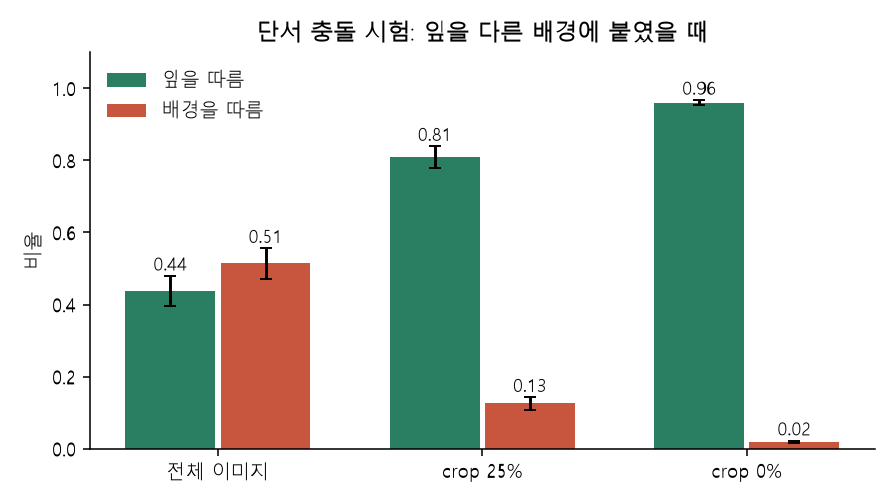
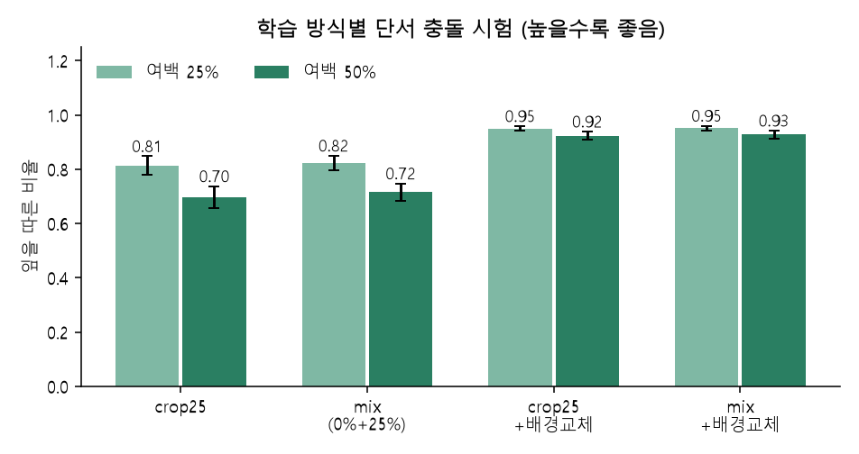

# 사진 진단 전처리 방식 시험 (2026-11-19)

> **작업 기록 원본.** 읽기 좋게 정리한 문서는 [vision.md](../../vision.md) · [eda.md](../eda.md) · [preprocessing.md](../preprocessing.md) · [performance.md](../performance.md). 이 문서는 시간 순서대로 쌓은 기록이라 내용 순서가 섞여 있다.

[vision.md](vision.md) S4~S5의 "전처리를 어떻게 할 것인가"를 정하기 위한 시험 기록이다. 이미지·원자료는 [vision-preprocess-test/](vision-preprocess-test/) 폴더에 있다.

## 0. 결론

| 질문 | 답 |
|---|---|
| 어제 시험(전체 0.970 / crop 0.969 / 배경만 0.936)은 샘플이 부족해서 못 믿는 건가? | **아니다.** 샘플은 충분했다 (시드 편차 0.005~0.01, 풀을 4배로 늘려도 순위 동일). 문제는 **변별력**이다. 같은 데이터 안의 정확도는 전처리 방식을 가르지 못한다 |
| 그러면 전처리는 무엇으로 정하나? | **단서 충돌 시험**(잎을 다른 배경에 붙임)으로 정했다. 일반 정확도는 같은데 이 시험에서 큰 차이가 났다 |
| 이미지 전체를 넣어도 되나? | **안 된다.** 충돌 시험에서 전체 이미지 입력은 잎을 44%, **배경을 51%** 따랐다 |
| 최종 방식 | **bbox crop(여백 0~25% 무작위) + 배경 교체 증강**. 잎을 따른 비율 0.95 (여백 25%), 0.93 (여백 50%) |

일반 정확도(품목 마스킹)는 전 방식이 0.95~0.97로 같으므로, 선택 근거는 모두 4~5장의 충돌 시험이다.

## 1. 무엇을 의심했나

어제 실험(`crop_ablation.py`)에서 bbox 안(잎)을 회색으로 가린 입력이 0.936이 나왔다. 잎을 가려도 맞힌다면 모델이 병이 아니라 **촬영 환경**으로 분류하고 있을 가능성이 있다 ([vision.md 4.1 "출처 편향"](vision.md#41-153-시설-작물-질병): 정상과 질병이 촬영 장소·시기·부위가 다르다). 이 상태에서는 시험 점수가 높아도 실제 사진에서 무너질 수 있다.

외부 평가 사진이 없으므로, 데이터 안에서 이 문제를 직접 재는 시험을 설계했다.

## 2. 설정

- 데이터: 153 Training, 고추·토마토·상추 (작물별 정상 + 병 2개 = 9클래스), 잎(area=3)만, 클래스당 최대 600장 (그룹을 돌아가며 뽑음). 촬영 대상(그룹) 수는 병 클래스가 6~15개뿐이다
- 모델: EfficientNet-B0 (ImageNet 사전학습), 224px, 6 epoch, AdamW, fp16. 이 PC(RTX 5060 Ti)에서 한 번에 30~60초
- **시험셋은 학습과 겹치지 않는 촬영 대상**(질병은 대상ID, 정상은 장소·날짜). 시드마다 분할이 바뀐다
- 입력 변형 4가지 (같은 이미지에서 생성)
  - `full`: 이미지 전체 / `crop25`: bbox 사방 25% 여백으로 자름 / `crop0`: bbox 그대로 / `bgonly`: bbox를 회색으로 가림 (통제용)
- 변형 예시: 각 행이 한 샘플이고 열은 순서대로 full, crop25, crop0, bgonly다
  (변형 예시 이미지 `samples_고추_3.jpg`는 AI Hub 이미지라 레포에 올리지 않았다. `preprocess_test.py`로 재생성)
  (다른 클래스도 같다: `samples_*.jpg`)
- 점수 (품목 마스킹 = 정답 작물의 클래스만 남기고 고름. 서비스는 사용자가 품목을 고르므로 이 조건이 실제 사용과 같다)
  - `acc_mask`: 마스킹 후 정확도, `f1_mask`: 마스킹 후 macro-F1, `dis2`: 병 사진만 같은 작물의 병 2개 중 맞힌 비율 (정상 사진을 뺀 값, 우연 0.5)

## 3. 시험 1: 시험셋 크기와 반복으로 신뢰도 확인

풀 크기(클래스당 150/300/600장)와 시드 6개(분할)를 바꿔 총 72회 학습했다. 스크립트 `ml/vision/experiments/preprocess_test.py`, 집계 [summary.md](vision-preprocess-test/summary.md).

품목 마스킹 정확도 (평균 ± 표준편차, 시드 6개):

| 풀 크기 | full | crop25 | crop0 | bgonly |
|---|---:|---:|---:|---:|
| 150 | 0.931 ± 0.011 | 0.931 ± 0.010 | 0.930 ± 0.010 | 0.882 ± 0.019 |
| 300 | 0.952 ± 0.007 | 0.952 ± 0.010 | 0.951 ± 0.006 | 0.913 ± 0.007 |
| 600 | 0.963 ± 0.006 | 0.962 ± 0.005 | 0.962 ± 0.006 | 0.929 ± 0.009 |

읽는 법:
- **샘플은 충분하다.** 같은 방식 안의 시드 편차는 0.005~0.01이고, 풀 크기에 따라 점수가 오르긴 하지만 방식 간 순위는 바뀌지 않는다.
- **전처리 방식끼리는 구분이 안 된다.** 같은 분할끼리 뺀 쌍 차이가 full·crop25·crop0 사이에서 −0.002~+0.001 (최소·최대가 0을 걸침, 이긴 시드 수도 절반 안팎)이다. 더 많은 샘플을 써도 이 시험으로는 가려지지 않을 것이다. 같은 데이터 안의 점수는 모두 "촬영 환경 단서"로도 올라가기 때문이다.
- 배경만 넣은 입력이 0.93이다. 다만 `bgonly`에는 bbox 밖의 주변 잎·식물이 남아 있어서(잎 bbox 면적비 0.16~0.8), 순수한 배경 편향이라고 단정할 수 없다. 이것을 분리하는 것이 시험 2다.
- 한계: 시험 그룹 수가 클래스에 따라 2~25개다 (고추 병4는 2개). 클래스별 점수는 불안정하다.

## 4. 시험 2: 단서 충돌 (잎 vs 배경)

시험 이미지 A의 잎(bbox 안쪽)을 **같은 작물의 다른 클래스 이미지 B의 배경**에 붙인다. 정답은 A의 클래스다. 모델이 B의 클래스를 말하면 배경을 따른 것이다. 스크립트 `cue_conflict_test.py`, 시드 4개.

(합성 예시 이미지 `conflict_samples.jpg`: 각 행은 한 샘플, 열은 full / crop25 / crop0. AI Hub 이미지라 레포에 올리지 않았다. `cue_conflict_test.py`로 재생성)



| 입력 | 일반 정확도(마스킹) | 잎을 따름 | 배경을 따름 | 그 외 |
|---|---:|---:|---:|---:|
| 전체 이미지 | 0.967 ± 0.005 | 0.438 ± 0.041 | **0.514 ± 0.042** | 0.048 |
| crop 25% | 0.963 ± 0.007 | 0.809 ± 0.030 | 0.126 ± 0.017 | 0.066 |
| crop 0% | 0.960 ± 0.007 | 0.960 ± 0.007 | 0.019 ± 0.003 | 0.021 |

- **전체 이미지 입력은 배경을 더 따른다.** 일반 정확도가 가장 높아 보이는 것이 오히려 배경 단서 덕분이었다.
- crop은 배경이 줄수록(여백 25% → 0%) 잎을 따르는 비율이 오른다. (crop0는 합성 배경이 아예 입력에 들어가지 않으므로 사실상 상한선이다)
- 즉 어제 우려는 맞았다. 단, 어제 시험은 이것을 가릴 능력이 없었다.

## 5. 시험 3: 여백 범위와 배경 교체 증강

서비스에는 bbox가 없고 앱의 가이드 틀로 자르므로 여백이 0~50%까지 흔들린다. 학습 방식 4가지를 비교했다 (`margin_swap_test.py`, 시드 3개). 배경 교체 증강은 **학습 이미지의 잎을 다른 학습 이미지(작물 상관없이)의 배경에 붙인 합성**이고, 정답은 잎의 클래스다. 시험용 배경은 시험셋에서만 가져와 섞이지 않는다.

| 학습 방식 | 설명 |
|---|---|
| crop25 | 여백 25% crop만 |
| mix | 여백 0% + 25% crop을 섞음 |
| crop25+swap | crop25 + 배경 교체 합성 (학습 이미지당 1장) |
| mix+swap | mix + 배경 교체 합성 |



| 학습 방식 | 일반 여백 0% | 25% | 50% | 충돌@25 잎 | 충돌@25 배경 | 충돌@50 잎 | 충돌@50 배경 |
|---|---:|---:|---:|---:|---:|---:|---:|
| crop25 | 0.919 | 0.952 | 0.958 | 0.814 | 0.120 | 0.697 | 0.230 |
| mix | 0.936 | 0.950 | 0.954 | 0.822 | 0.115 | 0.716 | 0.221 |
| crop25+swap | 0.942 | 0.958 | 0.961 | 0.950 | 0.025 | 0.924 | 0.049 |
| **mix+swap** | **0.955** | **0.961** | **0.964** | **0.951** | **0.025** | **0.928** | **0.044** |

- **배경 교체 증강이 가장 크게 효과가 있다.** 잎을 따르는 비율이 0.81 → 0.95 (여백 25%), 0.70 → 0.93 (여백 50%). 일반 정확도도 떨어지지 않고 오히려 오른다.
- 여백 0%·25%를 섞는 것(mix)은 여백 0% 입력의 일반 정확도(0.919 → 0.936)를 올리지만 충돌 방어에는 효과가 없다. 증강과 함께 쓰면 모든 여백에서 가장 좋다.
- 표준편차는 일반 점수 0.002~0.015, 충돌 점수 0.003~0.04다. 위 차이(0.1 이상)는 편차보다 훨씬 크다. mix+swap과 crop25+swap의 차이는 편차 안이다.

## 6. 정한 전처리·학습 규격

[vision.md 5장](vision.md#5-전처리-규격)에 반영했다.

1. 전처리는 **bbox crop** (사방 25% 여백, 긴 변 512px)으로 저장한다. **이미지 전체는 쓰지 않는다**
2. 학습할 때 **여백을 0~25%로 무작위** 줄여 자른다
3. 학습 때 **배경 교체 증강**: 같은 배치 안 또는 학습셋의 다른 이미지에서 배경을 가져와 잎(bbox 안쪽)을 붙인다. 이번 시험은 원본과 합성을 2:1 정도로 섞은 학습이었다 (원본 crop0·crop25 + 합성 25% 여백 1장)
4. 여백 50%까지도 버티는지는 시험했고(잎 0.93), 가이드 틀이 이보다 느슨한 사진은 시험하지 않았다
5. 분할은 대상ID 단위. AI Hub Validation 점수는 판단 근거로 쓰지 않는다

## 7. 이 시험으로 알 수 없는 것

- **실제 사용자 사진이 아니다.** 충돌 시험의 합성은 사각형을 붙인 것이라 이음새가 보이고, 배경 교체 증강도 같은 방식으로 만든 합성이다. 증강한 모델이 실제 사진의 낯선 배경에서도 잎을 보는지는 확인하지 못했다. S9의 Grad-CAM 점검과 직접 찍은 사진 몇 장으로 확인해야 한다
- 고추·토마토·상추 3작물, 잎 사진, 6 epoch 시험이다. 딸기(꽃·열매), 호박류, 147·146은 해당 없다. 학습을 전체 데이터로 한 뒤 같은 충돌 시험을 다시 해서 확인한다
- 정상 사진의 출처가 질병 사진과 다른 문제 자체(촬영 시기·부위)는 이 시험에서 해결한 것이 아니다. 잎 crop과 배경 교체로 영향을 줄였을 뿐이다
- 시험 그룹 수가 적은 클래스(고추 병4: 2개)의 점수는 불안정하다
- 증강에서 붙인 잎 경계 자체가 라벨과 상관없도록 배경 클래스를 무작위로 뽑았지만, 합성 이음새를 단서로 쓰지 않는다는 것도 직접 확인한 것은 아니다

## 8. 재현

모두 `ml/vision/experiments/`에서 `ml/vision/.venv`로 실행한다. 153 원본 zip이 `ml/vision/data/raw/153/`에 있어야 한다.

```bash
python -X utf8 experiments/preprocess_test.py   "data/raw/153/071.시설 작물 질병 진단/01.데이터" ../../docs/vision/archive/vision-preprocess-test 6 150,300,600   # 시험 1 (약 40분)
python -X utf8 experiments/summarize_preprocess_test.py ../../docs/vision/archive/vision-preprocess-test/results.json > ../../docs/vision/archive/vision-preprocess-test/summary.md
python -X utf8 experiments/cue_conflict_test.py "data/raw/153/071.시설 작물 질병 진단/01.데이터" ../../docs/vision/archive/vision-preprocess-test 4            # 시험 2 (약 7분)
python -X utf8 experiments/margin_swap_test.py  "data/raw/153/071.시설 작물 질병 진단/01.데이터" ../../docs/vision/archive/vision-preprocess-test 3            # 시험 3 (약 12분)
python -X utf8 experiments/plot_preprocess_test.py ../../docs/vision/archive/vision-preprocess-test                                                         # 그래프 (matplotlib 필요)
```

폴더 구성: `results.json`·`conflict_results.json`·`margin_swap_results.json` (원자료), `summary.md`, `fig_*.png`. (`run1~3.log`와 AI Hub 이미지인 `samples_*.jpg`·`conflict_samples.jpg`는 레포에 없다.)

메모: 시험 1은 실수로 같은 명령이 두 번 겹쳐 돌았다. 결과 파일은 나중에 끝난 쪽이 덮어썼고 (두 번의 점수 차이는 0.001 안팎), `run1.log`의 한 줄이 깨져 있다.
