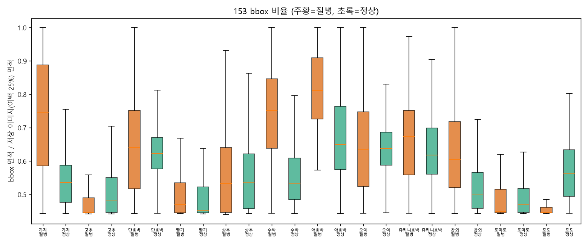
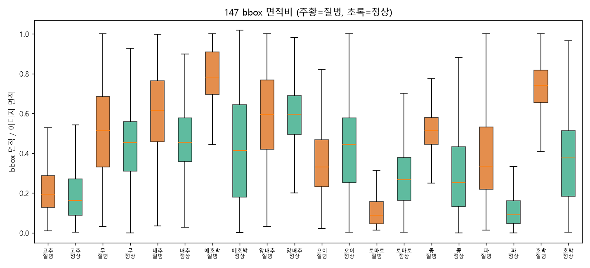
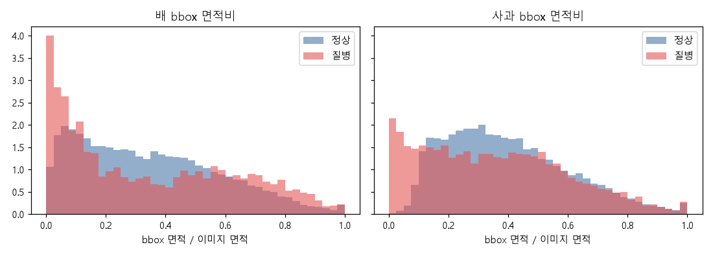
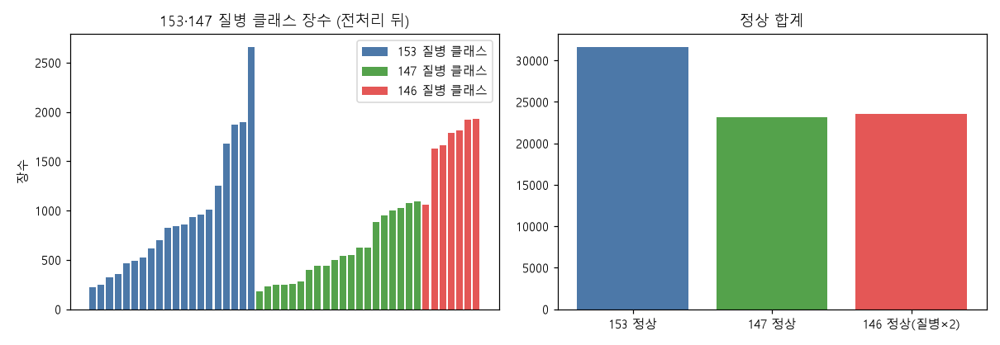

# 사진 진단 데이터 EDA (153·147·146)

사진 진단 모델을 학습하기 전에 세 데이터셋(AI Hub)을 어떻게 확인했고, **무엇이 문제여서 처리 규격을 어떻게 정했는지**를 데이터셋별로 정리한다. 기능 전체는 [vision.md](../vision.md), 처리 규격은 [preprocessing.md](preprocessing.md), 모델 성능은 [performance.md](performance.md). 표 전체·스크립트 출력·작업 당시 기록은 [archive/](archive/)에 있다.

방법: 라벨 JSON은 zip에서 바로 읽어 표로 만들었고(`ml/vision/experiments/eda_*.py`), 이미지는 표본(작물·클래스당 8~12장)만 메모리로 읽어 확인했다. 시트(이미지 모음)는 AI Hub 이미지라 레포에 올리지 않았다 (스크립트로 재생성).

## 1. 세 데이터셋 한눈에 비교

| 항목 | 153 시설 작물 | 147 노지 작물 | 146 과수화상병 |
|---|---|---|---|
| dataSetSn / 과제 번호 | 153 / 77 | 147 / 79 | 146 / 80 |
| 작물 | 12종 (가지·고추·단호박·딸기·상추·수박·애호박·오이·쥬키니호박·참외·토마토·포도) | 10종 (고추·무·배추·애호박·양배추·오이·토마토·콩·파·호박) | 2종 (사과·배) |
| 질병 클래스 | 20 | 20 (토마토 1종, 파 3종, 나머지 2종) | 7 (사과 5종, 배 2종) |
| 원본 라벨 수 (증강 제외) | 약 20.2만 | 150,337 | 67,526 |
| 정상 : 질병 | 약 9.6 : 1 (18.3만 : 1.9만) | 약 12 : 1 (138,705 : 11,632) | 약 4.5 : 1 (55,325 : 12,201) |
| 질병 클래스 장수 (원본) | 약 245~2,661 | 202~1,077 | 1,126~1,930 |
| 질병 대상ID (클래스당) | 4~22 (전체 111) | 2~13 (전체 85) | 5~17 (전체 64) |
| 질병 대상ID가 Train·Val 양쪽에 있음 | 111 중 109 | 85 중 79 | 64 중 64 |
| 같은 식물이 두 병 클래스에 걸침 | 56 / 146 (수박·단호박·상추·딸기·토마토) | 48 / 86 (콩·고추·무…) | **0 / 64** |
| bbox | 이미지당 1개, 관찰 부위 전체 | 같음 | 같음 |
| bbox 좌표 기준 | 이미지마다 다름 (JSON 크기와 이미지 크기를 비교해 판별) | EXIF 회전 뒤 좌표 181개 | EXIF 회전 뒤 좌표 176개 |
| 질병 JSON `type` | 1 | 1 | **null** |
| 질병 이름 | **확정** (설명서 v2.1 + 사용자 제공 표) | **확정** (사용자 제공 표) | **확정** (사용자 제공 표) |
| 전처리 후 이미지 | 50,350 | 34,730 | 12,993 |

세 데이터셋은 같은 컨소시엄이 만들어 **라벨 구조가 거의 같다**: `description`(image, date, worker, height, width, task, type, region)과 `annotations`(disease, crop, area, grow, risk, points). 파일명 `V006_<과제>_{type}_{disease}_{crop}_{area}_{grow}_{risk}_{대상ID}_{날짜}_{번호}`의 조각은 JSON 값과 일치한다 (146은 질병 일부가 어긋남, 아래). **작물·질병 코드는 데이터셋마다 다르다** (153의 15는 오이, 147의 15는 토마토, 146의 4는 사과 병). 그래서 클래스는 `(데이터셋 → 작물 이름, 질병 코드)`로 만들고 라벨은 `<작물>_<질병코드>`로 쓴다 (세 데이터셋의 라벨이 겹치지 않는다. 시설·노지 둘 다 있는 고추·애호박·오이·토마토의 **정상**만 하나의 클래스로 합쳐진다).

## 2. 공통 발견과 처리 결정

| # | 발견 | 어떤 데이터셋 | 결정 (처리 규격) |
|---|---|---|---|
| 1 | **bbox는 병반이 아니라 관찰 대상 한 개**(잎·열매·가지·줄기 한 부분)다. 이미지당 1개 | 3개 모두 | 탐지 모델은 쓰지 않고 **이미지 분류 + bbox crop** |
| 2 | **정상과 질병의 촬영 환경이 다르다 (출처 편향).** 정상은 과원·시설 여러 곳에서 지역 빈 값, 질병은 연구기관에서 한두 지역, 시기(정상 12월·질병 9~11월), 부위(정상 줄기·꽃, 질병 잎), 배경(손·화분·콘크리트·검은 판) | 3개 모두 | bbox crop(배경 줄이기) + **배경 교체 증강** + 대상ID 단위 분할 + **외부 사진으로 평가(E6)**. 같은 데이터 안의 점수는 믿지 않는다 |
| 3 | **AI Hub의 Training/Validation이 새고 있다.** 같은 식물이 양쪽에 있다 | 3개 모두 | 원래 분할을 쓰지 않고 **질병은 대상ID, 정상은 (장소, 날짜) 묶음 단위로 8/1/1 재분할** |
| 4 | **정상이 압도적으로 많고 연속 촬영 프레임이다** (147 정상 91%·146 정상 93%가 번호 간격 1, 질병도 146에서 87%) | 3개 모두 | 정상은 질병 합계의 약 2배까지만, 묶음마다 간격을 두고 균등 추출 (146은 작물당 3,000 상한) |
| 5 | **같은 식물에서 병 두 종이 같이 나온다** | 153·147 (146은 없음) | 한 번 정한 대상ID의 분할을 같은 작물의 모든 병 클래스에서 공유 (분할 누수 0). 혼동은 성능에서 확인 (수박·무·애호박 병 2종) |
| 6 | **bbox 좌표가 EXIF 회전 뒤인 이미지가 있고** JSON 크기는 회전 전이거나 0이다 | 147 181개, 146 176개, 153 일부 | **EXIF 회전을 먼저 적용하고 bbox를 쓴다.** JSON 해상도로 범위를 검사하지 않는다 (시트로 확인) |
| 7 | **부위가 클래스와 얽혀 있다.** 딸기 잿빛곰팡이는 잎 1%·대부분 꽃·열매, 고추 질병 절반은 열매, 사과 병은 잎·가지·열매에 나뉨 | 3개 모두 | "잎만 쓴다" 규칙을 폐기하고 **그 작물 질병 사진에 5% 이상 나오는 부위만** 쓴다. 정상도 같은 부위만, 질병의 부위 비율대로 뽑는다 |
| 8 | **이상 라벨이 있다.** 정상 코드인데 risk>0·region 있음, 질병 코드인데 risk 0, JSON과 파일명 코드 불일치, 코드표 밖 1장짜리 조합, 파일명 규칙 밖 | 3개 모두 (146이 가장 많음) | 해당 행 제외 (규칙은 [preprocessing.md](preprocessing.md)) |
| 9 | **상자 모양이 정상/병 단서다.** 정상 가지·줄기는 가늘고 긴 상자, 정상 파는 가는 띠 | 147·146 | 시험으로 확인(상자 모양만으로 정상/병 0.78~0.82). 서비스는 가이드 틀로 자르므로 **E6에서 확인** |
| 10 | **질병 클래스당 대상ID가 적다 (2~22개).** 시험 묶음이 클래스당 1~2개 | 3개 모두 | 클래스별 점수의 편차가 크다는 것을 기록. 합친 평가·시드 반복으로 보완 |
| 11 | **사과·배는 장수가 훨씬 많다** (원본 질병 클래스 1,126~1,930, 정상 5.5만) | 146 | 질병 클래스당 1,000장 상한(대상ID 균등 + 간격 추출), 정상 작물당 3,000 상한 → 합친 전체의 약 13% |

(위에서부터 153, 147, 146. 정상/질병 상자 크기 분포. 153 질병 클래스 중 호박류·수박은 0.6~0.8로 잎 한 장이 이미지 대부분이고, 고추·토마토·딸기는 0.2 안팎으로 작다. 147은 토마토 질병과 정상 파가 0.09로 아주 작다.)

## 3. 153 시설 작물 질병

작물 코드와 질병 이름은 설명서 v2.1 기준이다 (테크니컬 리포트판은 틀림).

| 작물 코드 | 1 가지 | 2 고추 | 3 단호박 | 4 딸기 | 5 상추 | 6 수박 | 7 애호박 | 8 오이 | 9 쥬키니호박 | 10 참외 | 11 토마토 | 12 포도 |
|---|---|---|---|---|---|---|---|---|---|---|---|---|

| 질병 코드 | 이름 | 질병 코드 | 이름 |
|---|---|---|---|
| 1 | 가지잎곰팡이병 | 11 | 수박탄저병 |
| 2 | 가지흰가루병 | 12 | 수박흰가루병 |
| 3 | 고추마일드모틀바이러스병 | 13 | 애호박점무늬병 |
| 4 | 고추점무늬병 | 14 | 쥬키니호박에 붙음 (오이녹반모자이크바이러스, CGMMV) |
| 5 | 단호박점무늬병 | 15 | 오이에 붙음 (오이모자이크바이러스, CMV) |
| 6 | 단호박흰가루병 | 16 | 참외노균병 |
| 7 | 딸기잿빛곰팡이병 | 17 | 참외흰가루병 |
| 8 | 딸기흰가루병 | 18 | 토마토잎곰팡이병 |
| 9 | 상추균핵병 | 19 | 토마토황화잎말이바이러스병 |
| 10 | 상추노균병 | 20 | 포도노균병 |

(14·15는 데이터에서 오이=15, 쥬키니=14라 설명서 이름과 엇갈렸으나, 2026-11-20 사용자가 제공한 AI Hub 표(쥬키니호박=오이녹반모자이크바이러스, 오이=오이모자이크바이러스)로 위처럼 확정했다.)

- **규모:** 라벨 20.2만 개 (정상 18.3만, 질병 약 1.9만), 증강본(`9.증강.zip`, `_a000N`)은 받지 않았다. 설명서 기준 작물마다 정상 1만 장, 질병 원본 1,000장이다 (AI Hub 페이지의 큰 수는 증강본 포함).
- **코드표 밖 조합 66개 제외** (1장짜리 잡음: 가지-7, 고추-2, 쥬키니-3, 애호박-2 38개 등).
- **출처 편향 (가장 크다):** 정상은 지역이 비고 대부분 2020-12에 찍혔으며 줄기 사진이 많다. 질병은 작물마다 거의 한 지역이고 2020-09~11, 대부분 잎이다. 정상이 12월에 몰린 작물이 많다 (가지 90%, 참외 87%, 토마토 70%. 포도 정상은 10월 100%로 반대). 딸기 질병은 손으로 잎을 들고 찍었고, 고추 질병은 연구 시설의 화분·콘크리트 바닥이 배경이다.
- **bbox:** 잎(관찰 대상) 전체이고 병반이 아니다. 면적비 중앙값은 작물마다 0.16~0.79.
- **부위:** "잎만 쓴다"는 처음 규칙은 틀렸다. 딸기 잿빛곰팡이(7)는 잎이 1%뿐이고 질병 중 꽃이 1,022장이다. 그래서 질병 사진에 5% 이상 나오는 부위만 쓰는 규칙으로 바꿨다 (딸기만 열매·꽃·잎, 나머지는 잎).
- **묶음:** 질병 대상ID 111개 중 109개가 Training에도 있다 (AI Hub Validation 점수는 믿을 수 없다). 클래스당 대상ID는 4~22개 (애호박 4, 오이 6, 딸기 8, 포도 7). 정상은 연속 프레임이다 (오이 정상 14,123장이 135개 묶음에서 나왔다). 같은 대상ID가 둘 이상의 질병 클래스에 걸친 것이 56/146개다 (단호박 21, 상추 14, 수박 10, 딸기 8, 토마토 3). 수박 병 2종은 같은 식물·같은 날 찍혀 사진에도 서로의 증상이 섞여 있다.
- **라벨 이상 18개:** 정상 코드인데 risk·region이 있는 행 4개(고추 `2766w`, 시트에서 잎에 병반이 보임), 질병 코드인데 risk 0인 행 14개.
- **받지 못한 것:** Validation 원천 포도(Training 원천으로 충분), Training 토마토·포도 정상(10GB 규칙), Validation 가지 질병 zip은 비어 있음.
- **AI Hub 제공 모델은 쓰지 않는다.** 참외 3클래스 예시였고 실제로 돌려 보니 다른 작물의 병은 모두 참외 병이나 정상으로 나왔다.
- **전처리 후:** 50,350장 (질병 18,726 · 정상 31,624), 질병 클래스 221~2,658장. 상세: [archive/vision.md 4.1](archive/vision.md), [archive/vision-153-eda/](archive/vision-153-eda/).

## 4. 147 노지 작물 질병

| 작물 코드 | 1 | 2 | 3 | 4 | 5 | 6 | 7 | 8 | 9 | 10 |
|---|---|---|---|---|---|---|---|---|---|---|
| 작물 | 고추 | 무 | 배추 | 애호박 | 양배추 | 오이 | 토마토 | 콩 | 파 | 호박 |

질병 코드는 작물을 가로질러 1~20으로 이어진다 (고추 1·2, 무 3·4, 배추 5·6, 애호박 7·8, 양배추 9·10, 오이 11·12, 콩 13·14, 토마토 15, 파 16·17·18, 호박 19·20). **질병 이름은 2026-11-20 사용자가 제공한 AI Hub 표로 확정**했다 (토마토 zip 이름이 `잎마름병(토마토)`). 코드 순서는 AI Hub 설명서 v2.1 표 3(코드 목록)과 20개 모두 일치한다. (AI Hub 표의 `배추검은썩음병`은 오타이고 설명서는 `배추검은썩음병`이다.)

| 질병 코드 | 이름 (AI Hub 표) | 질병 코드 | 이름 (AI Hub 표) |
|---|---|---|---|
| 1 | 고추탄저병 | 11 | 오이노균병 |
| 2 | 고추흰가루병 | 12 | 오이흰가루병 |
| 3 | 무검은무늬병 | 13 | 콩불마름병 |
| 4 | 무노균병 | 14 | 콩점무늬병 |
| 5 | 배추검은썩음병 | 15 | 토마토잎마름병 |
| 6 | 배추노균병 | 16 | 파검은무늬병 |
| 7 | 애호박노균병 | 17 | 파노균병 |
| 8 | 애호박흰가루병 | 18 | 파녹병 |
| 9 | 양배추균핵병 | 19 | 호박노균병 |
| 10 | 양배추무름병 | 20 | 호박흰가루병 |

- **규모:** 라벨 150,337개 (정상 138,705, 질병 11,632), 30클래스 (정상 10 + 질병 20), 질병 클래스 202~1,077장. 증강본·model.zip 없음. 이름에 "증강"이 든 토마토 zip 한 개는 받았다가 삭제했다.
- **코드표 밖:** 호박(코드 0) 질병 1장뿐. 같은 대상(9258e)·같은 날의 정상 4장도 질병 사진이 정상으로 섞인 것으로 보여 5장을 제외했다.
- **bbox:** 이미지당 1개. 토마토 질병 0.09, 파 정상 0.09처럼 매우 작은 상자가 있고, 정상/질병 상자 크기가 작물마다 다르다 (애호박 정상 0.41/질병 0.78, 콩 0.25/0.51). **EXIF 회전 뒤 좌표 181개**, JSON 해상도 0인 무 질병 43개.
- **출처 편향:** 정상은 12~1월·지역 빈 값, 질병은 9~11월·작물당 1~3개 지역. 정상에 줄기·꽃·열매가 많은 6작물(고추·애호박·오이·토마토·콩·호박)은 질병이 거의 잎뿐이다. 정상은 화분·손에 든 잎·실내 사진이 섞여 있다 (호박 정상 표본이 특히).
- **묶음:** 질병 대상ID 85개 중 79개가 Train·Val 양쪽. 클래스당 2~13개 (양배추_10 2개, 파_17 3개, 토마토 4개). 같은 (대상ID, 날짜)에서 병 2종이 17% (콩·고추·무). 정상 묶음은 작물당 46~138개, 번호 간격 1이 91%.
- **전처리 후:** 34,730장 (질병 11,579 · 정상 23,151). 상세: [archive/vision-147.md 4장](archive/vision-147.md), [archive/vision-147-eda/](archive/vision-147-eda/).

## 5. 146 과수화상병 (사과·배)

| 작물 코드 | 질병 코드 | 이름 | 장수 (Train+Val) | 시트에서 본 모습 |
|---|---|---|---:|---|
| 배 1 | 1 | 배검은별무늬병 | 1,126 | 잎의 검은 반점 |
| 배 1 | 2 | 배과수화상병 | 1,729 | 마른 갈색 잎·가지 |
| 사과 2 | 3 | 사과갈색무늬병 | 1,930 | 노란 잎 위 갈색 반점 |
| 사과 2 | 4 | 사과과수화상병 | 1,846 | 마른 잎·가지 |
| 사과 2 | 5 | 사과부란병 | 1,923 | 가지·줄기 껍질의 궤양 |
| 사과 2 | 6 | 사과점무늬낙엽병 | 1,821 | 잎의 붉은 점 |
| 사과 2 | 7 | 사과탄저병 | 1,786 | 열매의 갈색 부패 |

(질병 이름은 JSON·파일명에 없어 사용자가 제공한 AI Hub 표로 확정했다. 표의 구축수량은 증강본 포함이고 우리 원본 라벨은 위 장수다.) 부위 코드: 01 열매, 03 잎, **04 가지, 05 줄기(주간)** (시트로 확인).

- **규모:** 라벨 67,526개 (정상 55,325, 질병 12,201). zip 18개(112.8 GiB), 정상 원천이 두 zip으로 나뉜 것은 합치면 라벨과 일치. **사과 질병 867장은 `.png`**.
- **146에서 새로 보인 것:**
  - **질병 JSON `type`이 전부 null** (정상/질병은 zip 종류로 가른다).
  - **질병 JSON `area`는 파일명과 어긋난다** (정상은 99.9% 일치). 파일명 부위를 쓴다.
  - **JSON과 파일명이 어긋난 행** 114개 (작물 코드, 질병 코드, risk. 다른 사유와 겹치는 행은 제외하고 센 값), 코드표 밖 32장, 질병 risk 0 7장, 정상 type=1 5장, 정상 파일명이 규칙 밖 3,706장 (6자리 날짜 3,195장, 이름이 긴 것, `IMG_` 등). 모두 제외.
  - **같은 식물이 두 병에 걸치지 않는다** (0/64). 153 수박·147 무 같은 병끼리 혼동 문제가 구조적으로 없다.
  - **질병 클래스와 부위·지역이 거의 1:1:** 사과_3·6은 잎 100%, 사과_5는 가지 100%, 사과_7은 열매 100%, 배_1은 잎 94%. 사과_6은 지역 2 100%, 사과_4는 지역 8 79%. 정상 줄기(05)는 질병에 거의 없어 제외된다.
- **출처 편향:** 질병은 2020-09~11, 정상은 지역 빈 값이고 열매·잎은 10~11월로 질병과 겹치지만 **가지·줄기는 정상이 겨울(12월) 가지**다 (147보다 편향은 약함). 질병 열매(사과_7)는 검은 판·접시 위에 올린 사진이 섞여 있고, 정상 열매는 나무에 달린 모습이다. 정상 가지·줄기는 가늘고 긴 상자다 (상자 모양 단서).
- **bbox:** 잎 한 장(배_1·사과_3·6), 열매 한 개(사과_7), 굵은 가지·줄기(사과_5), 마른 잎·가지 무리(배_2·사과_4, 면적비 중앙 0.11~0.13으로 작음). **EXIF 6이고 JSON 크기가 회전 전인 이미지 176개**는 bbox가 회전 뒤 좌표다 (시트로 확인).
- **묶음:** 질병 대상ID 64개 모두 Train·Val 양쪽에 있다. 사과_3·사과_5는 대상 5개, 배_1은 6개뿐이라 대상 하나가 클래스의 20% 이상(최대 29%)을 차지하고 분할하면 train 3 / val 1 / test 1이다. 질병도 연속 프레임 (번호 간격 1이 87%).
- **불균형:** 규칙대로(질병 전부 + 정상 질병×2) 처리하면 3.5만 장으로 합친 전체의 29%가 되어 사과·배가 학습을 지배한다. 상한(질병 1,000/클래스, 정상 3,000/작물)을 적용해 12,993장(13%)으로 줄였다.
- **전처리 후:** 12,993장. 상세: [archive/vision-146.md 4장](archive/vision-146.md), [archive/vision-146-eda/](archive/vision-146-eda/).

(왼쪽: 153·147·146의 질병 클래스 장수. 146은 처음부터 다른 데이터셋보다 클래스가 크다. 오른쪽: 정상 합계.)

| 상한 시나리오 | 146 장수 | 합친 전체 대비 |
|---|---:|---:|
| 상한 없음 (질병 전부 + 정상 질병×2) | 35,391 | 29% |
| 질병 1,500 / 클래스 (정상 질병×2) | 30,165 | 26% |
| **질병 1,000 / 클래스 + 정상 3,000 / 작물 (채택)** | **12,993** | **약 13%** |
| 질병 800 / 클래스 + 정상 3,000 / 작물 | 11,600 | 12% |

## 6. EDA에서 남은 것

- 질병 이름은 세 데이터셋 모두 확정됐다. 147도 설명서 v2.1 표 3과 코드까지 일치한다. RAG(NCPMS 병명)와 맞추는 표만 남았다.
- 출처 편향은 데이터 안에서는 해결되지 않는다. **직접 찍은 사진(E6)** 과 Grad-CAM 점검이 남아 있다.
- 같은 식물에 병 2종(수박·무·애호박 등)을 한 클래스로 묶을지는 외부 사진으로 구분이 되는지 본 뒤 정한다.
