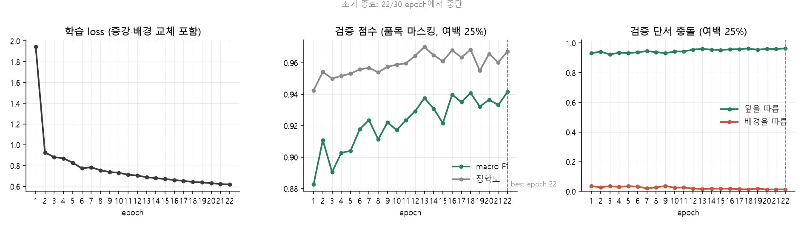
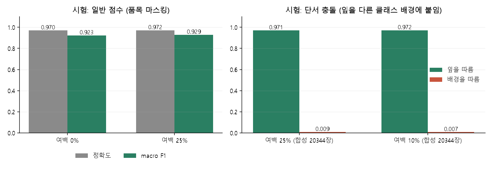
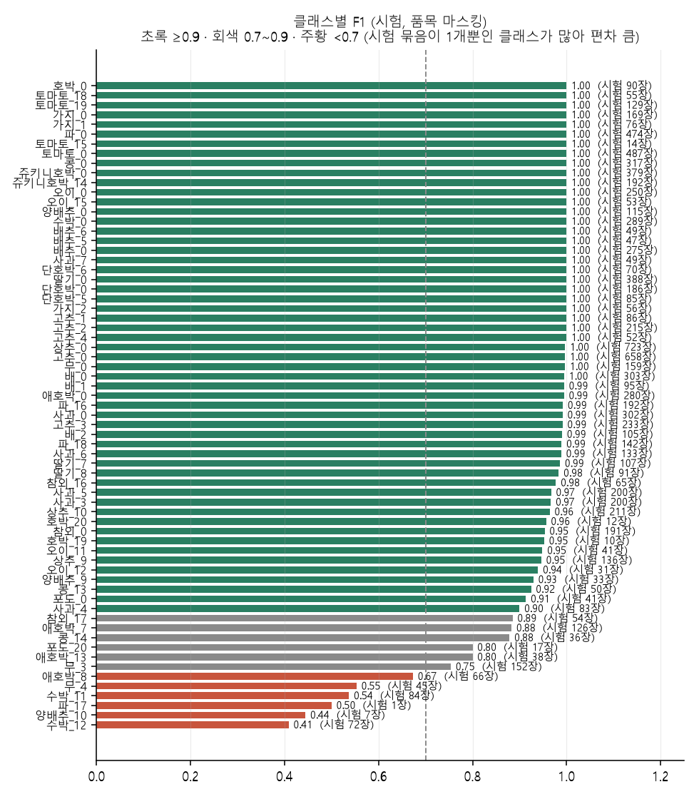
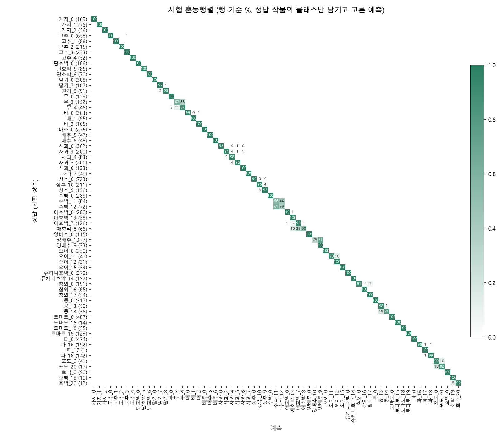

# 사진 진단 모델 성능

최종 모델(153·147·146을 합친 하나)의 학습 결과와 성능, 그리고 합치기 전 단독 모델과의 비교를 정리한다. 데이터는 [eda.md](eda.md), 처리·증강은 [preprocessing.md](preprocessing.md), 기능 전체는 [vision.md](../vision.md). 원자료(`results.json`, `confusion_test.csv` 등)는 [archive/vision-train-e5b_all/](archive/vision-train-e5b_all/).

> **이 점수는 같은 데이터 안의 점수다.** 정상과 질병의 촬영 환경이 다른 출처 편향이 학습·검증·시험에 모두 들어 있어서, **실제 사용자 사진의 정확도는 이보다 낮을 수 있다.** 사용 가능 여부는 직접 찍은 사진(E6)과 Grad-CAM 점검으로 판단한다. 시험 분할은 학습과 모델 선택(best epoch)에 쓰지 않고 학습이 끝난 뒤 한 번만 평가했다.

## 1. 요약

| 항목 | 값 |
|---|---|
| 모델 | EfficientNet-B0 (ImageNet 사전학습), 384px, 67클래스 `(작물, 병)` + 작물별 정상 |
| 데이터 | train 77,640 / val 10,261 / test 10,172장 (153 50,350 + 147 34,730 + 146 12,993) |
| 학습 | epoch 22에서 조기 종료 (최대 30, patience 6), best epoch 22, 누적 약 134분, GPU 장애 3회로 `--resume` 두 번 |
| **시험 정확도 / macro F1** | **0.972 / 0.929** (품목 마스킹, 여백 25%) |
| 마스킹 없이 (67클래스에서 고름) | 0.967 |
| 여백 0% | 정확도 0.970 |
| 단서 충돌 (잎 / 배경 따름) | 0.971 / **0.009** (여백 10%: 0.972 / 0.007) |
| 검증 macro F1 (best) | 0.941 |
| 배포 파일 | `ml/vision/model/vision.onnx` 16.4MB, CPU 1장 약 9ms, PyTorch와 출력 차이 2.7e-05 |

검증 macro F1은 epoch 13부터 0.93~0.94에서 정체했고 (학습 loss만 계속 내려감) epoch 22에서 조기 종료됐다.

## 2. 점수를 읽는 법

- **품목 마스킹:** 정답 작물의 클래스만 남기고 고른다. 서비스는 사용자가 품목을 고르므로 실제 사용 조건과 같다. 시설·노지가 모두 있는 품목(고추·애호박·오이·토마토)은 두 데이터셋의 병이 함께 후보가 된다.
- **정확도 vs macro F1:** 정확도는 장수가 많은 클래스(정상)에 끌려가고, macro F1은 67클래스를 똑같이 평균해 소수 클래스(대상이 적은 병)의 어려움이 드러난다. 모델 선택은 macro F1로 했다.
- **단서 충돌:** 잎을 다른 클래스의 배경에 붙여 모델이 잎을 보는지 배경을 따르는지 센다. 배경 따름이 낮을수록 병을 보고 판단한다.
- **시험 묶음이 적다:** 대부분의 병 클래스는 시험에 대상(같은 식물)이 1~2개뿐이라 클래스별 점수가 크게 출렁인다 (검증 macro F1이 epoch마다 ±0.01).

## 3. 데이터셋별 점수와 단독 모델 비교

시험 이미지는 단독 학습 때와 같다 (`ml/vision/experiments/eval_by_dataset.py`, manifest의 `dataset` 열).

| 시험 데이터 | 장수 | 클래스 | **합친 모델** 정확도 / macro F1 | 단독 모델 정확도 / macro F1 |
|---|---:|---:|---|---|
| 153 시설 | 5,040 | 32 | 0.975 / 0.949 | 0.979 / 0.958 |
| 147 노지 | 3,662 | 30 | 0.964 / 0.910 | 0.969 / 0.908 (약한 2클래스 제외 0.946) |
| 146 과수 | 1,470 | 9 | **0.980 / 0.977** | (단독 학습 안 함) |
| 전체 | 10,172 | 67 | 0.972 / 0.929 | |

- **합쳐도 점수가 무너지지 않았다.** 153 정확도 -0.004·F1 -0.009, 147 정확도 -0.005·F1 +0.002로 편차 안이다. 합친 쪽이 더 어려운 조건이다 (단독은 그 데이터셋의 클래스만 후보, 합친 모델은 같은 품목이면 시설·노지 클래스가 모두 후보).
- **시설·노지에 모두 있는 4작물** (데이터셋별 시험 정확도 / macro F1): 고추 147 0.994 / 0.998·153 1.000 / 1.000, 오이 147 0.984 / 0.963·153 1.000 / 1.000, 토마토 147 1.000 / 1.000·153 1.000 / 1.000, 애호박 147 0.898 / 0.850·153 1.000 / 1.000. 정상 클래스를 합쳤어도 한쪽 데이터셋이 무너지지 않았고, 애호박 147의 약점은 단독 모델 때와 같다.
- **146의 불균형 상한(질병 1,000/클래스, 정상 3,000/작물)이 의도대로 작동했다.** 사과·배가 합친 전체의 13%이고, 다른 작물의 점수가 단독 때와 비슷하다. 146 자체는 사과 0.969·배 0.993이고, 클래스별로 사과_4(과수화상병) 0.900이 가장 낮으며 나머지 8클래스는 0.967 이상이다. 146은 같은 식물이 두 병에 걸치지 않아 병끼리 혼동 문제가 구조적으로 없다.

## 4. 작물별 macro F1 (시험, 품목 마스킹)

| 작물 | F1 | 작물 | F1 |
|---|---:|---|---:|
| 수박 | 0.649 | 호박 | 0.970 |
| 무 | 0.768 | 오이 | 0.972 |
| 양배추 | 0.791 | 딸기 | 0.990 |
| 애호박 | 0.838 | 배 | 0.993 |
| 포도 | 0.857 | 고추 | 0.998 |
| 파 | 0.870 | 가지 | 1.000 |
| 콩 | 0.934 | 단호박 | 1.000 |
| 참외 | 0.939 | 배추 | 1.000 |
| 사과 | 0.969 | 쥬키니호박 | 1.000 |
| 상추 | 0.969 | 토마토 | 1.000 |

## 5. 약한 클래스 (시험 F1 0.9 미만, 12개)

| 클래스 | F1 | 원인 (확인된 정도) |
|---|---:|---|
| 수박_12 (흰가루) / 수박_11 (탄저) | 0.409 / 0.537 | **같은 식물·같은 날 찍힌 병 2종**이라 사진에도 서로의 증상이 섞여 있고, 학습 사진에서도 못 가른다 (153 단독 때와 같음: 0.40 / 0.59). 정상으로는 안 간다 |
| 무_4 / 무_3 | 0.553 / 0.754 | 147 무 병 2종 혼동 (단독 0.59 / 0.86). 정상으로는 안 간다 |
| 애호박_8 / 애호박_7 | 0.673 / 0.883 | 147 애호박 병 2종 혼동 (단독 0.68 / 0.85) |
| 양배추_10 | 0.444 | 시험 7장 (대상 2개). **점수를 신뢰할 수 없다**, 학습 데이터 부족 |
| 파_17 | 0.500 | 시험 **1장** (대상 3개 중 하나가 1장짜리). 점수를 신뢰할 수 없다 |
| 애호박_13 · 포도_20 | 0.800 · 0.800 | 대상 4개·시험 장수 적음 (포도 17장) |
| 콩_14 · 참외_17 | 0.879 · 0.885 | 원인 미확인 |

**병끼리 혼동 (수박·무·애호박):** 정상 대 병은 거의 틀리지 않고 같은 작물의 병 2종끼리만 헷갈린다. 같은 식물에 병 2종이 걸친 비율이 높았던 콩·고추는 오히려 잘 맞아서, "같은 식물 공유"만으로는 설명이 안 된다 (원인 후보: 두 병의 겉모습이 실제로 비슷함, 시험 묶음이 클래스당 1개, 라벨이 식물 단위로 붙었을 가능성. 이 시험으로는 가리지 못함). 대응은 외부 사진에서 구분이 되는지 본 뒤 정한다: 한 클래스로 묶거나, 사용자에게 두 병을 후보로 함께 보여 준다.

## 6. 학습 이력 (단독 → 합친 모델)

| 학습 | 데이터 | 클래스 | 종료 | 학습 시간 | 시험 정확도 / macro F1 | 단서 충돌 잎 / 배경 | 원자료 |
|---|---|---:|---|---|---|---|---|
| S8 153 단독 | 50,350 | 32 | 11 epoch 조기 종료, best epoch 8 (최대 12) | 40.9분 | 0.979 / 0.958 | 0.968 / 0.015 | [archive/vision-train-s8_153/](archive/vision-train-s8_153/) |
| E5 147 단독 | 34,730 | 30 | 8 epoch 조기 종료, best epoch 4 (최대 12) | 22.8분 | 0.969 / 0.908 | 0.951 / 0.024 | [archive/vision-train-e5_147/](archive/vision-train-e5_147/) |
| **E5b 합친 모델** | 98,073 | 67 | **22 epoch 조기 종료, best epoch 22** (최대 30) | 약 134분 (누적) | **0.972 / 0.929** | **0.971 / 0.009** | [archive/vision-train-e5b_all/](archive/vision-train-e5b_all/) |

- 단독 모델은 12 epoch을 계획하고 8~11 epoch에서 멈췄고, 합친 모델은 데이터가 약 2배라 최대 30 epoch·patience 6으로 늘렸다 (학습률은 올라갔다 내려오는 OneCycle이라 점수가 학습률이 내려오는 구간에서 올랐다).
- **단서 충돌의 배경 따름이 단독 1.5~2.4%에서 합친 0.9%로 줄었다.** 데이터가 늘어 배경 교체 증강 효과가 좋아졌다.
- 이어서 학습은 같은 30 epoch 학습을 마저 하는 용도다. epoch을 더 늘리려면 새 스케줄이 필요해서, 부족하면 `best.pt`에서 낮은 학습률로 짧게 파인튜닝한다 (이 데이터에서는 시험 묶음이 적은 클래스가 상한을 정해 큰 개선은 기대하지 않는다).

## 7. 한계와 남은 평가

| 항목 | 내용 | 다음 |
|---|---|---|
| 같은 데이터 안의 점수 | 출처 편향 때문에 실제 사진에서는 낮아질 수 있다 | **E6: 직접 찍은 사진**(가이드 틀 정확/부정확 분리) + **Grad-CAM**(병반인지 손·배경인지) |
| 상자 모양 단서 | 상자 모양만으로 정상/병 0.78~0.82 | E6에서 확인. 학습 때 crop 모양 변형 검토 |
| 병 2종 혼동 | 수박·무·애호박 | E6 결과로 묶을지 결정 |
| 작은 시험 묶음 | 양배추_10·파_17 등 점수 신뢰 불가 | 합친 평가·시드 반복. 학습 데이터 부족은 데이터를 늘려야 해결 |
| 신뢰도 기준 | "판단 어려움"으로 넘기는 기준값 미정 | E6에서 거절률과 정확도를 함께 기록해 정한다 |
| 합성 평가의 한계 | 단서 충돌은 사각형을 붙인 합성이다 | E6 실제 사진 |
