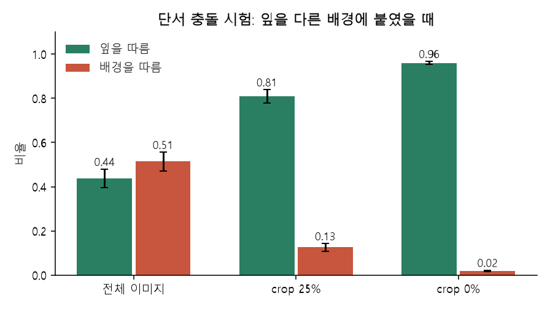
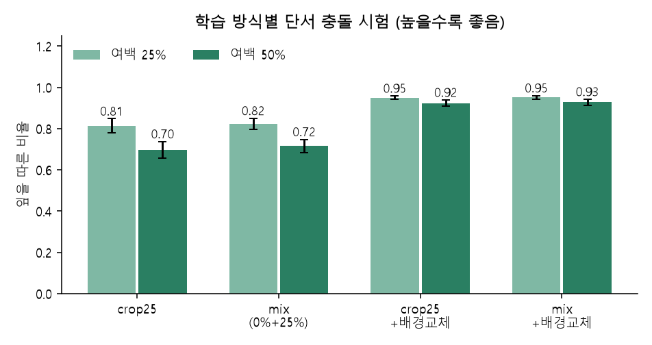

# 사진 진단 데이터 처리와 학습 설정

EDA([eda.md](eda.md))에서 찾은 문제를 **어떻게 처리했는지**, 그 방식을 **어떤 시험으로 정했는지**, 학습에서 **어떤 증강·설정을 썼는지** 정리한다. 성능은 [performance.md](performance.md), 기능 전체는 [vision.md](../vision.md). 시험 원자료와 당시 기록은 [archive/](archive/)에 있다.

## 1. 전체 흐름

```
AI Hub zip (원본, 압축을 풀지 않음)
  → ① 라벨·원천 짝 확인 (이름 집합, 증강본·model.zip 없음)
  → ② 라벨 선별 (코드표 안, 이상 라벨 제외, 질병 부위 5% 이상)
  → ③ 장수 제한 (정상은 질병의 약 2배, 146은 질병·정상 상한)
  → ④ 재분할 (질병 대상ID·정상 묶음 단위 8/1/1)
  → ⑤ bbox crop 저장 (EXIF 회전 후, 여백 25%, 긴 변 512px, JPEG 90)
  → data/processed/<153|147|146>/ + manifest.csv + summary.md   (총 98,073장, 약 5GB)
  → ⑥ 합쳐서 학습 (여백 0~25% 무작위 crop + 배경 교체 증강 등)
  → ⑦ 평가 (품목 마스킹, 단서 충돌) → ONNX
```

데이터셋마다 `다운로드 → 확인 → EDA → 전략 확인 → 전처리 → 원본 삭제`를 하고, 마지막에 결과를 합쳐 학습했다. 원본은 전처리 결과를 확인한 뒤 사용자 동의를 받아 삭제했다 (규격을 바꾸려면 다시 받아야 한다).

## 2. 처리 규격

| 단계 | 규칙 | 이유 (EDA) |
|---|---|---|
| 대상 | 증강본(`증강` zip, `_a000N`)과 `model.zip`은 받지 않는다. 라벨 JSON과 원천 이미지가 짝이 맞는 것만. **코드표 안의 `(작물, 질병)` 조합만** 쓴다 | 증강본은 같은 원본의 변형이라 분할 누수가 된다. 1장짜리 잡음 조합이 있다 |
| 이상 라벨 제외 | 정상인데 risk>0·region 있음, 질병인데 risk 0, JSON과 파일명이 어긋난 행(작물·질병 코드·risk, 정상 type), 정상 파일명이 규칙 밖(날짜·번호 형식) | 질병 식물 사진이 정상으로 섞이는 등 라벨이 틀린 행. 153 18개, 147 5개+346, 146 약 3,900개 |
| 부위 | **그 작물 질병 사진에 5% 이상 나오는 부위만** 쓰고, 정상도 같은 부위만, **질병의 부위 비율대로** 뽑는다 | 정상 줄기 사진이 "정상" 신호가 되는 것을 막는다. "잎만" 규칙은 딸기 꽃·열매 클래스를 없애서 폐기 |
| 자르기 | **EXIF 회전을 먼저 적용**한 뒤 bbox를 사방 **25% 넓혀** crop, 긴 변 **512px**, JPEG 품질 90. 긴 변이 128px 미만인 crop은 제외. **이미지 전체는 저장·학습하지 않는다** | bbox가 EXIF 회전 뒤 좌표인 이미지가 있다. 전체 이미지는 배경 단서를 51% 따랐다 (4장) |
| 정상 수 제한 | 작물마다 정상은 **질병 합계의 약 2배**까지만. (장소, 날짜) 묶음마다 **간격을 두고** 균등하게 뽑는다 | 정상이 4.5~12배 많고 연속 프레임이다 |
| 상한 (146만) | **질병 클래스당 1,000장** (대상ID 균등 + 같은 대상 안에서 간격 추출), **정상은 작물당 min(질병×2, 3,000)** | 사과·배가 합친 전체의 29%가 되는 것을 13%로. 장수보다 대상ID 수가 정보량이라 줄여도 손실이 작다 |
| 분할 | 원래 Training/Validation은 무시. **질병은 대상ID, 정상은 (장소, 날짜) 묶음** 단위로 train/val/test = 8/1/1. 클래스마다 시험에 대상이 1개 이상. **한 번 정한 대상ID의 분할을 같은 작물의 모든 병 클래스에서 공유** (147부터) | AI Hub 분할이 새고 있다. 같은 식물에 병 2종이 있으면 분할이 갈려 누수가 된다 |
| 결과물 | `processed/<데이터셋>/<작물>_<질병코드>/<원본이름>.jpg`, `manifest.csv`(`path, dataset, crop_code, crop_name, disease_code, disease_name, label, group_id, split, area, risk, region, date, orig_w/h, img_w/h, bx0 by0 bx1 by1, exif`), `summary.md`(클래스×분할 장수·묶음 수) | `bx0..by1`은 저장 이미지 안의 bbox. 배경 교체와 무작위 crop에 쓴다 |

### 데이터셋별 차이

| | 153 (`preprocess.py`) | 147 (`preprocess_147.py`) | 146 (`preprocess_146.py`) |
|---|---|---|---|
| 코드 | 작물 1~12, 질병 1~20 | 작물 1~10, 질병 1~20 | 배 1·사과 2, 질병 배 1~2·사과 3~7 |
| bbox 좌표 | JSON 크기와 이미지 크기를 비교해 판별 | 항상 EXIF 회전 뒤 | 항상 EXIF 회전 뒤 |
| 이상 라벨 | 정상 risk·region, 질병 risk 0 (18개, 나중에 제외 규칙 추가 제안) | + 정상 파일명 규칙 밖 | + JSON·파일명 어긋남, 정상 type≠0, 질병 type null, **파일명 부위 사용** |
| 분할 공유 | 클래스별로 나눔 (14개 대상이 분할에 걸침) | 작물 안에서 대상ID 분할 공유 (누수 0) | 같음 (누수 0) |
| 장수 제한 | 질병 전부, 정상 2배 | 같음 | **질병 1,000/클래스, 정상 3,000/작물** |
| 파일 형식 | jpg/jpeg | jpg/jpeg/JPG | jpg/JPG/**png** |
| 결과 | 50,350장 (train 40,214 / val 5,096 / test 5,040) | 34,730장 (27,342 / 3,726 / 3,662) | 12,993장 (10,084 / 1,439 / 1,470) |

검증: manifest 행 수 = 파일 수, 같은 식물(대상ID)이 여러 분할에 걸친 것 0, bbox가 저장 이미지 밖인 것 0, EXIF 회전 이미지는 시트로 확인 (`experiments/check_processed_146.py`·`_147.py`).

## 3. 이 규격을 정한 시험 (전처리 방식)

같은 데이터 안의 정확도는 전처리 방식을 가르지 못한다 (전체 이미지·crop·crop0 모두 0.96~0.97, 시드 편차 0.006). 배경만 남긴 입력(bbox를 회색으로 가림)도 0.936이 나와서, **모델이 병이 아니라 촬영 환경으로 맞힐 가능성**이 크다. 그래서 선택 근거는 **단서 충돌 시험**(시험 이미지의 잎을 같은 작물의 다른 클래스 이미지 배경에 붙이고, 모델이 잎을 따르는지 배경을 따르는지 센다)으로 삼았다. 상세: [archive/vision-preprocess-test.md](archive/vision-preprocess-test.md).

### 3.1 입력 방식 (153, 고추·토마토·상추 9클래스)

| 입력 | 일반 정확도 | 잎을 따름 | **배경을 따름** |
|---|---:|---:|---:|
| 이미지 전체 | 0.967 | 0.438 | **0.514** |
| bbox crop 여백 25% | 0.963 | 0.809 | 0.126 |
| bbox crop 여백 0% | 0.960 | 0.960 | 0.019 |

→ **전체 이미지는 일반 점수가 가장 높아 보이지만 배경을 더 따른다.** crop은 여백이 줄수록 잎을 따른다. 서비스에는 bbox가 없고 앱의 가이드 틀로 자르므로 여백이 0~50%까지 흔들린다.

### 3.2 배경 교체 증강 (여백 25%·50%에서 잎/배경을 따르는 비율)

| 학습 방식 | 153 잎 / 배경 @25 | 147 잎 / 배경 @25 | 146 잎 / 배경 @25 | 153 @50 | 147 @50 | 146 @50 |
|---|---|---|---|---|---|---|
| crop25 | 0.814 / 0.120 | 0.799 / 0.135 | 0.793 / 0.095 | 0.697 / 0.230 | 0.728 / 0.201 | 0.746 / 0.147 |
| crop25 + **배경 교체** | 0.950 / 0.025 | 0.935 / 0.031 | 0.920 / 0.025 | 0.924 / 0.049 | 0.900 / 0.061 | 0.895 / 0.046 |
| mix(여백 0%+25%) + 배경 교체 | 0.951 / 0.025 | 0.937 / 0.029 | 0.924 / 0.025 | 0.928 / 0.044 | 0.909 / 0.052 | 0.900 / 0.045 |




(위: 입력 방식별 단서 충돌, 아래: 학습 방식별. 153 시험 기준 그림. 153은 3작물 288px, 147은 4작물 12클래스, 146은 사과·배 9클래스 224px 6 epoch 시험이라 데이터셋 사이를 직접 비교하지 않는다.)

→ **배경 교체 증강이 세 데이터셋에서 같은 크기로 크게 효과가 있다** (잎을 따르는 비율 0.79~0.81 → 0.92~0.95, 배경 0.10~0.14 → 0.025~0.03). 일반 점수도 떨어지지 않고 오른다. 여백 0%·25%를 섞는 것(mix)은 단독으로는 효과가 작고 배경 교체와 함께일 때 가장 좋다.

### 3.3 147·146에서 다시 확인한 것

| 입력 | 147 (고추·토마토·콩·파) | 146 (사과·배) |
|---|---:|---:|
| 이미지 전체 | 0.930 | 0.944 |
| crop 25% | 0.946 | 0.947 |
| crop 0% | 0.958 | 0.946 |
| 배경만 (bbox 가림) | 0.820 | 0.846 |
| **상자 모양만 (이미지 없이)** | **0.545** (정상/병 0.78) | **0.529** (정상/병 0.82) |

- 전체와 crop의 차이는 편차 안이다. 전체 이미지는 3.1의 충돌 시험으로 쓰지 않기로 이미 정했으므로 바꾸지 않았다.
- **상자 모양(크기·가로세로 비율)만으로 정상/병을 0.78~0.82 맞힌다.** 정상 가지·줄기·파의 가늘고 긴 상자 때문이다. 학습 입력은 crop을 정사각 384로 줄이므로 크기는 잃지만 가로세로 비율은 일부 남는다. 서비스는 가이드 틀로 자르므로 상자 모양이 학습과 다를 수 있다 → **E6 외부 사진에서 확인**한다. 대응 후보: 학습 때 crop을 정사각에 가깝게 변형하거나 여백을 크게 흔든다.

## 4. 학습 설정 (`ml/vision/train.py`)

| 항목 | 값 |
|---|---|
| 모델 | **EfficientNet-B0** (ImageNet 사전학습) + Dropout 0.3 + Linear. 모델 비교는 하지 않았다: 자원·속도 때문에 확정 (아래) |
| 입력 | bbox crop을 **384×384로 비율 무시하고** 줄임, ImageNet 정규화, AMP(fp16), 배치 64 |
| 클래스 | 67개 `(작물, 병)`+작물별 정상. 시설·노지가 모두 있는 고추·애호박·오이·토마토의 정상은 하나의 클래스 |
| 손실 | 교차 엔트로피 + **클래스 가중치(역빈도의 제곱근)** + label smoothing 0.05 |
| 최적화 | AdamW(weight decay 1e-4) + **OneCycle**(최대 lr 1e-3, 올림 15%), 최대 30 epoch |
| **조기 종료** | 검증 macro F1이 N epoch 연속 best(+0.002)를 넘지 못하면 중단하고 **best 가중치로 시험** (N 기본 4, 합친 학습은 6). 이어서 학습(`--resume`)·`STOP` 파일 중단 지원 (epoch마다 `last.pt`) |
| 모델 선택 | 검증 macro F1 (**품목 마스킹**). 시험 분할은 마지막에 best로 한 번만 평가 |

**증강** (학습 이미지마다 매번 무작위):

| 증강 | 내용 | 왜 |
|---|---|---|
| **여백 0~25% 무작위 crop** | 저장된 25% 여백 crop에서 bbox 기준 0~25%만 남기고 자름 | 가이드 틀이 정확하지 않은 사진에 대비 |
| **배경 교체 (확률 1/3, 원본 2 : 합성 1)** | 잎(bbox 안쪽)을 **다른 학습 이미지(작물·클래스 상관없음)의 bbox 자리**에 붙임. 정답은 잎의 클래스 | 배경·촬영 환경으로 맞히는 지름길을 끊음 (3.2) |
| 뒤집기 | 좌우 50%, 상하 20% | |
| 회전·크기 | ±20°, ×0.85~1.15 | 촬영 각도·거리 |
| 색 | 밝기·대비·채도 0.7~1.3 | 조명·카메라 차이 |
| 흐림 | 확률 25%, 가우시안 σ 0.3~1.8 | 초점이 안 맞은 사진 |
| JPEG 압축 | 확률 30%, 품질 35~90 | 앱·서버 전송 압축 |

**평가 정의:**
- **품목 마스킹:** 정답 작물의 클래스만 남기고 고른다. 서비스는 사용자가 품목을 고르므로 이 조건이 실제 사용과 같다. macro F1은 클래스 평균이라 소수 클래스(대상이 적은 병)의 어려움이 그대로 드러난다.
- **단서 충돌:** 시험 이미지의 잎을 같은 작물의 다른 클래스 이미지 배경에 붙이고(여백 25%·10%), 잎을 따르는 비율과 배경을 따르는 비율을 센다. 일반 점수만으로 판단하지 않는다.

**B0로 확정한 이유** (SSAFY PC RTX 5060 Ti, 가짜 데이터, 384px, fp16):

| 모델 | 학습 img/s | 파라미터 | CPU 추론 (1장, 스레드 4개) |
|---|---:|---:|---:|
| **EfficientNet-B0** | 322 | 4.1M (fp32 16MB) | **21ms** |
| ResNet50 | 185 | 23.6M | 106ms |
| ConvNeXt-Tiny | 165 | 27.9M | 193ms |

배포는 GPU 없는 EC2 8GB(여유 메모리 약 3.5GB)에서 CPU로 돌린다. 실제 ONNX B0는 CPU 1장에 약 9ms였다.

**코드 주의:** `channels_last`를 쓰지 않는다 (이 PC torch 2.11 + RTX 5060 Ti에서 B0 37 img/s, 끄면 322 img/s). GPU 입력은 `.contiguous()`를 쓴다 (`permute` 뒤 NHWC가 되면 10배 느려진다). `cudnn.benchmark = True`는 켠다.

## 5. 추론할 때의 전처리 (서비스)

학습의 bbox crop·증강은 **서비스에 없다.** 서비스에는 bbox가 없으므로 앱이 **가이드 틀 안쪽만 잘라** 보내고, 서버는 EXIF 회전 → 384×384로 줄이기(비율 무시) → ONNX 추론 → **사용자가 고른 품목의 클래스만 남기기** → softmax → 신뢰도가 기준보다 낮으면 "판단 어려움"으로 텍스트 증상 진단에 넘긴다. 입출력 규격과 예시 코드는 `ml/vision/model/README.md`.

학습(정확한 bbox crop)과 추론(가이드 틀 crop)의 모양이 다르면 점수가 떨어질 수 있다. 이를 줄이려고 여백을 흔들고 배경 교체를 썼으며, 실제로 얼마나 떨어지는지는 E6에서 본다.

## 6. 알려진 한계

- 시험은 같은 데이터 안의 점수라 실제 사진 정확도는 이보다 낮을 수 있다 (출처 편향). **E6 (직접 찍은 사진, 가이드 틀 정확/부정확 분리) + Grad-CAM 점검**이 판단 기준이다.
- 단서 충돌의 합성은 사각형을 붙인 것이라 이음새가 보이고, 이음새를 단서로 쓰지 않는지는 직접 확인하지 못했다.
- 시험 묶음이 클래스당 1~2개라 클래스별 점수 편차가 크다.
- 원본이 삭제돼 규격(여백·크기·정상 비율·상한)을 바꾸려면 다시 받아야 한다 (153 321GB, 147 244GB, 146 113GB).
